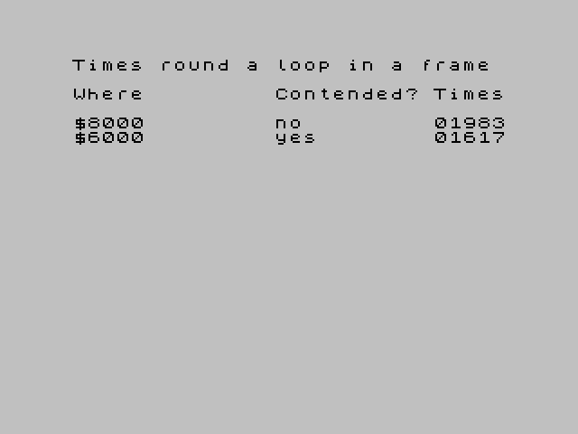
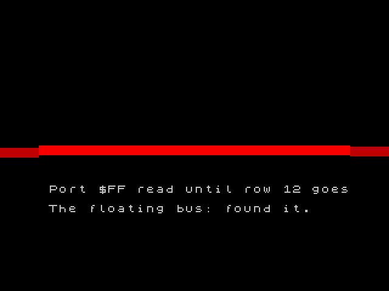

# 3. The machine

[‹ Working with Limoniter](02-working-with-limoniter.md) · [Contents](README.md) · [Startup and interrupts ›](04-startup-and-interrupts.md)

The 48K Spectrum is a Z80, 16K of ROM, 48K of RAM, and one custom chip, the **ULA** (Ferranti's uncommitted logic array), which makes the picture, reads the keyboard, and drives the border, the beeper and the tape. There are no sprites, no scrolling, no sound chip and no timers: the Z80 does everything, and the only thing that keeps time is the ULA's interrupt, once a frame. Almost every trick in this guide is a way of doing something the hardware doesn't, by knowing exactly how long the Z80 takes and exactly where the ULA's beam is.

## The memory map

| Address | What's there |
|---|---|
| `$0000`–`$3FFF` | the ROM: BASIC, the tape routines, the font (at `$3D00`, the characters 32 to 127, 8 bytes each) |
| `$4000`–`$57FF` | the screen's pixels, the **display file**: 6,144 bytes ([chapter 5](05-the-screen.md)) |
| `$5800`–`$5AFF` | the **attributes**: a byte of colour for each 8×8 character cell, 768 of them |
| `$5B00`–`$5BFF` | the printer buffer on a 48K; on a 128K, the ROM's paging routines and its system variables (`BANKM` at `$5B5C`) |
| `$5C00`–… | BASIC's system variables (`KSTATE` first), then the BASIC program, its variables, and the stacks |
| … `RAMTOP` | the top of BASIC's memory; above it, the user-defined graphics and free RAM |

The order of the areas from the display file to `RAMTOP` is the one the Spectrum's manual gives (chapter 24 of the 48K BASIC manual, <https://worldofspectrum.org/ZXBasicManual/zxmanchap24.html>); the system variables' names and addresses are the ROM disassembly's (SkoolKit's annotated Logan and O'Hara, <https://skoolkid.github.io/rom/maps/all.html>).

BASIC's loader for a program starts with `CLEAR`, which moves `RAMTOP` to just below the code, so BASIC never writes over it. The guide's examples go at `$8000` (32768), and the startup ([chapter 4](04-startup-and-interrupts.md)) keeps its stack and interrupt table up to `$BFFF`. From `$C000` up is free on a 48K.

The lower 16K of RAM, `$4000` to `$7FFF`, is special: it's the only RAM the ULA can read, because the screen is there, and the Z80 has to share it.

## Time: T-states, lines and frames

Everything on the Spectrum is counted in **T-states**, ticks of the Z80's clock. The ULA draws the picture a line at a time, and its timing never changes, so a program can know, to the T-state, where the beam is.

| | 48K | 128K, +2, +2A, +3 | Pentagon 128 |
|---|---|---|---|
| Z80 clock | 3.5 MHz | 3.54690 MHz | 3.584 MHz |
| T-states a scan line | 224 | 228 | 224 |
| Scan lines a frame | 312 | 311 | 320 |
| T-states a frame | 69,888 | 70,908 | 71,680 |
| Frames a second | 50.08 | 50.02 | 50.0 |

The 48K's and 128K's figures are World of Spectrum's reference pages' (<https://worldofspectrum.org/faq/reference/48kreference.htm>, <https://worldofspectrum.org/faq/reference/128kreference.htm>): "Each line takes exactly 224 T states", "a frame is (64+192+56)\*224=69888 T states long", and on the 128K, "228 T-states per scanline", "311 scanlines per frame", "70908 T states per frame". Fuse's timings (libspectrum's `timings.c`) give the +2A and +3 the 128K's, and are the source for the Pentagon's.

A 48K's line of 224 T-states is, by Fuse's model, 24 T-states of left border, 128 of screen (two pixels a T-state), 24 of right border and 48 of horizontal retrace, when the beam flies back and nothing is drawn. Its frame is 48 lines of top border, 192 of screen, 48 of bottom border, and 24 of vertical retrace. (World of Spectrum counts the 64 lines before the screen together; it's the same frame.) Not all the border is seen on a television: Fuse shows 24 lines above and below the screen, and 32 pixels each side.

The **interrupt** comes at the start of the frame: all of World of Spectrum's timings are "relative to the start of the interrupt", which is T-state 0. The ULA holds the Z80's interrupt line low for 32 T-states on a 48K ("the ULA holds the /INT pin low for precisely 32 T-states", <https://worldofspectrum.org/faq/reference/z80reference.htm>); Fuse gives the 128K 36, and the +2A and +3 32. A program with interrupts disabled for longer than that at the wrong moment misses a frame's interrupt altogether.

The screen's first pixel, top left, is drawn 64 lines after the interrupt on a 48K (64 × 224 = 14,336 T-states), and 63 lines and a bit after it on a 128K.

## Contended memory

The ULA reads the screen from RAM while it draws it: for each 8 pixels, a byte of pixels and a byte of attributes. While it's doing that, the Z80 can't use the same RAM, and has to wait. That RAM is **contended**, and the waiting is **contention**.

On a 48K the contended RAM is `$4000` to `$7FFF` ("contended memory (from 0x4000 to 0x7fff)", 48K reference). The waiting only happens during the 128 T-states of each of the 192 screen lines, when the ULA is fetching. Within those, it goes in a pattern of 8 T-states: an access the Z80 starts at the first T-state of the 8 waits 6, at the next 5, then 4, 3, 2, 1, and at the last two none. In World of Spectrum's words: "At cycle 14335 (just one cycle before the top left corner is reached) the delay is 6 cycles", then 5, 4, 3, 2, 1, 0, 0, and the same every 8 T-states along the line. On a 128K the same pattern "starts at 14361 T states after the interrupt as opposed to 14335".

Sources disagree here by one T-state. Fuse counts the top-left pixel as T-state 14,336 on a 48K and 14,362 on a 128K, and its contention from there; World of Spectrum's figures are one less. World of Spectrum explains: "Some machines use the timings given in this FAQ, while others are one T state later for all timings". Real 48Ks differ, so an effect timed to the very T-state works on some and is one T-state out on others. Design effects with a T-state or two to spare.

Not only RAM is held up. On a 48K the ULA answers every **even port** (port `$FE` is the one used), and an `IN` or `OUT` to an even port is contended like a memory access while the screen is drawn. So is any port whose high byte is `$40` to `$7F`, because that looks to the ULA like an address in contended RAM.

What it costs is easy to measure. [`examples/ch03_contention.asm`](examples/ch03_contention.asm) runs the same small loop, 35 T-states a time round, for a whole frame, once from `$8000` and once copied to `$6000`:



In Fuse, 1,983 times round from `$8000` and 1,617 from `$6000`: the same code, 18% slower, only because its instructions are fetched from contended RAM. (1,983 × 35 is 69,405: the whole frame, less the interrupt's own time.) The lesson every Spectrum coder learns: **keep code, and the tables it reads in its busiest loops, above `$8000`**, and write to the screen in the border's time if you can. On a 128K, which banks are contended is a matter of which bank, not which address ([chapter 8](08-the-128k-and-later-models.md)).

### Snow

The Z80's `I` register is the high byte of the address it puts on the bus while refreshing RAM. Set `I` to `$40`–`$7F` (as a program using IM 2 might, for its vector table, [chapter 4](04-startup-and-interrupts.md)), and the ULA "gets confused if I is in the range 64-127": "The screen seems to be filled with 'snow'; however, the Spectrum won't crash" (48K reference). On a 128K it's worse: the 128K reference says it "appears to crash the machine shortly after I is set to point to contended memory". Keep `I` at `$80` or above.

## The floating bus

When the Z80 reads a port nothing answers, it reads whatever is on the data bus. On a 48K or 128K that's usually `$FF`, but while the ULA is fetching the screen, it's the byte the ULA is fetching: "you'll read a mixture of 0xff (idle bus), and screen and ATTR data bytes. This will only happen when the ULA is reading the screen memory." (48K reference.) This is the **floating bus**, and it's a way to find out exactly where the beam is, without counting T-states from the interrupt at all.

[`examples/ch03_floating_bus.asm`](examples/ch03_floating_bus.asm) gives character row 12 an attribute that appears nowhere else on the screen, then reads port `$FF` until that byte goes by, and turns the border red there for eight lines:



Its loop is worth a look:

```asm
.poll:
        in      a,(c)                   ; 12 T-states
        cp      MARKER                  ; 7
        jr      z,.found                ; 7
        ld      a,(hl)                  ; 7: a frame gone by with no marker means there's no floating bus
        cp      e                       ; 4
        jr      z,.poll                 ; 12: 49 in all, an odd number
```

The ULA fetches in 8 T-state groups: in each, the pixel and attribute bytes of two cells, then 4 T-states of idle bus (Ramsoft's *Floating bus technical guide*, <https://k1.spdns.de/Develop/Projects/zxsp/Info/Floating%20bus%20technical%20guide.html>). The attribute byte is on the bus for only one T-state in eight. The first version of this example had a loop of 54 T-states, an even number: 54 is 6 more than a multiple of 8, so it only ever sampled the bus at four of the eight points in the group, and never at the one where the attribute was. It never found the marker, in Fuse or ZEsarUX. A loop of 49, odd, moves on by one T-state against the group each time round (49 is 1 more than 6 × 8), and finds it within eight.

The floating bus is machine-specific:

- **48K, 128K and +2**: as above.
- **+2A and +3**: the 128K reference says "reading from a non-existing port (eg 0xff) will always return 255". Later tests found the +2A and +3 do have a floating bus, but only on ports decoded like their printer port (address bits `0000 ---- ---- --0-`), and only when paging is enabled (<https://github.com/redcode/ZXSpectrum/wiki/2A-3-Floating-Bus-Test>). The example reads port `$FF`, so on a +2A it never sees the marker, and says so.
- **The Next** has no floating bus on port `$FF` to speak of; it has better ways to know the line ([chapter 11](11-the-next.md)).

A program that relies on the floating bus has to give up gracefully where there isn't one, as the example does: it stops looking after a frame.

## What's not here

The ULA's port `$FE` (border, beeper and keyboard) is in [the screen](05-the-screen.md), [sound](07-sound.md) and [input](09-input.md). The 128K's memory paging is in [chapter 8](08-the-128k-and-later-models.md).

[‹ Working with Limoniter](02-working-with-limoniter.md) · [Contents](README.md) · [Startup and interrupts ›](04-startup-and-interrupts.md)
