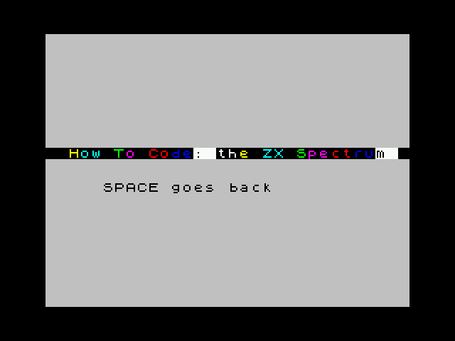

# 4. Startup and interrupts

[‹ The machine](03-the-machine.md) · [Contents](README.md) · [The screen ›](05-the-screen.md)

Every Spectrum example in this guide is built on one small startup, [`examples/startup.asm`](examples/startup.asm). It takes the machine from BASIC, runs your program once a frame with its own interrupt routine, and gives the machine back to BASIC when you press SPACE, so that BASIC says `0 OK` and the Spectrum carries on as if nothing had happened. This chapter explains every part, and the interrupts it's built on.

## Interrupts on the Spectrum

The ULA interrupts the Z80 once a frame, 50 times a second, at the start of the frame ([chapter 3](03-the-machine.md)). It's the only interrupt a standard Spectrum has. What the Z80 does with it depends on its **interrupt mode**:

- **IM 1**, which the ROM uses: "the processor simply executes an RST 38 instruction" (<https://worldofspectrum.org/faq/reference/z80reference.htm>), calling the ROM's routine at `$0038`. That routine counts the frame in the system variable `FRAMES` (`$5C78`) and reads the keyboard: "The real time clock is incremented and the keyboard scanned whenever a maskable interrupt occurs" (<https://skoolkid.github.io/rom/asm/0038.html>). It does it with `INC (IY+$40)`, so it relies on `IY` holding `$5C3A`, which "is initialised to 5C3A by the routine at NEW" (<https://skoolkid.github.io/rom/asm/5C3A.html>). A program that uses `IY` with interrupts on in IM 1 has the ROM write a byte 64 past wherever `IY` points, 50 times a second.
- **IM 2**: the Z80 makes an address from the `I` register (the high byte) and a byte read from the data bus (the low byte), reads a word from there, and calls it. That's how a program gets its own interrupt routine.
- **IM 0** reads an instruction from the bus. On a Spectrum nothing puts one there.

### IM 2 and the vector table

Which byte is on the bus when the Z80 asks? "The normal Spectrum contains no hardware to place a byte on the bus, and the bus will therefore always read FF", but "some not-so-neat hardware devices put things on the data bus when they shouldn't" (Z80 reference). So the usual way, and the startup's, is to make the answer not matter: a table of **257 bytes, all the same**, starting at `I` × 256. Whatever byte comes off the bus, the word read from the table has the same high and low byte, here `$BFBF`, and at `$BFBF` the startup puts a `JP` to its routine.

Where the table goes matters:

- **Not in contended memory** (`$4000`–`$7FFF`), because `I` would then be `$40`–`$7F`, and that makes "snow" on a 48K and can crash a 128K ([chapter 3](03-the-machine.md)).
- **Not where a 128K pages banks** (`$C000` up), or it vanishes when another bank is paged in.

So the startup keeps it at `$BE00`–`$BF00`, with the jump at `$BFBF` and its stack below at `$BC00`–`$BDFF`, all in the top of bank 2, which is at `$8000` on every model (in the usual paging: the +2A and +3 have others, [chapter 8](08-the-128k-and-later-models.md)).

## The startup

```asm
AUTOEXIT        equ     0               ; frames before going back to BASIC: 0 for never (SPACE goes back too)

        device  zxspectrum48
        include "startup.asm"

Init:                                   ; once, interrupts off
        ...
Frame:                                  ; once a frame, after the interrupt, in the main loop
        ...
Interrupt:                              ; in the interrupt itself, at the same time every frame
        ...
```

Your program defines three routines, and may change any register in them but `SP` and `I`. The startup's code starts at `$8000`, so the tape's loader calls it there. In order, it:

1. **Disables interrupts and keeps what BASIC needs back**: its stack pointer, and `H'L'`, the alternate `HL`. BASIC called your code from inside the ROM's calculator, which keeps its place in `H'L'` ("This saves the pointer to the first literal", <https://skoolkid.github.io/rom/asm/335B.html>), so a program that returns to BASIC with `H'L'` changed returns into a lost calculator.
2. **Moves the stack** to `$BE00`, out of contended RAM (BASIC's stack is just below `RAMTOP`, at `$7FFF` or so).
3. **Finds out what it's running on** (`FindMachine`): writes a mark at `$C000`, pages in another bank through port `$7FFD`, writes a second mark, pages the first bank back, and looks. On a 128K the first mark is still there; on a 48K, which has nothing at port `$7FFD`, both went to the same byte. It sets `Is128`, and `LineTime` to 224 or 228 T-states ([chapter 8](08-the-128k-and-later-models.md) has more on telling the models apart).
4. **Builds the vector table** with `LDIR`, writes `JP IntHandler` at `$BFBF`, sets `I` to `$BE`, and selects `IM 2`.
5. **Calls `Init`**, enables interrupts, and enters the **main loop**:

```asm
MainLoop:
        halt                            ; wait for the next frame's interrupt
        call    Frame
        ld      a,$7F                   ; the half-row SPACE, SYM SHIFT, M, N, B
        in      a,($FE)
        rra                             ; SPACE is bit 0, 0 when it's pressed
        jr      nc,Exit
        ...                             ; and AUTOEXIT, if it's set
        jr      MainLoop
```

`HALT` stops the Z80 until an interrupt; when the interrupt routine returns, `Frame` runs. If `Frame` takes longer than a frame, the next `HALT` waits for the interrupt after, and the program runs at 25 frames a second rather than crashing: the frame rate halves, nothing else changes.

The interrupt routine saves every register (both sets, and `IX` and `IY`), calls your `Interrupt`, adds one to `Frames`, restores them, and returns with `EI` and `RETI`.

### When Interrupt starts

`Interrupt` is called at the same point in every frame, which is what [beam racing](05-the-screen.md) needs. On Limoniter's built-in Spectrum it starts 173 to 176 T-states after the interrupt: the Z80 takes 19 T-states to answer an IM 2 interrupt (Zilog's *Z80 User Manual*), then come the `JP` (10), the routine's ten pushes, two exchanges and the `CALL` (17). The range is because of `HALT`: while halted, the Z80 runs `NOP`s, 4 T-states each, and only notices the interrupt at the end of one, so where the `HALT` began, which depends on how long `Frame` took, moves the start by up to 3 T-states. The test suite checks this: `cargo test howtocode` measures `Interrupt`'s start in ten frames on a 48K and a 128K.

Three T-states is 6 pixels. That doesn't matter for effects that change colours where the beam can't be seen, like [chapter 5](05-the-screen.md)'s border bars and multicolour, which make their changes in the border with time to spare; an effect that needs better, one that splits a line exactly, either keeps the main loop the same length every frame or finds the beam with the floating bus ([chapter 3](03-the-machine.md)).

### Giving the machine back

`Exit` undoes everything, in the reverse order:

```asm
Exit:
        di
        ld      a,(Is128)               ; a 128K's paging as BASIC left it
        or      a
        jr      z,.paged
        ld      a,(BANKM)
        ld      bc,$7FFD
        out     (c),a
.paged:
        ld      a,$3F                   ; I as the ROM sets it
        ld      i,a
        im      1
        ld      iy,$5C3A                ; for the ROM's interrupt routine
        exx
        ld      hl,(BasicHl)            ; for its calculator
        exx
        ld      a,(BORDCR)              ; BASIC's border colour
        rrca
        rrca
        rrca
        and     7
        out     ($FE),a
        ld      sp,(BasicSp)
        ei
        ret
```

`IY` comes back before `EI`, because the ROM's interrupt routine may run the moment interrupts are on, before the `RET`. On a 128K, `BANKM` (`$5B5C`) is the ROM's copy of what was last written to port `$7FFD` ([chapter 8](08-the-128k-and-later-models.md)), and writing it back puts back BASIC's bank, ROM and screen, whatever the program paged in.

Every example is tested this way: the test suite runs it with `AUTOEXIT` set, and checks that BASIC prints `0 OK` afterwards, on a 48K and a 128K.



[`examples/startup_demo.asm`](examples/startup_demo.asm), the smallest program on the startup: `Init` prints a title, `Frame` rolls a band of colour along it, and `Interrupt` flashes the border.

## Helpers

The startup has a few routines your program can call, each explained where it's first used:

| Routine | Does |
|---|---|
| `ClearScreen` | clears the pixels, and makes every attribute A |
| `PixelAddress` | B = y, C = x: HL = the byte holding that pixel, A = its bit ([chapter 5](05-the-screen.md)) |
| `PrintAt` | prints the text at HL (ending with 0) at row B, column C, in the ROM's font |
| `PrintChar` | prints the character A at row B, column C |
| `PrintNumber` | prints HL as five digits at row B, column C |

And its variables: `Frames` (a word, counted by the interrupt), `Is128`, and `LineTime`.

## Without the startup

A program that never goes back to BASIC (most games, and a demo that ends with a reset) can do less: `DI`, its own stack, its table and `IM 2`, and never think of BASIC again. It can then use all the memory from `$5B00` up, since BASIC's system variables don't matter any more. The guide's startup keeps BASIC alive because being able to go back is what lets you test a program fifty times an hour, and because a program that leaves the machine working is a polite one.

[‹ The machine](03-the-machine.md) · [Contents](README.md) · [The screen ›](05-the-screen.md)
