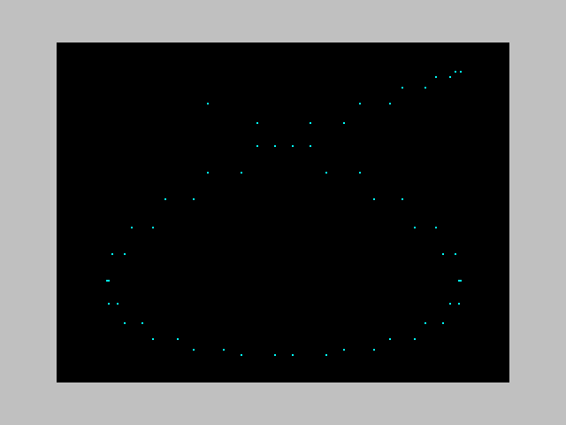
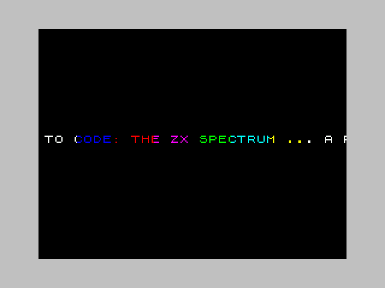
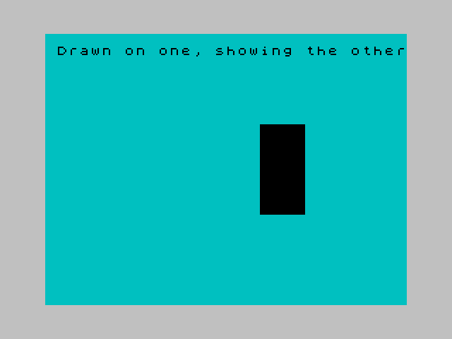
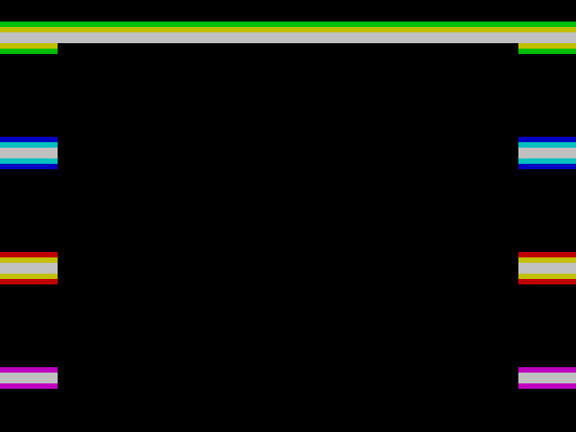
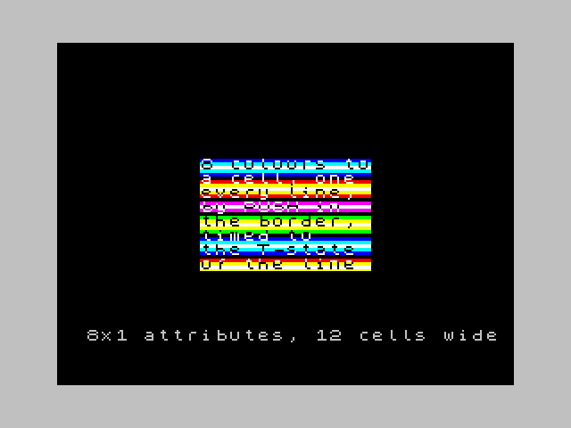

# 5. The screen

[‹ Startup and interrupts](04-startup-and-interrupts.md) · [Contents](README.md) · [Sprites ›](06-sprites.md)

The Spectrum's screen is 256 × 192 pixels, one bit each, with a byte of colour for every 8 × 8 cell, and a border round it in one colour. That's all: no hardware scrolling, no sprites, no palette. It's also laid out in memory in an order that looks strange until you see why. This chapter is about drawing on it fast, and then about the tricks that get round its limits by timing: changing the border, and the colours, as the beam goes by.

## The display file

The pixels are at `$4000`–`$57FF`, 32 bytes a line, each byte 8 pixels with bit 7 on the left. But the lines aren't in order. As the Spectrum's manual says, "First come the top scans of lines 0 to 7, then the next scans of lines 0 to 7", and so on: the screen is three **thirds** of 64 lines, and within each third, the first line of each of its 8 character rows comes first, then their second lines, and so on (<https://worldofspectrum.org/ZXBasicManual/zxmanchap24.html>).

In bits, a pixel at (x, y), with y from 0 at the top, is at:

| | 15 | 14 | 13 | 12 | 11 | 10 | 9 | 8 | 7 | 6 | 5 | 4 | 3 | 2 | 1 | 0 |
|---|---|---|---|---|---|---|---|---|---|---|---|---|---|---|---|---|
| address | 0 | 1 | 0 | y7 | y6 | y2 | y1 | y0 | y5 | y4 | y3 | x7 | x6 | x5 | x4 | x3 |

and its bit in the byte is 7 − (x AND 7). The ROM's own `PIXEL-ADD` routine says the same: its comments end "Finally 010b7b6b2b1b0" for the high byte and "Finally b5b4b3c7c6c5c4c3" for the low (<https://skoolkid.github.io/rom/asm/22AA.html>; the ROM counts y from the bottom, so it works with 175 − y first).

The order was chosen for the hardware, and it's handy for text: the 8 lines of a character are 256 bytes apart, so moving down a pixel line within a character is `INC H`. The startup's `PixelAddress` works the address out from the bits; the most useful routine on the Spectrum, though, is the one that moves an address **down one line**:

```asm
; LineDown: HL, an address on the screen, moved down one pixel line.
LineDown:
        inc     h                       ; the next line of a character: 256 bytes on
        ld      a,h
        and     7
        ret     nz
        ld      a,l                     ; past a character's last line: the next row, 32 bytes on,
        add     a,32                    ; back at its first line
        ld      l,a
        ret     c                       ; into the next third: H has moved on 8 already
        ld      a,h
        sub     8
        ld      h,a
        ret
```

## Attributes

The attributes are at `$5800`–`$5AFF`, 32 a row, 24 rows, in plain order: the cell at row r, column c is at `$5800` + 32r + c. Each is a byte: "128 if flashing + 64 if bright + 8×paper + ink" (chapter 16 of the manual, <https://worldofspectrum.org/ZXBasicManual/zxmanchap16.html>):

| bit 7 | bit 6 | bits 5–3 | bits 2–0 |
|---|---|---|---|
| FLASH | BRIGHT | PAPER | INK |

A pixel that's 1 is the ink colour, 0 the paper. The colours are 0 black, 1 blue, 2 red, 3 magenta, 4 green, 5 cyan, 6 yellow, 7 white, each normal or bright (bright black is still black). FLASH swaps ink and paper: "Every 16 frames, the ink and paper of all flashing bytes is swapped" (48K reference, <https://worldofspectrum.org/faq/reference/48kreference.htm>).

Two colours a cell is the Spectrum's famous limit: where a sprite of one colour crosses a background of another, the cell takes the sprite's ink and the background's pixels turn that colour too (**attribute clash**). Games live with it by drawing in one colour over a black background, colouring the play area in big blocks, or changing attributes only where sprites are. Demos beat it with multicolour, at the end of this chapter.

The **border** is set by bits 0 to 2 of `OUT ($FE)`: "The lowest three bits specify the border colour" (48K reference). The same port's bit 4 is the beeper ([chapter 7](07-sound.md)) and bit 3 the tape's MIC output; a write to `$FE` sets all three, so keep them as you want them each time. BASIC keeps its border colour in the system variable `BORDCR` (`$5C48`), in bits 3 to 5.

## Plotting fast: lookup tables

`PixelAddress` takes about 150 T-states. For a lot of dots, look the answer up instead: a table of the 192 lines' addresses, made once at the start with `LineDown`, turns y into an address with two loads. [`examples/ch05_plot.asm`](examples/ch05_plot.asm) plots 64 dots on a Lissajous curve each frame:

```asm
; Plot: the pixel at x = C, y = B XORed onto the screen.
Plot:
        ld      h,LineLow/256           ; the table's low bytes are in one 256-byte page,
        ld      l,b                     ; so (HL) with L = y is the line's low byte
        ld      a,c
        rrca
        rrca
        rrca
        and     31                      ; x / 8, the column
        or      (hl)                    ; the line's low byte has 0 in its column bits
        inc     h                       ; and its high bytes in the next page
        ld      h,(hl)
        ld      l,a
        ld      a,c
        and     7                       ; the bit: from a table of eight, $80 to $01
        ...
        xor     (hl)
        ld      (hl),a
```

Splitting the table into a page of low bytes and a page of high bytes (each aligned to 256 with `align 256`) means `H` is the page and `L` is y: no adding, no shifting. The same trick serves the sine tables the curve is drawn from: 256 entries, a page each, `L` the angle.

The dots are drawn with `XOR`, so drawing the same dot again rubs it out: each frame the last frame's dots are XORed away, from a list the plotting keeps, and the new ones drawn.



## Scrolling

There's no hardware scrolling: to move the screen, the Z80 moves the bytes. Moving by a whole character (8 pixels) is copying bytes; moving by a pixel is shifting every byte. [`examples/ch05_scroller.asm`](examples/ch05_scroller.asm) scrolls one character row left a pixel each frame, with `RL (HL)` through each line's 32 bytes, right to left, so the bit that falls off the left of one byte goes in at the right of the next. The new column at the right comes from the ROM's font, a bit at a time:

```asm
        ld      c,l                     ; the right-hand end, to go back to
        rl      (hl)                    ; 15 T-states
        dec     l                       ; 4: DEC doesn't change the carry
        rl      (hl)
        dec     l
        ...                             ; 32 times, unrolled
```

That's 19 T-states a byte, 608 a line, under 5,000 for the row's 8 lines. A whole screen this way would be 117,000 T-states, nearly two frames, which is why big Spectrum scrollers move a byte at a time (8 pixels, smoother looking if it's fast), scroll a band, or use [the stack](10-speed.md).



## The 128K's shadow screen

The 128K has a second screen. The ULA shows bank 5's screen (at `$4000`) normally, and bank 7's when bit 3 of port `$7FFD` is set: "Select normal (0) or shadow (1) screen" (<https://worldofspectrum.org/faq/reference/128kreference.htm>). That's **double buffering**: draw on the screen that isn't shown, and when it's finished, show it, by one `OUT`. Nothing half-drawn is ever seen.

[`examples/ch05_shadow_screen.asm`](examples/ch05_shadow_screen.asm) pages bank 7 in at `$C000` for the whole run, so both screens can be written (bank 5's at `$4000`, bank 7's at `$C000`, the same layout, only the high byte differs). Each frame it clears the middle third of the hidden screen and draws a bar on it, then sets a flag; the next `Interrupt`, at the top of the frame before the ULA reaches the screen, swaps them. Clearing and redrawing like that on a single screen would flicker as the beam caught it half done.



128K only (and +2, +2A and +3): bank 7 is contended, so drawing there is a little slower than in bank 0 ([chapter 8](08-the-128k-and-later-models.md)).

## Racing the beam: border bars

The border's colour can be changed at any moment, and the change shows from wherever the beam is. Change it once a scan line, at the same point in every line, and the border fills with horizontal bars of colour: the oldest Spectrum demo effect. The whole trick is a loop that takes **exactly one scan line**: 224 T-states on a 48K, 228 on a 128K.

[`examples/ch05_border_bars.asm`](examples/ch05_border_bars.asm) does it in `Interrupt`, which starts at the same time every frame ([chapter 4](04-startup-and-interrupts.md)):

```asm
BarLine:
        ld      a,(hl)                  ; 7: this line's colour
        out     (c),a                   ; 12: the border changes near the end of this
        inc     hl                      ; 6
        ld      b,13                    ; 7
.delay:
        djnz    .delay                  ; 13 x 12 + 8 = 164
        nop                             ; 4
Slot:
        nop                             ; 8 on a 48K (two NOPs), 12 on a 128K (JR $+2)
        nop
        dec     e                       ; 4
        jr      nz,BarLine              ; 12: 224 or 228 in all
```

Add them up: 7 + 12 + 6 + 7 + 164 + 4 + 8 + 4 + 12 = 224. For a 128K the loop needs 4 more, and `Init` puts them in: the two bytes at `Slot` are two `NOP`s (8 T-states) on a 48K, and `JR $+2` (a jump to the next instruction, 12) on a 128K. That's self-modifying code ([chapter 10](10-speed.md)) doing what a second copy of the loop would.

`OUT (C),A`, with `C` = `$FE` and `B` = 0 as `DJNZ` leaves it, is used rather than `OUT ($FE),A` (11 T-states) because it makes the sum come out to 224 with a whole number of `DJNZ`s. Counting a loop like this is what the status bar's T-states are for ([chapter 2](02-working-with-limoniter.md)).

**Where in the line** the change happens matters too. The example waits until each `OUT` falls in the horizontal retrace, when the beam is flying back and nothing is drawn, so every line is one colour from edge to edge. The wait is worked out from when `Interrupt` starts (about 174 T-states into the frame, [chapter 4](04-startup-and-interrupts.md)): on a 48K, 341 times round a 26 T-state wait loop puts the first `OUT`'s write about 9,139 T-states into the frame, which is line 40, 179 T-states after the line's first pixel would be (40 × 224 = 8,960). By Fuse's model a 48K line is screen (T-states 0–127 from its first pixel), right border (128–151), retrace (152–199), left border (200–223), so 179 is in the retrace, with 25 T-states to spare either side. The 128K's wait is worked out the same way for its 228 T-state lines.

The `OUT` is also safe from contention there. Port `$FE` is contended while the ULA is fetching the screen ([chapter 3](03-the-machine.md)), and an `OUT` held up by a varying amount on the screen's lines would make those lines longer, and the bars below drift. In the retrace the ULA isn't fetching, so the loop is exactly 224 every time.



The bars move up a line a frame, because the colour table is read from `Frames` on. 240 lines of it take 53,760 T-states, three quarters of the frame, all in the interrupt: an effect like this owns the machine while it runs.

## Multicolour

The ULA reads a cell's attribute again for **every one of its 8 lines**. So a program that changes an attribute after the ULA has read it for one line, and before it reads it for the next, gives that line its own colours: up to 8 colours down a cell, two on each line. That's **multicolour** (or "8 × 1 attributes", or rainbow processing), and it's the Spectrum's best-known demo effect.

The difficulty is time. The ULA reads a line's 32 attributes in the first 128 T-states of the line, two cells every 8 T-states; to change them for the next line the program has the rest of the line, and writing to the attributes during the 128 T-states of fetching would be held up by contention, by an amount that depends on exactly when. So the program writes them **in the border and retrace**, the 96 T-states (on a 48K) of each line when the ULA isn't fetching and contended memory is free, with `PUSH`, which writes two bytes in 11 T-states, the fastest way the Z80 has.

[`examples/ch05_multicolour.asm`](examples/ch05_multicolour.asm) gives 12 cells of 8 character rows a new colour every line, in a loop of exactly a line:

```asm
ColourLine:
        ld      a,(de)                  ; 7: this line's colour
        inc     e                       ; 4
        ld      h,a                     ; 4
        ld      l,a                     ; 4
        ld      sp,ix                   ; 10: the stack at the right-hand end of the row's 12 cells
        push    hl                      ; 11 x 6: twelve attributes, right to left
        push    hl
        push    hl
        push    hl
        push    hl
        push    hl
        ld      c,(iy+0)                ; 19: 0, or 32 to the next row every eighth line
        inc     iy                      ; 10
        add     ix,bc                   ; 15
        ...                             ; a wait, the 48K/128K slot, and the count: 224 or 228 in all
```

The `PUSH`es run from 29 to 95 T-states after the loop starts, and the loop starts about 100 T-states after each line's first pixel, on the line before the one they're for: so they fall between about 133 and 197, after the ULA's 128 T-states of fetching and before the next line's. With interrupts off and the stack pointed at the attributes, `PUSH` writes downwards, so `SP` starts just past the right-hand cell. (An interrupt now would push its return address into the attributes: the code runs in `Interrupt`, where interrupts are off, and puts `SP` back when it's done.)



Twelve cells is what 6 `PUSH`es in the border's time allow. Demos that colour the whole width do it with far more preparation: registers loaded with several colours before the line, `PUSH`es split across the left and right borders, and the code that changes the right half of a line racing the beam along the left half, with every T-state counted and the contention it meets worked out exactly. That's the same idea, taken as far as the machine goes.

On the **+2A and +3**, contention follows a different pattern ([chapter 8](08-the-128k-and-later-models.md)), but writes in the border's time aren't contended on any model, so this example works on all of them. On the **Pentagon**, whose lines split their 224 T-states differently (36 of left border, 128 of screen, 28 of right border and 32 of retrace, by Fuse's timings), its timing would need working out again.

[‹ Startup and interrupts](04-startup-and-interrupts.md) · [Contents](README.md) · [Sprites ›](06-sprites.md)
