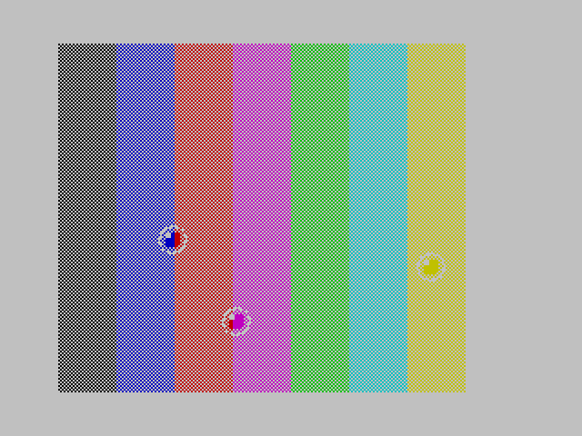

# 6. Sprites

[‹ The screen](05-the-screen.md) · [Contents](README.md) · [Sound ›](07-sound.md)

The Spectrum has no hardware sprites: a sprite is bytes the Z80 writes into the screen, and rubs out again before it moves. Every game's sprite routine is a trade between how it looks (does the background show round it? does it flicker?) and how many T-states it costs. This chapter goes through the usual ways, from the cheapest up, and [`examples/ch06_sprites.asm`](examples/ch06_sprites.asm) puts the best-looking one to work.

## XOR

The simplest sprite is drawn with `XOR`: each byte of the sprite XORed into the screen. Drawing it again in the same place rubs it out exactly, whatever was under it, so there's nothing to save:

```asm
        ld      a,(de)                  ; a byte of the sprite
        xor     (hl)                    ; with the screen's
        ld      (hl),a
```

It's fast, and it's how [chapter 5](05-the-screen.md)'s dots are drawn. But where a sprite crosses the background, both are inverted, and the sprite turns into a mess of the two; and where two sprites overlap, they cancel. Fine for a cursor, a bullet or a starfield; not for a hero.

## Masked sprites

A **masked** sprite has two pictures: the sprite, and a **mask**, 0 where the sprite is (usually with a pixel's outline round it) and 1 where the background should show. Each byte is drawn with `AND` and `OR`:

```asm
        ld      a,(de)                  ; the mask
        and     (hl)                    ; keeps the background where the mask is 1, clears it where it's 0
        inc     de
        ld      c,a
        ld      a,(de)                  ; the sprite
        or      c                       ; and puts the sprite in the hole
        ld      (hl),a
```

The background shows round the sprite, and a black outline (the mask a pixel bigger than the sprite) keeps it readable over anything. It costs twice the reads of XOR, and the sprite can't be rubbed out by drawing it again: what it covered has to be **saved** before it's drawn and **put back** before it moves.

The order matters when sprites overlap: put back what they covered in the reverse of the order they were drawn, so where two overlap, the background that comes back last is the real one. [`examples/ch06_sprites.asm`](examples/ch06_sprites.asm) does exactly this each frame: every sprite's background put back, last first; then each moved, its new background saved, and it drawn.

## Pre-shifting

A sprite 16 pixels wide at any x covers 3 bytes, not 2: at x = 3, its first byte's pixels are split across two screen bytes. Shifting it into place as it's drawn costs a shift per byte per pixel of offset, up to seven. So it's done **once, at the start**: eight copies of the sprite (and its mask), each three bytes wide, shifted right 0 to 7 pixels, and the one for (x AND 7) used each time. The example's `PreShift` makes them with `RR` through three bytes, a 1 shifted into the mask (so the background shows) and a 0 into the picture:

```asm
.shift:
        scf                             ; a 1 into the mask
        rr      (ix+0)
        rr      (ix+1)
        rr      (ix+2)
        or      a                       ; a 0 into the picture
        rr      (ix+3)
        rr      (ix+4)
        rr      (ix+5)
        djnz    .shift
```

Eight copies of a 16 × 16 masked sprite, three bytes wide, are 8 × 16 × 6 = 768 bytes. That's the usual trade on the Spectrum: memory for speed. The example keeps mask and picture interleaved, a byte of each in turn, so one pointer walks through both.



Counting its instructions, each ball here costs roughly 7,500 T-states a frame: about 2,000 to put its background back, 2,000 to save the new one, and 3,500 to draw it, most of it the `CALL` to `LineDown` and the pushing and popping round it on each of 16 lines. Three are a third of a frame. A game with more sprites unrolls the 16 lines, and keeps the screen address in a table rather than calling a routine for it.

## Flicker, and racing the beam

If the beam draws a sprite's lines while the program is halfway through rubbing it out and drawing it again, that frame shows it half there: **flicker**, or tearing. The cures, in order of cost:

- **Draw while the beam is elsewhere.** After the interrupt, the beam spends 64 lines (14,336 T-states on a 48K) in the top border before it reaches the screen. Sprites drawn in that time are never caught. More than that, and the ones near the top of the screen start to be.
- **Draw in the order the beam goes**: sort the sprites by y, and draw the ones nearest the top first, so the program stays ahead of the beam down the screen.
- **Double buffer**: draw a whole frame off screen and show it at once. The 128K's shadow screen does that in hardware ([chapter 5](05-the-screen.md)); on a 48K, a buffer in uncontended RAM copied to the screen costs a copy (the stack is fastest, below).

## Drawing with the stack

`POP` reads two bytes in 10 T-states and moves on, faster than any other way the Z80 has to read memory; `PUSH` writes two in 11. With interrupts off, the stack pointer can be pointed at anything. So the fastest copies on the Spectrum use it: point `SP` at the sprite's data, `POP` it into registers, and write them to the screen; or the other way, point `SP` at the screen and `PUSH` registers into it.

```asm
        di
        ld      (SavedSp),sp
        ld      sp,SpriteLine           ; the sprite's bytes for this line
        pop     de                      ; 10: two bytes of it
        pop     bc                      ; 10: two more
        ld      (hl),e                  ; 7 each, to the screen
        inc     l
        ld      (hl),d
        ...
        ld      sp,(SavedSp)
        ei
```

Unmasked sprites, and copies of a whole buffer to the screen, are where this pays most: [chapter 10](10-speed.md) measures it filling memory at 5.5 T-states a byte, against `LDIR`'s 21. Two cautions: an interrupt while `SP` points at the screen pushes its return address into the picture (so interrupts are off, or the interrupt routine copes), and `PUSH` writes downwards, so a buffer is copied from its end.

## Colour

Sprites drawn in pixels take the colours of the cells they're in. The cheap and common answers: make the sprites the background's ink colour (monochrome games, coloured by area), or set the cells under a sprite to its colour as it's drawn, and back as it's put back, accepting that whatever else is in those cells changes too. Multicolour ([chapter 5](05-the-screen.md)) is what demos do instead.

[‹ The screen](05-the-screen.md) · [Contents](README.md) · [Sound ›](07-sound.md)
