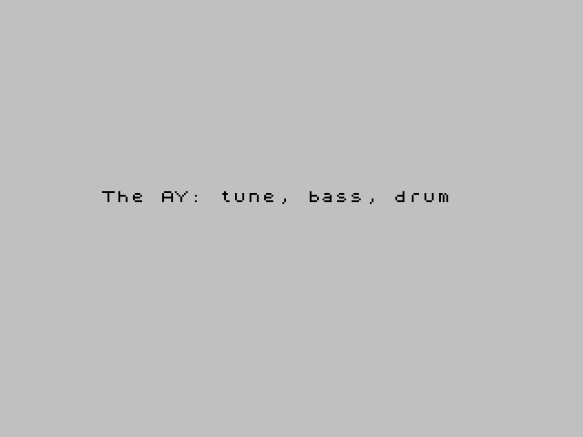

# 7. Sound

[‹ Sprites](06-sprites.md) · [Contents](README.md) · [The 128K and later models ›](08-the-128k-and-later-models.md)

The 48K's sound is one bit: a speaker that the program pushes out or pulls in, by writing to port `$FE`. There's no volume, no second voice, and no timer to keep the pitch: every note is the Z80 toggling the bit at the right moments, and doing nothing else meanwhile. The 128K added a real sound chip, the AY-3-8912, with three voices, noise and volume, that plays by itself. This chapter does both, with a small engine and a small player written here.

## The beeper

Bit 4 of `OUT ($FE)` is the beeper: "a one in bit 4 activates the EAR output and the internal speaker", and "a zero in bit 3 activates the MIC output" (<https://worldofspectrum.org/faq/reference/48kreference.htm>). Bits 0 to 2 are the border ([chapter 5](05-the-screen.md)). So a sound routine writes the border colour too, every time; and it sets bit 3, to keep the MIC (tape) output quiet.

A square wave is the bit flipped at a steady rate. A loop of n T-states that flips it each time round makes a note of 3,500,000 / (2n) Hz on a 48K:

```asm
Tone:                                   ; B: half-waves; C: the pitch
        ld      a,%00001000             ; MIC off, border black, speaker in
.half:
        xor     %00010000               ; 7: the speaker out, or in
        out     ($FE),a                 ; 11
        ld      e,c                     ; 4
.wait:
        dec     e                       ; 4
        jr      nz,.wait                ; 12 (7 the last time)
        djnz    .half                   ; 13
```

That's what the ROM's `BEEP` does, more carefully. The catch is the word "nothing else": while it plays, the program can't draw. Games of the 1980s mostly played their music on the title screen only, and sound effects as short bursts.

The 128K's Z80 is a little faster (3.5469 MHz), so the same loop plays about 1.3% sharp there.

## Two voices from one bit

There are several ways to get more than one voice out of the beeper, all of them by doing something faster than the speaker can follow. [`examples/ch07_beeper.asm`](examples/ch07_beeper.asm) uses **pulse interleaving**: two voices, each a square wave, given to the speaker in turn, many thousand times a second. Each voice is a 16-bit counter that has its note's step added to it each time round; its top bit is its square wave:

```asm
.sample:
        add     hl,de                   ; 11: voice 1 moves on
        ld      a,h                     ; 4
        and     %10000000               ; 7: its top bit
        rrca                            ; 4: to bit 4, the beeper
        rrca                            ; 4
        rrca                            ; 4
        or      %00001000               ; 7: MIC off, the border black
        out     ($FE),a                 ; 11: voice 1 is heard for the next 60 T-states
        exx                             ; 4
        add     hl,de                   ; 11: voice 2, in the other register set
        ld      a,h                     ; 4
        exx                             ; 4
        and     %10000000               ; 7
        rrca                            ; 4
        rrca                            ; 4
        rrca                            ; 4
        or      %00001000               ; 7
        out     ($FE),a                 ; 11: and voice 2 for the next 65
        djnz    .sample                 ; 13: 125 T-states a sample
```

The speaker hears each voice for half of every 125 T-states (28,000 times a second), and smooths them into the two notes together. A note's step is its frequency × 65,536 ÷ the samples a second.

The first version of this example mixed the voices by XORing their top bits, a single `OUT` a sample. It sounded wrong, and measuring it showed why: XOR of two square waves is their *product*, which has their sum and difference frequencies and neither note. Interleaved, ZEsarUX's recording shows both notes.

The example plays 530 samples a frame and stops before the next interrupt, so the startup's main loop goes on as usual. That leaves a gap of about 3,600 T-states a frame when the voices stand still, and the first version's notes were 5% flat because of it (measured: 624 Hz for an E of 659). Its steps are now worked out from 530 samples × 50.08 frames a second, and the same recording measures 655 Hz for the E, 585 for the D (587) and 523 for the C. The gap is still there as a faint 50 Hz buzz: serious beeper engines run with interrupts off, and do their drawing, if any, between notes.

## The AY-3-8912

The 128K, +2, +2A and +3 have a General Instrument AY-3-8912: three square-wave voices (A, B and C), a noise generator, a volume for each voice, and an envelope generator. It's written through two ports: "OUT (0xfffd) - Select a register 0-14", "OUT (0xbffd) - Write to the selected register", and "IN (0xfffd) - Read the value of the selected register" (<https://worldofspectrum.org/faq/reference/128kreference.htm>). Its registers, as the +3 manual lists them (<https://worldofspectrum.org/ZXSpectrum128+3Manual/chapter8pt30.html>):

| Register | What |
|---|---|
| R0, R1 | voice A's tone period: 8 bits fine, 4 bits coarse (12 bits) |
| R2, R3 | voice B's |
| R4, R5 | voice C's |
| R6 | the noise period, bits 4 to 0 |
| R7 | the mixer: bits 0–2 tone A, B, C; bits 3–5 noise A, B, C; "A zero in a mix bit indicates that the function is enabled" |
| R8, R9, R10 | voices A, B and C's volume, 0 to 15; bit 4 set: "use envelope generator" instead |
| R11, R12 | the envelope's period, 16 bits |
| R13 | the envelope's shape: bits 3 to 0 continue, attack, alternate, hold |

The AY's clock on the 128K is 1.7734 MHz: "The basic unit of tone is the clock frequency divided by 16 (ie 110.83KHz)" (+3 manual). So a note of frequency f needs a period of 1,773,400 ÷ (16 × f): 252 for the A at 440 Hz. (Fuse's timings give the same clock, 1,773,400 Hz; the Pentagon's AY runs at 1,792,000.)

The AY plays by itself once set: the program only has to change the registers when the music changes, once a frame at most. That's why 128K music players are called from the interrupt.

## A small AY player

[`examples/ch07_ay_player.asm`](examples/ch07_ay_player.asm) is a whole player in about a hundred lines. Its tune is rows of three bytes (voice A's note, voice B's note, and a drum on C), one row every six frames; a note is a number into a table of periods worked out with the sum above. Between rows, each voice gets a step quieter each frame, so the notes fade like plucked strings. The drum is voice C's noise, turned on in the mixer for as long as it's loud:

```asm
MIXER_TONES     equ     %00111000       ; R7: tones on A, B and C (0 is on), noise off
MIXER_DRUM      equ     %00011100       ; tones on A and B, noise on C and its tone off
```

Every register it uses lives in memory, and all eleven are written to the AY together once a frame, from `Interrupt`:

```asm
Write:
        ld      hl,Regs
        ld      e,0
.register:
        ld      bc,$FFFD                ; select register E
        out     (c),e
        ld      a,(hl)
        ld      b,$BF                   ; $BFFD: write it (C is $FD for both)
        out     (c),a
        inc     hl
        inc     e
        ld      a,e
        cp      11
        jr      nz,.register
```

Keeping a copy and writing it all is simpler than working out which registers changed, and costs a few hundred T-states a frame.

Recorded in ZEsarUX on a 128K and measured, the first rows play 434 Hz and 107 Hz (an A at 440 over an A at 110, as near as the measurement's 8 Hz steps can tell), then 518–533 Hz (the C at 523) and 655 Hz (the E at 659), with the drum's noise between.



128K and later only: a 48K has no AY of its own.

## Sound effects over music

A game's sound effects usually borrow a voice: the player leaves voice C alone while an effect plays on it, and takes it back after. **Tools › General › Sound effects** in Limoniter makes effects for the AY and the beeper, and saves them as AYFX banks, the format the Spectrum's AYFX players use.

[‹ Sprites](06-sprites.md) · [Contents](README.md) · [The 128K and later models ›](08-the-128k-and-later-models.md)
