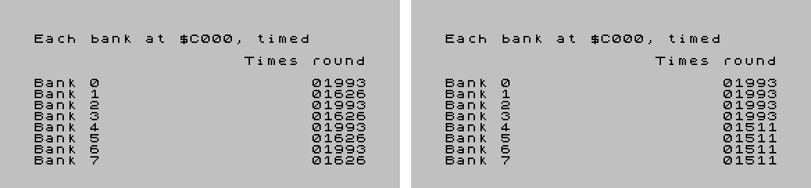

# 8. The 128K and later models

[‹ Sound](07-sound.md) · [Contents](README.md) · [Input ›](09-input.md)

Sinclair's Spectrum 128 is the 48K's design with 128K of RAM, a second ROM with a better BASIC editor, the AY sound chip ([chapter 7](07-sound.md)), a second screen, and slightly different timing. Amstrad, who bought Sinclair's computers, made it into the +2 (the same machine with a tape recorder built in), then the +2A and +3 (a new design, the +3 with a disk drive), which changed more than they look. This chapter is about what a program has to know about all of them.

## Paging

The 128K's Z80 still sees 64K: 16K of ROM and 48K of RAM. The extra RAM is in eight **banks** of 16K, numbered 0 to 7, and one of them at a time is **paged in** at `$C000`. The other two RAM areas never change: "the memory between 0x4000 and 0x7fff ... is always bank 5", and bank 2 is "also at 0x8000" (<https://worldofspectrum.org/faq/reference/128kreference.htm>). So bank 5 is the normal screen, and paging bank 5 or bank 2 in at `$C000` as well shows the same memory twice.

Paging is done by port `$7FFD`, by the 128K reference:

| Bits | What |
|---|---|
| 0–2 | "RAM page (0-7) to map into memory at 0xc000" |
| 3 | "Select normal (0) or shadow (1) screen": the screen shown from bank 5 or bank 7 |
| 4 | "ROM select. ROM 0 is the 128k editor and menu system; ROM 1 contains 48K BASIC" |
| 5 | "If set, memory paging will be disabled and further output to this port will be ignored until the computer is reset" |

The port can't be read back, so the ROM keeps a copy: "the system variable at 0x5b5c (23388) must be kept updated with the last value sent to port 0x7ffd" (the +3 manual calls it `BANKM`). That matters if the ROM's interrupt routine or BASIC will run while your banks are paged in: the 128K's ROM pages through `BANKM`, and if it's stale, the ROM pages the wrong bank back. A program that has taken the machine, like the guide's startup in IM 2, can page as it likes, so long as it puts things back before returning, as the startup does from `BANKM` ([chapter 4](04-startup-and-interrupts.md)).

The 128K decodes the port loosely: it "respond[s] to any port address with bits 1 and 15 reset", so "0x7ffd should be used if at all possible": other values of the address can page by accident, and the +2A and +3 decode it differently ("bit 1 reset, bit 14 set and bit 15 reset").

A program that sets bit 5 has locked itself into 48K mode until the next reset: some 48K games do it on purpose, so the 128K behaves like a 48K for them.

```asm
; Page: bank A at $C000, the ROM and screen kept as BASIC had them.
Page:
        ld      b,a
        ld      a,(BANKM)
        and     %11111000
        or      b
        ld      bc,$7FFD
        out     (c),a
        ret
```

### Telling a 128K from a 48K

The 128K reference gives no method, and there's no port that says. The startup's way ([chapter 4](04-startup-and-interrupts.md)) is to test what paging does: write a mark at `$C000`, page in another bank, write another, page back, and look. If the first mark survived, there are banks. A 128K locked into 48K mode, or a 48K, both look like 48Ks, which is what they are as far as a program can tell.

## Contention by bank

On the 128K, contention is by bank, not by address: "Memory banks 1,3,5 and 7 are contended" (128K reference), wherever they're paged. Contention starts "at 14361 T states after the interrupt as opposed to 14335", with the 48K's pattern of 6, 5, 4, 3, 2, 1, 0, 0.

The **+2A and +3** are different again: "Unlike the base 128K machine, RAM banks 4, 5, 6 and 7 are contended", with a different pattern, and a stronger effect. As the +3 manual puts it, "executing NOPs in contended RAM will give an effective clock frequency of 2.66Mhz" (<https://worldofspectrum.org/ZXSpectrum128+3Manual/chapter8pt24.html>).

[`examples/ch08_banks.asm`](examples/ch08_banks.asm) times all eight. Each frame it pages one bank in at `$C000`, copies a 35 T-state loop there (keeping what was there, and putting it back after, so as not to spoil the 128K editor's workspace in bank 7), and counts how many times round it goes in a frame. In ZEsarUX, on a 128K (left) and a +2A (right):



| Banks | 128K | +2A |
|---|---|---|
| uncontended | 1,993 | 1,993 |
| contended (128K: 1, 3, 5, 7; +2A: 4, 5, 6, 7) | 1,626 | 1,511 |

So: put code and its data in banks 0, 2 (and 4 and 6 on a 128K) where you can, and don't count on bank 4 or 6 being as fast as bank 0 on every model.

## The +2A and +3

Amstrad's +2A and +3 have a gate array in place of the ULA, and differ in ways that break some 48K and 128K programs:

- **Contention**: banks 4 to 7, with a different pattern (above), and the I/O ports aren't contended the same way: "Port 0xfe is not" contended on the +3, by the 128K reference.
- **The floating bus**: not on port `$FF` ([chapter 3](03-the-machine.md)).
- **Four ROMs**, chosen by bit 4 of `$7FFD` with bit 2 of a second port, `$1FFD`: "It is best to think of bit 4 in port 7FFDh and bit 2 in port 1FFDh combining to form a 2-bit number" (+3 manual). ROM 3 is 48K BASIC.
- **All-RAM paging**: port `$1FFD` bit 0 set turns on "special" paging, in which the whole 64K is RAM, in one of four arrangements chosen by its bits 1 and 2 (128K reference): banks 0, 1, 2, 3; banks 4, 5, 6, 7; banks 4, 5, 6, 3; or banks 4, 7, 6, 3, from `$0000` up. Useful for CP/M, and for programs that want RAM at `$0000` for their own interrupt vectors. The system variable for `$1FFD` is at `$5B67` (`BANK678` in the +3 manual).
- `$1FFD`'s other bits drive the +3's disk motor (bit 3) and the printer strobe (bit 4). It decodes as "bit 1 reset, bit 12 set and bits 13, 14 and 15 reset".
- The **interrupt** lasts 32 T-states, as on the 48K, not the 128K's 36 (by Fuse's timings).

The guide's examples run on the +2A as well as the 128K: the startup leaves `$1FFD` alone, and every 48K example's timing allows for either.

## The Pentagon

The Pentagon 128 is a Russian clone, built in many versions, and the machine many Spectrum demos are written for. It pages like a 128K through `$7FFD`, has an AY (at 1.792 MHz), and its own timing: 3.584 MHz, 224 T-states a line, 320 lines a frame, 71,680 T-states (Fuse's timings). Its lines split differently from a 48K's (36 T-states of left border, 128 of screen, 28 of right border, 32 of retrace), so every beam-raced effect needs its own timing for it. The guide's startup takes it for a 128K, since it pages, and sets `LineTime` to 228: wrong for a Pentagon, whose lines are 224. A program that cares has to be told, or time a frame.

The guide's examples were run on a Pentagon only by accident, and it's instructive. Fuse 1.6 took the 128K `.sna` snapshots it was given for a Pentagon, and the first 128K test runs were made that way. There, [chapter 3](03-the-machine.md)'s contention example counted 2,034 times round its loop from every address, contended or not (Fuse's Pentagon has no contended memory, and its frame is longer), and [chapter 5](05-the-screen.md)'s multicolour came out a colour a character row, not a line, as its timing was a 48K's and a 128K's. The border bars, needing only lines of 224 T-states, still worked. Run as a 128K (from a `.z80` that says so), all three were right.

[‹ Sound](07-sound.md) · [Contents](README.md) · [Input ›](09-input.md)
