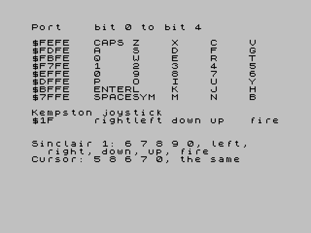

# 9. Input

[‹ The 128K and later models](08-the-128k-and-later-models.md) · [Contents](README.md) · [Speed ›](10-speed.md)

The Spectrum's keyboard is read straight from the ULA, a few keys at a time, with no buffer and no interrupt of its own; joysticks were add-ons, and came in two kinds that work completely differently. This chapter reads all of them, and [`examples/ch09_input.asm`](examples/ch09_input.asm) shows each key and each joystick direction light up as it's pressed.

## The keyboard's half-rows

The 40 keys are wired as eight **half-rows** of five. Reading port `$FE` reads them, and the high byte of the port's address chooses which: each of its bits, when 0, selects one half-row. Bits 0 to 4 of the byte read are that half-row's five keys, **0 when pressed**: "The bit is 0 if the key is pressed, 1 if it is not" (the 48K manual, chapter 23, <https://worldofspectrum.org/ZXBasicManual/zxmanchap23.html>). The half-rows, from World of Spectrum's 48K reference (<https://worldofspectrum.org/faq/reference/48kreference.htm>), bit 0 first:

| Port | Bit 0 | Bit 1 | Bit 2 | Bit 3 | Bit 4 |
|---|---|---|---|---|---|
| `$FEFE` | CAPS SHIFT | Z | X | C | V |
| `$FDFE` | A | S | D | F | G |
| `$FBFE` | Q | W | E | R | T |
| `$F7FE` | 1 | 2 | 3 | 4 | 5 |
| `$EFFE` | 0 | 9 | 8 | 7 | 6 |
| `$DFFE` | P | O | I | U | Y |
| `$BFFE` | ENTER | L | K | J | H |
| `$7FFE` | SPACE | SYMBOL SHIFT | M | N | B |

The order is the keyboard's, from the outside in: on the left half of the keyboard bit 0 is the leftmost key, on the right half the rightmost. That's why the number row reads 1 2 3 4 5 and then 0 9 8 7 6.

`IN A,($FE)` puts `A` on the port's high byte, so:

```asm
        ld      a,$7F                   ; the half-row SPACE, SYM SHIFT, M, N, B
        in      a,($FE)
        rra                             ; SPACE into the carry
        jr      nc,SpacePressed         ; 0: pressed
```

Selecting several half-rows at once (more than one 0 bit in the high byte) reads them ANDed together: `XOR A` then `IN A,($FE)` reads all eight, and any 0 in bits 0 to 4 means some key is down: the quickest "press any key".

Bits 5 to 7 of the byte aren't keys. Bit 6 is the tape input: "Bit 6 of IN-Port 0xfe is the EAR input bit" (48K reference); mask it off, as it can be either. Bits 5 and 7 are best ignored.

The same read is how the startup's main loop looks for SPACE ([chapter 4](04-startup-and-interrupts.md)), and why SPACE always leaves the examples.

### Ghosting

A keyboard wired as a matrix has a weakness: with three keys held down at three corners of a rectangle in the matrix, the fourth corner can read as pressed too. Two keys together are always read right; it's the third that can bring in a ghost. Games that need three keys at once (two directions and fire) choose them with that in mind, or use a joystick.

## Joysticks

### Kempston

The **Kempston** interface is read from port `$1F`: "0x1F ... Kempston joy 1" (the Next's port list, which keeps the Kempston's mapping: <https://gitlab.com/SpectrumNext/ZX_Spectrum_Next_FPGA/-/raw/master/cores/zxnext/ports.txt>). Its bits are the other way round from the keyboard's, **1 when pressed**:

| Bit | 0 | 1 | 2 | 3 | 4 |
|---|---|---|---|---|---|
| Kempston | right | left | down | up | fire |

```asm
        in      a,($1F)
        and     %00011111
        bit     4,a                     ; fire
        jr      nz,Fire
```

With no Kempston plugged in, port `$1F` isn't answered, and reads whatever is on the bus: `$FF` in the border's time on a 48K or 128K, or a byte of the screen while the ULA is fetching ([chapter 3](03-the-machine.md)). A program that reads it without checking sees phantom movement. A reliable test: no joystick can push left and right at once, so a value with both bits 0 and 1 set means no Kempston. The example reads it just after the interrupt, in the top border, and uses that test.

### Sinclair and cursor joysticks

The **Sinclair** joysticks (two, as on Sinclair's Interface 2) and **cursor** joysticks don't have ports of their own: they press keys. A program reads them as the keyboard. By Fuse's joystick mappings (<https://sources.debian.org/src/fuse-emulator/1.5.7%2Bdfsg1-4/peripherals/joystick.c>):

| | left | right | up | down | fire |
|---|---|---|---|---|---|
| Sinclair 1 | 6 | 7 | 9 | 8 | 0 |
| Sinclair 2 | 1 | 2 | 4 | 3 | 5 |
| Cursor | 5 | 8 | 7 | 6 | 0 |

So Sinclair 1 is the half-row `$EFFE` alone (6, 7, 8, 9, 0 are its bits 4 to 0), and Sinclair 2 the half-row `$F7FE` alone, each a single read. Cursor keys are split over two half-rows (5 is in `$F7FE`, the rest in `$EFFE`).

## Reading every control the same way

A game should let the player use whatever they have. The usual way is a routine that reads every control and returns one byte of directions and fire, the same whatever pressed them, as [chapter 12](12-games-and-demos.md)'s game does:

```asm
; ReadControls: A's bits 0 to 2 set for left, right and fire, from the keys (O, P, ENTER), Sinclair joystick 1
; (6, 7, 0) and a Kempston joystick, whichever is used.
```

Let the player redefine the keys, too: keep a table of the port's high byte and the bit for each control, and read through it, rather than writing the keys into the code.



The test suite presses Q on the built-in Spectrum and checks that Q's place lights up.

[‹ The 128K and later models](08-the-128k-and-later-models.md) · [Contents](README.md) · [Speed ›](10-speed.md)
