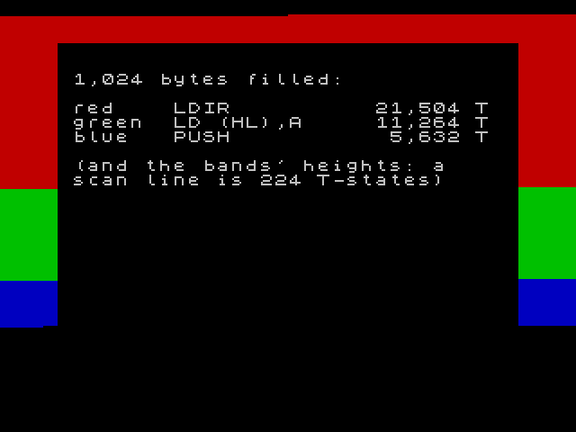

# 10. Speed

[‹ Input](09-input.md) · [Contents](README.md) · [The Next ›](11-the-next.md)

A 48K has 69,888 T-states a frame, and a demo or game has to fit everything into them: drawing, music, moving things, reading the keys. When it doesn't fit, it drops to 25 frames a second, and it shows. This chapter is about making code fast, in the order that pays: measure first, then choose a better method, and only then shave T-states off instructions.

## Measure first

Limoniter's **profiler** ([chapter 2](02-working-with-limoniter.md)) counts the T-states spent at every address of a program running on the built-in Spectrum, contention included, and shows the routines that took longest. It's nearly always one routine, and nearly never the one you'd have guessed.

The oldest way works anywhere: change the border colour when a routine starts, and back when it ends. The border's band shows how many scan lines it took, at 224 T-states a line (228 on a 128K). [`examples/ch10_speed.asm`](examples/ch10_speed.asm) does that for three ways of filling 1,024 bytes:



| Way | T-states a byte | For 1,024 bytes | Scan lines |
|---|---|---|---|
| `LDIR` | 21 | 21,504 | 96 |
| `LD (HL),A` and `INC L`, unrolled | 11 | 11,264 | 50 |
| `PUSH` | 5.5 | 5,632 | 25 |

The status bar's T-states, as you put the cursor on each line, are the quickest way to count ([chapter 2](02-working-with-limoniter.md)). The counts are Zilog's (the *Z80 User Manual*), for code and data in uncontended memory; in contended memory, add the waits of [chapter 3](03-the-machine.md).

## Contended memory first

The cheapest speed-up on a Spectrum is to move code out of `$4000`–`$7FFF`. [Chapter 3](03-the-machine.md)'s example measures the same loop 18% slower there. Code, its tables and its stack all belong above `$8000` (or in banks 0, 2, 4 and 6 on a 128K, 0 to 3 on a +2A).

## Unrolling

A loop pays for its counting every time round: `DJNZ` costs 13 T-states, more than many loop bodies. Writing the body out n times (unrolling) pays that once. sjasmplus's `REPT` does the writing:

```asm
        ld      b,4                     ; four pages of 256 bytes
.page:
        rept    256
        ld      (hl),a                  ; 7
        inc     l                       ; 4: within a page, INC L is enough (INC HL is 6)
        endr
        inc     h
        dec     b
        jp      nz,.page
```

That's the example's middle way: 11 T-states a byte, half `LDIR`'s 21, for 512 bytes of code. The trade is always memory; on a 48K there's usually some to spare above `$C000`.

Small choices inside a loop add up too:

| Instead of | Use | Saves |
|---|---|---|
| `INC HL` (6) | `INC L` (4), when the data doesn't cross a 256-byte boundary | 2 |
| `LD A,0` (7) | `XOR A` (4), when the flags don't matter | 3 |
| `JR` (12, taken) in a loop | `JP` (10), when it's always taken | 2 |
| `CP 0` (7) | `OR A` (4) | 3 |
| a table you add an offset to | a table aligned to 256 (`align 256`), indexed by `L` | the add |

The last is how [chapter 5](05-the-screen.md)'s plotting and sine tables are read: `LD H,table/256`, `LD L,index`, `LD A,(HL)`.

## Self-modifying code

A value a loop needs can be written into the loop's own instruction, where it costs nothing to fetch. The example puts the fill value straight into an `LD DE` before it runs:

```asm
        ld      a,(Value)
        ld      (PushValue+1),a         ; the value into the LD DE below: its low byte
        ld      (PushValue+2),a         ; and its high
        ...
PushValue:
        ld      de,0                    ; the 0 is replaced before this runs
```

and [chapter 5](05-the-screen.md)'s border bars patch two bytes of their loop, two `NOP`s or a `JR`, to make it 224 or 228 T-states for the machine it's on. On the Z80 this is safe: there's no instruction cache to go stale, as there is on the Amiga's later processors. It does mean the code can't be in ROM, and that reading it is harder: say in a comment what's patched, and by what.

## The stack

`PUSH` writes two bytes in 11 T-states, and `POP` reads two in 10: no other Z80 instruction moves memory as fast. So the fastest fills, clears and copies point `SP` at the memory and push or pop. The example's fastest fill:

```asm
        di                              ; an interrupt now would push into the buffer
        ld      (SavedSp),sp
        ld      sp,BUFFER+1024          ; PUSH writes downwards, from the end
PushValue:
        ld      de,0
        rept    512
        push    de
        endr
        ld      sp,(SavedSp)
        ei
```

5.5 T-states a byte. Clearing the whole 6,144 bytes of the screen this way is about 34,000 T-states, under half a frame (the same with `LDIR` is nearly two frames). For copying, `POP` from the source and `PUSH` to the destination, moving `SP` between them with `LD SP,HL` or `LD SP,IX` every few pairs: [chapter 6](06-sprites.md) shows the idea for sprites, and [chapter 5](05-the-screen.md)'s multicolour writes attributes with `PUSH` in the border's time.

The rules: interrupts off while `SP` isn't the stack (or an interrupt routine that copes), and `SP` put back after.

## Choose a better method

After all that, the biggest gains are still in doing less: drawing only what changed, pre-shifting sprites once rather than shifting them every frame ([chapter 6](06-sprites.md)), working out a table at the start rather than a sum every time, keeping x and y in the form the screen wants (a screen address and a bit) rather than as numbers to convert. Every fast Spectrum program is mostly tables and unrolled loops, and the art is choosing which.

[‹ Input](09-input.md) · [Contents](README.md) · [The Next ›](11-the-next.md)
