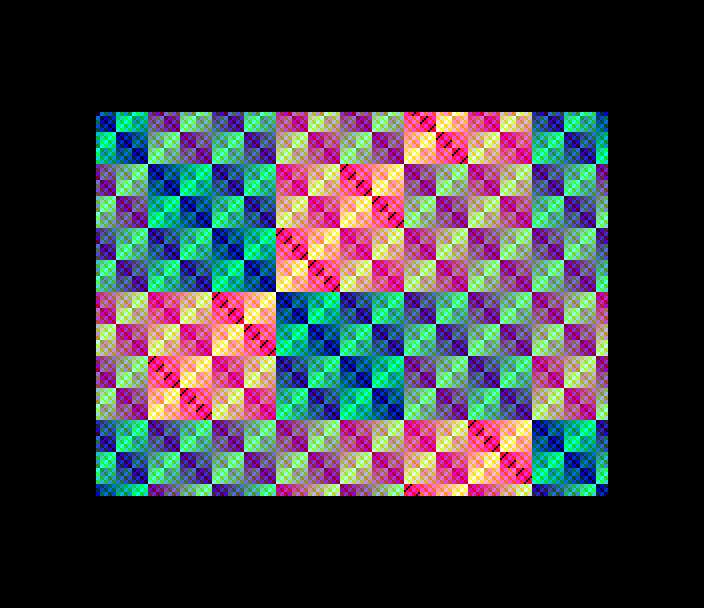
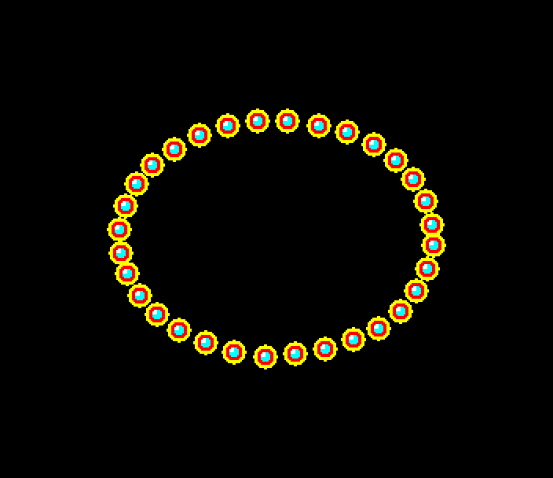
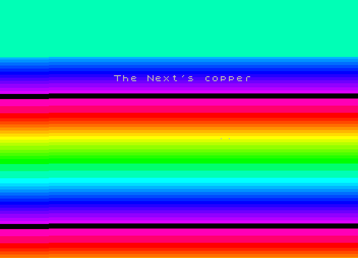

# 11. The Next

[‹ Speed](10-speed.md) · [Contents](README.md) · [Games and demos ›](12-games-and-demos.md)

The ZX Spectrum Next is a Spectrum built in an FPGA: it runs 48K, 128K and +3 software as they were, and adds a faster Z80 with new instructions (the **Z80N**), up to 28 MHz, 8K memory paging over a megabyte or two, a 256-colour bitmap screen (**Layer 2**), 128 hardware **sprites**, a **tilemap**, a **copper**, and **DMA**. All of it is controlled through one set of registers, the **nextregs**. This chapter goes through them, and three examples put Layer 2, the copper and the sprites to work.

Everything here is from the Next's own documentation: the register list and port list from its FPGA core (`nextreg.txt` and `ports.txt`, <https://gitlab.com/SpectrumNext/ZX_Spectrum_Next_FPGA/-/raw/master/cores/zxnext/nextreg.txt> and <https://gitlab.com/SpectrumNext/ZX_Spectrum_Next_FPGA/-/raw/master/cores/zxnext/ports.txt>), and the wiki at <https://wiki.specnext.dev>.

**Tested where**: the three examples were run in ZEsarUX 13.0's emulated Next (its "TBBlue" machine), loaded from their `.nex` files. They haven't been run on a real Next, nor in CSpect; please report what you find there.

## Nextregs

A nextreg is written by selecting it on port `$243B` and writing its value to `$253B`: "0x243B NEXTREG register select", "0x253B NEXTREG data ... Reads or writes data to the selected register" (`ports.txt`). The Z80N does both at once:

```asm
        nextreg $07,3                   ; ED 91 07 03: 20 T-states
        nextreg $16,a                   ; ED 92 16: register $16 = A, 17 T-states
```

Reading one still needs the ports:

```asm
        ld      bc,$243B
        ld      a,$12                   ; Layer 2's bank
        out     (c),a
        inc     b                       ; $253B
        in      a,(c)
```

## Speed

Nextreg `$07` sets the Z80's speed: "00 = 3.5 MHz", "01 = 7 MHz", "10 = 14 MHz", "11 = 28 MHz", and reading it gives the speed it's actually running at in bits 5 and 4 (`nextreg.txt`). "28MHz (works since core 3.0)" (<https://wiki.specnext.dev/CPU_Speed_Register>). The examples set 28 MHz. Anything timed in T-states, like [chapter 5](05-the-screen.md)'s border bars, needs 3.5 MHz, or its own timing for the faster speed.

## The Z80N's new instructions

The wiki's table (<https://wiki.specnext.dev/Extended_Z80_instruction_set>), whose timings it says are "based on limited testing and may not be accurate":

| Instruction | Does | Opcode | T-states |
|---|---|---|---|
| `SWAPNIB` | swaps A's two nibbles | ED 23 | 8 |
| `MIRROR A` | reverses A's bits | ED 24 | 8 |
| `TEST n` | A AND n, flags only | ED 27 n | 11 |
| `BSLA DE,B` and `BSRA`, `BSRL`, `BSRF`, `BRLC` | shift DE by B bits | ED 28 to ED 2C | 8 |
| `MUL D,E` | DE = D × E | ED 30 | 8 |
| `ADD HL,A` (and `DE`, `BC`) | adds A, unsigned | ED 31 to ED 33 | 8 |
| `ADD HL,nn` (and `DE`, `BC`) | adds a 16-bit number | ED 34 to ED 36 | 16 |
| `PUSH nn` | pushes a number | ED 8A hi lo | 23 |
| `OUTINB` | `OUT (C),(HL)`, `INC HL`, B unchanged | ED 90 | 16 |
| `NEXTREG n,n` / `NEXTREG n,A` | writes a nextreg | ED 91 / ED 92 | 20 / 17 |
| `PIXELDN` | HL down a line of the ULA screen | ED 93 | 8 |
| `PIXELAD` | HL = the ULA screen address of x = E, y = D | ED 94 | 8 |
| `SETAE` | A = the pixel's bit, from E | ED 95 | 8 |
| `JP (C)` | jumps within the current 16K, to 64 × a byte read from port C | ED 98 | 13 |
| `LDIX`, `LDDX`, `LDIRX`, `LDDRX`, `LDPIRX` | `LDI` and friends that skip bytes equal to A | ED A4 ... | 16, or 21/16 |
| `LDWS` | copies (HL) to (DE), then `INC L` and `INC D` | ED A5 | 14 |

`PUSH nn` is "the only operand encoded as big-endian". The barrel shifts need core 2 or later. `PIXELAD` and `PIXELDN` are [chapter 5](05-the-screen.md)'s `PixelAddress` and `LineDown` in 8 T-states each. Limoniter's assembler knows them all ([chapter 2](02-working-with-limoniter.md)).

`OUTINB` is the one the copper example uses: `OTIR` can't send a run of bytes to a nextreg, because it counts in `B`, and `B` is also the port's high byte (`$25`). `OUTINB` leaves `B` alone.

## Memory

The Next's 64K is eight **slots** of 8K, and nextregs `$50` to `$57` choose which 8K **page** of RAM is in each (`nextreg.txt`). They start as the 128K's memory: slots 0 and 1 the ROM (255), then pages 10 and 11 (16K bank 5), 4 and 5 (bank 2), and 0 and 1 (bank 0). Page n is 16K bank n / 2. So `nextreg $56,a` puts page A at `$C000`–`$DFFF`, and port `$7FFD` still works as on a 128K.

## Layer 2

Layer 2 is a bitmap screen of a byte a pixel: "256x192 256 colours, 320x256 256 colours or 640x256 16 colours", the 256 × 192 one "in English reading order with no ULA-style interlacing" (<https://wiki.specnext.dev/Layer_2>): pixel (x, y) is byte 256y + x. That's 48K, six 8K pages, starting at the 16K bank nextreg `$12` gives ("Starting 16K RAM bank (soft reset = 8)"; the wiki notes NextZXOS uses bank 9, so read it, don't assume).

- Port `$123B` bit 1 shows it: "bit 1 = 1 to enable layer 2 display" (`ports.txt`). The same port can map Layer 2 over the bottom 16K for writing (bit 0), an older way than the MMU.
- Each byte is a colour from **Layer 2's palette**. Palettes are written by nextreg `$43` (which palette: bits 6 to 4 = 001 for Layer 2's first), `$40` (the index) and `$41` (the colour, 8-bit RRRGGGBB; the index moves on after each write), or `$44` for 9-bit colour in two writes.
- Colour `$E3` is see-through by default: nextreg `$14`, "Transparency colour value (soft reset = 0xe3)", so the ULA's screen shows through.
- Nextregs `$16` and `$17` scroll it: X 0 to 255, Y 0 to 191, by hardware, for nothing.
- Nextreg `$15` orders the layers: sprites, Layer 2 and the ULA, "000 - S L U" by default (sprites on top).

[`examples/ch11_next_layer2.asm`](examples/ch11_next_layer2.asm) fills Layer 2's palette so colour n is RRRGGGBB n, pages each of its six 8K pages in at `$C000` with `nextreg $56` and draws x XOR y into it, turns it on, and scrolls it a pixel a frame each way:



The few black specks are pixels whose colour came out as `$E3`: see-through, so the ULA's black screen shows.

### Waiting for a frame

The Next examples don't use the startup (which goes back to BASIC), and don't use interrupts at all. They wait for a frame by reading the line the video is on, nextregs `$1E` and `$1F` ("Active Video Line"), until it's 192, just below the picture:

```asm
WaitFrame:
        ld      bc,$243B
        ld      a,$1F
        out     (c),a
        inc     b
.wait:
        in      a,(c)
        cp      192
        jr      nz,.wait
.leave:
        in      a,(c)                   ; at 28 MHz the line lasts long enough to be seen twice
        cp      192
        jr      z,.leave
        ret
```

The Next can also interrupt on any line (nextregs `$22` and `$23`), and has a hardware IM 2 mode (nextreg `$C0`) in which it supplies its own vector for each kind of interrupt.

## Sprites

The Next has "Total of 128 sprites", each 16 × 16, from "A 16K pattern memory" (<https://wiki.specnext.dev/Sprites>): 64 patterns of 256 bytes (a byte a pixel, from the sprites' palette), or twice as many of 4 bits a pixel. Three ports drive them (`ports.txt`):

- `$303B`: which sprite (and pattern) the next writes are for.
- `$5B`: pattern bytes, the address moving on by itself, so one `OTIR` sends a whole pattern.
- `$57`: a sprite's attributes, 4 or 5 bytes each: X's low 8 bits; Y's low 8 bits; palette offset, mirroring, rotation and X's ninth bit; and visible (bit 7), a fifth byte to follow (bit 6) and the pattern number.

Sprite coordinates run over a 320 × 256 area whose (32, 32) is the top left of the 256 × 192 screen, so a sprite can sit partly or wholly in the border. Nextreg `$15` bit 0 shows them; bit 1 lets them over the border. Colour `$E3` is see-through for sprites too (nextreg `$4B`).

[`examples/ch11_next_sprites.asm`](examples/ch11_next_sprites.asm) sends one pattern, a ball, and places 32 sprites on a turning circle each frame, four bytes each:



## The copper

The copper is a small coprocessor with two instructions (<https://wiki.specnext.dev/Copper>): **WAIT** for a place on the screen (`%1hhhhhhv %vvvvvvvv`: "Wait for raster line v (0-311) and horizontal position h\*8"), and **MOVE** a value into a nextreg (`%0rrrrrrr %vvvvvvvv`). Its list holds "exactly 1024 instructions", and runs in step with the beam while the Z80 does something else. Line 0 is the screen's first line ("Normally the ula's pixel row 0 aligns with vertical line count 0", `nextreg.txt`); the border above it comes at the end of the count.

It's loaded through nextregs: `$61` and `$62` set the address (2K, 0 to `$7FF`), `$60` takes the bytes one at a time (the address moving on), and `$62`'s top two bits start it: "11 = Copper start, execute the list from index 0, and restart the list when the raster reaches position (0,0)". Writing `$62` with the start bits it already has doesn't restart it, so a running list can be rewritten in place.

[`examples/ch11_next_copper.asm`](examples/ch11_next_copper.asm) makes a list that, on every one of 312 lines, waits for the line's start and changes palette entry 16 (PAPER 0, which the border uses when it's black) with two MOVEs: 936 instructions. Each frame it makes the list again a line further on, and sends it with `OUTINB` while the copper runs:



In ZEsarUX, the top border stays one colour. Reading ZEsarUX's source, it seems to restart the copper's list at the start of its frame, before the top border, rather than at line 0 as `nextreg.txt` describes, so the list is already waiting for line 0 when the top border's lines (the end of the count) go by. On a real Next, by the documentation, the whole border should change; this hasn't been checked on one. A first version stopped the copper and restarted it every frame to load the list, and showed nothing at all in ZEsarUX: loading it while it runs is what works.

## The tilemap

The tilemap is a layer of 8 × 8 tiles, 40 × 32 of them or 80 × 32 ("bit 6 = 0 for 40x32, 1 for 80x32", nextreg `$6B`), each tile 4 bits a pixel (32 bytes), from a map of two bytes a tile (tile number, and an attribute of palette offset, mirroring and rotation), or one byte a tile with nextreg `$6B` bit 5 (<https://wiki.specnext.dev/Tilemap>). Nextreg `$6E` and `$6F` say where the map and the tiles are in bank 5 or 7 (by default `$6C00` and `$4C00`), and `$6C` is the attribute to use for a map of one byte a tile. It's the Next's answer to the ULA's text screen, and to scrolling backgrounds. **Thin**: there's no example of it yet.

## DMA

The Next's **zxnDMA** copies memory to memory, or memory to a port, without the Z80: "The zxnDMA is mapped to a single Read/Write IO Port 0x6B" (<https://wiki.specnext.dev/DMA>). It's programmed by sending it a short program of bytes, in the order of Zilog's Z80 DMA: disable it, set the source and length (WR0), the source's and destination's addressing (WR1, WR2), the destination and the mode (WR4: "continuous" runs to the end with the Z80 stopped; "burst" lets the Z80 run between bytes), then load and enable. The wiki's page has a complete program to copy memory, sent with `OTIR` to port `$6B`. Its rate can be slowed by a prescaler, which is how it plays samples. **Thin**: there's no example of it yet.

## .nex files

A `.nex` is the Next's program file: "official Distro supported version is the V1.2" (<https://wiki.specnext.dev/NEX_file_format>). A 512-byte header ("Next", the version, the RAM it needs, how many 16K banks follow, a loading screen's kind, the border, SP, PC, and a byte for each of 112 banks saying whether it's in the file), then the banks themselves, in the order "5,2,0,1,3,4,6,7,8,9,10,...,111", then any loading screen. The Next's browser runs one when it's chosen.

Limoniter's F9 makes a version 1.2 `.nex` of source that says `DEVICE ZXSPECTRUMNEXT`: banks 5, 2 and 0 (the 64K the program sees), started at its first byte with the stack below `$FFFE`. For more (more banks, a loading screen, a different stack), use sjasmplus's `SAVENEX`, which Limoniter's assembler does too.

[‹ Speed](10-speed.md) · [Contents](README.md) · [Games and demos ›](12-games-and-demos.md)
