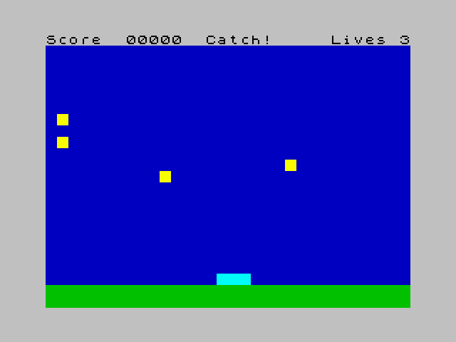

# 12. Games and demos

[‹ The Next](11-the-next.md) · [Contents](README.md) · [Releasing ›](13-releasing.md)

The chapters so far are pieces: a screen, sprites, sound, controls. This one puts them together, the way a game or a demo is put together, and [`examples/ch12_game.asm`](examples/ch12_game.asm) is a small whole game: **Catch**. Stars fall; move the paddle along the bottom to catch them.



## The frame loop

A Spectrum game is a loop that runs once a frame: read the controls, move everything, draw what changed, play the sound, and wait for the next frame. The guide's startup ([chapter 4](04-startup-and-interrupts.md)) is that loop: `HALT` waits for the interrupt, then `Frame` runs. Two rules keep it smooth:

- **Fit in a frame.** If `Frame` takes longer than 69,888 T-states (less the interrupt's time), the game runs at 25 frames a second, and everything moves half as fast or jerks. The profiler ([chapter 2](02-working-with-limoniter.md)) says where the time goes, and [chapter 10](10-speed.md) how to get it back.
- **Move by the frame, not by the loop.** Speeds are in pixels (or cells) a frame, so the game runs the same on every Spectrum. A 128K's frame is 1.5% longer than a 48K's (70,908 T-states against 69,888, [chapter 3](03-the-machine.md)), but both are 50 a second, so a game counted in frames plays the same on both.

Catch draws only with **attributes**: each star, the paddle and the ground are character cells coloured by their paper, so drawing a star is writing one byte, and rubbing it out another. That's the cheapest graphics a Spectrum has (and there's no attribute clash, since nothing else shares the cells). Most of its frame is spent waiting.

## States

A game is in one of a few **states**: a title screen, playing, a life lost, game over. Each has its own frame routine, and the main one only chooses between them:

```asm
Frame:
        ld      a,(State)
        or      a
        jr      nz,Over
Playing:
        call    MovePaddle
        call    MoveStars
        jp      ShowScore

; Game over: the stars stop; ENTER or fire starts again.
Over:
        call    ReadControls
        and     FIRE
        ret     z
NewGame:
        ...
```

Keeping states apart, each with a clear start (`NewGame` sets up everything a game needs, every time), is what stops the bugs that only happen on the second game.

## Moving things on a timer

Each star in Catch has three bytes: its row, its column, and a count of frames until it next moves. Each frame the count goes down; at 0 the star falls a row and the count starts again from `Speed`, which gets smaller as the score goes up. The same pattern (a counter per object, reloaded when it runs out) gives every object its own speed with no multiplication.

## Controls

`ReadControls` reads the keys (O and P, and ENTER), Sinclair joystick 1 (6, 7 and 0) and a Kempston joystick, and returns one byte of left, right and fire, so the rest of the game never knows which was used ([chapter 9](09-input.md)). It checks the Kempston isn't a phantom (left and right at once means nothing's there).

## Random numbers

Where each star starts is random. The Spectrum has nothing that makes random numbers, so programs make them: Catch uses an 8-bit **xorshift**, which goes through all 255 values from 1 to 255 before repeating:

```asm
; Random: the next of 255 numbers from 1 to 255 (an 8-bit xorshift: x ^= x << 1, x ^= x >> 1, x ^= x << 2).
Random:
        ld      a,(Seed)
        ld      b,a
        add     a,a
        xor     b
        ld      b,a
        srl     a
        xor     b
        ld      b,a
        add     a,a
        add     a,a
        xor     b
        ld      (Seed),a
        ret
```

The seed must never be 0 (xorshift stays at 0 forever), so Catch takes it from `Frames` with bit 0 set, at the start. (`LD A,R` is often used instead; the refresh register counts with every instruction, so it's only as random as the code before it is irregular.) Other common sources: the ROM's bytes as a table of "random" numbers, or a 16-bit xorshift for longer runs.

## Sound in a game

Catch clicks the beeper when a star is caught: 32 changes of the speaker bit, a few thousand T-states, short enough to fit in the frame. That's how most 48K games did effects: short bursts, never long enough to hold the game up. On a 128K, effects go on the AY, on a voice the music leaves free ([chapter 7](07-sound.md)).

## A demo

A demo is put together the same way, with **parts** in place of states: each part has its own `Init` and `Frame`, and the main loop moves to the next part after so many frames, or when the music says. The guide's examples are each one part: the border bars ([chapter 5](05-the-screen.md)), a scroller, multicolour, the AY player ([chapter 7](07-sound.md)). A demo runs the music from the interrupt, so it plays on across parts, and puts each part's set-up (tables, pre-shifted graphics) in the time while the last part is still running, or behind a fade.

On a 128K the parts can sit in different banks, each paged in when it runs ([chapter 8](08-the-128k-and-later-models.md)), and the music in another; a 48K demo usually loads each part from tape, or depacks it from a cruncher's packed data, between parts.

## Testing

Run it on every machine it claims to support: a 48K, a 128K and a +2A at least ([chapter 8](08-the-128k-and-later-models.md) has what differs), in two emulators. Play it to the end, game over and a new game included. The guide's own test suite runs Catch to its main loop on a 48K and a 128K, and checks it goes back to BASIC cleanly.

[‹ The Next](11-the-next.md) · [Contents](README.md) · [Releasing ›](13-releasing.md)
