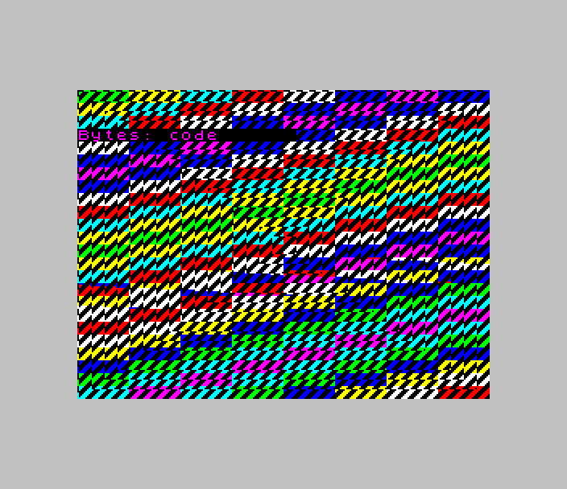

# 13. Releasing

[‹ Games and demos](12-games-and-demos.md) · [Contents](README.md) · [Further reading ›](14-further-reading.md)

A finished Spectrum program is released as a **tape**: a `.tap` or `.tzx` file that any emulator loads, that a divMMC or similar card interface loads on a real machine, and that can be played into a real Spectrum's EAR socket as sound. This chapter is about making a good one, with its own loader and a loading screen, and about the other ways to release.

## How the ROM saves a tape

The ROM saves each file as two **blocks**: a 17-byte **header** ("Allow seventeen locations for the header", <https://skoolkid.github.io/rom/asm/0605.html>) and the data. Each block starts with a **flag** byte, "+00 (header block) or +FF (data block)", and ends with a parity byte, all its bytes XORed: "the final byte sent is the parity byte" (<https://skoolkid.github.io/rom/asm/04C2.html>). The header holds:

| Bytes | What |
|---|---|
| 0 | type: 0 a BASIC program, 1 a number array, 2 a character array, 3 bytes (CODE, and SCREEN$) |
| 1–10 | the name, padded with spaces |
| 11–12 | the data's length |
| 13–14 | for CODE, where it loads; for a program, the line to start at (32768 or more: none) |
| 15–16 | for a program, its length without its variables |

On tape each block is a **pilot tone** (pulses of 2,168 T-states: 8,063 of them before a header, 3,223 before data), two sync pulses (667 and 735), then the bits, each two pulses: 855 T-states each for a 0, 1,710 for a 1 (the TZX format's description of the ROM's timing, <https://worldofspectrum.net/TZXformat.html>). That's about 1,400 bits a second (if half are 0s), so a 48K program takes about five minutes, and a loading screen 40 seconds of it.

## .tap and .tzx

A **`.tap`** file is those blocks one after another, each with "two bytes specifying how many bytes will follow (not counting the two length bytes)" (<https://worldofspectrum.org/faq/reference/formats.htm>), and the flag and parity included. Nothing about timing: every block is played the ROM's way. It's what Limoniter's F9 makes, and what nearly everything loads.

A **`.tzx`** keeps a tape as it really was: each block with its own timing. Block `$10` is a standard block ("Data as in .TAP files", with a pause after); block `$11` is a **turbo** block, with every pulse length and pulse count given; `$12` to `$15` are pure tones, pulse sequences, pure data and direct recordings, `$19` is a generalised data block, and there are blocks for pauses, groups, text and archive information (the TZX format, above). Use `.tzx` when the tape isn't standard: a turbo loader, a custom loading scheme, or to keep the archive information (title, authors, year) with the file.

## A loader of your own

F9's tape has a loader of one line, made for running the program while you write it. A release's tape usually has more: a loading screen, and a loader that runs itself. [`examples/ch13_tape.asm`](examples/ch13_tape.asm) makes such a tape with sjasmplus's `SAVETAP`, which Limoniter's assembler does too, so F9 runs the tape the source saved:

```asm
        savetap "ch13_tape.tap",BASIC,"HowToCode",Loader,LoaderEnd-Loader,10
        savetap "ch13_tape.tap",CODE,"screen",$4000,6912
        savetap "ch13_tape.tap",CODE,"code",$8000,CodeEnd-$8000
```

The first saves a BASIC program that starts itself at line 10 (the `10` at the end); the second a screen (a `CODE` file of 6,912 bytes at 16384 is what `SCREEN$` saves); the third the code. The loader is written in the source as the Spectrum keeps a BASIC line: its number (high byte first, unlike everything else on the Z80), its length, the keywords as single-byte tokens, and ENTER:

```asm
; 10 CLEAR VAL "32767": LOAD ""SCREEN$ : LOAD ""CODE : RANDOMIZE USR VAL "32768"
Loader:
        db      0,10                    ; line 10, high byte first
        dw      LineEnd-LineStart       ; its length, low byte first
LineStart:
        db      $FD,$B0,'"32767":'      ; CLEAR VAL "32767":
        db      $EF,'""',$AA,':'        ; LOAD ""SCREEN$ :
        db      $EF,'""',$AF,':'        ; LOAD ""CODE :
        db      $F9,$C0,$B0,'"32768"'   ; RANDOMIZE USR VAL "32768"
        db      $0D                     ; ENTER ends the line
LineEnd:
```

`VAL "32767"` rather than `32767` is the usual loader trick: a number typed into a line is kept as its digits *and* a hidden five-byte copy, and `VAL` of a string avoids the copy (and makes the line shorter). The loading screen is made by [`examples/ch13_make_screen.py`](examples/ch13_make_screen.py), and `incbin`ed into the screen's own memory, at `$4000`, so `SAVETAP` can save it from there.



In ZEsarUX the tape loads as a person would load it: `LOAD ""`, the loader runs itself, the screen appears, then the code runs. One thing the example doesn't do, that releases often do: the ROM prints each file's name ("Bytes: screen") as it finds it, over the loading screen. Give the code no header (a headerless block, `SAVETAP ...,HEADLESS,...`, loaded by a few lines of machine code calling the ROM's `LD-BYTES` rather than by BASIC), and nothing is printed.

## Turbo loaders

A **turbo loader** is a program's own tape routine, loading faster than the ROM by using shorter pulses (and sometimes a striped border or a countdown, for show). It's loaded by the ROM first, then loads the rest itself. In a `.tzx` its blocks are type `$11`, with their own timings. Two points of etiquette:

- **Release a standard version too.** Turbo blocks don't load on every card interface or with every emulator's fast-loading, and a plain `.tap` always does.
- **Don't fight the person loading it.** Copy protection made sense on cassettes sold in shops; on a free release it only stops people playing it, and preserving it.

This guide has no turbo loader example: **that part is thin**. The TZX format's description of block `$11`, and the ROM's own `LD-BYTES` (SkoolKit's disassembly, from `$0556`), are where to start.

## Snapshots

A snapshot (`.sna`, `.z80`) is the whole machine at a moment, loaded at once: handy for a playable preview, and for emulators, but it can't be loaded on a real Spectrum without an interface that does it. A `.sna` is 27 bytes of registers then 48K of RAM, with the program counter on the stack; the 128K version adds the paging and the other banks, "The third RAM bank saved is always the one currently paged" (<https://worldofspectrum.org/faq/reference/formats.htm>). `.z80` is compressed, and its versions 2 and 3 describe 128K machines and more (<https://worldofspectrum.org/faq/reference/z80format.htm>). Limoniter's `--assemble` makes a `.sna` of a program loaded and about to start ([chapter 2](02-working-with-limoniter.md)), which is how this guide's examples are run in Fuse.

## The Next

A Next program is released as a `.nex` ([chapter 11](11-the-next.md)), which the Next's browser runs, or as a "dot command" (a small program in the SD card's `dot` folder, run by typing `.name`). Many Next releases also come as a folder of files to copy to the card. Limoniter sends a file to a Next over Wi-Fi with NextSync ([chapter 2](02-working-with-limoniter.md)).

## Where to put it

- **Spectrum Computing** (<https://spectrumcomputing.co.uk/>), with its ZXDB database, is where Spectrum software is catalogued and archived today; submit a release there.
- **Pouët** (<https://www.pouet.net/>) and **Demozoo** (<https://demozoo.org/>) list demos, by platform and party.
- **itch.io** is where many new Spectrum and Next games are given away or sold.

Put a text file with it: what it is, which machines it runs on (and which it was tested on), who made it, and its licence. And put the tape in a form that will still load in thirty years: a plain `.tap` or `.tzx`, not just an audio file.

[‹ Games and demos](12-games-and-demos.md) · [Contents](README.md) · [Further reading ›](14-further-reading.md)
