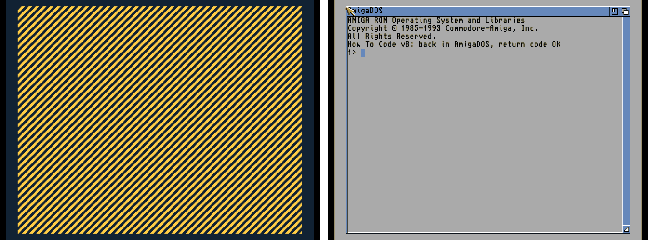

# 3. General guidelines

The rules in this chapter are the ones that decide whether a demo runs on someone else's Amiga. Almost none of them costs an effect any speed. Most came from v7, which got them from Commodore's manuals and from a pile of demos that refused to run on the editor's A3000. Where v7 was wrong, or 1993 has gone, this chapter says so.

The short version: **read the manuals; allocate everything; never assume.**

## Read the manuals

v7 said: read the Commodore manuals, all of them, borrow them from friends or the library if you have to. That's easier today: they're free, and online.

- The ***Amiga Hardware Reference Manual*** (3rd edition) describes every custom chip register, the copper, the blitter, the CIAs and the memory map. Its first chapter has a section, **General Development Guidelines**, that every demo coder should read once and follow to the letter. v7: "If it says 'Leave this bit cleared' then don't set it!"
- The ***ROM Kernel Reference Manuals*** (*Libraries*, *Devices*, and *Includes and Autodocs*) describe the system: exec, graphics, dos and the rest.
- The **NDK 3.2** (Native Developer Kit for AmigaOS 3.2, from Hyperion) has the assembler includes (`Include_I/`) and the Autodocs for every library, up to date. It's a free download from Aminet, and Limoniter fetches it for you when you ask. Each Autodoc says which version of the system added the function, as in "CacheClearU - User callable simple cache clearing (V37)".

[Further reading](18-further-reading.md) has the links. Everything in v8 is checked against these, and when a forum post, a tutorial or this guide disagrees with them, believe the manuals and test on the machine.

## Allocate everything; never use a fixed address

v7 put it strongly: "If you write demos that run from a fixed address you should be shot." The *Hardware Reference Manual* puts it more calmly: "All memory is dynamically allocated by the memory manager at boot time, and the actual locations of system structures may change from release-to-release, machine-to-machine, or boot-to-boot."

There is exactly **one** fixed address in the system: **`$00000004`**, which holds the address of exec.library. Everything else (other libraries, free memory, the system's own copper list) is found from there, by asking the system.

So:

- **No `ORG`**, and no loading anything to an address you chose. Assemble an ordinary AmigaDOS program, and AmigaDOS's loader puts it wherever there's room and fixes up every address in it as it loads. Your code doesn't need to be PC-relative for that: `move.l #Screen,d0` works wherever the program lands, because the loader fixes the address inside the instruction. (Limoniter marks any line it can't make relocatable, such as a word holding an address.)
- **Memory you need, you allocate**: as a section of the program, or with `AllocMem`. Then give it back.
- **Never assume memory is there** because it was there on your machine.

### Sections

Put the program in several sections, each kept in the kind of memory it needs:

```asm
        section code,code               ; code: any memory (fast RAM if there is any)
        ...
        section data,data               ; the processor's data: any memory
        ...
        section copper,data_c           ; anything the chips read: chip RAM
Copper: dc.w    ...
        ...
        section screen,bss_c            ; screens, cleared, in chip RAM, taking no room in the file
Screen: ds.b    40*256
```

v7's advice still holds: several small sections fit into fragmented memory more easily than one big one. Keep code that calls itself a lot in one section, though, as calls between sections need `jsr` with a full address rather than `bsr` (v8's examples call the startup with `jsr` for that reason).

**Never use `code_f`, `data_f` or `bss_f`.** They ask for fast RAM, and an Amiga with none (a plain 512K A500, an unexpanded A1200) can't load the program at all. Tried on an emulated 512K A500, a three-instruction program in a `code_f` section gets "Unable to load demo: Error code 103" from Kickstart 1.3, and "not enough memory available" from 3.1. Ask for no particular memory, and you get fast RAM if there is any. The *Hardware Reference Manual* says the same about `AllocMem`: "do not explicitly ask for Fast memory. Instead ask for memory type MEMF_PUBLIC or 0L as appropriate. If Fast memory is available, you will get it."

### Chip RAM for the chips

All data for the custom chips must be in chip RAM: bitplanes, copper lists, sprites, samples, and anything the blitter reads or writes. Get this wrong and it often *seems* to work, because a plain A500 has nothing but chip RAM, so everything lands there anyway. Then it fails on the first machine with any other memory, because the system gives that memory out first. The *Hardware Reference Manual* warns about exactly this: "a program can run correctly on an unexpanded Amiga which has only Chip memory while crashing on an Amiga which has expanded memory."

The mistake looks like this:

```asm
        section data,data               ; wrong: any memory
Copper: dc.w    COLOR00,$0000           ; the copper can't read this outside chip RAM
```

and the fix is one letter: `section data,data_c`. Test on a machine with fast RAM, or with an A500's trapdoor slow RAM, and you'll catch it at once.

### Slow RAM: v7 was wrong

v7 said: "$C00000 memory does not exist on any production machines now, so stop using it!!!". That's wrong. The Amiga 500's trapdoor expansion (Commodore's A501 and its many copies) puts 512K exactly there, at `$C00000`, and it's one of the most common Amiga expansions there is. The *Hardware Reference Manual*'s memory map lists `$C00000`-`$D7FFFF` as "Internal expansion (slow) memory (on some systems)".

It's called *slow* RAM because it's on the chip bus: the processor waits for the chips there just as it does in chip RAM. But the chips can't read it. And the system counts it as **fast** RAM. v8 checked this on an emulated A500 with Kickstart 1.3 and 3.1: with the trapdoor's 512K fitted, `AllocMem` with `MEMF_FAST` succeeds and gives memory at `$C00000`, `MEMF_ANY` memory comes from there before chip RAM, and the `code_f` program above loads. Without it, `MEMF_FAST` fails. Two consequences:

- A copper list in a plain `data` section works on a 512K A500 and fails on the very common 1MB one, where memory of no particular kind is slow RAM first.
- A `code_f` program loads on a 1MB A500 and not on a 512K one. And "fast" RAM may be no faster than chip RAM.

[Loading and memory](15-loading-and-memory.md) has more.

v7's real point stands, and it's the rule for all memory: **don't use `$C00000`, or any other address, because you expect memory there. Allocate it.** Then it doesn't matter whether there's slow RAM, fast RAM, or neither.

### Memory on a boundary

Sometimes memory has to start on a particular boundary: a table indexed by the low byte of an address, a screen that mustn't cross a 64K boundary (so only the low word of its bitplane pointers changes as it scrolls), or bitplanes for AGA's widest fetch mode, which [the AGA chapter](09-aga.md) covers. `AllocMem`'s blocks always start on a multiple of 8 (`MEM_BLOCKSIZE` in the NDK's `exec/memory.i`), and nothing coarser is promised. v7 found 64K boundaries by trying `AllocAbs` at each one in turn. It's simpler to allocate a little more than you need and start at the first boundary inside it:

```asm
ALIGN           equ     65536           ; a power of two: here, a 64K boundary

        move.l  ExecBase.w,a6
        move.l  #SIZE+ALIGN-1,d0        ; ALIGN-1 bytes spare: the boundary is always inside
        move.l  #MEMF_CHIP!MEMF_CLEAR,d1
        jsr     _LVOAllocMem(a6)
        move.l  d0,ScreenBlock          ; keep the block's own address: FreeMem needs it
        beq     NoMemory                ; it can fail: always check
        add.l   #ALIGN-1,d0             ; up to the next multiple of ALIGN
        and.l   #-ALIGN,d0
        move.l  d0,Screen
        ...
        move.l  ScreenBlock,a1          ; as the demo ends: the same address and size
        move.l  #SIZE+ALIGN-1,d0
        jsr     _LVOFreeMem(a6)
```

For a 64K boundary that wastes up to 64K, which a 512K machine may not have to spare. Then a screen that only must not *cross* a boundary is cheaper: allocate it, and if it crosses one, allocate again.

## Addresses are 32 bits

"Oh look," says the clever programmer in v7, "if I access `$DCDFF180` I can access the colour 0 hardware register, but it confuses people hacking my code!"

On a 68000 that works: it has only 24 address lines, so the top byte of an address is ignored, and `$DCDFF180` is `$DFF180`. The 68010 and the A1200's 68EC020 are the same. But a 68020, 68030, 68040 or 68060 with all 32 address lines (any A3000 or A4000, and almost every accelerator) goes to `$DCDFF180`, where there's nothing, or someone else's memory.

So, as the *Hardware Reference Manual* says:

- **Treat every address as 32 bits.** Write `$00DFF180`, or let the assembler, and never put anything in the top byte of a pointer: not flags, not your IQ (v7), not scroll text.
- **Don't use signed arithmetic or comparisons on addresses.** Addresses are unsigned. Use `blo`/`bhi`/`bls`/`bhs` to compare them, not `blt`/`bgt`:

```asm
.copy:
        move.l  (a0)+,(a1)+
        cmp.l   a2,a0                   ; a2: the end
        blo.s   .copy                   ; unsigned: right wherever the memory is
```

v7 also warned against relying on chip RAM appearing more than once: on some machines with only 512K of chip RAM, the same memory shows again at `$080000`, `$100000` and `$180000`. v7 said this "does not work on ECS and upwards". The truth is it depends on how much chip RAM the machine has and which chips it has: on a machine with 1 or 2 MB of chip RAM, `$080000` is real memory, and something else may be using it. Which is the rule again: never use an address you didn't allocate.

## No self-modifying code

Self-modifying code is code that writes over its own instructions: say, storing a value into the immediate of an instruction in an inner loop, to save a register:

```asm
        move.w  d0,.add+2               ; patch the instruction below: don't
        ...
.add:   add.w   #0,d1                   ; the 0 is replaced as the program runs
```

On a 68000 this works (unless the patched instruction is the very next one, which the processor has already fetched: the *Hardware Reference Manual* warns that every 680x0 prefetches). On anything later, it fails, sooner or later:

- The **68020** and **68030** have an instruction cache (256 bytes), and the 68030 a data cache too. The instruction cache doesn't see writes, so the processor can carry on running the *old* instruction from it.
- The **68040** has 4K caches, and the **68060** 8K, and both can run their data caches in **copyback** mode: what the processor writes may sit in the data cache for a while before it reaches memory. Write some code and jump to it, and the instruction fetch may read memory that hasn't been written yet. v7 quoted the author of the Imploder cruncher, who had just found this out.

The bigger the cache, the more likely it is to bite, "even when you think you will be safe" (v7). Encrypted or "protected" code that decrypts itself is self-modifying code too. v7's view of protection still stands: what's the point?

### Code written at run time, done properly

There's a respectable cousin of self-modifying code: writing a routine once, as the demo starts, and then running it. Unrolled loops, "compiled" sprites and generated chunky-to-planar routines are made this way, because the generated code would be far bigger in the file than the loop that writes it. That's fine, as long as the caches are cleared **after writing the code and before running it**:

- On **Kickstart 2.04 (V37) and later**, call exec's `CacheClearU()`. It clears every cache on every processor (pushing a copyback data cache out to memory first), including caches an accelerator adds that you've never heard of.
- **Kickstart 1.x** has no `CacheClearU`. A 68000 or 68010 has no cache to clear. On a 68020 or 68030, set the "clear instruction cache" bit in the processor's `CACR` register, in supervisor mode, as the *Hardware Reference Manual* shows. Kickstart 1.x was never made for the 68040 or 68060: it doesn't know them, and `AttnFlags` won't say they're there. (FS-UAE will boot 1.3 on an emulated 68040, and v8's examples ran there, but that says nothing about real accelerators.) (v7 was blunter about anyone who runs one under 1.3.)

```asm
; Clears the processor's caches after code has been written to memory, on any Amiga.
ClearCaches:
        move.l  a6,-(sp)
        move.l  ExecBase.w,a6
        cmp.w   #37,LIB_VERSION(a6)     ; Kickstart 2.04 or later?
        blo.s   .kick1
        jsr     _LVOCacheClearU(a6)
        bra.s   .done
.kick1:
        btst    #AFB_68020,AttnFlags+1(a6)
        beq.s   .done                   ; 68000 or 68010: no cache
        move.l  a5,-(sp)
        lea     ClearInstructionCache(pc),a5
        jsr     _LVOSupervisor(a6)      ; run it in supervisor mode
        move.l  (sp)+,a5
.done:
        move.l  (sp)+,a6
        rts

ClearInstructionCache:
        dc.l    $4e7a0002               ; movec cacr,d0
        or.w    #$0008,d0               ; CACRF_ClearI
        dc.l    $4e7b0002               ; movec d0,cacr
        rte
```

`CacheClearU` works with the machine taken over, too: it's an ordinary exec call that needs neither multitasking nor interrupts. `examples/ch03_generated_code.s` writes its drawing routine (about 5.5K of unrolled `MOVE.L`s) from a loop of a few dozen bytes, clears the caches, and runs it every frame. It was run both ways on an A500 with Kickstart 1.3 and 3.1 (with the trapdoor's slow RAM and without), on Kickstart 1.3 with a 68020, and on Kickstart 3.1 with a 68020, 68040 and 68060.



You don't need to clear anything after the system loads your program: `LoadSeg` does it. Nor for the chips' work in chip RAM: the system sets chip RAM so the data cache never holds it, so what the blitter writes is what the processor reads (the `CacheClearE` Autodoc says so). But a cruncher's decruncher, which writes the program it unpacks, must clear the caches before jumping to it: a reason to use one that's known to (see [releasing](17-releasing.md)).

## Open libraries properly

[Startup and exit](04-startup-and-exit.md) shows v8's startup doing this, and why. In short:

```asm
        move.l  ExecBase.w,a6
        lea     GraphicsName(pc),a1
        moveq   #33,d0                  ; the oldest version this program works with
        jsr     _LVOOpenLibrary(a6)
        move.l  d0,GfxBase
        beq     NoGraphics              ; check the result, in d0 and nothing else
        ...
        move.l  GfxBase,a1              ; and close it as the program ends
        jsr     _LVOCloseLibrary(a6)
        ...
GraphicsName:   dc.b    "graphics.library",0
```

- **Never walk exec's list of libraries** to find one. v7 printed a contributor's code that took the second library down the list from ExecBase and called it graphics.library; it isn't, always. The NDK's `exec/execbase.i` marks the system's lists "(private!)". `OpenLibrary` finds the library for you.
- **Never use `OldOpenLibrary`.** Its Autodoc calls it "obsolete", kept for programs compiled on Kickstart 1.0, and it's "exactly the same as `OpenLibrary(libName,0L)`". It saves nothing.
- **Give the version you need.** The version is your promise about which functions you'll call. Every function in a library is reached through a table just before the library's base; call one newer than the library you've got, and you jump to whatever is in memory before that table. `CacheClearU` on Kickstart 1.3 is a crash, not an error. So ask for the version that has everything you use, or check `LIB_VERSION` before calling, as `ClearCaches` above does.

| Version | Kickstart |
|---|---|
| 33 | 1.2 |
| 34 | 1.3 |
| 36 | 2.0 (the first A3000s) |
| 37 | 2.04 and 2.05 |
| 39 | 3.0 |
| 40 | 3.1 |
| 46 | 3.1.4 (Hyperion, 2018) |
| 47 | 3.2 (Hyperion, 2021) |

Asking for 33 means "any Kickstart from 1.2 on", which is what v8's startup asks for: it covers the A500's 1.3.

## Never assume the state of anything

"Unlike inferior machines, almost everything on the Amiga can and will change" (v7). Chips change, the system changes, the processor changes. Something set to one value on your machine may be set to another on the next one. The *Hardware Reference Manual*: "Never assume that a hardware register will be initialized to any particular value. Different versions of the OS may leave registers set to different values."

So **set every register your code depends on**, every time:

- **The display.** Set every display register in your copper list, each frame: the display window and data fetch (`DIWSTRT`, `DIWSTOP`, `DDFSTRT`, `DDFSTOP`), the bitplane controls (`BPLCON0` to `BPLCON2`), both modulos, every colour you use, every sprite pointer. v7 found that Kickstart 3.0 (V39) leaves the bitplane modulos non-zero, and demos that never set them broke. v8's examples also set `FMODE` and `BPLCON3`, which matter on ECS and AGA (and which OCS ignores): an AGA machine's Workbench may have left a wider fetch mode on.
- **DMA.** v8 found one while testing its own startup: on Kickstart 3, `LoadView(0)` switches bitplane DMA off; Kickstart 1.3 leaves it on. A demo written on 1.3 that never switched bitplane DMA on itself would show a blank screen on any Kickstart 3 machine. Switch on what you use.
- **The CIAs.** "Even if you are taking over the machine, do not assume the initial contents of any of the CIA registers or the state of any enabled interrupts" (*Hardware Reference Manual*). Set the timers and control registers you use.
- **The processor's registers.** Your routines are called with whatever the last one left. A classic:

```asm
        move.w  Angle,d0
        add.w   d0,d0
        move.w  (a0,d0.l),d1            ; wrong: d0's upper word is whatever was there
```

Index with `d0.w`, or clear the register first with `moveq #0,d0`. It works on your machine because something happened to leave zero there; it won't on the next.

**Check for features, not for machines.** v7 told coders using AGA registers to check for AGA, and only AGA, because the next chipset (AAA, which never came) wouldn't be compatible. The rule outlived the chipset: find out what's there before you use it. The processor is in exec's `AttnFlags`; the chipset in graphics.library's `gb_ChipRevBits0` (with its AGA bits from V39; but on Kickstart 3.1 they only show AGA once SetPatch has run, so a demo started from the boot disk before SetPatch should read the chip's own ID, `DENISEID`, instead). [The AGA chapter](09-aga.md) shows the test.

## No delay loops

```asm
        move.w  #5000,d0                ; wait a bit: don't
.wait:  dbf     d0,.wait
```

How long that takes depends on the processor, its clock, its caches, and whether the code is in chip or fast RAM. On a 68060 it's over in a fraction of the time, and in an emulator with a just-in-time compiler it takes almost none. The *Hardware Reference Manual*: "Never use software delay loops!" For demos, there are always better clocks:

- **the beam**: wait for a line with `VPOSR`/`VHPOSR` (a line takes about 64 microseconds, PAL or NTSC; [input](11-input.md) times the keyboard's handshake this way);
- **the CIA timers**, which count at about 0.7 MHz on every Amiga, whatever its processor;
- **the blitter's busy bit**, not a guess at how long a blit takes;
- **the frame**: the vertical blank interrupt.

## Take the hardware properly

Using the hardware directly is what demos are for, but take it properly, and give it all back: own the blitter (`OwnBlitter`), stop multitasking or rise above it, save the chips' settings and restore them, find the vectors through the VBR. [Startup and exit](04-startup-and-exit.md) does all of this, both ways, and every v8 example is built on it.

With the system left running, share what the system uses: the blitter, and the CIAs, which the *Hardware Reference Manual* says to ask for through `cia.resource` rather than writing their interrupt registers directly.

v7 had a section for authors of utilities, which drew their own copper lists for no reason: "If you want to write good utilities, learn C." The point survives in kinder words: a tool, a picture viewer or a music disk menu that doesn't need the hardware's tricks should open a screen through Intuition and multitask like any other program.

And Chris Green, of Commodore US, asked v7 to say this early: "it IS possible to do quite exciting demos without poking any hardware registers, and that this can be as interesting as direct hardware access." That's still true. v8 is mostly about the hardware, because that's what most demos want. But it's a choice, not a rule.

## The processor isn't fixed either

A few 68000 habits break on later processors. [The 68000 and later processors](14-processors.md) has the details; the *Hardware Reference Manual*'s list is:

- Don't use `MOVE SR,<ea>`: it's privileged from the 68010 on. Use exec's `GetCC()`.
- Don't use `CLR` on a hardware register that something happens when you write: the 68000's `CLR` reads before it writes, so the register is touched twice. Use `move.w #0,...`.
- Never use `TAS`: the chips' DMA can break its read-modify-write.
- The stack frame an exception leaves differs on each processor, and the vectors may not be at address 0 (the VBR again).

## System private structures

From v7, thanks to Arno Hollosi: if anywhere in the manuals, includes or Autodocs something is marked PRIVATE, RESERVED or INTERNAL (or anything like it), then

- don't read it,
- never write to it,
- if it's a function, don't call it,
- don't check it for anything.

Private parts of the system can change without notice, and have. The *Hardware Reference Manual* adds: "Do not modify or depend on the format of private system structures. This includes the poking of copper lists, memory lists, and library bases."

And where the system has a function that changes something (`SetAPen` for the pen in a RastPort, say), use it, even if poking the structure would do the same today.

The fields v8's startup reads (exec's `AttnFlags` and `VBlankFrequency`, graphics.library's `gb_ActiView` and `gb_copinit`, a library's `LIB_VERSION`) are documented in the NDK's includes, and the first two are marked "(readable)" there.

## Put a version string in

Put a version string in every program, and in its source:

```asm
; $VER: mydemo.s 1.0 (20.11.2026)
        ...
        dc.b    "$VER: mydemo 1.0 (20.11.2026)",0
        even
```

That's `$VER:`, the name, the version and revision, and the date as day.month.year, in brackets: the way the NDK's own files write theirs. AmigaOS's `Version` command finds it in the file (`Version mydemo`), as do many directory tools. v7 liked it for the demo compilations that renamed everything `1`, `2`, `3`: `Version 1` gives the real name.

A crunched program hides its version string along with everything else. [Releasing](17-releasing.md) has more.

## Crunching

v7 advised against the crunchers of its day (Tetrapack, Bytekiller) and for others (PowerPacker, Imploder, Titanics Cruncher). They've all been overtaken. Today's demos are crunched with **Shrinkler**, by Aske Simon Christensen (Blueberry), which packs much smaller than 1993's crunchers did, or **Cranker**, by Timm S. Müller (The Electronic Knights), which decrunches as the program loads and needs no extra memory to do it. Limoniter runs both. [Releasing](17-releasing.md) covers how to choose, and how to test the crunched program, which is a different program from the one you tested.

## What changed from v7

- **Slow RAM** at `$C00000` is real and common, and the system calls it fast RAM. v7 said it didn't exist. The rule is still "allocate, never assume".
- **Aligned memory** by allocating a little extra, rather than `AllocAbs` at every 64K boundary.
- **Caches**: `CacheClearU` on Kickstart 2.04 and later, and the `CACR` on a 68020 or 68030 under 1.3, with a tested example.
- **Never assume**, with a new case: Kickstart 3's `LoadView(0)` switches bitplane DMA off.
- **No delay loops** and **the processor's own rules**, from the *Hardware Reference Manual*.
- **Version strings** with four-digit years, as the NDK writes them.
- **Crunchers**: Shrinkler and Cranker, in [releasing](17-releasing.md), in place of 1993's.
- **Left out**: the list of 1993's manuals and where to buy them (now [further reading](18-further-reading.md)), and the advice for utility authors.
