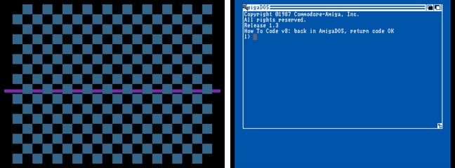

# 4. Startup and exit

How To Code began as an angry protest: new demos that refused to run on anything but the machine they were written on. Most of the time the effect itself was fine. What failed was the few dozen lines at the start and end: the part that takes the Amiga from its operating system and gives it back. Get those right once, and every demo you build on them starts from solid ground.

v8's startup is in `examples/startup.i`. This chapter explains every part of it, and why each part is there. `examples/startup_demo.s` is the smallest whole demo built on it.



## Two ways to take the machine

There are two ways for a demo to get the hardware to itself, and both are right, for different demos.

**Taking the machine.** Multitasking stops, every interrupt and every kind of DMA is switched off, and the demo installs its own. Nothing else runs, nothing takes cycles, and the timing is the demo's alone. This is how almost every demo works today. The cost: while the demo runs, the system can't do anything for it. In particular it can't load a file.

**Keeping the system running.** The demo shows its own display, but multitasking carries on underneath. The demo's frame comes from an interrupt server on the system's own chain, its input goes through an input handler, and it shares the blitter. Whenever the demo waits for the next frame, the system's tasks run: so `dos.library` can load the next part from a floppy, a hard drive or a CD while the effect keeps going. This is the way How To Code v7 recommended, and it's still the way for a demo that loads as it goes.

The startup does both, chosen by one setting at the top of the demo:

```asm
OS_FRIENDLY     equ     0               ; 0: take the machine; 1: keep the system running
```

The rest of the demo doesn't change. A demo can be built both ways and tried both ways, and the v8 examples are.

## What your demo writes

The startup calls four things that belong to the demo:

| | What it is | When |
|---|---|---|
| `Init` | a routine | once, before the display starts: build the screen, fill in the copper list |
| `Frame` | a routine | once a frame, from the main loop, with the display running |
| `VBlank` | a routine | at the start of every frame, from the interrupt: keep it short (a music replay, a counter) |
| `Copper` | the copper list | in a chip RAM section |

Each is called with `a5` pointing at the custom chips (`$DFF000`), and may change any register. The demo ends when the left mouse button is pressed, or when the demo sets `ExitNow` to non-zero.

A demo that installs something of its own in `Init` (another interrupt, say) gives the startup a routine that takes it away again:

```asm
        move.l  #MyExit,ExitHook
```

The startup calls it first as the demo ends, while everything is still running.

The startup also gives the demo a few things: `Frames` (how many frames have been shown), `PalDisplay` (not zero on PAL), `GfxBase`, and `VectorBase` (where the exception vectors are). With the system running there are also `ButtonPressed` and `LastKey`, from the input handler.

## Step by step

### Started from an icon

A program started from Workbench is sent a message, and must take it before anything else and give it back as it ends. From the CLI there's none. v7 pointed this out (a demo given an icon would crash, or lose its memory), and the fix is a few lines:

```asm
        sub.l   a1,a1
        jsr     _LVOFindTask(a6)        ; our own task
        move.l  d0,a4
        tst.l   pr_CLI(a4)              ; started from the CLI?
        bne.s   .fromcli
        lea     pr_MsgPort(a4),a0
        jsr     _LVOWaitPort(a6)
        lea     pr_MsgPort(a4),a0
        jsr     _LVOGetMsg(a6)          ; Workbench's message: kept until the end
        move.l  d0,WorkbenchMessage
.fromcli:
```

At the end the message goes back with multitasking off (`Forbid`), so Workbench can't unload the program before it has finished returning. That is the one place a program ends while forbidden, and it's how the system's own startup code does it.

### The libraries

Open each library with a version, and check that it opened:

```asm
        lea     GraphicsName(pc),a1
        moveq   #33,d0                  ; version 33: Kickstart 1.2 or later
        jsr     _LVOOpenLibrary(a6)
        move.l  d0,GfxBase
        beq     StartNoGraphics         ; it can fail: say goodbye politely
```

Never walk ExecBase's list of libraries to find one, and never use `OldOpenLibrary` (it's only `OpenLibrary` with version 0, and saves nothing). v7 said both, and they're still true.

### PAL or NTSC

From Kickstart 2 on, `graphics.library` knows: the `PAL` bit in `gb_DisplayFlags`. On Kickstart 1.x the best there is the vertical blank rate exec was started with, `VBlankFrequency` (50 or 60). The startup works it out and leaves it in `PalDisplay`, so the demo can, say, show fewer lines on an NTSC machine.

### Where the vectors are: the VBR

This one is missing from v7, and it broke many demos. On a 68000 the processor's exception vectors are at address 0, always, so the level 3 interrupt's address goes at `$6C`. A 68010 or anything later has a **vector base register** (VBR), and the vectors are wherever it points. Tools such as VBRControl, and the software of some accelerator boards, move them into fast RAM, where the processor reads them faster, and many accelerated Amigas run with them moved. A demo that writes `$6C` on such a machine changes nothing the processor looks at, and its interrupt never runs.

The VBR can only be read in supervisor mode, so the startup asks exec to run a two-instruction routine there:

```asm
        moveq   #0,d0                   ; on a 68000, the vectors are at 0
        btst    #AFB_68010,AttnFlags+1(a6)
        beq.s   .novbr
        lea     ReadVBR(pc),a5
        jsr     _LVOSupervisor(a6)      ; runs ReadVBR in supervisor mode
.novbr:
        move.l  d0,VectorBase
        ...
ReadVBR:
        dc.l    $4e7a0801               ; movec vbr,d0
        rte
```

`MOVEC VBR,D0` is written as its two words, so any assembler set for the 68000 accepts it. It's only ever run on a 68010 or later.

### An empty display

```asm
        move.l  gb_ActiView(a6),OldView ; the view on show, to put back
        sub.l   a1,a1
        jsr     _LVOLoadView(a6)        ; show nothing
        jsr     _LVOWaitTOF(a6)
        jsr     _LVOWaitTOF(a6)
```

`LoadView(0)` puts the display back to plain settings. Whatever Workbench was showing (an AGA mode, interlace, a strange screen promoted to something else), the chips are back to an ordinary display. Two `WaitTOF`s let both fields of an interlaced view finish.

One thing found while testing v8: on Kickstart 3, `LoadView(0)` also switches the bitplanes' DMA off, while Kickstart 1.3 leaves it on. A demo written on a 1.3 machine that keeps the system running, and never switches the bitplanes on itself, shows nothing on a 3.1 machine. Never count on DMA, or any register, being left as your own machine leaves it.

### Taking the machine

With `OS_FRIENDLY` at 0:

```asm
        jsr     _LVOOwnBlitter(a6)      ; the blitter is ours
        jsr     _LVOWaitBlit(a6)        ; once anything the system started has finished
        move.l  ExecBase.w,a6
        jsr     _LVOForbid(a6)          ; no other task runs

        move.w  DMACONR(a5),d0          ; note the chips' settings
        or.w    #DMAF_SETCLR,d0
        move.w  d0,OldDMACON
        ...                             ; the same for INTENA and ADKCON

        bsr     WaitVerticalBlank
        move.w  #$7fff,INTENA(a5)       ; every interrupt off,
        move.w  #$7fff,INTREQ(a5)       ; every request cleared,
        move.w  #$7fff,INTREQ(a5)
        move.w  #$7fff,DMACON(a5)       ; every kind of DMA off
```

Reading `DMACONR` gives the bits that are on. With bit 15 (`SETCLR`) set, writing the same value back switches those bits on again, which is how they're restored at the end. Everything is switched off in the vertical blank: v7 warned that stopping sprite DMA in the middle of a frame can leave a sprite's last line smeared down the screen as a vertical stripe.

Then the startup installs its level 3 interrupt at `VectorBase+$6C`, switches the blitter on, calls `Init`, and starts the display at the next frame:

```asm
        move.l  #Copper,COP1LC(a5)
        move.w  d0,COPJMP1(a5)          ; writing anything here starts the copper list
        move.w  #DMAF_SETCLR!DMAF_MASTER!DMAF_RASTER!DMAF_COPPER!DMAF_BLITTER,DMACON(a5)
        move.w  #INTF_SETCLR!INTF_INTEN!INTF_VERTB,INTENA(a5)
```

Sprite DMA stays off: a demo that wants sprites switches it on in `Init`. The interrupt counts the frame, calls `VBlank`, and acknowledges the request **twice**:

```asm
        move.w  #INTF_COPER!INTF_VERTB!INTF_BLIT,INTREQ(a5)
        move.w  #INTF_COPER!INTF_VERTB!INTF_BLIT,INTREQ(a5)
        movem.l (sp)+,d0-d7/a0-a6
        rte
```

On a fast processor, the first write may still be on its way to the chips when the `RTE` runs. The request is then still set, and the interrupt comes straight back. The second write makes sure. It costs nothing on a 68000.

### Keeping the system running

With `OS_FRIENDLY` at 1, nothing is switched off. Instead:

- The task's **priority** goes up to 30 (`TASK_PRIORITY`), rather than multitasking being stopped with `Forbid`. That's above input.device (20) and the tasks that run the disks, so the demo isn't held up, but they all run whenever the demo waits for the next frame. v7 suggested 127; anything above the system's own tasks does the job, and a lower number leaves room above the demo.
- A **signal** is set aside, and a **vertical blank interrupt server** is added to the system's chain with `AddIntServer`. Each frame it counts the frame, calls `VBlank`, and signals the main loop. The main loop sleeps in `Wait()` until then, and while it sleeps, the system works.
- An **input handler** at priority 100 sees every input event before Intuition (priority 50) does. Mouse and keyboard events are noted (`ButtonPressed`, `LastKey`) and then turned into nothing (`IECLASS_NULL`). So clicks don't fall through to Workbench, which v7 warned about: a click on the demo shouldn't drag Workbench's windows about underneath it. Other events, such as a disk being put in, carry on.
- The **DMA** the demo needs (bitplanes, copper, blitter) is switched on, because of the Kickstart 3 behaviour above. The startup notes how those bits were, and puts them back as it ends.
- The **blitter is shared.** The system uses it too: Kickstart 1.x even decodes floppy disk tracks with it. So the demo owns it only around its own blitting. That's what the two macros are for:

```asm
        BLIT_BEGIN                      ; OwnBlitter (with the system running), then wait
        move.l  #Screen,BLTDPTH(a5)
        ...
        move.w  #(HEIGHT<<6)!(ROWBYTES/2),BLTSIZE(a5)
        BLIT_END                        ; wait for it to finish, then DisownBlitter
```

### The blitter and the processor: a lesson from testing

`BLIT_END` always waits for the blitter to finish, in both ways. The first version of v8's startup didn't wait when it had taken the machine. `startup_demo.s` clears its screen with the blitter, then draws a chequerboard with the processor. On a 68000 the blitter finishes long before the processor gets far, and all was well. On an emulated 68040 the screen stayed black: the processor drew the chequerboard while the blitter was still clearing, and the clear wiped it out.

Never touch, with the processor, anything the blitter is still writing. On a 68000 you'll usually get away with it, so this is the bug that hides until someone runs your demo on an accelerated machine. [The blitter](07-blitter.md) has more.

### The main loop

```asm
MainLoop:
        jsr     WaitFrame               ; until the next frame starts
        lea     CUSTOM,a5
        jsr     Frame                   ; the demo's work for this frame
        tst.b   ExitNow
        bne.s   .out
        bsr     MouseClicked
        beq.s   MainLoop
```

Taking the machine, `WaitFrame` waits for the interrupt's frame counter to change. With the system running, it `Wait()`s for the server's signal. Either way the demo's `Frame` runs once a frame, at its start. A frame that takes too long simply misses the next one.

### Giving it all back

The order matters. In this order:

1. **The demo's own things**: `ExitHook`, while everything it set up is still running.
2. **The sound stops**, taking the machine: audio DMA off, and every channel's volume to 0. With the system running, the sound is the demo's own business, as other programs may be playing: unless it asked the startup to allocate its channels (`AUDIO_CHANNELS`, below), when those are silenced and given back to audio.device.
3. **The blitter finishes** whatever it's doing.
4. **Interrupts and DMA off**, in the vertical blank (taking the machine), and the old level 3 vector back. With the system running: the server off the chain, and the input handler removed.
5. **The system's copper list** (`gb_copinit`) back in `COP1LC`, then the chips' old settings: `ADKCON`, `DMACON`, and last `INTENA`, so no interrupt arrives before everything is in place.
6. **`Permit()`** and **`DisownBlitter()`**.
7. **The audio filter** as it was found (bit 1 of CIA-A's port A, which some replayers change and don't put back), and on an AGA machine **`BPLCON4`** to `$0011`, which the system never sets itself (see [AGA](09-aga.md)).
8. **The old view** with `LoadView`, two `WaitTOF`s, and `RethinkDisplay()`, so Intuition rebuilds its screens' copper lists properly.
9. **The libraries closed**, Workbench's message returned, and **the return code in `d0`**: 0, all went well.

That last one is from v7 too. The value in `d0` as a program ends is its return code. Leave rubbish there, and a script that runs the demo stops with "Program failed return code 184641234". Zero means all went well; the startup only gives 5, a warning a script carries on after, when a demo that needs AGA finds it isn't there.

### More settings

Two more settings, given before the include like the others, cover what some demos need:

- **`NEEDS_AGA`** (1): the demo needs the AGA chips. The startup checks before taking anything, by asking the chip (`DENISEID`, as [AGA](09-aga.md) explains, so it's right before SetPatch has run), and on a machine without them says so in the CLI and ends. A demo that only *uses* AGA when it's there reads `AgaChips`, which the startup sets either way.
- **`AUDIO_CHANNELS`** (a mask, `%1111` for all four): with the system running, the startup allocates these channels from audio.device at the highest precedence as the demo starts, so no other program's sound cuts in, and silences them and gives them back as it ends. [Sound and music](12-sound-and-music.md) shows how to do it yourself.

## How it was tested

Every v8 example is built both ways and run in FS-UAE:

- an Amiga 500 with Kickstart 1.3, and with Kickstart 3.1;
- a 68020, a 68040 and a 68060, with fast RAM.

Each test build ends itself after 500 frames (`AUTOEXIT=500`, given on the command line). The emulated machine's startup-sequence then runs a small program that prints "back in AmigaDOS". So each run shows two things in its screen captures: the effect while it runs, and a working CLI after it.

```text
limoniter --assemble startup_demo.s demo OS_FRIENDLY=0 AUTOEXIT=500
limoniter --assemble startup_demo.s demo OS_FRIENDLY=1 AUTOEXIT=500
```

Testing the startup this way found the two faults described above, both before anyone else could:

- the bitplanes left off by Kickstart 3's `LoadView(0)` with the system running;
- the 68040 overtaking the blitter.

## What changed from v7

- **One startup, both ways.** v7's startup kept the system running. v8's does that or takes the machine, chosen by one setting, with the same demo code on top.
- **The VBR** is found and used. v7 didn't mention it.
- **Frames come from an interrupt** (or a server with a signal), not from polling the beam.
- **The DMA is never assumed** to be as Workbench leaves it.
- **The blitter is waited for** before the processor uses its work.
- **The input handler** that v7 promised "next time" is here.
- **v7's fix for the V39 sprite resolution bug is left to the [AGA chapter](09-aga.md).** On AGA machines, Kickstart 3.0's `LoadView(0)` didn't reset the sprites' resolution, and v7's startup set it back through `VideoControl`. The v8 startup leaves sprites off, so only a demo that uses them on AGA needs it.
