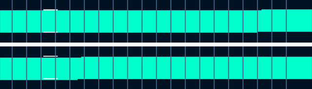
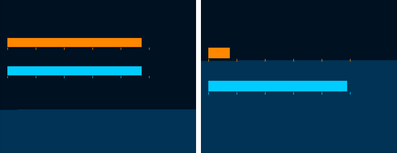

# 5. Interrupts

An interrupt is the hardware tapping the processor on the shoulder: stop what you're doing, deal with this, then carry on. A demo uses them to know when a frame starts, to do something when the beam reaches a line, to play music at a steady rate, and to hear that the blitter has finished. This chapter covers how the Amiga's interrupts work, the four kinds a demo uses most, and how to install each one both ways: with the machine taken, and with the system still running.

There are two whole examples, each built both ways like every v8 example:

- `examples/ch05_copper_interrupt.s`: the copper raises an interrupt twice a frame, and the processor changes the background colour there. The copper marks the moment it asks with a white dash, so you can see how long the processor takes to answer.
- `examples/ch05_cia_timer.s`: a CIA timer interrupt at 50 Hz, worked out from the machine's clock so it's 50 Hz on PAL and NTSC alike.

## Levels

The 68000 has three interrupt input lines, which together give a **level** from 1 to 7 (0 is no interrupt). The Amiga's interrupts (all but the NMI) go through one chip, **Paula** (which also does the sound, the disk and the serial port). Paula collects fourteen sources, and presents the highest-level one that's both asking and enabled on those three lines. Agnus's sources (the copper, the blitter and the vertical blank) come to Paula too, as do the two CIAs.

| Level | Bit | Name | Raised by | Vector |
|---|---|---|---|---|
| 1 | 0 | `TBE` | the serial port: transmit buffer empty | `$64` |
| | 1 | `DSKBLK` | the disk: a block has been read or written | |
| | 2 | `SOFTINT` | software (exec uses it for its software interrupts) | |
| 2 | 3 | `PORTS` | **CIA-A**, and the expansion bus's INT2 line | `$68` |
| 3 | 4 | `COPER` | **the copper**, by writing `INTREQ` | `$6C` |
| | 5 | `VERTB` | **the vertical blank**: the start of each frame | |
| | 6 | `BLIT` | **the blitter**, when it finishes | |
| 4 | 7-10 | `AUD0`-`AUD3` | the four sound channels | `$70` |
| 5 | 11 | `RBF` | the serial port: receive buffer full | `$74` |
| | 12 | `DSKSYNC` | the disk: the sync word found | |
| 6 | 13 | `EXTER` | **CIA-B**, and the expansion bus's INT6 line | `$78` |
| 7 | | `NMI` | nothing in the Amiga itself; the expansion bus can | `$7C` |

The processor's status register holds the level it's working at. An interrupt at a higher level than that is taken at once; one at the same level or lower waits. So while a level 3 handler runs, another level 3 interrupt waits until it returns, but a level 6 one (a CIA-B timer) comes straight in, in the middle of it. Level 7 can't be masked at all; the HRM says nothing in the Amiga generates it.

The levels and sources are from the *Hardware Reference Manual*, chapter 7 ("Interrupts"), and the vectors from the *ROM Kernel Manual: Libraries*, chapter 26 ("Exec Interrupts").

## INTENA and INTREQ

Two registers, each with the bits in the table above:

- **`INTENA`** (`$DFF09A`, read at `INTENAR`, `$DFF01C`): which interrupts are enabled.
- **`INTREQ`** (`$DFF09C`, read at `INTREQR`, `$DFF01E`): which are asking. A source sets its bit here whether it's enabled or not; it only reaches the processor if its `INTENA` bit is set too.

Bit 14 of `INTENA`, **`INTEN`**, is the master switch: with it clear, no interrupt reaches the processor at all (but the NMI). It's only a switch: the HRM says it "creates no interrupt request".

Both registers are written the same way as `DMACON`. Bit 15, **`SETCLR`**, says whether the other bits you write are to be set (1) or cleared (0); bits written as 0 aren't changed. So:

```asm
        move.w  #INTF_SETCLR!INTF_COPER,INTENA(a5)      ; the copper interrupt on; the rest as they were
        move.w  #INTF_COPER,INTENA(a5)                  ; and off again
        move.w  #INTF_COPER,INTREQ(a5)                  ; a copper interrupt acknowledged (its request cleared)
        move.w  #INTF_SETCLR!INTF_SOFTINT,INTREQ(a5)    ; a request made, from software
```

Writing a bit to `INTREQ` with `SETCLR` *makes* an interrupt request, just as if the hardware had. That's how the copper raises its interrupt, below.

Two common mistakes:

- **Forgetting `SETCLR`** when switching something on: `move.w #INTF_COPER,INTENA(a5)` switches the copper interrupt *off*.
- **Acknowledging everything**: `move.w #$7fff,INTREQ(a5)` at the end of a handler throws away any other request that came in while it ran (a blitter interrupt, say), and that interrupt never happens. Acknowledge the bits you handled, and no others.

## Vectors, and the VBR

When the 68000 takes an interrupt, it saves the status register and the program counter on the supervisor stack, raises its level to the interrupt's, and jumps to the address in that level's **autovector**: `$64` for level 1, up to `$7C` for level 7, as in the table. The handler ends with **`RTE`**, which puts the status register and program counter back.

On a 68010 or later, those addresses are offsets from the **vector base register** (VBR), not from 0. Many accelerated machines run with the VBR moved into fast RAM, and then writing to `$6C` does nothing. That's why the startup reads the VBR and leaves it in `VectorBase` ([Startup and exit](04-startup-and-exit.md) has the details): the level 3 vector is at `VectorBase+$6C`, the level 6 vector at `VectorBase+$78`.

The vectors belong to exec. With the system running, the RKM says never to change them: exec's own handler is behind each one, and it calls the code you give it through `AddIntServer` or `SetIntVector`. Taking the machine, you write the vectors yourself, because you've taken everything else too, and you put the old ones back as you leave.

A handler on a vector of its own must:

- **save every register it changes**, and put them back: the main loop was in the middle of something;
- **find out which source it is**, from `INTREQR`, as three sources share level 3 (and several share every other level);
- **acknowledge** the request (below);
- end with **`RTE`**, not `RTS`.

Code that exec calls for you (a server or a handler) is different: it's a subroutine, ending with `RTS`, with rules of its own about registers, below.

## Acknowledging, twice

A request stays set until it's cleared. If a handler returns without clearing its bit in `INTREQ`, the interrupt is still there, and the processor takes it again the moment the `RTE` has run: forever.

And clear it **twice**:

```asm
        move.w  #INTF_COPER,INTREQ(a0)
        move.w  #INTF_COPER,INTREQ(a0)
```

On a 68000, one write is enough: it's finished before the next instruction starts. A 68040 or 68060 can **buffer** a write and carry on before it has reached the chips, and the chips are on a slow bus. So the `RTE` can run while the write is still on its way, the request is still set as the processor looks at its interrupt lines, and the interrupt comes straight back. The second write can't start until the first has finished, and by the time it does, the request has gone. It costs a few cycles on a 68000.

This fault doesn't show in FS-UAE: v8 tried a copper interrupt with one write on emulated 68020, 68040 and 68060 machines, and it worked on each. It's real hardware's bus timing that causes it. Write it twice anyway; the startup does.

Acknowledge as soon as you know the interrupt is yours, rather than at the end. If the same source asks again while the handler is busy, that new request then stays set and is answered after the `RTE`, instead of being cleared with the old one and lost.

## The vertical blank

`VERTB` is raised at line 0, the start of each frame, 50 times a second on PAL and 60 on NTSC. The HRM says the vertical blanking takes at least 25 lines on PAL and 20 on NTSC; where the display actually starts is up to `DIWSTRT`.

It's the startup's own interrupt. Taking the machine, the startup's level 3 handler counts the frame (`Frames`) and calls your `VBlank`; keeping the system running, its server on exec's vertical blank chain does the same. Use `VBlank` for things that must happen once a frame however late the main loop is: a music replay, a frame counter, double-buffered pointers swapped for the next frame. Keep it short. Everything else belongs in `Frame`.

## The copper interrupt

The copper can write `INTREQ` like any other register, and setting bit 4 (`COPER`) raises a level 3 interrupt. So the copper can interrupt the processor at any position on the screen it can wait for:

```asm
        dc.w    $7051,$fffe                     ; wait for line $70, near its left edge
        dc.w    INTREQ,INTF_SETCLR!INTF_COPER   ; and ask for a copper interrupt
```

The HRM's suggestion for it: when the vertical blank is too short for all a frame's work, start the work with a copper interrupt just after the last line of the display, instead of waiting for line 0. A demo also uses it to do something on the processor that has to wait until the beam has passed a line: start drawing into the top half of the screen once it has been shown, say.

### How late is the processor?



The copper writes a register at an exact place on the screen. The processor, answering an interrupt, can't. In `ch05_copper_interrupt.s` the copper makes the background white for two moves around its write to `INTREQ`, and the handler then sets the band's colour. The gap between the two is the time from the copper's request to the processor's write. On a 68000 at 7.09 MHz, one clock cycle is almost exactly one lores pixel, so the gap is how many cycles it took. On an emulated Amiga 500 (68000, Kickstart 1.3 and 3.1), over several frames:

| | From the request to the colour changing |
|---|---|
| Taking the machine (its own level 3 handler) | 220 to 240 cycles: half a line, on the same line |
| Keeping the system running (an exec server) | about 490 cycles: more than a whole line (455 cycles) |

Taking the machine, it's nearly all the handler's own instructions. The 68000 takes 44 cycles to take the interrupt and get to the handler. Testing the bit, acknowledging it twice, saving three registers, calling `CopperWork` and reading the colour take another 180 or so; add up the instructions' times in the 68000's manual and that's what you get. Then the instruction the processor was in the middle of has to finish first, and that varies: a `DIVS` can take over 150 cycles. So the processor's change wobbles from frame to frame, and the less you do before it, the sooner it comes.

With the system running, exec's interrupt dispatcher works out which interrupt it is and walks the copper server chain before your server is called, and the server itself does far less than the handler above: exec's part is most of a line. v7 said system interrupts have "a very tiny overhead". For one vertical blank server a frame, that's true. For an interrupt that has to land at a place on the screen, it isn't.

So: **for an exact place on the screen, let the copper do it.** Use the copper interrupt to *start* work on the processor once the beam is past a line, and leave a few lines' margin.

### Taking the machine

The startup's level 3 handler is already at `VectorBase+$6C` when `Init` runs, counting the frames. The example puts its own handler in front of it, and passes every level 3 interrupt on:

```asm
Init:
        ...
        move.l  VectorBase,a0
        move.l  $6c(a0),NextLevel3              ; the startup's handler
        move.l  #CopperLevel3,$6c(a0)           ; ours in front of it
        move.w  #INTF_SETCLR!INTF_COPER,INTENA(a5)
        move.l  #CopperExit,ExitHook

CopperLevel3:
        btst    #INTB_COPER,CUSTOM+INTREQR+1    ; ours?
        beq.s   .notours
        move.w  #INTF_COPER,CUSTOM+INTREQ       ; acknowledged, twice
        move.w  #INTF_COPER,CUSTOM+INTREQ
        movem.l d0/a0-a1,-(sp)
        lea     CUSTOM,a0
        bsr     CopperWork
        movem.l (sp)+,d0/a0-a1
.notours:
        move.l  NextLevel3,-(sp)                ; on to the startup's handler
        rts
```

The last two lines **chain** to the next handler: pushing its address and "returning" to it jumps there with the stack exactly as the interrupt left it, so it runs as if the processor had gone straight to it, and its `RTE` returns from the interrupt. This is the usual way to add to a vector that something else already uses.

`ExitHook` is the startup's: the routine whose address you put there is called first as the demo ends, while everything is still running. `CopperExit` switches the copper interrupt off and puts the startup's handler back, so the startup finds the vector as it left it:

```asm
CopperExit:
        move.w  #INTF_COPER,INTENA(a5)
        move.l  VectorBase,a0
        move.l  NextLevel3,$6c(a0)
        rts
```

The copper interrupt comes twice a frame in the example, at the band's top and bottom. The handler tells them apart with a counter, `CopperCount`, which `VBlank` sets back to 0 each frame. They're both level 3, so neither can interrupt the other, and they can share it safely (see [sharing data](#interrupts-and-the-main-loop-sharing-data), below).

### Keeping the system running: a server

With the system running, the copper interrupt is a **server chain**: exec keeps a list of routines to call for it, and `AddIntServer` adds yours. v7 showed how, and its lessons still hold; here they are, checked against the NDK 3.2's autodocs and the *RKM Libraries*:

```asm
Init:
        move.l  ExecBase.w,a6
        moveq   #INTB_COPER,d0
        lea     CopperServer,a1
        jsr     _LVOAddIntServer(a6)    ; the first server on a chain enables its interrupt
        ...

CopperExit:
        move.l  ExecBase.w,a6
        moveq   #INTB_COPER,d0
        lea     CopperServer,a1
        jsr     _LVORemIntServer(a6)
        rts

CopperServerCode:                       ; called by exec as a subroutine
        lea     CUSTOM,a0
        bsr     CopperWork
        moveq   #0,d0                   ; Z set: let the other servers on the chain run too
        rts

CopperServer:
        dc.l    0,0                     ; the node's links
        dc.b    NT_INTERRUPT,0          ; its type, and its priority on the chain
        dc.l    CopperServerName        ; a name
        dc.l    0,CopperServerCode      ; is_Data, is_Code
```

- **Registers.** A server may change d0, d1, a0, a1, a5 and a6, and must keep the rest. It's called with a1 = the `is_Data` from its structure (handy for a pointer to your variables), and a5 = its own address.
- **The Z flag.** exec calls each server on the chain, highest priority first, until one returns with the Z flag *clear*: that means "this interrupt was mine and no one else's". Return with Z *set* (`moveq #0,d0`) to let the rest run. A vertical blank server must always return with Z set. Watch out for the last instruction before the `RTS`: the autodoc warns that a `MOVEM` (which doesn't change the flags) turned into a `MOVE` (which does) by an optimising assembler changes what you return.
- **a0 for high priorities.** The `AddIntServer` autodoc, under BUGS: "The graphics library's VBLANK server, and some user code, currently assume that address register A0 will contain a pointer to the custom chips. If you add a server at a priority of 10 or greater, you must compensate for this by providing the expected value ($DFF000)." The RKM puts it as: a vertical blank server at priority 10 or more must leave `$DFF000` in a0 when it returns. At priority 0, as here, it doesn't matter.
- **The name.** By convention `LN_NAME` points at a description, "so that other users may identify who currently has control of the interrupt".
- **Don't acknowledge it.** The RKM: "In a server chain, the interrupt is cleared automatically by the system. Having a server clear its interrupt is not recommended and not necessary."
- **End with `RTS`**, not `RTE`. exec does the `RTE`.
- **Take it away.** `RemIntServer` before the program ends, or exec calls into memory that's been freed. From Kickstart 2 on it also disables the interrupt if yours was the last server on the chain; before that (the autodoc, under BUGS) it doesn't, and the copper interrupt stays enabled with an empty chain, which does no harm.

PORTS, COPER, VERTB, EXTER and the NMI are server chains. The others are **handlers**: one routine each, set with `SetIntVector`, and the system uses most of them itself (the disk, the serial port, audio.device). Leave those alone with the system running.

An interrupt runs outside any task, so the RKM limits what it may call: `Signal()`, `Cause()`, `PutMsg()`, `ReplyMsg()`, `GetMsg()`, `FindTask()`, `FindPort()`, `Disable()` and `Enable()`, and list functions on lists of your own. Nothing that allocates memory, waits, or calls `Forbid()`. The startup's vertical blank server `Signal()`s the main loop, and that's the pattern: the interrupt notes that something happened, and a task does the work.

## The blitter-finished interrupt

`BLIT` (bit 6, level 3) is set each time a blit finishes. Taking the machine, it lets the processor start the next blit from an interrupt instead of waiting in a loop: keep a queue of blits, start the first, and let the handler start each next one as the last finishes, while the main loop gets on with something else. The handler is like the copper one, with `INTB_BLIT` and `INTF_BLIT`, and `INTF_SETCLR!INTF_BLIT` in `INTENA` to switch it on.

Two things to watch. [The blitter](07-blitter.md) chapter's rules still hold: the processor mustn't touch what the blitter is still writing, and blits started from both an interrupt and the main loop get in each other's way, so start them all from one place (here, the interrupt). And `BLIT` is set in `INTREQ` whenever *any* blit finishes, enabled or not, so clear it before enabling the interrupt, or a blit that finished long ago interrupts at once.

With the system running, `BLIT` is a handler, not a chain, and it's the system's: `graphics.library` keeps an interrupt structure for it in GfxBase (`gb_bltsrv`, beside its vertical blank server's), and drives its queue of blits, `QBlit()`, with it. So don't take it. Use `OwnBlitter()` and wait for your blits (the startup's `BLIT_BEGIN` and `BLIT_END`), or queue them with `QBlit()`, whose routine is called when the blitter is yours.

## The CIA timers

Each of the two CIAs (the 8520 chips that look after the keyboard, the disk drives' signals, the parallel and serial ports' control lines, and the mouse buttons) has two 16-bit **interval timers**, A and B. A timer counts down from a value you set (its **latch**), and when it passes zero it raises an interrupt and, in continuous mode, starts again from the latch. CIA-A's interrupts come in at level 2 (`PORTS`), CIA-B's at level 6 (`EXTER`).

They count the **E clock**, which is a tenth of the 68000's clock. The HRM gives it as **709379 Hz on PAL** machines and **715909 Hz on NTSC** ones (appendix F, the CIA's timer registers and its clock input). The NDK's `exec/execbase.i` gives the same two numbers.

### Why a timer, and not the vertical blank

A music replay called from the vertical blank runs 20% faster on NTSC than on PAL: 60 frames a second instead of 50. A CIA timer runs at the same rate on both, if you set it from the machine's E clock. That's why trackers have a "CIA timing" mode: the tempo isn't tied to the display. The same goes for anything else that has to keep time.

The count for a rate is the E clock divided by the rate, rounded:

| | E clock | For 50 Hz: 1 tick every | Rounded | So the rate is |
|---|---|---|---|---|
| PAL | 709379 Hz | 14187.58 E clocks | 14188 | 49.9985 Hz |
| NTSC | 715909 Hz | 14318.18 E clocks | 14318 | 50.0006 Hz |

The E clock comes from the machine's crystal, so it's whether the *machine* is PAL or NTSC that matters, not what the display is set to. From Kickstart 2 on, exec knows it exactly: `ex_EClockFrequency` in ExecBase (offset 568). Kickstart 1.3 has no such field, so `ch05_cia_timer.s` falls back on the startup's `PalDisplay` there:

```asm
        move.l  ExecBase.w,a6
        move.l  #709379,d0                      ; PAL
        cmp.w   #36,LIB_VERSION(a6)
        blo.s   .oldkick
        move.l  ex_EClockFrequency(a6),d0       ; Kickstart 2 and later: exact
        bra.s   .eclock
.oldkick:
        tst.b   PalDisplay
        bne.s   .eclock
        move.l  #715909,d0                      ; NTSC
.eclock:
        add.l   #TICK_HZ/2,d0                   ; rounded
        divu    #TICK_HZ,d0                     ; the count, in the low word
```



The example shows it working. The top bar grows a pixel each frame, the bottom one a pixel each timer tick, with a mark every 50 pixels (a second, for the timer's bar); both start again after 256. On a PAL machine they keep together. On an NTSC machine the frame bar runs ahead, and the timer's bar still grows 50 pixels a second. Each tick also lightens the background from where the beam is when it comes, and that edge doesn't stay put: the timer isn't tied to the display. On the emulated PAL machine it crept up the screen about 25 lines a second, so each tick came a little earlier in the frame than the last. That's the PAL display's frame rate being a little under 50 Hz (about 49.92, by that speed), while the timer's is 49.9985.

### The registers

Each CIA's registers are a byte each, `$100` apart: CIA-A's on odd addresses from `$BFE001`, CIA-B's on even ones from `$BFD000`. For a timer:

- **`TALO`, `TAHI`** (timer B: `TBLO`, `TBHI`): write the latch, low byte first. Reading gives the count as it is now.
- **`CRA`** (timer B: `CRB`): its control register. Bit 0 `START` runs it; bit 3 `RUNMODE` is one-shot (1) or continuous (0); bit 4 `LOAD` (write only) loads the latch into the count at once; bit 5 `INMODE` (0) counts the E clock. The other bits are for other things, and some are the system's: `CRA`'s bit 6 sets the CIA's serial port's direction, and CIA-A's serial port is the keyboard. So change only the timer's bits, with `AND.B` and `OR.B`, never with a `MOVE.B` of a whole value. The RKM's own example (`Cia_Interval.c`) stops a timer A by keeping bits 1, 2, 6 and 7 and clearing the rest; the example does the same.
- **`ICR`**: the interrupt control register. Writing sets the **mask**, which interrupts are enabled, with bit 7 as set/clear just like `INTENA`'s bit 15: `$81` enables timer A's interrupt, `$01` disables it. *Reading* gives the **data**: which of the five sources (timer A, timer B, the TOD alarm, the serial port, the FLAG pin) have fired since the last read, with bit 7 set if any enabled one has. And reading **clears it**.

```asm
        and.b   #STOPA_AND,(a0)         ; a0 = CRA: stopped, continuous, counting the E clock
        move.b  d0,CIATALO(a1)          ; the latch, low byte
        lsr.w   #8,d0
        move.b  d0,CIATAHI(a1)          ; and high byte
        or.b    #CIACRAF_START!CIACRAF_LOAD,(a0)        ; loaded, and going
```

The HRM's general guidelines: "Even if you are taking over the machine, do not assume the initial contents of any of the CIA registers or the state of any enabled interrupts." So set every bit of the timer you use.

### Taking the machine: level 6

`ch05_cia_timer.s` uses CIA-B's timer A, and its own level 6 handler at `VectorBase+$78`. In `Init`:

```asm
        move.l  VectorBase,a0
        move.l  $78(a0),OldLevel6
        move.l  #TimerLevel6,$78(a0)

        lea     CIAB,a1
        move.b  #CIAICRF_TA,CIAICR(a1)          ; timer A's interrupt off while it's set up
        bsr     StartTimer
        tst.b   CIAICR(a1)                      ; reading clears any old request
        move.b  #CIAICRF_SETCLR!CIAICRF_TA,CIAICR(a1)   ; timer A's interrupt on

        move.w  #INTF_EXTER,INTREQ(a5)
        move.w  #INTF_SETCLR!INTF_EXTER,INTENA(a5)      ; and level 6
        move.l  #TimerExit,ExitHook
```

The handler:

```asm
TimerLevel6:
        movem.l d0/a0,-(sp)
        lea     CUSTOM,a0
        move.b  CIAB+CIAICR,d0                  ; what CIA-B has to say (and cleared)
        move.w  #INTF_EXTER,INTREQ(a0)          ; then acknowledged, twice
        move.w  #INTF_EXTER,INTREQ(a0)
        btst    #CIAICRB_TA,d0
        beq.s   .nottimer
        bsr     TimerWork
.nottimer:
        movem.l (sp)+,d0/a0
        rte
```

**Read the ICR before acknowledging `EXTER`.** While the CIA has an interrupt to report, it holds its interrupt line low. Reading the ICR lets the line go (the HRM: "When you read the DATA register, its contents are cleared (set to 0), and the IRQ line returns to a high state"). Acknowledge `EXTER` first, with the line still held, and Paula sets the bit again straight away: v8 tried it, and every tick came in twice. And since reading clears everything the ICR was showing, read it once, into a register, and test every bit you care about from that.

`TimerExit` undoes it all, in `ExitHook`: the timer stopped, level 6 off in `INTENA`, timer A's interrupt off in the ICR, and the system's level 6 vector back.

### Keeping the system running: cia.resource

With the system running, the CIAs are shared, and the system owns some of what's in them. The way to get a timer is to ask **`ciab.resource`** (or `ciaa.resource`) for it with `AddICRVector`. The resource's own level 6 handler then reads the ICR and calls the routine of whoever owns each bit that's set.

```asm
        move.l  ExecBase.w,a6
        lea     CiabName,a1                     ; "ciab.resource"
        jsr     _LVOOpenResource(a6)            ; (there's no CloseResource)
        move.l  d0,CiabBase
        beq     .notimer
        jsr     _LVODisable(a6)
        move.l  CiabBase,a6
        moveq   #CIAICRB_TA,d0                  ; timer A, if it's free
        lea     TimerInterrupt,a1
        jsr     _LVOAddICRVector(a6)            ; 0: it's ours
        tst.l   d0
        bne.s   .tryb                           ; else d0 is its owner's Interrupt
        ...
```

- **`AddICRVector`** returns 0 if the bit is now yours, and enables its interrupt in the CIA. If someone already has it, it returns their `Interrupt` structure (whose name says who). The RKM's advice is to try for another timer: the example tries CIA-B's timer A, then its timer B, and gives up cleanly (setting `ExitNow`) if both are taken. The autodoc suggests calling it with interrupts off (`Disable()`), so the timer can be set up before its first interrupt comes; the example does, and is quick about it, as the RKM asks that interrupts are never off for more than 250 microseconds.
- **Never read the ICR yourself.** Reading clears it for everyone, and the system's own handler would miss its interrupts. The autodoc for `SetICR`: "Never read the contents of the CIA interrupt control registers directly." Use `SetICR()` to clear or check a request and `AbleICR()` to switch one on or off, and only for bits you own.
- **The routine** is called with a1 = `is_Data` and a5 = its own address. The RKM: "You must observe the standard convention of preserving all registers except D0-D1 and A0-A1." It returns with `RTS`, and doesn't acknowledge anything; the resource has.
- **`RemICRVector`** as the demo ends (in `ExitHook`), after stopping the timer. It disables the timer's interrupt in the CIA and gives the timer back.

Which timers are free? On the emulated A500s v8 was tested on, after booting to the CLI, `AddICRVector` found CIA-A's timer B already taken on both Kickstart 1.3 and 3.1, and the other three free. Don't build on that. The RKM says plainly: "Do not make any assumptions regarding which interval timers are in use", and that `timer.device` "may dynamically allocate one of the interval timers". So **never touch a CIA timer you haven't been given**, and above all not CIA-A's, where the system's own timer was in the test: change a timer the system is counting with, and whatever it was timing goes wrong, for every program that relies on it, long after your demo has gone. That goes for the control register's bits that aren't the timer's, too.

CIA-B's timers are the ones to ask for, for music: level 6 is above everything else, so the replay's timing doesn't wobble when the disk or the keyboard is busy. The `AddICRVector` autodoc's caution is the other side of that: a level 6 interrupt holds up every other interrupt while it runs, so keep it short, and do anything long in the main loop.

## Interrupts and the main loop: sharing data

An interrupt can come between any two instructions of the main loop. Anything both of them use has to survive that.

**One instruction is safe.** The 680x0 takes interrupts only between instructions, never in the middle of one. So the main loop can read a counter that an interrupt keeps with one `MOVE.L`, even on a 68000, whose 16-bit bus reads it in two halves: no interrupt comes between them. `ch05_cia_timer.s` reads its tick count like that:

```asm
        move.l  Ticks,d0                ; counted by the timer interrupt
```

**Several instructions are not.** These go wrong, rarely, and only when the timing is unlucky:

- **Reading two things that belong together.** The interrupt updates an X and a Y; the main loop reads X, the interrupt comes, and the main loop reads the *new* Y with the old X. Or a long read as two words, the low word one instruction after the high.
- **Read, change, write back, when the interrupt writes too.**

```asm
        move.w  Score,d0                ; the main loop adds 10...
        add.w   #10,d0
        move.w  d0,Score                ; ...and the interrupt's addq.w #1,Score in between is lost
```

The fixes, simplest first:

- **Do it in one instruction:** `add.w #10,Score`, `addq.l #1,Ticks`, `bset`, `or.w`. A read-modify-write instruction can't be interrupted part way.
- **Let only one side write.** The interrupt writes, the main loop only reads (or the other way round). `ch05_copper_interrupt.s` does this with the band's colour: `Frame` writes it, the interrupt only reads it.
- **Keep it at one level.** Two interrupts at the same level can't interrupt each other: the copper example's `CopperCount` is used by the copper interrupt and by `VBlank`, both level 3, so neither can catch the other half way. A CIA-B timer (level 6) *can* interrupt either.
- **Switch interrupts off around it**, briefly. Taking the machine: `move.w #INTF_INTEN,INTENA(a5)` before, and `move.w #INTF_SETCLR!INTF_INTEN,INTENA(a5)` after. With the system running: `Disable()` and `Enable()` (they nest), for no more than the RKM's 250 microseconds.

**The chips aren't the processor.** "One instruction" only protects you from interrupts. The copper and the blitter read memory between the processor's bus cycles, so on a 68000 a `MOVE.L` into a copper list can be seen half old and half new by the copper: a bitplane pointer with the old high word and the new low one. Change what the copper reads while it isn't reading it (in the vertical blank, before it gets there), or keep two copies and switch between them.

## What changed from v7

- **Both ways.** v7's chapter showed one thing: a vertical blank server with the system running. Its lessons (the Z flag, a0 for priorities of 10 and more, the server's name, `RTS` not `RTE`) are all still right, and are here. v8 adds interrupts on vectors of your own, with the machine taken.
- **The VBR**, which v7 never mentioned: the vectors may not be at 0.
- **Acknowledging twice**, for faster processors.
- **The copper interrupt's latency, measured.** v7 called system interrupts' overhead "very tiny". For a copper interrupt that has to land on the screen, exec's dispatcher costs most of a line on a 68000.
- **CIA timers**, both ways, with the E clock from ExecBase on Kickstart 2 and later, and `cia.resource` with the system running.
- **One fix to v7's example.** v7's `SystemOff` called `Forbid()` and then added a server. v8's startup doesn't `Forbid()` with the system running (the point of keeping it is to let it work: [Startup and exit](04-startup-and-exit.md)), and a server needs none.

## How it was tested

Both examples were built both ways (`OS_FRIENDLY=0` and `1`, with `AUTOEXIT=500`) and run in FS-UAE:

- an Amiga 500 (68000) with Kickstart 1.3 and with Kickstart 3.1;
- Kickstart 3.1 with a 68020 and with a 68040, and Kickstart 1.3 with a 68040, each with fast RAM;
- `ch05_cia_timer.s` on an NTSC Amiga 500 too, with Kickstart 1.3 and 3.1, both ways.

Every run showed the effect, and then the CLI with "back in AmigaDOS, return code OK" after the demo had ended. The NTSC runs showed the timer's bar growing at 5/6 the rate of the frame bar, as 50 ticks a second against 60 frames should. The latencies above were measured from the screen captures of the 68000 runs (the emulated 68020 and 68040 aren't cycle-exact, so their timings aren't given). Three more things were tried to check what this chapter says: which CIA timers `AddICRVector` could get; acknowledging `EXTER` before reading the ICR (each tick then came twice); and a copper interrupt acknowledged only once on a 68020, 68040 and 68060 (which FS-UAE didn't fault).
