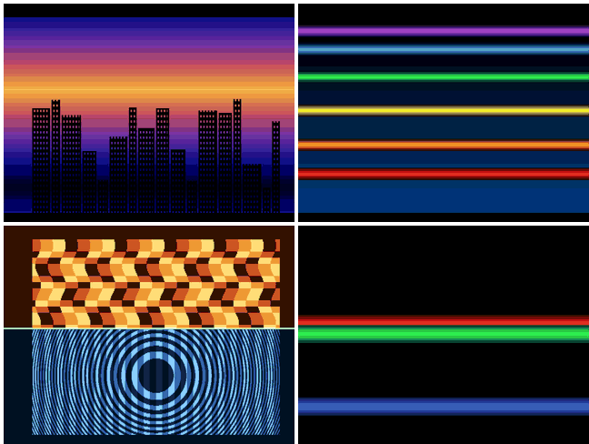
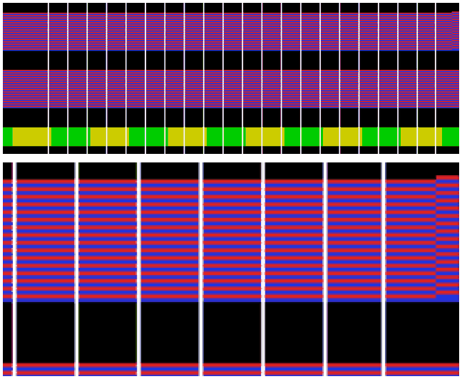

# 6. The copper

[‹ Interrupts](05-interrupts.md) · [Contents](README.md) · [The blitter ›](07-blitter.md)

The copper is the Amiga's display coprocessor: a tiny processor in Agnus that reads a list of instructions from chip RAM, once a frame, in step with the video beam. It has only three instructions, and two of them are all most demos use: *wait until the beam gets here*, and *put this value in that register*. With those it changes colours, bitplane pointers, scroll values and screen modes at exact places on the screen, every frame, without the processor doing anything at all. v7 called it "probably the most wonderful part of the Amiga architecture", and it still is.

This chapter covers the instructions, where a wait really happens on the screen, the line 255 problem, the danger bit, lists that jump, change and double-buffer, and the effects demos have always made with it: bars, gradients, colour cycling and split screens. There are five whole examples, each built both ways (with the machine taken and with the system running) like every v8 example:

- [`examples/ch06_waits.s`](examples/ch06_waits.s): where a `WAIT` lands. Colour changes after `$xx01` waits and after `$xx07` waits, and a ruler of horizontal positions.
- [`examples/ch06_gradient.s`](examples/ch06_gradient.s): a colour on every one of 256 lines behind a city skyline, cycling through a palette.
- [`examples/ch06_bars.s`](examples/ch06_bars.s): six copper bars on a sine wave, built in one list while the copper shows another, with a jump through `COP2LC`.
- [`examples/ch06_split.s`](examples/ch06_split.s): a low resolution top that wobbles (a scroll value for each line) and a high resolution bottom with its own bitplanes.
- [`examples/ch06_line255.s`](examples/ch06_line255.s): bars bouncing across line 255, in a list rebuilt each frame; two lists take turns through `COP1LC`.



## The three instructions

Every copper instruction is two words, and the copper always fetches both. Bit 0 of each word says which instruction it is:

| | First word | Second word |
|---|---|---|
| **MOVE** | the register's offset from `$DFF000` (bit 0 is 0) | the value to write |
| **WAIT** | the beam position (bit 0 is 1) | which bits of it to compare (bit 0 is 0) |
| **SKIP** | the beam position (bit 0 is 1) | which bits of it to compare (bit 0 is 1) |

### MOVE

```asm
        dc.w    COLOR00,$0f00           ; the background red
        dc.w    BPL1PTH,$0002           ; bitplane 1 from $21000: the high word...
        dc.w    BPL1PTL,$1000           ; ...and the low word
```

The first word is a register's offset (`$180` for `COLOR00`); the second is the value. The copper writes words only, so a pointer takes two MOVEs, high word first. Bits 15-9 of the first word aren't used; keep them 0.

### WAIT

```asm
        dc.w    $6407,$fffe             ; wait for line $64, horizontal position $06
```

The first word holds the line in bits 15-8 and the horizontal position in bits 7-1 (bit 0 is the 1 that makes it a WAIT, so `$xx07` waits for position 6, and `$xx01` for position 0). The second word says which of those bits to compare: `$fffe` compares them all, and is what nearly every WAIT uses. The copper then sits, off the bus, until the beam's position is **equal to or greater than** the one given. Not *equal*: greater than or equal. That matters below.

Bit 15 of the second word is the blitter-finished-disable bit (BFD). It's normally 1; with it 0, the WAIT also waits for the blitter to finish ([below](#the-copper-and-the-blitter)).

The comparison bits (bits 14-1 of the second word) let a WAIT ignore part of the position: `$80fe` ignores the line (keeping BFD set), and waits for a horizontal position on whatever line it's on. One bit can't be ignored: the line's top bit (bit 7), because its place in the second word is taken by BFD. So a WAIT "for any line" still compares line bit 7, and from line 128 on it's always true. The Hardware Reference Manual warns about this, and v8's tests show it happen: a loop of masked WAITs that splits each line in two works down to line 127, then races round and round, every WAIT passing at once.

### SKIP

```asm
        dc.w    $c001,$ff01             ; skip the next instruction if the beam is at line $C0 or later
        dc.w    COPJMP2,$0000           ; (skipped from line $C0 on) jump to COP2LC
```

SKIP is a WAIT that doesn't wait: if the beam has reached the position, the copper skips the instruction after it. Its use is to end a loop, as here: [jumps](#jumps-cop2lc-and-the-strobes) below.

## Where a WAIT happens

### Lines: 8 bits, and line 255

The first word has room for 8 bits of the line, 0 to 255. A PAL frame has 312 lines (and 313 in an interlaced long frame), and a NTSC frame 262 or 263. The usual PAL display runs from line `$2C` (44) to line `$12B` (299), so every full-height PAL effect crosses line 255.

The copper compares the low 8 bits of the line. Line 256 looks like line 0 to it, line 300 like 44. So "wait for line 300" is `$2c07,$fffe`... but put that in a list at the top of the frame, and it passes on line 44, 256 lines too soon. The copper must first be made to wait until the line count has wrapped round:

```asm
        dc.w    $ffdf,$fffe             ; wait for the end of line 255
        dc.w    $2c07,$fffe             ; now line $2C is line 300 ($12C)
```

Why `$DF` (position $DE)? The next WAIT is compared as soon as it's read, and must be read *after* line 255 has ended, or it too passes at once (`$FF` is greater than `$2C`). A line is 227 positions long (`$00` to `$E2` on PAL), so position $DE is near the end, and by the time the copper has fetched the next WAIT, the line has wrapped. That was tested in FS-UAE, with a list that made the background red on line 240, then had one of these WAITs, then `$1007,$fffe` (meaning line 272) and a change to green:

| The WAIT before `$1007,$fffe` | Where the background turned green |
|---|---|
| none | at once, on line 240 |
| `$ff07,$fffe` | on line 255 |
| `$ffd1`, `$ffd7`, `$ffdb` | at the right-hand end of line 255 |
| `$ffdd`, `$ffdf`, `$ffe1` | on line 272: right |

So `$ffdf,$fffe` it is, with a little to spare. The Hardware Reference Manual's own advice for the last lines (wait for line 255, then for lines 0 to 5) leaves this out; written as it says, with a WAIT for the *start* of line 255, the next WAIT passes on line 255.

Only the first WAIT after line 255 needs it. After the `$FFDF` wait, the rest work as usual, by their low 8 bits. `ch06_gradient.s` puts it in a list of fixed WAITs; `ch06_line255.s` puts it wherever the first line after 255 falls, in a list rebuilt each frame:

```asm
        cmp.w   #$100,d0                ; this WAIT is for line 256 or later...
        blo.s   .wait
        tst.b   d3                      ; ...and the first one that is?
        bne.s   .wait
        move.l  #$ffdffffe,(a0)+        ; then the end of line 255 first
        st      d3
.wait:
        move.w  d0,d4
        lsl.w   #8,d4                   ; the line's low 8 bits (the 9th falls off the top)
        or.w    #$07,d4
```

### Across the line: 4 pixels at a time

The horizontal position counts the beam in *color clocks*: 280 nanoseconds each, the time of two low resolution pixels. A WAIT's position ignores the lowest bit, so its steps are 2 color clocks: **4 low resolution pixels**, 8 high resolution ones. There are 113 of them on a line (`$00` to `$E2`). So a copper colour change can only start at every 4th low resolution pixel, and the copper can't make anything finer than that.

A MOVE takes the copper 4 color clocks (it reads two words, on every other memory cycle), so back-to-back MOVEs change something every 8 low resolution pixels. That's the copper's finest horizontal detail, and why "copper chunky" effects are made of blocks 8 pixels wide (see [what the copper costs](#what-the-copper-costs)).

Where does position `h` land on the screen? `ch06_waits.s` has a ruler: on its bottom band, the colour changes after WAITs for positions `$10`, `$20` ... `$E0`, over a bitplane with a line every 16 pixels. In FS-UAE, a colour changed straight after a WAIT for position `h` appears at about low resolution pixel `2h+4` on the scale `DIWSTRT` uses: that is, with the usual window starting at `$81`, the WAIT for position `$40` changes the colour about 3 pixels into the screen. Each step of 1 in `h` is 2 pixels further right. The few pixels' lag is the copper fetching and doing the MOVE, and the picture's own delay.

The horizontal count starts again, and the line count goes up by one, before the line's picture has finished: position 0 is out in the right-hand border, a little before the horizontal blank begins (at position `$0F`, the Hardware Reference Manual says). That's the root of the next section.

### `$xx07`, not `$xx01`

The Hardware Reference Manual waits for the start of a line with `$xx01,$fffe`: line `xx`, position 0. v7 pointed out that this changes a colour "just before the end of the previous line", leaving a step at the far right of the screen, and that `$xx07,$fffe` puts the change exactly at the start of the line.

v8 tested it: `ch06_waits.s` changes the background colour, red and blue in turn, on each line of two bands, after `$xx01` waits in the top band and `$xx07` waits in the middle one.



v7 was right. With `$xx01`, the new colour starts on the line *before*, about 13 low resolution pixels right of the usual 320-pixel screen's right edge: there's a step at the end of every line, out in the overscan border. With `$xx07`, the change moves 12 pixels later, past the right-hand edge of FS-UAE's picture (set to show the whole picture, borders and all), so each line is one colour from edge to edge. Whether a real monitor shows the `$xx01` step depends on how much of the border it shows; with `$xx07` there's nothing to see.

So wait with `$xx07` for anything that changes what the border or the background shows. There's still time after it: about 40 color clocks pass before a usual low resolution display's first fetch, room for ten or so MOVEs before the line's picture starts (a split screen's handful of registers fits easily).

## Ending a list

The copper has no instruction to stop. A list ends with a WAIT that can never pass:

```asm
        dc.w    $ffff,$fffe             ; line 255, position $FE: there's no such position
```

The horizontal position never goes past `$E2`, so `$FFFE` never comes, and the copper waits there until the next frame starts it again. (A WAIT for position `$FE` on any line before 255 would pass as soon as the line count went past it: "greater than or equal".)

## Starting the copper, and every frame after

The copper's program counter is loaded from one of two **location registers**, `COP1LC` and `COP2LC`, when you write to the matching **strobe**, `COPJMP1` or `COPJMP2` (the value written doesn't matter):

```asm
        move.l  #Copper,COP1LC(a5)      ; a long word: both halves of the address at once
        move.w  d0,COPJMP1(a5)          ; start the copper there now
```

At the start of every frame, the copper starts again from `COP1LC` by itself. That's what makes a list run once a frame, and it's why the startup only has to write `COP1LC` once. It does that in the vertical blank, then switches on the copper's DMA: the copper DMA bit and the master bit in `DMACON` ([Startup and exit](04-startup-and-exit.md)).

Copper lists must be in **chip RAM**: the copper reads them by DMA, like the other chips' data. Put them in a `data_c` or `bss_c` section.

## What the copper may write: COPCON's danger bit

The copper can't write every register. Which ones it can depends on bit 1 of `COPCON`, `CDANG` (the "copper danger" bit), and on the chips:

| | `CDANG` 0 | `CDANG` 1 |
|---|---|---|
| OCS | `$80` and up | `$40` and up (adds the blitter) |
| ECS and AGA | `$80` and up | all of them |

That's the Hardware Reference Manual's chapter 2 for the original chips, and its Appendix C for ECS. (The manual muddles this in places: its MOVE section says `$20` and up, and Appendix C's description of the ECS change contradicts itself. Only the `$80`-and-up row matters to most demos.)

`$80` and up is everything a display needs: the copper's own registers, the display, bitplanes, sprites, colours, `DMACON`, `INTENA`, `INTREQ` and audio. `CDANG` exists to keep a broken copper list away from the blitter, which can write anywhere in chip RAM.

A MOVE to a register the copper may not write doesn't just do nothing. **The copper stops**, and nothing after it in the list happens that frame. v8 tried it on an emulated Amiga 500: a MOVE to `BLTCON1` with `CDANG` clear, in the middle of a list of colour changes, and every change after it was gone.

Set it with the processor (`move.w #2,COPCON(a5)`): with `CDANG` clear, `COPCON` (at `$2E`) is out of the copper's reach. It's write-only, so it can't be saved; if your demo sets it, clear it again as it ends (an `ExitHook`, [Startup and exit](04-startup-and-exit.md)).

## Jumps: COP2LC and the strobes

The copper can write its own location registers and strobes ($80 to $8A), so a list can jump:

```asm
        dc.w    COPJMP2,$0000           ; carry on at COP2LC
```

`COP2LC` isn't touched by the start of a frame, so it's free for anything. Two uses:

- **A fixed start and a changing rest.** `ch06_bars.s` keeps a short list at `COP1LC` (the display's settings) that ends by jumping to `COP2LC`; the processor points `COP2LC` at whichever of two lists it has just built. See [double buffering](#changing-a-list-while-its-shown).
- **Loops.** Point `COP2LC` at the top of a loop, end the loop with `COPJMP2`, and put a SKIP before the jump to get out:

```asm
Loop:                                   ; COP2LC points here
        dc.w    COLOR00,$0f00
        dc.w    $0081,$80fe             ; position $80, on whatever line this is (line bits ignored)
        dc.w    COLOR00,$000f
        dc.w    $00e1,$80fe             ; position $E0
        dc.w    $c001,$ff01             ; SKIP: from line $C0 on, don't jump back
        dc.w    COPJMP2,$0000
        dc.w    COLOR00,$0000
```

That makes every line half red, half blue, with one copy of the instructions. And it shows the masking catch from above: in v8's test it works to line 127, then the masked WAITs pass at once and the loop races until the SKIP stops it at line `$C0`. The Hardware Reference Manual's way round it is a second loop for lines 128 and on, with bit 7 set in its WAITs.

## Changing a list while it's shown

The processor can change a copper list in memory at any time: write a new colour into a MOVE's second word, and the copper uses it next time it gets there. That's how almost every copper effect moves.

The trouble is *when*. The copper reads the list as the beam goes down the screen. Rewrite a list from the top while it's shown, and if your writing falls behind the beam, the bottom of the screen shows this frame and the top shows the next: a tear. Rewrite only a few words, near the start of the frame, before the beam gets to them, and it's fine. Rebuild a whole list (or change one late in the frame, or on a slow machine with the system running, where `Frame` may start a little late), and you need two lists:

1. The copper shows list A while the processor builds list B.
2. When B is done, point the copper at it **for the next frame**.
3. Next frame, build A while B is shown; and so on.

Step 2 is safe because of when the copper reads its location registers. `COP1LC` is read at the start of each frame, so writing it during a frame changes nothing until the next. `ch06_line255.s` does it this way:

```asm
        move.l  Hidden,d0               ; the list just built
        move.l  d0,COP1LC(a5)           ; shown from the next frame
```

`ch06_bars.s` does the same with `COP2LC` instead. Its `COP1LC` list is fixed, and ends with `COPJMP2`; by the time `Frame` runs, the copper has already jumped for this frame, so a new `COP2LC` takes effect at the next:

```asm
Copper:
        dc.w    FMODE,$0000
        dc.w    BPLCON3,$0c00
        dc.w    BPLCON0,$0200           ; no bitplanes: only the background colour
        dc.w    COLOR00,$0000
        dc.w    COPJMP2,$0000           ; jump to whichever list COP2LC points at
```

One care: a pointer is written as two words, and if the copper reads it between them, it gets half of each. So don't write `COP1LC` or `COP2LC` at the moment the copper uses them, at the very start of a frame. Writing them at the end of `Frame`, as these examples do, keeps well away from it.

The same goes for the bitplane and sprite pointers the copper sets: `ch08_scroll.s` and `ch08_sprites.s` in [the display chapter](08-display.md) write them from the vertical blank interrupt, and have the copper read them after a WAIT for line 16, so they're always written first.

## Bars and gradients

A **copper gradient** is a WAIT and a MOVE for every line, each with a slightly different colour. `ch06_gradient.s` makes the list in `Init`, with a `$FFDF` wait before line 256:

```asm
.line:
        cmp.w   #$100,d0
        bne.s   .notwrap
        move.l  #$ffdffffe,(a0)+        ; wait for the end of line 255
.notwrap:
        move.w  d0,d1
        lsl.w   #8,d1                   ; the line's low 8 bits, in the WAIT's top byte
        or.w    #$07,d1
        move.w  d1,(a0)+
        move.w  #$fffe,(a0)+
        move.w  #COLOR00,(a0)+          ; and a MOVE, its colour filled in each frame
        clr.w   (a0)+
```

The colour changes only the background, so a bitplane picture in front of it (the skyline) stays as it is, and the gradient shows wherever its pixels are 0: around the buildings and through their windows. The 12-bit colours come from a few key colours with 16 steps worked out between each pair; with 4 bits a component, a smooth gradient needs its key colours close together, or the steps show as bands.

A **copper bar** is a gradient a few lines tall that moves. The simple way to move several, and let them overlap, is to draw them into a table of one colour a line, as you'd draw into a bitplane, and then copy the table into the list's MOVEs. `ch06_bars.s` does that each frame: the background first, then each bar at its place on a sine wave, the later bars over the earlier:

```asm
        move.w  (a2,d0.w),d0            ; sine, -16384 to 16384
        muls    BarSwing,d0
        add.l   d0,d0
        add.l   d0,d0
        swap    d0                      ; * 4 / 65536: the same as / 16384
        add.w   BarCentre,d0            ; the bar's top line
```

The sine table is in the source as `dc.w` lines, made with one line of Python (it's in the comment above the table); Limoniter's **Tools › General › Table generator** makes the same.

`ch06_line255.s` writes its list differently: a WAIT and a MOVE only where a line's colour differs from the line above's. The list is short, but its length changes every frame, so it has to be rebuilt every frame, and it's double-buffered.

## Colour cycling

Colour cycling moves colours rather than pixels. With the copper, that's rewriting the colours in a gradient's MOVEs one step further along the palette each frame: `ch06_gradient.s` writes 256 words a frame, from the top, at the start of the frame. The 68000 writes them far faster than the beam goes down the screen, so it's always ahead, and the list needs no second copy.

The other kind, for a bitplane picture, rotates the values in the colour registers themselves (`COLOR01` to `COLOR07`, say), so the pixels drawn in those colours seem to flow. The copper can set those registers too, at the top of the list, from values the processor changes each frame.

## Splitting the screen

Nearly every display register can be changed by the copper between one line and the next, so one screen can be several. `ch06_split.s` has a low resolution, four-colour top and a high resolution bottom:

```asm
        dc.w    (SPLITLINE<<8)!$07,$fffe
        dc.w    BPLCON0,$0200           ; no bitplanes on the dividing line
        dc.w    COLOR00,$0fff
        dc.w    BPLCON1,$0000
        dc.w    DDFSTRT,$003c           ; high resolution's fetch
        dc.w    DDFSTOP,$00d4
        dc.w    BPL1MOD,$0000
        dc.w    BPL2MOD,$0000
        ...                             ; the bottom's colours and bitplane pointers
        dc.w    ((SPLITLINE+2)<<8)!$07,$fffe
        dc.w    COLOR00,$0012
        dc.w    BPLCON0,$a200           ; high resolution, two bitplanes
```

Three things make a split clean:

- **Change things between the fetches.** A line's bitplane data is fetched between `DDFSTRT` and `DDFSTOP`. The fetch registers, the modulos and the pointers should change after one line's fetch has finished and before the next one's starts. A `$xx07` WAIT does that, if what follows is short.
- **Or give it a line with nothing on it.** `ch06_split.s` switches the bitplanes off (`BPLCON0` `$0200`) for its white dividing lines, so nothing is fetched or shown while the copper changes everything, and then switches them on in the new mode. A blank line or two between modes is normal in demos, and hides any half-changed line.
- **Each part has its own pointers.** The bitplane pointers go up as each line is fetched (and the modulo is added at the end of each line). The bottom part sets its own, so it starts where it should whatever the top did.

`ch06_split.s` also moves the bottom's pointers each frame to scroll it up and down, by rewriting the words in the list after the split. And its top **wobbles**: there's a WAIT and a `MOVE BPLCON1` for every line, each a different scroll value from a sine wave, so each line of the picture is shifted by a different number of pixels. For that, the top fetches one word more than it shows (`DDFSTRT` `$30` rather than `$38`), as any horizontally scrolled screen must: [scrolling](08-display.md#hardware-scrolling).

## The copper and the blitter

With `CDANG` set, the copper can write the blitter's registers, and start blits by writing `BLTSIZE`. For a run of blits, it has to know when each has finished, and that's the BFD bit: a WAIT whose second word has bit 15 clear waits for the beam position **and** for the blitter to finish.

```asm
        dc.w    $6001,$fffe             ; line $60
        dc.w    BLTCON0,$01ff           ; D only, all ones: fill
        dc.w    BLTCON1,$0000
        dc.w    BLTDMOD,$0000
        dc.w    BLTDPTH,0,BLTDPTL,0     ; (filled in by the processor)
        dc.w    BLTSIZE,(200<<6)!20     ; 200 lines of 20 words: the blit starts
        dc.w    $6101,$7ffe             ; line $61, and the blitter finished (BFD clear)
        dc.w    COLOR00,$0f00
```

v8 tried this list (with `CDANG` set by the processor). The copper filled the rectangle every frame. With `$fffe` in the last WAIT, the background turned red on line `$61`; with `$7ffe`, over twenty lines further down, when the blit had finished.

The blitter must be yours for the copper to use it: with the machine taken it is; with the system running, own it ([the blitter](07-blitter.md)) for as long as the copper may start blits. And the processor mustn't start blits of its own meanwhile.

## What the copper costs

The copper reads its list by DMA, from chip RAM. The Hardware Reference Manual's figures:

- A line has about 227 memory cycles. The copper uses every other one: not the cycles kept for memory refresh, the disk, audio, sprites and a low resolution display, but the ones the processor and the blitter use. It has priority over both.
- A MOVE takes 2 memory cycles (4 cycles of time, as it uses every other one); a WAIT 3 (6), as it takes an extra cycle to wake. While a WAIT waits, the copper uses no cycles at all.
- So the copper can do at most about 56 MOVEs a line, and fewer with WAITs between them.
- A list busy with MOVEs all the way across the line slows the blitter, and slows the processor's chip RAM accesses. Code and data in fast RAM don't care.
- **Bitplanes can take the copper's cycles too.** During the display, up to four low resolution bitplanes, or two high resolution ones, leave them alone. Five or six low resolution bitplanes take half of them. Four high resolution bitplanes take every cycle there is, and the copper (like the processor and the blitter) can do nothing until the line's fetch is over. So mid-line colour changes need a light display.

In practice the copper's cost is small for anything but the busiest lists, and it's always cheaper than the processor doing the same: the processor would have to be there at the right moment, which it can't ([interrupts](05-interrupts.md#how-late-is-the-processor)).

## The copper in an interrupt

The copper can write `INTREQ` (`$9C`), so it can raise the level 3 copper interrupt at any line it can wait for. [Interrupts](05-interrupts.md#the-copper-interrupt) has it in full, and shows how late the processor answers.

## What changed from v7

- **`$xx07` waits**: v7's tip, tested, and right. The step it gets rid of is shown in a screenshot, with where it falls.
- **Line 255**, which v7 didn't cover: why `$FFDF`, tested, and that the Hardware Reference Manual's own description leaves out the end of the line.
- **The danger bit**, and that the copper *stops* at a register it may not write.
- **Double-buffered lists**, with both location registers, and why changing a list as it's shown tears.
- **The masked WAIT's catch** (line bit 7 can't be ignored), seen in a test, not only read about.
- **v7's "proper copper startup"** (saving the view, `LoadView(0)`, two `WaitTOF`s) is now the startup's job: [Startup and exit](04-startup-and-exit.md).

## How it was tested

The five examples were built both ways (`OS_FRIENDLY=0` and `1`, with `AUTOEXIT=500`) and run in FS-UAE:

- an Amiga 500 (68000) with Kickstart 1.3 and with Kickstart 3.1;
- Kickstart 3.1 with a 68020 and with a 68040, each with fast RAM;
- an Amiga 1200 (AGA) with Kickstart 3.1, taking the machine;
- an NTSC Amiga 500 with Kickstart 1.3, with the system running.

Every run showed the effect, and then the CLI with "back in AmigaDOS, return code OK" after the demo had ended. Besides the examples, small test lists (not in `examples/`) checked what this chapter says about: the WAITs before line 256 (the table above); a MOVE to `BLTCON1` without `CDANG`; a copper-started blit with BFD set and clear; and the masked WAIT loop with SKIP. The screen positions given are FS-UAE's, measured from its screen captures; a real Amiga's picture may sit a pixel or two differently, and how much of the border a monitor shows is up to the monitor.

[‹ Interrupts](05-interrupts.md) · [Contents](README.md) · [The blitter ›](07-blitter.md)
