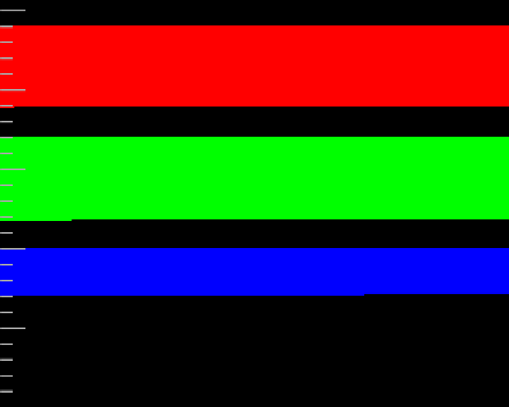
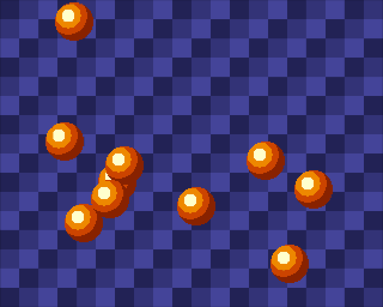

# 7. The blitter

[‹ The copper](06-copper.md) · [Contents](README.md) · [The display ›](08-display.md)

The blitter is the part of Agnus that moves memory about. It copies rectangles of words, combining up to three sources with any logical function on the way, shifting two of them by up to 15 pixels and masking the edges; it fills between lines; and it draws lines. It works at the same time as the processor, so while it clears a screen the processor can be working out the next frame. The Hardware Reference Manual puts its copying at about twice the speed of a 68000.

It can only reach **chip RAM**. Point it at fast RAM or slow RAM and it reads and writes chip RAM somewhere else instead (the HRM warns it "may result in destruction of the contents of Chip memory"). Everything a blit touches - screens, bobs, masks, a scratch word - has to be in a `data_c` or `bss_c` section, or allocated with `MEMF_CHIP`.

Everything here was checked against the HRM (chapter 6 and appendices A and C) and the NDK 3.2, and every example was run on an emulated Amiga 500 with Kickstart 1.3 and 3.1, both ways, with a 68000, 68020 and 68040. Where the HRM is wrong, it says so below.

## Owning it

With the system running, the blitter is shared. graphics.library uses it to draw, and on Kickstart 1.x even to decode floppy disk tracks, so if you take it and don't give it back, the disk stops. Ask for it with `OwnBlitter()` and give it back with `DisownBlitter()`:

- `OwnBlitter()` returns with the blitter yours, putting your task to sleep until it's free. The blitter may still be finishing the last owner's blit, so wait for it before you touch a register (the autodoc says so).
- Calls don't nest: calling `OwnBlitter()` again while you own it, or calling a system function that wants the blitter, locks the machine up.
- Own it around each run of blits, not for the whole demo, so the system gets it in between. They're quick enough to call every frame.
- They're ordinary library calls: d0, d1, a0 and a1 may change. (v7 said `OwnBlitter()` changes no registers; its autodoc promises no such thing.) `WaitBlit()`, on the other hand, is documented to keep d0, d1, a0 and a1.

Taking the machine, you own it once at the start (the v8 startup does) and it's yours until the end.

The startup has two macros that do the right thing either way: put `BLIT_BEGIN` before a blit or a run of blits, and `BLIT_END` after.

```asm
        BLIT_BEGIN                      ; OwnBlitter() if the system's running; then wait for the blitter
        move.l  #Screen,BLTDPTH(a5)
        move.w  #0,BLTDMOD(a5)
        move.l  #$01000000,BLTCON0(a5)  ; BLTCON0 $0100 (D only, minterm 0), BLTCON1 0
        move.w  #(256<<6)!20,BLTSIZE(a5)
        BLIT_END                        ; wait for it to finish; DisownBlitter() if the system's running
```

`OwnBlitter()` may put your task to sleep, so it can't be called from an interrupt. That's one reason to do all your blitting in one place - the main loop - rather than some in the main loop and some in an interrupt. v7 warned of the other: nothing stops an interrupt (or the copper) starting a blit between your wait and your write to `BLTSIZE`, and then both blits go wrong, more often the faster the processor. Keep the blits together.

## Waiting for it

`DMACONR` bit 14, BBUSY (`DMAF_BLTDONE` in the includes), is set while a blit runs. **Wait for it to clear before writing any blitter register**: the blitter reads its registers as it goes, so changing one mid-blit changes the blit. The startup's `WaitBlitter` does it like this (with a5 = `CUSTOM`):

```asm
WaitBlitter:
        btst    #DMAB_BLTDONE-8,DMACONR(a5) ; the byte with bit 14 in it is DMACONR's first
.wait:
        btst    #DMAB_BLTDONE-8,DMACONR(a5)
        bne.s   .wait
        rts
```

The first `btst` is there on purpose. On Agnus chips before the Fat Agnus, the busy bit isn't set the moment `BLTSIZE` is written, only when the blitter gets its first memory cycle, which can be a while if the display is using them all; a processor running from fast RAM or its cache can test the bit before that and think the blit has finished. The HRM's answer is to read a chip register first and test the second read. The `WaitBlit()` autodoc says the fault was fixed in the first Fat Agnus, which every A500 and A2000 has - but it costs almost nothing, so v8 keeps it. The same autodoc mentions a second fault, in every Agnus up to ECS: the busy bit can clear before the last word is written, "in a heavily loaded system with extended memory, in PRODUCTIVITY mode"; `WaitBlit()` tests more times to get round it. The autodoc ties that one to productivity mode, which a demo's own PAL or NTSC screen isn't; but if you're keeping the system running, `WaitBlit()` is there.

## The race: wait before the processor touches the blitter's work

The other half of waiting is easy to forget: **wait before the processor reads or writes anything the blitter is still working on**.

v8 found this in its own startup demo (see [startup and exit](04-startup-and-exit.md)). It cleared the screen with the blitter, then drew a chequerboard over it with the processor, without waiting in between. On a 68000 the blitter finishes long before the processor gets far, so it worked. On an emulated 68040 the screen stayed black: the processor drew the chequerboard while the blitter was still clearing, and the clear wiped it out. The fix is one wait, and that's why `BLIT_END` always waits, whichever way the startup runs.

The HRM says the same: a 68020 "running out of its cache" can get at the data before the blitter has finished writing it, while a 68000 is slow enough not to. It gives another case: freeing memory a blit is still reading. Some more:

- Drawing with the processor on top of a blit (text on a cleared screen, say).
- Reading the result of a blit (a collision test with the zero flag; see below).
- Swapping double buffers before the last blit into the new one has finished.
- Having the processor clear one part of a screen while the blitter clears another is fine - as long as the parts don't overlap, and you wait before using the whole.

Think of it as v7 put it: imagine the processor, or the blitter, a hundred times faster than yours. Code that only works because one is slower than the other will break on someone's machine.

This is a matter of timing, not of caches: the system sets chip RAM so the data cache never holds it (the `CacheClearE` autodoc says so), so what the processor writes is in chip RAM for the blitter to read, and what the blitter writes is what the processor reads - once the blitter has written it. [The processors chapter](14-processors.md) has more on the caches.

## The blitter nasty

`DMACON` bit 10, BLTPRI (`DMAF_BLITHOG`), is the "blitter nasty" bit. The blitter normally has a higher priority for chip memory than the processor; with BLTPRI clear, the HRM says, if the processor has waited three memory cycles in a row the blitter lets it have one. With BLTPRI set, the blitter keeps every cycle it can use, and a processor that needs chip memory (or a custom register) waits until the blit ends.

So set it when the processor would only be waiting for the blitter anyway, and it isn't running from fast RAM or its cache: the blit gets the cycles the processor's waiting loop would have taken. Don't set it when the processor has work to do in chip RAM, and think twice with the system running, as every task's memory accesses wait too. A processor running from fast RAM is held up only when it touches chip RAM or the chips. (The HRM describes all this; the effect wasn't measured for v8.)

```asm
        move.w  #DMAF_SETCLR!DMAF_BLITHOG,DMACON(a5)    ; nasty on
        move.w  #DMAF_BLITHOG,DMACON(a5)                ; and off
```

## The four channels

The blitter has three sources, **A**, **B** and **C**, and a destination, **D**. Each has:

| | A | B | C | D |
|---|---|---|---|---|
| Pointer (`BLTxPTH`/`BLTxPTL`) | yes | yes | yes | yes |
| Modulo (`BLTxMOD`) | yes | yes | yes | yes |
| Data register (`BLTxDAT`) | yes | yes | yes | (read-only `BLTDDAT`) |
| Shift (0 to 15 pixels) | `BLTCON0` | `BLTCON1` | no | no |
| First and last word masks | `BLTAFWM`, `BLTALWM` | no | no | no |

Each channel is switched on by its bit in `BLTCON0` (USEA to USED, bits 11 to 8). A source that's switched off isn't read from memory; the blitter uses whatever is in its data register instead, for every word. That makes a constant: A off with `BLTADAT` = `$FFFF` is "all ones", which the HRM uses as a mask. A channel that's off costs no time.

The pointers are byte addresses, written as one long to the `PTH` register (the high word comes first). The lowest bit is ignored: the blitter works in whole words, so every pointer must be even. The modulos are in bytes too, signed, and are added to the pointer at the end of each row.

## Minterms: the LF byte

For each bit, the blitter takes a bit from A, B and C and makes D's bit. There are eight ways the three bits can be, and the low byte of `BLTCON0`, called **LF** (logic function), has a bit for each: whether D is 1 for that combination. Bit 7 is for A, B and C all 1; bit 0 is for all three 0; in general, the bit number is A×4 + B×2 + C:

| A | B | C | LF bit | minterm |
|---|---|---|---|---|
| 0 | 0 | 0 | 0 | abc |
| 0 | 0 | 1 | 1 | abC |
| 0 | 1 | 0 | 2 | aBc |
| 0 | 1 | 1 | 3 | aBC |
| 1 | 0 | 0 | 4 | Abc |
| 1 | 0 | 1 | 5 | AbC |
| 1 | 1 | 0 | 6 | ABc |
| 1 | 1 | 1 | 7 | ABC |

(A lower-case letter means NOT: "aBC" is not-A and B and C. The HRM writes it with bars over the letters.)

To make an LF byte, write down which of the eight rows you want D to be 1 for. The HRM's example: D = 1 where A is 1, or B is 1. That's rows 2, 3, 4, 5, 6 and 7; reading the bits from 7 down, `11111100`, $FC.

There's a quicker way, which v7 gave. Give each source the byte its column of the table makes, read from bit 7 down:

```asm
SRCA    equ     %11110000               ; $F0: A is 1 in rows 4 to 7
SRCB    equ     %11001100               ; $CC
SRCC    equ     %10101010               ; $AA
```

Then write the function with them, and the assembler works the byte out, as each bit of the result is the function worked out for that row:

```asm
        move.w  #$0f00!(((SRCA&SRCB)!(~SRCA&SRCC))&$ff),BLTCON0(a5) ; cookie-cut: $0FCA
```

`&` is AND, `!` is OR (in Devpac, vasm and Limoniter; `|` in some other assemblers), `^` is exclusive or, and `~` is NOT. NOT works on the whole 32-bit number, so `~SRCA` alone is `$FFFFFF0F`: `&$ff` keeps it to a byte (v7's example, `(A!B)&C`, didn't need NOT).

The ones you'll use most:

| D = | LF | Used for |
|---|---|---|
| 0 | $00 | clearing (D only) |
| A | $F0 | copying |
| B | $CC | copying through B |
| C | $AA | copying through C |
| not A | $0F | copying and inverting |
| AB + aC | $CA | cookie-cut: B where A is set, C elsewhere |
| A xor C | $5A | exclusive-or A onto C |
| A or C | $FA | OR A onto C |
| C where A is clear (aC) | $0A | cutting A's shape out of C |
| ABc + aC | $4A | lines that exclusive-or (with B all ones, it's A xor C) |

The HRM's Table 6-1 has more, and a second way to work them out, with a Venn diagram of A, B and C.

**Limoniter** has a minterm calculator: **Tools › Amiga › Blitter minterms**. Type the function the way you'd say it (`AB + aC`, or `A&B | ~A&C`), or pick a common one, and it gives the LF byte, the minterms, which sources it actually reads, and with the shifts, channels and fill set, the whole `BLTCON0` and `BLTCON1`, ready to insert into your source. It takes a value apart the other way too.

## BLTCON0 and BLTCON1

In area mode (all but lines), from the HRM's appendix A:

| Bit | `BLTCON0` | `BLTCON1` |
|---|---|---|
| 15-12 | ASH3-0: A's shift | BSH3-0: B's shift |
| 11 | USEA | 0 |
| 10 | USEB | 0 |
| 9 | USEC | 0 |
| 8 | USED | 0 |
| 7 | LF7 | DOFF (ECS: D isn't written) |
| 6-5 | LF6-LF5 | 0 |
| 4 | LF4 | EFE: exclusive fill |
| 3 | LF3 | IFE: inclusive fill |
| 2 | LF2 | FCI: fill carry in |
| 1 | LF1 | DESC: descending mode |
| 0 | LF0 | LINE: 0 for area mode |

Write zeros to the bits that are 0: the HRM asks for that, so later chips can use them.

ECS adds `BLTCON0L` ($DFF05A), which writes LF alone, leaving the shift and channels as they were.

`BLTCON0` and `BLTCON1` are next to each other, so `move.l #$09f00000,BLTCON0(a5)` sets both. The same goes for `BLTAFWM` and `BLTALWM`, `BLTCMOD` and `BLTBMOD`, and `BLTAMOD` and `BLTDMOD`.

## The size, and the modulos

Writing `BLTSIZE` starts the blit, so write it **last**. It holds the height and the width:

| Bits | 15-6 | 5-0 |
|---|---|---|
| | the height, in rows: 1 to 1024 (0 means 1024) | the width, in **words**: 1 to 64 (0 means 64) |

```asm
        move.w  #(HEIGHT<<6)!WORDS,BLTSIZE(a5)
```

The width is the only thing in the blitter counted in words. Everything else - pointers, modulos - is in bytes, and the height is in rows. Giving `BLTSIZE` the width in bytes, or in pixels, is the classic mistake: the blit is twice as wide as it should be, or sixteen times (and the bits above spill into the height).

The **modulo** is what's added to a channel's pointer at the end of each row: the bytes to skip to get to the start of the next row. For a rectangle in a bigger bitmap it's the bitmap's width in bytes, less the blit's width in bytes. The HRM's example: in a 320-pixel bitplane (40 bytes a line), a rectangle 10 bytes wide starting 12 bytes in, 13 lines down:

```asm
        move.l  #Bitplane+40*13+12,BLTDPTH(a5)
        move.w  #40-10,BLTDMOD(a5)      ; 30: the 12 bytes to its left and 18 to its right
        move.w  #(HEIGHT<<6)!(10/2),BLTSIZE(a5)
```

Each channel has its own modulo, so the source and destination can be different widths: a 4-byte-wide bob (modulo 0) into a 40-byte-wide screen (modulo 36). A negative modulo goes back: -2 reads the last word of each row again, and minus the row's width repeats the same row all the way down.

**Big blits (ECS).** The ECS Agnus can do blits up to 32768 by 32768 pixels. Write the height (up to 32768) to `BLTSIZV` ($DFF05C) first, then the width in words (up to 2048) to `BLTSIZH` ($DFF05E), which starts the blit. The original Agnus doesn't have these registers, so check before you use them: from Kickstart 2 (V36) on, bit 0 of `gb_ChipRevBits0` in GfxBase (offset 236; `GFXB_BIG_BLITS` in the NDK) is set when they're there. On an A500 with the original chips, split a big blit into ones of 1024 rows or fewer.

## Shifts and masks

A and B each have a barrel shifter, which shifts the data right by 0 to 15 pixels on its way through - for nothing: a shifted blit takes no longer than one that isn't. That's how a bob is drawn at any pixel, though the blitter only works in words: point D at the word its left edge falls in, and shift by how far into that word it is (`x & 15`).

What's shifted in from the left? For the first word of the blit, zeros. After that, the bits shifted out of the word before - including, at the start of each row, the bits shifted out of the *last word of the row before*. That's what the masks are for. `BLTAFWM` is ANDed with the first word of each row of A, and `BLTALWM` with the last (both, if the blit is one word wide), before the shift. Set them to `$FFFF` when you don't need them.

A shifted bob is wider than it was, too: 32 pixels shifted by 5 cover three words, not two. So the blit is a word wider than the bob, and that extra word has to come from somewhere. You can store every bob and mask with a blank word at the end of each row. Or, as `ch07_bobs.s` does, let the blit read on into the next row's first word, mask it off with `BLTALWM` = `$0000`, and give A and B a modulo of -2 to go back for it:

```asm
        move.l  #$ffff0000,BLTAFWM(a5)  ; BLTAFWM $FFFF, BLTALWM $0000: the third word of each row is masked off
        move.w  #-2,BLTAMOD(a5)         ; the ball is 2 words a row, the blit 3: go back a word each row
        move.w  #-2,BLTBMOD(a5)
```

A masked to 0 means the cookie-cut takes C - the screen as it was - for those bits, whatever B has there. (The blit reads one word past the end of the mask and the image; that's harmless, as long as there's memory there.)

One warning from the HRM: write the shifts (`BLTCON0` and `BLTCON1`) **before** loading a data register by hand. Writing `BLTxDAT` sends the value through the shifter straight away, with whatever shift is set at that moment.

## Descending mode

Copying a block onto itself, moved down, overwrites rows before they've been read. **Descending mode** (`BLTCON1` bit 1, DESC) runs the blit backwards: the pointers go down by 2 and the modulos are subtracted, the shifts go left instead of right, and the first-word mask is applied to the last word of each row (the first one read). Point every channel at the *last* word of the area (not the word after it, as `-(an)` would). The rule from the HRM, when the source and destination overlap: if the destination is lower in memory than the source (higher up the screen), ascending; otherwise descending. Area fill needs descending mode, always.

## Clearing

A clear is the simplest blit there is: D only, minterm 0.

```asm
        BLIT_BEGIN
        move.l  #$01000000,BLTCON0(a5)  ; BLTCON0 $0100: D only, LF 0; BLTCON1 0
        move.w  #0,BLTDMOD(a5)
        move.l  #Screen,BLTDPTH(a5)
        move.w  #(256<<6)!20,BLTSIZE(a5) ; 256 lines of 20 words
        BLIT_END
```

Should the processor do it instead? v7 said a `MOVEM.L` loop was almost three times faster than the blitter on an A1200, and that on a 68000 you gain by "NOT using blitter-nasty and the movem-loop". `ch07_clear_timing.s` measures it, the way coders always have: it turns the background red, clears 10K with the blitter, and turns it back; the height of the red band is how long it took. Then the same with the processor (green), and then with both at once, each doing half (blue). The marks on the left are every 10 lines, which is 640 microseconds.



On the emulated A500 (68000, one bitplane on), clearing 10240 bytes took:

| | Lines | Milliseconds |
|---|---|---|
| The blitter alone | about 51 | 3.2 |
| The 68000 alone (`MOVEM.L` of 10 registers, 40 bytes at a time) | about 52 | 3.3 |
| Both at once, half each | about 30 | 1.9 |

On a 68000, then, the processor and the blitter clear at the same speed. But a D-only blit uses only every other memory cycle (see the speed table below), and a 68000 leaves every other one free too, so together they get through almost twice as much - as long as the processor doesn't have to wait for the blitter to finish before it starts, and they clear different memory. The blitter's 51 lines is more than the HRM's formula gives (45): the formula leaves out the cycles the display and memory refresh take.

On faster processors the answer changes, and the emulator can't say by how much: its 68020 and 68040 aren't cycle-exact, and with the 68040 it cleared 10K of chip RAM with the processor in under a line, which no real Amiga's chip RAM can do. v7's A1200 figure hasn't been checked again for v8. What does hold: on any Amiga the blitter clears while the processor does something else, and that is usually worth more than which is faster.

## Copying

A to D with minterm $F0. A and D together cost no more than D alone (4 clock ticks a word), so copy through A, not B: B adds 2 ticks a word.

```asm
        move.l  #$09f00000,BLTCON0(a5)  ; A and D, D = A; BLTCON1 0
        move.l  #$ffffffff,BLTAFWM(a5)
        move.w  #SRCMOD,BLTAMOD(a5)
        move.w  #DESTMOD,BLTDMOD(a5)
        move.l  #Source,BLTAPTH(a5)
        move.l  #Dest,BLTDPTH(a5)
        move.w  #(ROWS<<6)!WORDS,BLTSIZE(a5)
```

To copy to a position that isn't on a word boundary, shift A, make the blit a word wider, and use the masks - or, to leave the bits around it alone, cookie-cut, as below. The HRM's "Copying Arbitrary Regions" gives the general rules.

## Cookie-cut bobs

A **bob** (blitter object) is a picture drawn into the screen by the blitter, unlike a sprite, which the display hardware lays over it. It needs to be drawn over the background without its rectangle's empty corners wiping the background out. For that it has a **mask**: one bitplane, set wherever the bob is solid. The HRM calls it the bob's shadow.

Then:

- **A** = the mask (shifted)
- **B** = the bob's image (shifted the same)
- **C** = the screen as it is
- **D** = the screen

and D = AB + aC: where the mask is set, the bob; elsewhere, what was there. That's minterm **$CA**, the "cookie-cut" - it's in every Amiga game. All four channels, so `BLTCON0` = shift<<12 ! $0FCA, and `BLTCON1` = shift<<12 for B.

```asm
        and.w   #15,d0                  ; x's place in its word
        ror.w   #4,d0                   ; into bits 15-12
        move.w  d0,d2
        or.w    #$0fca,d2               ; A, B, C and D; LF $CA
        jsr     WaitBlitter
        move.w  d2,BLTCON0(a5)
        move.w  d0,BLTCON1(a5)          ; B shifted the same
        move.l  #BallMask,BLTAPTH(a5)
        move.l  #Ball,BLTBPTH(a5)
        move.l  d1,BLTCPTH(a5)          ; C and D both at the screen
        move.l  d1,BLTDPTH(a5)
        move.w  #BOBSIZE,BLTSIZE(a5)
```

C has to read the screen before D writes it, because most words of the bob are only partly the bob: the blitter can't write part of a word, so it has to have the rest of it.

### Putting the background back

Once the bob moves, its old place needs the background back. Two ways:

- **Keep a clean copy of the background** and copy the rectangle back from it (A to D, $F0). Simple, and the order doesn't matter, but it costs a whole screen of chip RAM, and the background can't change. `ch07_bobs.s` does this.
- **Save what's under each bob** before drawing it (A to D, from the screen to a buffer), and copy it back after. That works with a background that changes, but if bobs overlap, put them back in the **reverse** order of drawing, or a later bob's saved background (which has an earlier bob in it) is put back last.

Either way, put back *all* the bobs before drawing *any* of them, or putting one back wipes out part of another just drawn.

### Double buffering

If you draw into the screen being shown, the display shows bobs half-drawn and half-erased: they flicker. So draw into a second screen that isn't shown, and when it's finished, show it, and draw the next frame into the first. Each screen then has its own list of where the bobs were *in that screen*, two frames ago, to put the background back. `ch07_bobs.s` keeps the list as offsets from the start of the screen, so the same offset gives the place in the clean background:

```asm
        move.l  (a2)+,d0                ; where the bob was, from the start of the screen
        move.l  d0,d2
        add.l   #Background,d2          ; the same place in the clean background
        add.l   d1,d0                   ; and in the screen being drawn
        jsr     WaitBlitter
        move.l  d2,BLTAPTH(a5)
        move.l  d0,BLTDPTH(a5)
        move.w  #BOBSIZE,BLTSIZE(a5)
```

The registers that are the same for every bob - `BLTCON0`, the masks, the modulos - are set once before the loop: no one else blits while you own the blitter, so they stay set. Only the pointers and the size are written for each one.



The example draws ten 32 by 32 balls in three bitplanes. Each cookie-cut is 3 words by 96 rows at 8 ticks a word, about 325 microseconds (5 lines), and each restore half that: about 76 lines of a PAL frame's 312 for all ten, before the display takes its share of the cycles. While the blitter draws one ball, the processor moves the next and works out where it goes.

## Interleaved bitplanes

Usually each bitplane of a screen is a block of its own: all of bitplane 0, then all of bitplane 1. Then a bob in three bitplanes is three blits.

**Interleaved**, the screen is stored a line at a time: line 0 of bitplane 0, line 0 of bitplane 1, line 0 of bitplane 2, then line 1 of each, and so on. The display is told to skip the other bitplanes' lines with the modulos, and each bitplane pointer starts one line further on:

```asm
        dc.w    BPL1MOD,ROWBYTES*(PLANES-1)     ; 80, for three 40-byte bitplanes
        dc.w    BPL2MOD,ROWBYTES*(PLANES-1)
        ; bitplane n's pointer: Screen + n * ROWBYTES
```

To the blitter, an interleaved screen looks like one bitplane three times as tall. A bob in three bitplanes is one blit, of three times the rows; so is clearing the whole screen, or filling every bitplane of a box. The bob's image is stored interleaved the same way, and its mask has each line repeated once for each bitplane (it costs memory: the mask is as big as the image).

That saves setting up and waiting for two blits out of three, which adds up with many small bobs. The blitter's own time is the same: the same words are read and written. Two things to watch: the height limit (1024 rows on the original chips, so a 5-bitplane, 256-line screen can't be cleared in one blit: 1280 rows), and a line drawn into one bitplane needs the modulo of the whole interleaved line (`LINEBYTES`, 120 for three), not the bitplane's 40.

## How fast

The blitter's speed depends only on which channels are switched on. From the HRM ("Blitter Speed"): a blitter cycle is 4 clock ticks at least; B adds 2; C and D both on add 2 more; A is free; and a channel used as a constant (switched off) counts for nothing. In line mode, every pixel takes 8 ticks.

| Channels on | Ticks per word | For example |
|---|---|---|
| D | 4 | clearing |
| A, D | 4 | copying |
| A, C | 4 | collision test (no D) |
| B, D | 6 | copying through B |
| C, D | 6 | |
| A, B, D | 6 | |
| A, C, D | 6 | |
| A, B, C | 6 | |
| B, C, D | 8 | the HRM's masked copy, A a constant |
| A, B, C, D | 8 | cookie-cut |
| line mode | 8 per pixel | |

The time for a blit, in microseconds, is ticks × height × width (in words) / 7.09 on PAL (7.16 on NTSC; v7 had 7.15). These are the best case: the HRM's figures leave out the memory cycles taken by the display, sprites, audio, disk and refresh, which come before the blitter's. Up to four low-resolution bitplanes leave plenty. Five or six take half the cycles the processor would have had while a line is shown, and four in high resolution take every one: in the HRM's words, that "effectively locks out the 68000 (as well as the blitter or Copper)" until the line's display ends.

The HRM's Table 6-2 shows the order of the memory cycles for each mix of channels, and has a lesson in it: a D-only blit is "D0 - D1 - D2", every other cycle unused, and an A-D copy "A0 - A1 D0 A2 D1 - D2". Those gaps are where the processor gets in. It also shows that the blitter reads two sets of sources before it writes its first D (it's pipelined), which is why a blit can copy a block one word to the right onto itself. The HRM says the table is only an illustration and isn't guaranteed.

## The zero flag

`DMACONR` bit 13, BZERO, is set after a blit if every bit it made for D was 0 - even if D was switched off, so nothing was written. AND two masks together (A and C, minterm $A0, D off) and BZERO says whether they overlap: a collision test. Wait for the blit to finish before reading it.

## Line mode

Set bit 0 of `BLTCON1` (LINE) and the blitter draws lines instead, up to 1024 pixels long, with a pattern if you like. Most of the registers mean something else in line mode. The line goes from (x1, y1) to (x2, y2); first work out

- dx = |x2 − x1|, dy = |y2 − y1|
- long = the larger of dx and dy, short = the smaller

Then, from the HRM's register summary (corrected - see below):

| Register | Value |
|---|---|
| `BLTCON0` | bits 15-12: x1 & 15 (the first pixel's place in its word); $B00: A, C and D on, B off; LF: $CA, or $4A to exclusive-or |
| `BLTCON1` | bits 15-12: where to start the pattern (0 for a solid line); bit 6 SIGN: set if 4·short − 2·long is negative; bits 4-2: the octant; bit 1 SING: one dot per line, for filling; bit 0 LINE = 1 |
| `BLTADAT` | $8000: the dot, which the blitter moves along |
| `BLTBDAT` | the pattern: $FFFF for a solid line |
| `BLTAFWM`, `BLTALWM` | $FFFF |
| `BLTAPTL` | 4·short − 2·long |
| `BLTAMOD` | 4·(short − long) |
| `BLTBMOD` | 4·short |
| `BLTCPT`, `BLTDPT` | the word with the first pixel in it |
| `BLTCMOD`, `BLTDMOD` | the bitmap's width in bytes (from one line to the next) |
| `BLTSIZE` | (long + 1) << 6 ! 2: the height is the length, the width always 2 |

The **octant** says which way the line goes, in three bits of `BLTCON1`. They have names: SUD (bit 4) is set when the line is more across than up and down; then AUL (bit 2) means it goes left and SUL (bit 3) that it goes up. When the line is more up and down, AUL means it goes up and SUL that it goes left. As a table, indexed by three bits a program can work out quickly:

| Index | The line goes | Octant (HRM) | Bits 4-2 | `BLTCON1` |
|---|---|---|---|---|
| 0 | more across: right, down | 7 | SUD | $10 |
| 1 | more across: left, down | 4 | SUD, AUL | $14 |
| 2 | more across: right, up | 0 | SUD, SUL | $18 |
| 3 | more across: left, up | 3 | SUD, SUL, AUL | $1C |
| 4 | more down: right, down | 6 | none | $00 |
| 5 | more down: left, down | 5 | SUL | $08 |
| 6 | more up: right, up | 1 | AUL | $04 |
| 7 | more up: left, up | 2 | SUL, AUL | $0C |

The index is 1 if x2 < x1, + 2 if y2 < y1, + 4 if dy > dx. These match the HRM's Table 6-3 and the NDK's `OCTANT1` to `OCTANT8` (which number them differently).

Minterm **$CA** (AB + aC) sets the dot's pixel to the pattern's bit and leaves the rest of the word (C) as it was. **$4A** (ABc + aC: with B all ones, A xor C) flips it instead, so drawing a line twice removes it - and that's the one for filling.

**What the HRM gets wrong here.** Its chapter text says the A shift is "x1 modulo 15"; it's x1 modulo 16 - `x1 & 15`, 0 to 15, as its own appendix says ("0 thru 15"). Its appendix says `BLTBDAT` should be "FF" for a solid line; it must be `$FFFF`. And the appendix gives `BLTAPTL` as "2Y−X", where the chapter (and the modulos, 4Y and 4Y−4X) need 4·short − 2·long: use the chapter's.

`ch07_lines_fill.s` has two line routines, meant to be lifted into your own code:

```asm
; DrawLine:     a solid line, every pixel set (minterm $CA).
; DrawFillLine: a line to fill between (one dot a line, exclusive-or, top end left off).
;   d0,d1 = x1,y1; d2,d3 = x2,y2; a0 = the bitplane; d4.w = bytes from one line of it to the next;
;   a5 = CUSTOM. No clipping: both ends must be on the bitplane.
;   Changes d0-d3, d5-d7, a1; keeps d4, a0, a2-a6.
;   Each waits for the blitter before it starts, but not after: call them between BLIT_BEGIN and BLIT_END.
```

Here's the heart of it, from the octant to the start:

```asm
LineCommon:
        sub.w   d0,d2                   ; dx
        sub.w   d1,d3                   ; dy
        moveq   #0,d7
        tst.w   d2
        bpl.s   .dxplus
        neg.w   d2
        addq.w  #1,d7
.dxplus:
        tst.w   d3
        bpl.s   .dyplus
        neg.w   d3
        addq.w  #2,d7
.dyplus:
        cmp.w   d3,d2
        bhs.s   .across
        exg     d2,d3
        addq.w  #4,d7
.across:                                ; d2 = long, d3 = short
        lea     Octants(pc),a1
        or.b    (a1,d7.w),d6            ; d6: BLTCON1 so far

        mulu.w  d4,d1                   ; the word with the first pixel
        lea     (a0,d1.l),a1
        move.w  d0,d7
        lsr.w   #3,d7
        and.w   #$fffe,d7
        add.w   d7,a1
        and.w   #15,d0                  ; its place in the word, into BLTCON0's top four bits
        ror.w   #4,d0
        or.w    d0,d5                   ; d5: BLTCON0 so far

        add.w   d3,d3
        add.w   d3,d3                   ; 4 * short: BLTBMOD
        move.w  d3,d7
        sub.w   d2,d7
        sub.w   d2,d7                   ; 4 * short - 2 * long: BLTAPTL
        bpl.s   .plus
        or.w    #$40,d6                 ; SIGN
.plus:
        move.w  d7,d1
        sub.w   d2,d1
        sub.w   d2,d1                   ; 4 * (short - long): BLTAMOD
        addq.w  #1,d2
        lsl.w   #6,d2
        addq.w  #2,d2                   ; BLTSIZE

        jsr     WaitBlitter
        move.w  d5,BLTCON0(a5)          ; before BLTADAT: the data is shifted as it's written
        move.w  d6,BLTCON1(a5)
        move.w  #$8000,BLTADAT(a5)
        move.w  #$ffff,BLTBDAT(a5)
        move.l  #$ffffffff,BLTAFWM(a5)
        move.w  d4,BLTCMOD(a5)
        move.w  d4,BLTDMOD(a5)
        move.w  d3,BLTBMOD(a5)
        move.w  d1,BLTAMOD(a5)
        move.w  d7,BLTAPTL(a5)
        move.l  a1,BLTCPTH(a5)
        ...                             ; BLTDPTH: see below
        move.w  d2,BLTSIZE(a5)
```

It sets every register for every line, which keeps it safe to mix with other blits. If you draw many lines in a row with nothing between, the ones that don't change (`BLTADAT`, `BLTBDAT`, the masks, `BLTCMOD` and `BLTDMOD`) can be set once before them.

## Area fill

In area mode, the blitter can fill as it copies. Along each row, from right to left, it keeps a "filling" state, starting with the FCI bit (`BLTCON1` bit 2, usually 0). Every 1 bit it meets turns the state over, and while it's filling it writes 1s. At the left edge of the blit the state goes back to FCI for the next row. So a row with two dots comes out filled between them.

- **Inclusive fill** (IFE, `BLTCON1` bit 3) keeps both dots: `00100100` becomes `00111100`.
- **Exclusive fill** (EFE, bit 4) keeps the right-hand dot and drops the left-hand one: `00100100` becomes `00011100`. Shapes come out a pixel narrower, and a corner where two edges meet comes out as a single point (the HRM's Figure 6-7).
- **FCI** set starts each row filling, so the outside is filled and the inside left empty.

(The HRM's chapter text calls FILL_CARRYIN bit 3; it's bit 2, as its appendix and the NDK's `hardware/blit.i` have it.)

The fill has to run in **descending mode**, so the blit starts at the last word of the area (bottom right) and goes backwards. It's an ordinary A-to-D copy of the area onto itself:

```asm
; FillArea: a0 = the area's top left word, d0 = its width in words (1-64), d1 = its height in rows (1-1024),
; d2 = its modulo, d3 = FILL_XOR or FILL_OR (and FILL_CARRYIN if wanted), a5 = CUSTOM.
; Changes d1, d3, d5-d7, a1. Waits for the blitter before, not after.
FillArea:
        move.w  d0,d5
        add.w   d5,d5                   ; a row's bytes
        move.w  d5,d6
        add.w   d2,d6                   ; from one row to the next
        move.w  d1,d7
        subq.w  #1,d7
        mulu.w  d6,d7
        lea     -2(a0,d7.l),a1
        add.w   d5,a1                   ; the last word
        lsl.w   #6,d1
        move.w  d0,d5
        and.w   #63,d5
        or.w    d5,d1
        or.w    #BLITREVERSE,d3         ; descending
        jsr     WaitBlitter
        move.w  #$09f0,BLTCON0(a5)      ; A and D, D = A
        move.w  d3,BLTCON1(a5)
        move.l  #$ffffffff,BLTAFWM(a5)
        move.w  d2,BLTAMOD(a5)
        move.w  d2,BLTDMOD(a5)
        move.l  a1,BLTAPTH(a5)
        move.l  a1,BLTDPTH(a5)
        move.w  d1,BLTSIZE(a5)
        rts
```

### Lines to fill between

For the fill to work, every row of a shape needs exactly one dot where each edge crosses it, and an even number in all. Ordinary lines don't give that, so lines for filling are drawn differently - this is what `DrawFillLine` does:

1. **One dot a row**: SING (`BLTCON1` bit 1). A line that's more across than down has many pixels on each row; with SING, only one of them is drawn.
2. **Exclusive-or** (minterm $4A), so where two edges put a dot on the same pixel they cancel out, and the count stays even.
3. **Never both ends.** Where one edge ends and the next begins, both would put a dot on that row; one of them has to go. `DrawFillLine` draws every line from the top down, and leaves off its top end. So an edge covers the rows below its top down to its bottom. At a corner where the shape carries on down, one edge has the row and the other doesn't; at a point at the top, neither does; at a point at the bottom, both do: two dots, still an even number (and if they fall on the same pixel, they cancel). Level edges cover no rows at all, so they aren't drawn.

The top end is left off with a trick of the hardware: in line mode the blitter writes the line's **first** dot through `BLTDPT`, and every dot after that through C's pointer (the word it has just read). So pointing `BLTDPT` at a spare word sends the first dot there, out of sight:

```asm
        btst    #1,d6                   ; SING: a line for filling?
        beq.s   .solid
        move.l  #LineDummy,BLTDPTH(a5)  ; its first dot goes here (a word in chip RAM no one looks at)
        bra.s   .go
.solid:
        move.l  a1,BLTDPTH(a5)
.go:
        move.w  d2,BLTSIZE(a5)
```

This trick is used in demos everywhere; the HRM doesn't mention it. On the emulator, leave it out and this is what happens: where one edge carries on into the next, both edges put a dot on the corner's row (and two dots on one pixel cancel to none), so the count is wrong, and from there to the left edge of the box the row is filled inside out:


Done right, the edges before filling look like this (the star's edges, one dot a row, in red; the hexagon's outline, drawn with `DrawLine`, in white):


and after one fill:


`ch07_lines_fill.s` draws the star's edges into bitplane 0 and the hexagon's into bitplane 1 of an interleaved screen, then fills **only the box** they're in, both bitplanes in one blit (it's interleaved: the box's rows run through all three bitplanes, and the third is still empty). The outline goes into bitplane 2 after the fill, so it isn't filled. Filling the box rather than the screen matters: the fill is 4 ticks a word, and a whole 320 by 256 screen of three bitplanes is 15360 words. The processor works out the corners while the blitter clears the screen.

The shapes can be any shape - concave, overlapping themselves - as long as they're closed: the fill just counts edges. For 3D, [the vectors chapter](13-vectors.md) builds on these routines.

## The examples

All three run on the v8 startup, both ways (`OS_FRIENDLY` 0 and 1), and were run on Kickstart 1.3 and 3.1 with a 68000, 68020 and 68040.

- `ch07_bobs.s`: ten cookie-cut bobs over a background, interleaved, double-buffered, restored from a clean copy.
- `ch07_lines_fill.s`: blitter lines and area fill: `DrawLine`, `DrawFillLine`, `FillArea`.
- `ch07_clear_timing.s`: clearing with the blitter, the processor and both, timed with the background colour.

## What changed from v7

- v7's "Calculating LF bytes" (the $F0, $CC, $AA trick) is kept, with `~` needing `&$ff`.
- v7's speed table is right, but NTSC's clock is 7.16 MHz (v7 had 7.15), and the figures leave out the display's cycles: the emulated A500 cleared at about 51 lines where the formula gives 45.
- v7 said always to use `WaitBlit()`, as it's quicker in a 32-bit ROM than a loop in chip RAM. With the system running, it's a good choice. Taking the machine, your own loop (in fast RAM if there is any) with the double read is fine.
- v7 said `OwnBlitter()` keeps every register. Its autodoc doesn't say so: treat it as any library call.
- v7's "the CPU clears faster than the blitter" (on an A1200) wasn't checked again. On a 68000 they're about equal, and doing both at once beats either.
- New: the processor/blitter race, the blitter nasty, interleaved bitplanes, line mode and area fill, with the HRM's mistakes in them corrected.

[‹ The copper](06-copper.md) · [Contents](README.md) · [The display ›](08-display.md)
