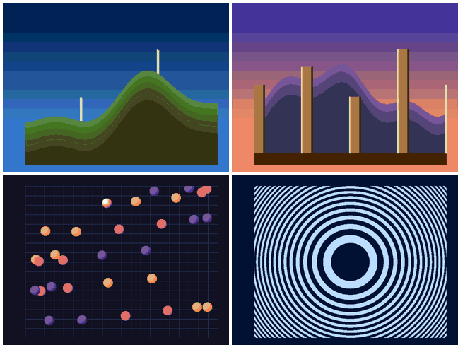
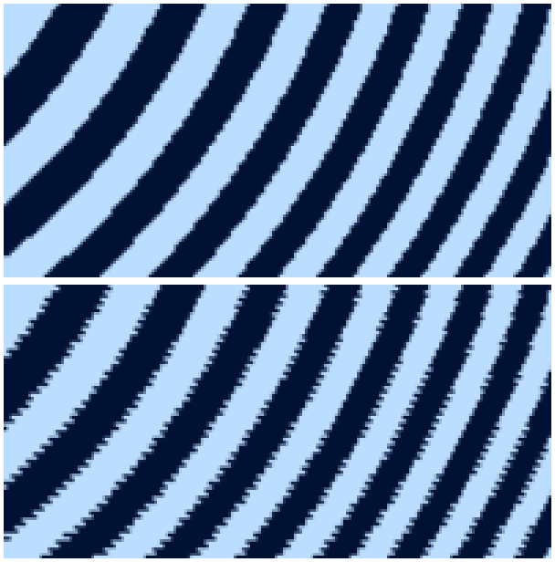
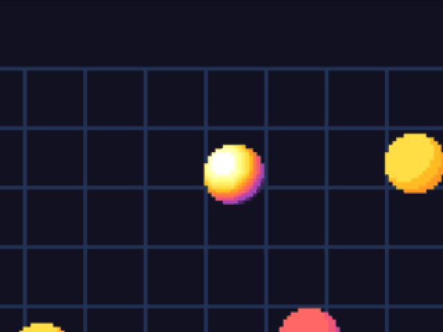

# 8. The display

v7's chapter on video was about one thing: telling PAL from NTSC. This one covers that, and the rest of what a demo needs to set up its own display: the window and the fetch, the bitplanes and their control registers, modulos, scrolling, dual playfield, interlace, sprites, and the two special colour modes. Everything here is the original chip set's (OCS) and ECS's, which every Amiga has; AGA's additions are in [the AGA chapter](09-aga.md).

There are four whole examples, each built both ways (with the machine taken and with the system running) like every v8 example:

- `examples/ch08_scroll.s`: smooth horizontal scrolling across a landscape three screens wide.
- `examples/ch08_dualpf.s`: dual playfield parallax: two playfields, each with its own bitplanes, modulo and scroll.
- `examples/ch08_sprites.s`: 31 balls from the 8 hardware sprites, used several times each down the screen, and an attached pair of 15 colours.
- `examples/ch08_interlace.s`: a 640 by 512 interlaced screen, from two copper lists.



## PAL and NTSC

An Amiga is made for one TV standard, and its Agnus chip counts lines for it:

| | PAL (Europe, Australia) | NTSC (North America, Japan) |
|---|---|---|
| Frames a second | 50 | 60 |
| Lines a frame | 312 (313 in an interlaced long frame) | 262 (263) |
| The usual display | 256 lines, from line `$2C` to `$12B` | 200 lines, from `$2C` to `$F3` |
| Color clock | 3,546,895 Hz | 3,579,545 Hz |

A line is 227 color clocks on PAL (227 and 228 in turn on NTSC): about 64 microseconds. The usual screen's top line is `$2C` on both too, so the difference is at the bottom: an NTSC display ends 56 lines sooner. That's v7's point, still true: a demo made for 256 lines loses its bottom fifth on NTSC, and one made for 200 leaves a PAL screen's bottom fifth empty.

The v8 examples set the display window for 256 lines in their copper lists, and change it for 200 in `Init` if the startup found NTSC:

```asm
        tst.b   PalDisplay              ; set by the startup
        bne.s   .pal
        move.w  #$f4c1,CopperWindowEnd+2        ; NTSC: the window ends at line $F4
.pal:
```

Which picture goes in the 200 lines is up to the demo: `ch06_gradient.s` starts its bitplane 56 rows further down on NTSC, so its skyline sits on the bottom of the screen either way.

### Finding out which

The startup does it the way v7 recommended, with v7's warning heeded:

- **Kickstart 2.0 and later:** the `PAL` bit (bit 2) of `gb_DisplayFlags` in GfxBase. Kickstart 2's boot menu lets ECS and AGA machines start in the other mode, and this tells you the mode the machine was started in, which is what's on the screen.
- **Kickstart 1.x:** the vertical blank frequency exec was started with, `VBlankFrequency` in ExecBase: 50 or 60. v7 found that 1.x's `gb_DisplayFlags` "can guess wrong", so it isn't used there.

The answer is in `PalDisplay`. It says how the machine was started, not what the monitor can show. From Kickstart 3.0 (V39) on, `REALLY_PAL` (bit 4 of `gb_DisplayFlags`) tells you what the machine's crystal is, if the boot menu has been used to switch.

### Switching: BEAMCON0, carefully

An ECS or AGA Agnus has `BEAMCON0` (`$1DC`), and its bit 5 (`PAL`) switches the line counting and sync between PAL and NTSC. v7 gave the pokes:

```asm
        move.w  #$0020,BEAMCON0(a5)     ; PAL: 50 Hz
        move.w  #$0000,BEAMCON0(a5)     ; NTSC: 60 Hz
```

v8 tried the second on an emulated Amiga 500+ (ECS), PAL, in `ch06_gradient.s`: the frame became 262 lines, the gradient stopped at the bottom of the NTSC frame, and writing `$0020` back as the demo ended left the CLI as it was. On an Amiga 500 with the original Agnus, which has no `BEAMCON0`, the write did nothing at all.

Be careful with it:

- The other bits of `BEAMCON0` matter: they set sync polarities, blanking, and the programmable modes the productivity and VGA-like screens use. These pokes set them all to 0, which is right only for a plain 15 kHz PAL or NTSC display. The Hardware Reference Manual's own advice is not to write it at all, and says a wrong value can (just possibly) harm a multisync monitor.
- Only the counting changes; the machine's clock, which comes from its crystal, doesn't. Whether the screen copes is up to the monitor: v7 noted that 1084-type monitors and multisyncs take both, and most American TVs won't take PAL.
- Put it back as you found it. Since it can't be read, that means knowing what it was (`PalDisplay` tells you which of the two plain values), and writing it in an `ExitHook` ([Startup and exit](04-startup-and-exit.md)).

v7's suggestion still stands: if your demo is made for PAL, ask an NTSC user before switching, rather than switching on your own.

## The display window and the fetch

Four registers set where the picture is and what's fetched for it. They're the ones every v8 copper list starts with:

```asm
        dc.w    DIWSTRT,$2c81           ; the window's top left: line $2C, pixel $81
        dc.w    DIWSTOP,$2cc1           ; its bottom right: line $12C, pixel $1C1
        dc.w    DDFSTRT,$0038           ; the fetch starts at color clock $38...
        dc.w    DDFSTOP,$00d0           ; ...and its last 16 pixels are fetched from $D0
```

### The window: DIWSTRT and DIWSTOP

The **display window** is the part of the screen where bitplanes (and sprites) can be seen; outside it there's only the background colour, `COLOR00`. `DIWSTRT` holds its top line (bits 15-8) and left pixel (bits 7-0); `DIWSTOP` the line and pixel just past its bottom right. The pixels are low resolution ones, and the lines non-interlaced ones, whatever mode the screen is in.

8 bits isn't enough for either, so the chips fill in a 9th:

- `DIWSTRT`'s horizontal and vertical start are taken as they are (0 to 255).
- `DIWSTOP`'s horizontal stop has 256 added: `$C1` is pixel `$1C1`.
- `DIWSTOP`'s vertical stop gets a 9th bit that's the opposite of its 8th: `$2C` (bit 7 clear) is line `$12C`; `$F4` (bit 7 set) is line `$F4`. So the bottom can be anywhere from line `$80` to `$17F`.

The usual 320 by 256 PAL screen is `$2C81` and `$2CC1`; NTSC's 200 lines end at `$F4C1`. On ECS, a further register, `DIWHIGH`, holds full 9-bit and 11-bit positions, and lifts these limits; the Hardware Reference Manual's Appendix C has it.

### The fetch: DDFSTRT and DDFSTOP

The window says where the picture is shown. **Data fetch** says when the bitplane DMA reads it. `DDFSTRT` and `DDFSTOP` are horizontal positions in color clocks, the same units as a copper WAIT's: one is 2 low resolution pixels.

A low resolution line is fetched 16 pixels (8 color clocks) at a time, and the manual recommends starting the fetch on a multiple of 8 (4 in high resolution). The data arrives a little after it's fetched, so the fetch starts 8.5 color clocks before the window:

- low resolution: `DDFSTRT` = window start / 2 - 8.5: `$81` / 2 - 8.5 = `$38`. `DDFSTOP` = `DDFSTRT` + 8 × (words a line - 1): for 20 words (320 pixels), `$38` + `$98` = `$D0`.
- high resolution: `DDFSTRT` = window start / 2 - 4.5 = `$3C`, and `DDFSTOP` = `DDFSTRT` + 4 × (words a line - 2): for 40 words, `$D4`.

Those are the Hardware Reference Manual's formulas. Make the fetch and the window agree, or the picture's edges show garbage or are cut off.

### Overscan, and its limits

A screen bigger than 320 by 256 is **overscan**: a bigger window, fetching more. The limits:

- The fetch can't start before `$18` or end after `$D8`: 25 words a line at most in low resolution. Horizontal blanking leaves 368 low resolution pixels that can be seen.
- Vertically, nothing shows in the vertical blank: from line 29 on PAL (21 on NTSC), so up to about 283 lines on PAL and 241 on NTSC.
- **A fetch that starts before `$38` costs sprites.** The sprite DMA's slots are just before the display's; an earlier fetch takes them. v8 tried it: with `DDFSTRT` `$30` sprite 7 vanished, and with `$28` sprites 6 and 7 did. Each 8 color clocks earlier loses one more.
- How much of the overscan a monitor or TV shows varies. The edges of a big overscan screen may be off a TV's edges, and well inside a monitor's. Keep what matters away from them.

## Bitplanes, and the modulo

A screen is up to six **bitplanes**: separate pictures one bit deep, each pixel's bits together making its colour's number. `BPLxPTH`/`BPLxPTL` point at each plane's top-left word. As each line is fetched, the pointers go up past it, so they must be set again for every frame: the copper does it, at the top of its list, every frame.

At the end of each line's fetch the **modulo** is added to the pointers: `BPL1MOD` for the odd planes (1, 3, 5), `BPL2MOD` for the even ones (2, 4, 6). A screen exactly as wide as it's shown needs a modulo of 0. A picture wider than the screen needs the bytes of each row that aren't fetched:

```asm
        dc.w    BPL1MOD,ROWBYTES-FETCHBYTES     ; skip the rest of the row
```

The modulo is a signed word, so it can be negative. A modulo of minus the bytes fetched shows the same line again; the copper can switch it on and off down the screen to stretch a picture.

The planes can be one after another in memory (each a whole picture), or **interleaved**: row 0 of plane 1, row 0 of plane 2, ... then row 1 of plane 1. Interleaved, each plane's pointer starts one row further on, and the modulo skips the other planes' rows. The blitter likes that ([the blitter](07-blitter.md#interleaved-bitplanes)).

## The control registers: BPLCON0, 1 and 2

`BPLCON0` sets the mode:

| Bit | Name | |
|---|---|---|
| 15 | `HIRES` | high resolution (640 pixels across) |
| 14-12 | `BPU` | how many bitplanes, 0 to 6 |
| 11 | `HOMOD` | hold-and-modify ([below](#ehb-and-ham)) |
| 10 | `DBLPF` | dual playfield ([below](#dual-playfield)) |
| 9 | `COLOR` | colour on the composite output (only the A1000 has colour composite; set it anyway) |
| 8 | `GAUD` | genlock audio |
| 3 | `LPEN` | light pen |
| 2 | `LACE` | interlace ([below](#interlace)) |
| 1 | `ERSY` | external sync, for a genlock: never set it yourself |

So `$1200` is one low resolution bitplane, `$4600` four in dual playfield, `$9204` one high resolution plane, interlaced. The other bits belong to ECS and AGA (super high resolution, AGA's eighth plane): keep them 0 unless you mean them, and see [AGA](09-aga.md). In high resolution there are at most four bitplanes on OCS and ECS.

`BPLCON1` is the horizontal **scroll** (delay) for each playfield: bits 3-0 for the odd planes, bits 7-4 for the even ones ([scrolling](#hardware-scrolling)).

`BPLCON2` sets **priorities**: which of the playfields and the four pairs of sprites is in front:

| Bits | Name | |
|---|---|---|
| 6 | `PF2PRI` | playfield 2 (the even planes) in front of playfield 1 |
| 5-3 | `PF2P` | where playfield 2 goes among the sprites: 0 in front of all, 4 behind all |
| 2-0 | `PF1P` | the same for playfield 1 |

The value `n` puts the playfield behind the first `n` pairs of sprites: 1 behind sprites 0 and 1, 2 behind 0 to 3, and so on. A catch: **in a single playfield, it's `PF2P` (bits 5-3) that places the screen among the sprites**, though the bitplanes are numbered from 1. The Hardware Reference Manual warns of it in a box, and v8 checked: in `ch08_sprites.s` (one bitplane), `BPLCON2` `$0004` left the balls *behind* the grid lines, and `$0020` put them in front. The example writes `$0024`, both, which works either way. With `BPLCON2` 0, every sprite is behind every non-zero pixel of the screen.

`BPLCON3` (ECS and AGA) and `BPLCON4` (AGA) add more. v8's examples write `BPLCON3` `$0C00` and `FMODE` 0 in their copper lists: on AGA, that puts the colour banks, sprites and fetch back to how OCS and ECS have them, whatever Workbench left ([AGA](09-aga.md)).

## Hardware scrolling

**Vertically**, a screen scrolls by its bitplane pointers: start one row further down the picture, and it moves up a line. Any amount, any frame, for nothing.

**Horizontally**, the pointers can only move a word at a time: 16 pixels. The pixels in between are done by `BPLCON1`'s delay, which shows each line's data 0 to 15 pixels later (to the right). For that to work, there must be data to fill in from the left: so the fetch **starts 16 pixels earlier**, fetching one more word than the screen shows. For the usual low resolution screen, `DDFSTRT` goes from `$38` to `$30`, and `DDFSTOP` stays at `$D0`: 21 words a line, so the modulo is the row's bytes less 42.

With the fetch 16 pixels early and no delay, the first word fetched is hidden to the left of the window, and the screen shows from the 17th pixel fetched. A delay of `d` moves everything `d` pixels right. So to show a picture from pixel `x`, with its pixel 0 at the start of a word, put one empty word to the left of the picture in memory, and:

- fetch from word `w` = (`x` + 15) / 16 of the row;
- with a delay of 16 × `w` - `x` (0 to 15) for both playfields.

`ch08_scroll.s` works it out in its vertical blank routine:

```asm
        move.w  d0,d1                   ; x
        add.w   #15,d1
        lsr.w   #4,d1                   ; w
        move.w  d1,d2
        lsl.w   #4,d2
        sub.w   d0,d2                   ; the delay
        move.w  d2,d0
        lsl.w   #4,d0
        or.w    d0,d2                   ; the same for both playfields
        move.w  d2,CopperScroll+2
        add.w   d1,d1                   ; w words is 2w bytes
```

v8 checked it pixel by pixel: built with `x` fixed at 0, 1, 15, 16, 17, 31 and 32, the landscape's posts moved exactly one pixel for each, across the word boundaries too.

The vertical blank routine writes the new pointers and delay into the copper list, and the copper sets them after a WAIT for line 16, so they're always written before the copper reads them. If the copper set them at the top of its list, at line 0, the processor would be writing them in the same moment, and a frame could get the old pointer with the new delay: a one-frame jerk ([the copper](06-copper.md#changing-a-list-while-its-shown)).

Remember the sprites: with `DDFSTRT` at `$30`, sprite 7 is gone ([above](#overscan-and-its-limits)). In high resolution, the delay counts in pairs of high resolution pixels (low resolution pixels, still), and the extra fetch is two words.

## Dual playfield

With `DBLPF` set in `BPLCON0`, the odd bitplanes make **playfield 1** and the even ones **playfield 2**: two separate screens, one in front of the other. Where the front one's pixels are 0, the back one shows through; where both are 0, the background colour does.

- With up to six low resolution planes, each playfield has up to three (seven colours and clear). In high resolution, two each.
- Playfield 1's colours are `COLOR01` to `COLOR07`; playfield 2's are `COLOR09` to `COLOR15`. (On AGA, `BPLCON3`'s bits 12-10 move playfield 2's colours; `$0C00` puts them at 8, as on OCS.)
- `PF2PRI` (`BPLCON2` bit 6) puts playfield 2 in front; normally playfield 1 is.
- Each has its own pointers, its own modulo (`BPL1MOD` for playfield 1, `BPL2MOD` for 2), and its own scroll (`BPLCON1`'s two halves). They share the fetch (`DDFSTRT`, `DDFSTOP`).

So two layers can scroll at different speeds, the parallax of a hundred games and demos. `ch08_dualpf.s` scrolls hills at a pixel a frame behind pillars at two, both fetching from `$30`:

```asm
        dc.w    BPLCON0,$4600           ; four bitplanes, dual playfield (bit 10), colour
        dc.w    BPLCON2,$0000           ; playfield 1 in front
```

Its vertical blank routine works out each playfield's word and delay as `ch08_scroll.s` does, and puts the two delays in `BPLCON1` together: playfield 1's in bits 3-0, playfield 2's in bits 7-4. Each picture repeats every 320 pixels, and is drawn 320 pixels wider than that, so any 320 pixels of a period can be shown, and the scroll goes round for ever.

If only one playfield scrolls, the Hardware Reference Manual's advice: give both the early fetch (it's shared), and make the still one's pointers 2 bytes lower and its modulo 2 less, so it doesn't move.

## Interlace

With `LACE` set, the display alternates between two kinds of frame: **long frames** (313 lines on PAL, 263 on NTSC) and **short frames** (312, 262). The long frame's lines fall between the short frame's on the screen, so together they make one picture of twice the lines: 512 on PAL, 400 on NTSC, at 25 or 30 whole pictures a second. That's the flicker everyone remembers interlace for: a thin horizontal line is shown in one frame in two.

The bitplanes are fetched as usual each frame, so the picture's rows have to be split between them: one frame shows rows 0, 2, 4 ..., the other rows 1, 3, 5 .... So:

- the modulo skips a row: the row's bytes (80 for a 640-wide plane);
- there are **two copper lists**, the same but for the bitplane pointers: one starts at row 0, the other at row 1;
- and each frame, the copper must start the right one.

`VPOSR` bit 15 (`LOF`) says which kind of frame it is: 1 in a long frame. The copper starts each frame from `COP1LC` before the processor gets a look in, so the vertical blank routine sets `COP1LC` for the *next* frame, which is the other kind:

```asm
VBlank:
        btst    #7,VPOSR(a5)            ; LOF: bit 15 of the word, bit 7 of its first byte
        beq.s   .short
        move.l  #CopperShort,COP1LC(a5) ; a long frame now: the next is short, rows 1, 3, 5...
        rts
.short:
        move.l  #Copper,COP1LC(a5)      ; a short frame now: the next is long, rows 0, 2, 4...
        rts
```

Which rows does the long frame show? The Hardware Reference Manual doesn't say. In FS-UAE, **the long frame shows rows 0, 2, 4**: `ch08_interlace.s` draws rings fine enough that the wrong order shows, and built the other way round, its rings came out combed, every pair of lines swapped.

The display window is still given in non-interlaced lines (`$2C81` and `$2CC1`), and the copper's WAITs count each frame's own lines. Keep an interlaced window an even number of lines tall, so both frames show as many.



## Sprites

The Amiga has eight **sprites**: small pictures, 16 pixels wide and any height, that the hardware puts on the screen wherever you say, over or under the playfields, without touching the bitplanes. Each has its own DMA channel, which fetches its data two words a line during the horizontal blank.

### A sprite's data

```asm
Ball:
        dc.w    $6d60,$7200             ; SPRxPOS, SPRxCTL: where it is
        dc.w    $0990,$07e0             ; line 1: the low bits of its 16 pixels, then the high bits
        dc.w    $13c8,$0ff0             ; line 2
        ...
        dc.w    $0000,$0000             ; the end
```

The two **control words** come first:

- `SPRxPOS`: bits 15-8 are the top line's low 8 bits; bits 7-0 are the horizontal start's high 8 bits.
- `SPRxCTL`: bits 15-8 are the low 8 bits of the line *after* the bottom; bit 7 attaches it ([below](#attached-sprites)); bit 2 is the top line's 9th bit, bit 1 the stop line's; bit 0 is the horizontal start's low bit.

Then two words for each line. Each pixel's colour is 2 bits: the first word gives bit 0, the second word bit 1. 0 is transparent; 1 to 3 are three colours. Sprites 0 and 1 use `COLOR17` to `COLOR19`, 2 and 3 `COLOR21` to `COLOR23`, 4 and 5 `COLOR25` to `COLOR27`, 6 and 7 `COLOR29` to `COLOR31`.

Positions are in low resolution pixels and non-interlaced lines, whatever the screen's mode. The line is the beam's line (`$2C` is the usual screen's top). For the horizontal start, v8 measured it in FS-UAE: **a sprite at `$80` + x lines up with pixel x** of a screen whose window starts at `$81`. `ch08_sprites.s` sets them like this:

```asm
        move.w  d4,d0
        add.w   #$80,d0                 ; the horizontal start
        move.w  d5,d1                   ; the top line
        move.w  d5,d2
        add.w   #BALLLINES,d2           ; the line after the bottom
        ...
        btst    #8,d2
        beq.s   .stoplow
        bset    #1,d1                   ; the stop line's 9th bit
.stoplow:
```

Sprites are shown only inside the display window, and only lines after the vertical blank.

### Showing them

The sprite pointers (`SPRxPTH`/`SPRxPTL`) go up as the data is fetched, like the bitplane pointers, so the copper sets all eight every frame. **Every sprite you don't use must point at a pair of zero words** (an empty sprite), or it shows whatever its pointer happens to point at. And sprite DMA has to be on: the v8 startup leaves it off, and `ch08_sprites.s` has its copper list switch it on (the copper can write `DMACON`):

```asm
        dc.w    DMACON,DMAF_SETCLR!DMAF_SPRITE
```

Change a sprite's control words while its DMA is reading them, and you can get the top from one frame and the bottom from the next. `ch08_sprites.s` keeps two copies of all its sprite data: `Frame` writes the next frame's positions into one, while the sprite DMA reads the other; when it's done, the vertical blank routine swaps them, by changing the pointers the copper sets after its WAIT for line 16.

### Reusing sprites down the screen

When a sprite ends (the beam reaches its stop line), its DMA reads the next two words as new control words. If they're another sprite's position, further down, the same channel shows that too. So one channel can show any number of sprites, one under another:

```asm
        dc.w    pos1,ctl1               ; the first use
        dc.w    ...                     ; its lines
        dc.w    pos2,ctl2               ; the second: it must start at least one line below the first's end
        dc.w    ...
        dc.w    0,0                     ; the end
```

The line on which a use ends is spent fetching the next one's control words, so there must be at least one empty line between a use's last line and the next one's first. v8 saw it: a second use whose top was the first's stop line (the line after its last) showed a gap of one line between them. In `ch08_sprites.s`, sprites 0 to 5 are each used five times, in bands 50 lines apart; 30 balls, from six channels.

The sprite's colours can change between uses too: the copper can rewrite `COLOR17` to `COLOR31` on the lines in between.

### Attached sprites

Two sprites of a pair (0 and 1, 2 and 3, 4 and 5, 6 and 7) can be **attached**: set bit 7 of the odd sprite's `SPRxCTL`, put them at the same position, and each pixel takes 2 bits from each, a number from 0 to 15. 0 is transparent; 1 to 15 are `COLOR17` to `COLOR31`. The even sprite's words are bits 0 and 1, the odd sprite's bits 2 and 3. If they come apart, they're two 3-colour sprites again.

The 15 colours are all the sprite colours, shared with the other pairs. `ch08_sprites.s` makes that a virtue: `COLOR17` to `COLOR31` are one ramp from dark purple to white, the attached pair (sprites 6 and 7) uses all of it for a smoothly shaded ball, and each other pair takes three steps of it.



### Sprites on AGA

AGA sprites can be wider and in other resolutions, and Kickstart 3.0's `LoadView(0)` doesn't put the sprites' resolution back (v7 found that bug). v8's examples write `BPLCON3` and `FMODE` in their copper lists, which sets both back to OCS's on AGA; the details, and the rest, are in [AGA](09-aga.md).

## EHB and HAM

Two modes give more colours from six low resolution bitplanes. Both are low resolution only on OCS and ECS, and six planes take half the processor's chip RAM cycles during the display ([the copper](06-copper.md#what-the-copper-costs) has the details).

**Extra Half-Brite** (EHB): `BPLCON0` with six bitplanes, `HOMOD` and `DBLPF` clear (`$6200`). Planes 1 to 5 choose one of the 32 colour registers as usual; where plane 6 is 1, that colour is shown at half brightness (each component halved). 64 colours from 32 registers.

**Hold-and-modify** (HAM6): `HOMOD` set, with six (or five) bitplanes (`$6A00`). Planes 5 and 6 say what each pixel does with planes 1 to 4's value:

| Planes 6, 5 | The pixel is |
|---|---|
| 00 | colour register 0 to 15, chosen by planes 4 to 1 |
| 01 | the pixel to its left, with blue changed to planes 4 to 1's value |
| 10 | the same, with red changed |
| 11 | the same, with green changed |

So any of the 4,096 colours can be on screen at once, but each pixel can only change one component of the one before; sharp edges between very different colours take up to three pixels to arrive at, and smear. HAM suits pictures, not things drawn and moved. AGA's HAM8 is in [AGA](09-aga.md).

## What changed from v7

- **v7's video chapter was PAL and NTSC only.** Its advice holds: find which, and look after both. Its two checks (`VBlankFrequency` for Kickstart 1.x, `gb_DisplayFlags` from 2.0) are the startup's.
- **`BEAMCON0`**: v7's pokes are right for a plain display on an ECS or AGA machine (v8 tried them), but they reset the register's other bits, do nothing on the original chips, and should be undone as the demo ends.
- **The rest is new**: the window and the fetch, scrolling, dual playfield, interlace, sprites, EHB and HAM, each checked against the Hardware Reference Manual and on the emulator.
- **Two things the manual says that matter more than they look**, both tested: an early fetch costs sprites, and in a single playfield it's `PF2P` that places the sprites.

## How it was tested

The four examples were built both ways (`OS_FRIENDLY=0` and `1`, with `AUTOEXIT=500`) and run in FS-UAE:

- an Amiga 500 (68000) with Kickstart 1.3 and with Kickstart 3.1;
- Kickstart 3.1 with a 68020 and with a 68040, each with fast RAM;
- an Amiga 1200 (AGA) with Kickstart 3.1, taking the machine;
- an NTSC Amiga 500 with Kickstart 1.3, with the system running.

Every run showed the effect, and then the CLI with "back in AmigaDOS, return code OK" after the demo had ended. Besides the examples, small test programs (not in `examples/`) checked: where sprites line up with the playfield; which sprites an early `DDFSTRT` loses; the sprite priorities in a single playfield; the scroll position at fixed values of x; the interlaced rows both ways round; and `BEAMCON0` on an Amiga 500+ and an Amiga 500. The positions given are FS-UAE's, measured from its screen captures.
