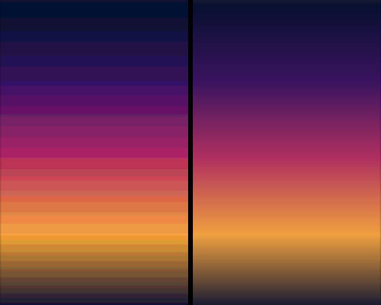
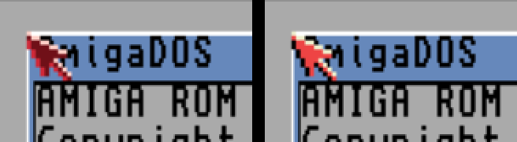

# 9. AGA

[‹ The display](08-display.md) · [Contents](README.md) · [Chunky to planar ›](10-chunky-to-planar.md)

> **AGA only.** Everything in this chapter needs an AGA machine: an Amiga 1200, an Amiga 4000 or a CD32. The examples check for AGA as they start, and on any other Amiga they show nothing and end at once.

AGA came in 1992 with the A4000 and the A1200, and the CD32 used it the year after. Commodore called it AA; everyone else calls it AGA. Two of the three custom chips are new: **Alice** takes the place of Agnus (DMA, the copper, the blitter), and **Lisa** the place of Denise (the display). Paula, and so the sound, is the same as ever. What AGA adds is all about the display:

- **256 colour registers of 24 bits each**, where OCS and ECS have 32 of 12 bits.
- **8 bitplanes**: 256 colours on screen at once, and **HAM8**.
- **Wider fetches** from chip RAM, 32 or 64 bits at a time instead of 16, so the display takes less of the bus.
- **Sprites 32 or 64 pixels wide**, at any resolution, with their colours from any 16 of the 256.
- **Finer scrolling**, in quarter-pixel steps, over 64 pixels instead of 16.

The blitter is the same 16-bit blitter, at the same speed. On an A1200 the processor (a 68020) is usually the better choice for drawing; [the processors chapter](14-processors.md) measures it.

There are three examples, each built both ways (taking the machine, and with the system running), like every v8 example:

- [`examples/ch09_256colours.s`](examples/ch09_256colours.s): 8 bitplanes fetched 64 bits at a time, a picture in all 256 colours, and a 24-bit palette that cycles, set by the copper every frame. The picture is drawn in chunky form and turned into bitplanes once, at the start.
- [`examples/ch09_24bit_gradient.s`](examples/ch09_24bit_gradient.s): a copper gradient set in 24-bit colour beside the same gradient in 12-bit colour, so the difference shows.
- [`examples/ch09_sprites.s`](examples/ch09_sprites.s): four sprites 64 pixels wide, with their colours moved to 224-239 and set in 24 bits, bouncing in quarter-pixel steps.


## AGA's registers are here to stay

v7's AGA chapter began with a warning in capitals: "AGA Registers are temporary. They will change. Do not rely on this documentation." Future Amigas would not support any of them; programs should open AGA screens through the operating system; and v7 begged readers not to use the chapter in commercial software, or it would have to be withdrawn.

That was Commodore's position in 1993. It hadn't documented AGA's registers for developers, it wanted AGA screens opened through graphics.library, and the next chipset, AAA, was on its way. Commodore went bankrupt in 1994. AAA never shipped, AGA was the last chipset, and its registers never changed. Every AGA demo since has programmed them directly.

So v8 drops the warning. The registers' names are in the NDK's `hardware/custom.i` (`bplcon3`, `bplcon4`, `fmode`), but not what their bits do. For that, this chapter was checked against Commodore's AA register descriptions as copied in [the Amiga Development wiki](http://amiga-dev.wikidot.com/hardware:bplcon3) and [ikod.se's AGA guide](https://www.ikod.se/references/amiga-aga-guide/registers-by-name/), against [WinUAE's source](https://github.com/tonioni/WinUAE) (whose author tests his emulation against real machines), and on emulated machines.

## Is it AGA?

### What v7 said: graphics.library's ChipRevBits0

From Kickstart 3.0 (V39) on, graphics.library has a byte in its base, `gb_ChipRevBits0`, with a bit for each newer chip:

| Bit | Name (`graphics/gfxbase.i`) | Set when there's... |
|---|---|---|
| 0 | `GFXB_HR_AGNUS` | an ECS Agnus (or Alice) |
| 1 | `GFXB_HR_DENISE` | an ECS Denise (or Lisa) |
| 2 | `GFXB_AA_ALICE` | Alice |
| 3 | `GFXB_AA_LISA` | Lisa |

v7's test was `btst #GFXB_AA_ALICE,gb_ChipRevBits0(a6)`, and v7 added that it "will not work unless the V39 SetPatch command has been executed": the AGA bits are only set once something calls graphics.library's `SetChipRev()`, which SetPatch does. That's still so on Kickstart 3.1. A probe run on emulated machines, with no SetPatch, found:

| Machine | `ChipRevBits0` at boot | after `SetChipRev(SETCHIPREV_BEST)` |
|---|---|---|
| A1200, Kickstart 3.1 (40.63, the A500/A600/A2000 ROM) | `$13`: no AGA bits | `$1F` |
| CD32, its own Kickstart 3.1 (40.60) | `$13`: no AGA bits | `$1F` |
| A1200, FS-UAE's built-in AROS ROM | `$00` | `$0F` |
| A600 (ECS), Kickstart 3.1 | `$03` | `$03` |

(Bit 4, set on the Commodore ROMs, is `GFXB_AA_MLISA`, "internal use only".) So on Kickstart 3.1, too, the AGA bits mean "AGA is there **and turned on**". From the CLI of a normally booted A1200 SetPatch has run, and the test works. From a trackmo, or any disk whose startup-sequence doesn't run SetPatch, it says "no AGA" on an A1200. A trackmo can call `SetChipRev(SETCHIPREV_BEST)` itself, as SetPatch does (the autodoc says that's what it's there for); a demo started from the CLI shouldn't, because it changes the system for good.

### Asking the chip: DENISEID

ECS added a register that says which video chip is there: `DENISEID`, at `$DFF07C`. Lisa answers `$F8` in its low byte, ECS's Denise `$FC`. The first Denise, in most A500s, has no such register at all: reading it gives whatever happens to be on the bus. v7 warned that How To Code 4's AGA test read it once, and on an A500 sometimes got a false "yes". Read it many times, and only a chip that's really answering gives the same value every time:

```asm
; Returns d0 = 1 (and the Z flag clear) on AGA, 0 if not. a5 = CUSTOM.
IsAGA:
        move.w  DENISEID(a5),d0
        cmp.b   #$f8,d0                 ; Lisa: $F8 in the low byte
        bne.s   .no
        moveq   #32-1,d1
.again:
        move.w  DENISEID(a5),d2         ; the same answer every time?
        cmp.b   d0,d2
        bne.s   .no
        dbf     d1,.again
        moveq   #1,d0
        rts
.no:
        moveq   #0,d0
        rts
```

Compare only the low byte: the high byte isn't defined (WinUAE gives `$FCF8` on an A4000, `$00F8` on an A1200). This works on any Kickstart, with or without SetPatch, with the system running or the machine taken, and it's what v8's AGA examples use. On the emulated machines it read `$00F8` on the A1200 and CD32, `$FFFC` on the A600, and `$FFFF` on the A500 (the emulator's idea of an empty bus; a real one may give anything, which is why it's read 33 times).

(`VPOSR`'s bits 8-14 give Alice's ID in the same way: `$23` on the emulated PAL A1200, against `$00` for the A500's Agnus and `$20` for the A600's ECS Agnus. One test is enough; this chapter uses Lisa's.)

### When it isn't there

Each example calls `IsAGA` first thing in `Init`. Without AGA it cuts its copper list short after the first move (`BPLCON0` with no bitplanes), sets `ExitNow`, and returns: the startup shows that empty display for one frame and gives the machine back.

```asm
Init:
        bsr     IsAGA
        bne.s   .aga
        move.l  #$fffffffe,CopperAGA    ; the copper list ends here
        st      ExitNow
        rts
.aga:
```

Run on an A500 with Kickstart 1.3 and 3.1, and on an A600, each example returned to the CLI at once, with the CLI's colours and pointer as they were. A real demo should also say *why* it ended: print "This demo needs AGA" before taking the machine, while the system can still show it.

## Fetching more at a time: FMODE

On OCS and ECS, each bitplane is read from chip RAM 16 bits at a time. Alice can read 32 or 64 bits in one go, because the A1200's and A4000's chip RAM is 32 bits wide and can work in page mode, giving two 32-bit reads for the time of one. The new register `FMODE` (`$DFF1FC`) chooses:

| Bits | Name | What they do |
|---|---|---|
| 0 | `BPL32` | bitplanes: 32-bit bus |
| 1 | `BPAGEM` | bitplanes: page mode (double CAS) |
| 2 | `SPR32` | sprites: 32-bit bus |
| 3 | `SPAGEM` | sprites: page mode |
| 14 | `BSCAN2` | bitplane scan doubling (the system's 31 kHz modes use it; leave it 0) |
| 15 | `SSCAN2` | sprite scan doubling (leave it 0) |

For the bitplanes, bits 0-1 are the **fetch mode**:

| `FMODE` bits 1-0 | Fetch | Called |
|---|---|---|
| 0 | 16 bits | 1x: as OCS and ECS |
| 1 | 32 bits | 2x |
| 2 | 32 bits | 2x, in the register descriptions; don't use it |
| 3 | 64 bits | 4x |

v7 found that 2 had the "same effect" as 1, "but different things happen... Not sure why!". The registers' description gives 2 as a 32-bit fetch made of two 16-bit page-mode reads. In FS-UAE (3.1.66) it looked just like 1. Today's WinUAE emulates it differently: the first 16 bits of each fetch are shown twice. v8 couldn't check which a real A1200 does. Use 1 for 2x and 3 for 4x, as everyone does.

Why fetch more? Because the display then takes fewer of chip RAM's turns. A low resolution display with 8 bitplanes at 1x takes **every** turn while it fetches, from `DDFSTRT` to `DDFSTOP`: on those lines the copper and the processor get none at all (in chip RAM). At 4x the same display reads all eight planes in 8 turns out of every 32, and leaves the other 24. That's the time v7 meant when it said wider fetches "give you more processor time to play with". ([The processors chapter](14-processors.md) measures what bitplanes cost the processor.)

The catch is that bigger fetches need everything lined up to them.

## Alignment

At 2x the display reads 4 bytes at a time, and at 4x, 8 bytes. It reads them from a 4- or 8-byte boundary: so with 4x fetch,

- **every bitplane pointer must be a multiple of 8**,
- **every modulo must be a multiple of 8**, and
- the width fetched is a multiple of 64 pixels (8 bytes).

At 2x, the same with 4 (and 32 pixels). Get it wrong and the display goes wrong, not just a few pixels off: WinUAE reads the aligned 64 bits and shows some of the words twice, and coders on the ADA forum (below) report planes out of line, or a black screen, on real A1200s. The same goes for **sprites**: a 64-pixel sprite's data must be on an 8-byte boundary, a 32-pixel one's on 4.

v7 said copper lists must be 64-bit aligned too. They needn't: the copper reads one word at a time, on every chipset.

Getting memory on an 8-byte boundary is easy. `AllocMem` hands out memory in blocks of 8 bytes (`MEM_BLOCKSIZE` in the NDK's `exec/memory.i`), and the sections of a program the system loads start on one too. But nothing promises more, and a variable placed before your screen in the same section moves it, so do as v7 suggested and round up: allocate 8 bytes more and start at the first boundary inside. The examples do it for their screen and sprites:

```asm
        move.l  #ScreenSpace+7,d0       ; ScreenSpace is 8 bytes bigger than the screen
        and.w   #$fff8,d0               ; the first multiple of 8 in it
        move.l  d0,ScreenStart
```

(From Kickstart 3.0, `AllocBitMap()` with `BMF_DISPLAYABLE` gives bitplanes lined up for any AGA display.) [General guidelines](03-general-guidelines.md) has more on allocating on a boundary.

The rows must line up too. With **interleaved** bitplanes (each row of the screen holds a row of every plane in turn), every plane's start is the screen's start plus a multiple of the row's width, and the modulo is the other planes' rows: with 40-byte rows, as in `ch09_256colours.s`, that's 280 for 8 planes, a multiple of 8. A row that isn't a multiple of 8 bytes wide can't be shown at 4x.

## The fetch mode each display needs

The more bitplanes, and the higher the resolution, the more must be read in the same time. Each fetch mode has a most it can do, and a display needing more than that shows no bitplanes at all (so WinUAE's source has it, noting a Sanity demo that depends on it). This is v7's table, checked against WinUAE's:

| Resolution | 1x | 2x | 4x |
|---|---|---|---|
| Low (320 pixels) | up to 8 bitplanes | up to 8 | up to 8 |
| High (640) | up to 4 | up to 8 | up to 8 |
| Super-high (1280) | up to 2 | up to 4 | up to 8 |

So 8 bitplanes in low resolution work at 1x, with no alignment to worry about, at the cost of every turn of the bus while they're fetched. High resolution with more than 16 colours needs 2x; super-high resolution needs 2x for 8 or 16 colours, and 4x for more. v7 listed Productivity mode (640 by 480 at 31 kHz) with super-high resolution: its pixels are as short (35 ns), so it needs the same.

The rule v7 gave still holds: use the widest fetch your alignment allows, and the display takes the least of the bus.

## Where the fetch starts and stops: DDFSTRT and DDFSTOP

With bigger fetches the display is read in bigger blocks: in low resolution, 16 pixels at 1x, 32 at 2x and 64 at 4x, which take `$08`, `$10` and `$20` in `DDFSTRT`'s units. As at 1x, `DDFSTOP` is where the last block starts. A 320-pixel low resolution screen with `DIWSTRT` at `$81`, at each fetch mode:

| Fetch | Blocks | `DDFSTRT` | `DDFSTOP` |
|---|---|---|---|
| 1x | 20 of 16 pixels | `$38` | `$D0` (`$38` + 19 × `$08`) |
| 2x | 10 of 32 | `$38` | `$C8` (`$38` + 9 × `$10`) |
| 4x | 5 of 64 | `$38` | `$B8` (`$38` + 4 × `$20`) |

The picture still starts at `$81`: the display window doesn't change, and the data arrives in time for it. With 4x, `ch09_256colours.s` was tried with other stops. `$A0` (which a lot of AGA code uses: it's in krabob's table, below) to `$B8` gave the five blocks. `$98` gave four, and each line took its start 8 bytes too early, shearing the picture. From `$C0` on, the display broke up completely in FS-UAE. (Mikael Kalms, on the [ADA forum](https://ada.untergrund.net/?p=boardthread&id=1022), gives `$C0` as five blocks on real hardware; `$B8` is right either way.) The 1x and 2x values were tried too, with the same picture.

For a wider display, start the fetch on a block boundary: at 4x the blocks start at `$18`, `$38`, `$58` and so on, as Kalms explains in the same thread.

## 256 colours: 8 bitplanes

The number of bitplanes is in `BPLCON0`'s bits 12-14 (`BPU0`-`BPU2`), as always, which count up to 7. For 8, AGA adds bit 4, `BPU3`: set it and clear the other three.

```asm
        dc.w    BPLCON0,$0210           ; 8 bitplanes (BPU3), colour on
        dc.w    BPLCON0,$7200           ; 7 bitplanes, as before
```

v7's notes on the other new bits still hold:

- **6 bitplanes** are still extra half-brite (64 colours, the last 32 half as bright as the first) unless `BPLCON2`'s bit 9, `KILLEHB`, is set; then they're 64 colours of their own. 7 bitplanes are 128 colours.
- `BPLCON0`'s bit 6, `SHRES`, is super-high resolution (1280 pixels across), as on ECS.
- In **dual playfield** mode each playfield can have up to 4 bitplanes (16 colours). Playfield 2's colours start at the colour given by `BPLCON3`'s bits 10-12 (`PF2OF`): 3, which gives colour 8 as on OCS, is the value at reset, and 0 to 7 give colours 0, 2, 4, 8, 16, 32, 64 and 128.

`ch09_256colours.s` shows 8 bitplanes at 4x. Its screen is 320 by 256, interleaved, and its picture uses every colour: a zone plate, where the colour is the square of the distance from the middle. Below the display, the copper sets all 256 colours in 24 bits, and every frame the program moves them one step round the palette, so the rings flow.

It also sets **`BPLCON3`'s bit 5, `BRDRBLNK`**: the border is black, whatever colour 0 is. Colour 0 is one of the picture's colours here, and without it the border would flash through the palette. (`BRDRBLNK` is an ECS bit, and does nothing unless `BPLCON0`'s bit 0, `ECSENA`, is set.)

## 24-bit colour: two writes and a bank

AGA has 256 colour registers of 24 bits, but only the same 32 addresses for them (`COLOR00` to `COLOR31`) that hold 12 bits each. Two bits of `BPLCON3` choose which colours and which bits a write reaches:

| `BPLCON3` | Name | |
|---|---|---|
| bits 13-15 | `BANK0`-`BANK2` | which 32 colours `COLOR00`-`COLOR31` are: bank 0 is colours 0-31, bank 1 is 32-63, ... bank 7 is 224-255 |
| bit 9 | `LOCT` | 0: a write sets the high 4 bits of red, green and blue; 1: it sets the low 4 bits |

A write with `LOCT` clear sets **the low 4 bits too**, to a copy of the high 4. That's what keeps old programs right: their 12-bit `$0F80` becomes `$FF8800`, the full orange it always was. So to set a 24-bit colour, write the high halves first and the low halves second:

```asm
; Colour 0 = $123456: red $12, green $34, blue $56
        move.w  #$0c00,BPLCON3(a5)      ; bank 0, LOCT clear
        move.w  #$0135,COLOR00(a5)      ; the high halves: 1, 3, 5 (and, for now, the low halves the same)
        move.w  #$0e00,BPLCON3(a5)      ; LOCT set
        move.w  #$0246,COLOR00(a5)      ; the low halves: 2, 4, 6
        move.w  #$0c00,BPLCON3(a5)      ; LOCT clear again
```

Write them the other way round and the second write wipes out the first. v7 had this right, apart from a slip: its example of `$123456` wrote `$0245` for the low halves, which gives `$123455`. Its example also wrote `$0000` and `$0200` to `BPLCON3`, which clears the playfield 2 offset (bits 10-12, normally 3); `$0C00` and `$0E00` keep it as the system has it.

The same in a copper list, and to set a colour in another bank, put the bank in bits 13-15:

```asm
        dc.w    BPLCON3,$ec00           ; bank 7 (colours 224-255), LOCT clear
        dc.w    COLOR01,$0711           ; colour 225: the high halves
        dc.w    BPLCON3,$ee00           ; bank 7, LOCT set
        dc.w    COLOR01,$0008           ; colour 225: the low halves (so it's $701018)
        dc.w    BPLCON3,$0c00           ; bank 0, LOCT clear, as everything else expects
```

A full 256-colour palette is 8 banks of 64 writes, plus 16 to `BPLCON3`: 528 copper moves, about 10 lines' worth. Put it where it can't be seen being made: in the vertical blank, or below the display as `ch09_256colours.s` does. That also leaves it alone while the program writes the next frame's colours into the list, near the top of the frame. (On NTSC the display ends at line `$F4`, and the example moves its palette there.)

Always leave `BPLCON3` with bank 0 and `LOCT` clear when you've finished: everything that comes after (your own colour changes, and the system's) expects it.



`ch09_24bit_gradient.s` shows the difference. Every line of the display has its own colour, from a slow gradient: on the left, colour 0 is written once, the old way, so it only has the high 4 bits of each component, and slow changes become bands; on the right, colour 1 is written twice, and the gradient is smooth. Both are written to the left of the display, in the horizontal blank, so the change is never seen half done. (The two halves are bitplanes: one plane, the same row on every line, with a modulo of -40.)

24 bits cost the copper: four moves for a colour change instead of one. With the high halves only, a colour changes in one move, as on OCS, but in 12-bit steps.

## BPLCON4: XOR, and the sprites' colours

`BPLCON4` (`$DFF10C`) is new with AGA:

| Bits | Name | What they do | At reset |
|---|---|---|---|
| 8-15 | `BPLAM` | XORed with each bitplane pixel's colour number before it's looked up | 0 |
| 4-7 | `ESPRM` | the even sprites' (0, 2, 4, 6) colours: from this × 16 | 1 (colours 16-31) |
| 0-3 | `OSPRM` | the odd sprites' (1, 3, 5, 7) colours: from this × 16 | 1 (colours 16-31) |

**`BPLAM`** changes every pixel's colour at once, with one write: `$80` XOR swaps each colour for the one 128 away, so a picture drawn in colours 0-127 shows in 128-255 instead. Two palettes for the price of one register, flipped on any line the copper likes.

**`ESPRM` and `OSPRM`** move the sprites' colours. As on OCS, sprites 0 and 1 use 4 colours (one transparent), 2 and 3 the next 4, and so on, 16 colours in all; AGA lets those 16 be any 16-colour group of the 256, separately for the even and the odd sprites. `$0011` is the old arrangement: colours 16-31 for both. v7's table of these bits had the even and odd sprites the wrong way round, and its colour numbers one out (15, 31, 47 and so on, where the groups start at 16, 32, 48).

Two mistakes to avoid:

- **Writing 0** puts every sprite's colours in 0-15: on top of the playfield's.
- **Leaving it changed.** The system's first copper list sets `BPLCON3` (to `$0C00`) and `FMODE` (to 0) every frame, but not `BPLCON4`, with AGA turned on or not; and on the emulated A1200, without SetPatch, nothing else set it either. A demo that ends with it changed leaves the mouse pointer in the demo's colours:



The v8 startup puts `BPLCON4` back to `$0011` on an AGA machine as every demo ends, after the system's own copper list is back, so nothing can write it again. A demo needs no code of its own for that. But a demo on another startup, or one that changes `BPLCON3` and `FMODE` too, can do as `ch09_sprites.s` does. Writing `BPLCON4` from the processor isn't enough there, because the demo's copper list could write it again before the copper is stopped; so its exit routine (given to the startup through `ExitHook`, as [the startup chapter](04-startup-and-exit.md) describes) points the copper at a three-line list that sets `BPLCON4`, `BPLCON3` and `FMODE` back to the values the system starts with:

```asm
Restore:                                ; called by the startup as the demo ends
        move.l  #CopperRestore,COP1LC(a5)
        move.w  d0,COPJMP1(a5)
        rts

CopperRestore:                          ; in chip RAM
        dc.w    BPLCON4,$0011
        dc.w    BPLCON3,$0c00
        dc.w    FMODE,$0000
        dc.w    $ffff,$fffe
```

## Sprites


### Wider: FMODE's sprite bits

`FMODE`'s bits 2-3 set every sprite's width:

| `FMODE` bits 3-2 | Sprite width |
|---|---|
| 0 | 16 pixels, as before |
| 1 or 2 | 32 pixels |
| 3 | 64 pixels |

A wide sprite's data is the 16-pixel kind made wider. Its two control words (`SPRxPOS` and `SPRxCTL`) are each the first word of a fetch of 32 or 64 bits, the rest being ignored; then each line is that many bits of the sprite's first plane, then the same of its second; and two fetches of zeros end it. For 64 pixels:

```asm
        cnop    0,8                     ; on an 8-byte boundary (or round up, as the examples do)
Sprite:
        dc.w    pos,0,0,0               ; SPRxPOS, and 48 bits that are ignored
        dc.w    ctl,0,0,0               ; SPRxCTL, and 48 more
        dc.l    $ffffffff,$ffffffff     ; line 1: 64 pixels of the first plane...
        dc.l    $00000000,$ffffffff     ; ...and 64 of the second
        ; ... the other lines
        dc.l    0,0,0,0                 ; the end
```

The width is for all eight sprites at once, and a 64-pixel sprite still has 3 colours (or 15 when two are attached).

### Resolution: BPLCON3's SPRES bits

| `BPLCON3` bits 7-6 | `SPRES` | Sprite pixels |
|---|---|---|
| 00 | ECS default | low resolution, or high resolution on a super-high resolution screen |
| 01 | | low resolution (140 ns) |
| 10 | | high resolution (70 ns) |
| 11 | | super-high resolution (35 ns) |

v7's version of this table had the low resolution row twice, where the second should be `10`.

### Position, to a quarter of a pixel

A sprite's position across has always been 9 bits, in low resolution pixels: 8 in `SPRxPOS` and the lowest in `SPRxCTL`'s bit 0. ECS added a bit for half a pixel, and AGA one for a quarter:

| `SPRxCTL` bit | | Step |
|---|---|---|
| 0 | as always | 1 low resolution pixel |
| 4 | ECS and AGA | 1/2 (70 ns) |
| 3 | AGA | 1/4 (35 ns) |

`ch09_sprites.s` keeps each ball's position in quarter pixels, and moves some of them less than a pixel a frame, which on OCS would jerk.

### What else they need

- **Bitplanes on.** In the emulator, the sprites didn't show at all with `BPLCON0` set to no bitplanes: the video chip only starts showing sprites on a line once the bitplanes' data has started there (WinUAE's source says so, for every chipset). `ch09_sprites.s` shows one bitplane of zeros: a single 40-byte row, shown on every line with a modulo of -40.
- **Their DMA slots.** Sprites are fetched early in each line, in the slots before the bitplanes usually start. Start the bitplane fetch earlier and sprites are lost, as on OCS; with 4x fetch from `$18` (for scrolling, below), only sprite 0 was left in the emulator, as krabob's table (below) says.
- **The startup leaves sprite DMA off** when it takes the machine. `ch09_sprites.s` sets every sprite pointer in its copper list, then turns sprite DMA on in `Frame`.

### v7's sprite resolution bug

v7 warned that Kickstart 3.0 didn't put the sprites' resolution back when a demo called `LoadView(NULL)`, so a demo's sprites could appear in high resolution, and it gave a way to set it through `VideoControl()`. On Kickstart 3.1, the system's first copper list (`gb_copinit`, which runs every frame after `LoadView(NULL)`) sets `BPLCON3` to `$0C00` and `FMODE` to 0, whether AGA is turned on or not: the sprites' resolution and width are back to normal. Whether 3.0 did, v8 couldn't check (there was no 3.0 ROM to test). Either way, the cure is simpler than v7's: an AGA demo's own copper list sets `FMODE`, `BPLCON3` and `BPLCON4` every frame, as the examples do, and then nothing the system left behind matters.

## Smoother scrolling: BPLCON1

On OCS, `BPLCON1` delays each playfield by 0 to 15 low resolution pixels: 4 bits for the odd bitplanes (playfield 1), 4 for the even (playfield 2). AGA gives each 8 bits, in steps of a quarter of a low resolution pixel (35 ns, a super-high resolution pixel), so a delay of up to 63¾ pixels. The new bits sit around the old ones, so an old value means the same:

| Delay bits | Playfield 1 (odd planes) | Playfield 2 (even planes) |
|---|---|---|
| H0-H1: quarter and half pixel | bits 8-9 | bits 12-13 |
| H2-H5: 1 to 8 pixels (the old bits) | bits 0-3 | bits 4-7 |
| H6-H7: 16 and 32 pixels | bits 10-11 | bits 14-15 |

So a delay `d` in quarter pixels, the same for both playfields, is:

```asm
; d0 = delay in quarter pixels (0-255); returns the BPLCON1 value in d1
        move.w  d0,d1
        lsr.w   #2,d1
        and.w   #$000f,d1               ; H2-H5 to bits 0-3
        move.w  d0,d2
        and.w   #$0003,d2
        lsl.w   #8,d2                   ; H0-H1 to bits 8-9
        or.w    d2,d1
        move.w  d0,d2
        and.w   #$00c0,d2
        lsl.w   #4,d2                   ; H6-H7 to bits 10-11
        or.w    d2,d1
        move.w  d1,d2
        lsl.w   #4,d2                   ; the same for playfield 2, 4 bits up
        or.w    d2,d1
```

v7 gave the bits rightly, though it called the first playfield "playfield 0" in one sentence and "playfield 1" in the next. What it didn't say is that **the range depends on the fetch mode**: 16 pixels at 1x, 32 at 2x, 64 at 4x. The delay can be at most one fetch's worth of pixels. Tried in the emulator, with `BPLCON1` = `$8888` (40 pixels for both playfields): at 4x the picture moved 40 pixels; at 1x it moved 8, the top bits ignored. (The quarter-pixel bits work too, but FS-UAE draws an AGA screen at high resolution, so it showed them in half-pixel steps.)

To scroll smoothly, the display has to fetch one block more than it shows, as on OCS, where the fetch starts 16 pixels early. At 4x the block is 64 pixels, so:

- `DDFSTRT` is `$18` instead of `$38` (one block of `$20` earlier); `DDFSTOP` stays.
- Each line fetches 8 bytes more of each plane: take 8 off the modulo, or make the screen 8 bytes wider.
- The bitplane pointers point 8 bytes earlier, so with no delay the picture is where it was; a delay of up to 63¾ pixels slides in the extra block. Beyond that, the pointers move in steps of 8 bytes (64 pixels), and the delay does the rest.

That was tried on `ch09_256colours.s`: with no delay the picture was unchanged, and with delays of 40 and 63¾ pixels it moved right by that much. The cost is the sprites: with the fetch starting at `$18`, only sprite 0 is left.

krabob posted this table of settings for a 320 by 256 low resolution screen on the [ADA forum](https://ada.untergrund.net/?p=boardthread&id=1022), which matches what was tried here:

| | `FMODE` | Align to | `DDFSTRT` | `DDFSTOP` | Bytes of each plane a line | Sprites |
|---|---|---|---|---|---|---|
| 1x | 0 | 2 | `$38` | `$D0` | 40 | 8 |
| 1x, scrolling | 0 | 2 | `$30` | `$D0` | 42 | 7 |
| 2x | 1 | 4 | `$38` | `$C8` | 40 | 8 |
| 2x, scrolling | 1 | 4 | `$28` | `$C8` | 44 | 5 |
| 4x | 3 | 8 | `$38` | `$A0` | 40 | 8 |
| 4x, scrolling | 3 | 8 | `$18` | `$A0` | 48 | 1 |

## HAM8

HAM8 is hold-and-modify with 8 bitplanes: set `BPLCON0`'s `HAM` bit (11) with 8 bitplanes. Each pixel's two lowest bits (from bitplanes 1 and 2) say what to do, and its six highest (bitplanes 3 to 8) are the value:

| Bits 1-0 | The pixel is |
|---|---|
| 00 | colour register 0-63, given by the six bits |
| 01 | the pixel to its left, with blue's top 6 bits replaced |
| 10 | the same, with red's |
| 11 | the same, with green's |

A modified component keeps its two lowest bits from the pixel to its left, so (as v7 said) the base palette of 64 matters: choose it well, and a HAM8 picture looks like 24-bit colour. The order of blue, red and green is HAM6's, whose control bits are bitplanes 5 and 6. (HAM6 still works on AGA, with the 4 bits given setting both halves of a component.)

## Chunky to planar

Bitplanes suit scrolling and blitting. They don't suit drawing pixel by pixel: changing one pixel of a 256-colour screen means changing a bit in each of eight bitplanes. So texture mappers, rotozoomers, voxel landscapes and most of the other AGA effects work in **chunky** form, one byte a pixel, in fast RAM if there is some; then, once a frame, a **chunky to planar** routine (C2P) turns the whole buffer into bitplanes in chip RAM.

`ch09_256colours.s` does the plainest kind, once, as it starts: eight pixels give one byte of each bitplane, through a table of each colour's bits spread out a byte apart. On an A1200 that takes a fraction of a second for 320 by 256, far too slow for every frame. Fast C2P routines move the bits in bigger groups: swap 4-bit groups between pairs of registers, then 2-bit groups, then single bits, each swap a few instructions on 32 bits at once, so that eight or more pixels become planar data in a few dozen instructions. Some give part of the work to the blitter, which runs at the same time as the processor.

C2P is a subject of its own, and a well-studied one. Mikael Kalms (Scout of C-Lous) explains the method step by step in [Make your own Chunky Two Planar](https://lysator.liu.se/~mikaelk/doc/1c2p.html), and his [collection of C2P routines](https://github.com/Kalmalyzer/kalms-c2p), for processors from the 68020 to the 68060 and 1 to 8 bitplanes, is public domain. [Chapter 10](10-chunky-to-planar.md) builds v8's own routines for the processor, the blitter and Akiko, and measures each.

### The CD32's Akiko

The CD32 has a chip of its own, **Akiko**, which (besides driving the CD drive) converts chunky pixels to planar ones. graphics.library (V40, Kickstart 3.1) gives its address in `GfxBase`, as `gb_ChunkyToPlanarPtr`; on other machines it's 0. The autodoc for `WriteChunkyPixels()` says how to use it: own the blitter first (that's how Akiko is shared), write exactly 8 longwords (32 chunky pixels) to the address, then read back up to 8 longwords: 32 pixels of bitplane 1, then of bitplane 2, and so on. It's at `$B80038` on a CD32; read the pointer rather than assume it. graphics.library's `WriteChunkyPixels()` uses it on a CD32; on other machines before graphics.library V45 the same function is slow, and the autodoc says to use your own routine there.

## Monitors

v7 spent a page on monitors. The A1200 and A4000 can show Workbench without flicker on a VGA-type monitor, at 31 kHz, because the system builds copper lists for its double-scanned modes. A demo with its own copper list is a 15 kHz PAL or NTSC display, as on every Amiga, and needs a screen or a scan converter that takes one. That's still true; leave `FMODE`'s scan doubling bits clear.

## How it was tested

Each example was built both ways (taking the machine, and with the system running), ending itself after 500 frames, and run in FS-UAE on:

- an A1200 (`amiga_model = A1200`) with Kickstart 3.1 (the A500/A600/A2000 ROM, 40.63, which boots the A1200 model happily), with its 68020 and no fast RAM, with a 68020 and 8 MB of fast RAM, and with a 68040 and 8 MB;
- an A1200 with NTSC chips;
- a CD32 (`amiga_model = CD32`) with its own Kickstart and extended ROM, which boots from the hard drive folder without a CD;
- an A1200 with FS-UAE's built-in AROS ROM;
- and, to see them refuse, an A500 with Kickstart 1.3 and 3.1, and an A600 (ECS) with 3.1.

Each showed its effect on every AGA machine, and on every machine then the CLI with "back in AmigaDOS, return code OK" and its pointer in its own colours. The fetch modes, `DDFSTOP` values, scroll values and sprite slots in this chapter were tried by changing the examples, as described where they come up.

## What changed from v7

- **The "AGA registers are temporary" warnings are gone.** AAA never came; AGA's registers never changed.
- **AGA detection**: v7's `gb_ChipRevBits0` test is still right, and still needs SetPatch first, on Kickstart 3.1 too. v8's examples ask Lisa (`DENISEID`), reading it many times, which works on any Kickstart, from anywhere.
- **The fetch mode table is v7's**, checked against WinUAE, with the `DDFSTRT` and `DDFSTOP` values it needs, which v7 left out.
- **FMODE 2**, which puzzled v7: use 1 for 2x instead.
- **Copper lists needn't be aligned**; bitplanes, modulos and sprites must.
- **v7's slips corrected**: the `LOCT` example's low halves (`$0246`, not `$0245`); `SPRES`'s high resolution value (`10`); `BPLCON4`'s sprite bits (even sprites in bits 4-7, odd in 0-3, colour groups from 16, not 15).
- **Leaving BPLCON4 changed** shows in the system's pointer; put it back.
- **Sprites need a bitplane on**, and lose DMA slots to an early fetch, at 4x as on OCS.
- **The scroll range depends on the fetch mode**, and scrolling at 4x needs a 64-pixel block fetched early, with `DDFSTRT` at `$18`.
- **The sprite resolution bug**: Kickstart 3.1's own copper list puts the resolution back; a demo that sets `BPLCON3` and `FMODE` in its copper list needn't care.
- **New**: 24-bit copper gradients, `BPLAM`, the border blank bit, wide sprite data, chunky to planar and the CD32's Akiko.

[‹ The display](08-display.md) · [Contents](README.md) · [Chunky to planar ›](10-chunky-to-planar.md)
