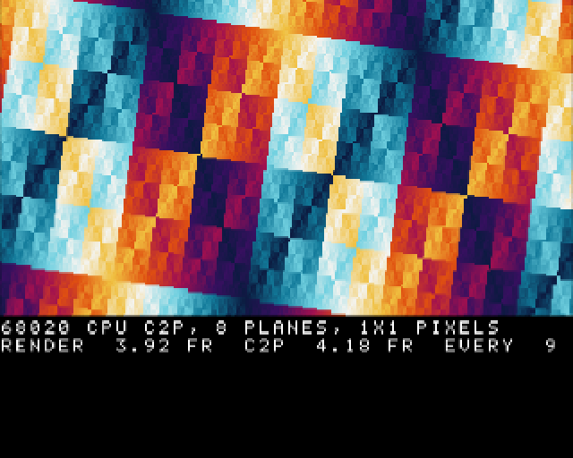
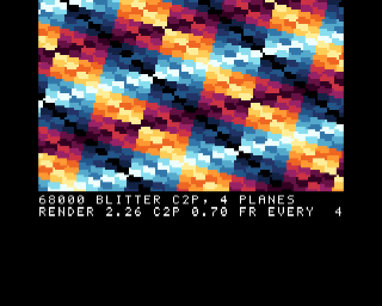
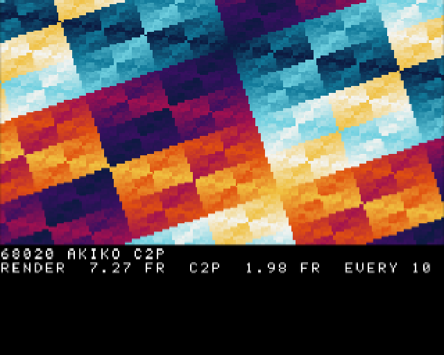

# 10. Chunky to planar

Texture mappers, rotozoomers, tunnels, voxel landscapes, the Doom-likes: the effects that made the A1200 years all work out the screen one pixel at a time. The Amiga's display isn't made for that. This chapter is about the answer everyone used: draw the picture in **chunky** form, a byte a pixel, and turn it into bitplanes once a frame. That's **chunky to planar**, C2P to its friends.

It covers the three ways to do it:

- **the processor**, merging bits between registers (the way on the A1200 and anything faster);
- **the blitter**, doing the merges while the processor draws (the way on the A500);
- **Akiko**, the CD32's chip that does it in hardware.

There are three examples, each a rotozoomer with a panel that gives the time each part took:

- `examples/ch10_c2p_cpu.s` *(AGA)*: 8 bitplanes, 256 colours, 320 by 176 pixels, converted by the processor. Settings give the scrambled-chunky routine (`SCRAMBLE`) and 2x2 pixels (`DOUBLE`).
- `examples/ch10_c2p_blitter.s` *(any Amiga)*: 4 bitplanes, 16 colours, 2x2 pixels, on a 68000, converted by the blitter, or by the 68000 for comparison (`BLITTER` set to 0).
- `examples/ch10_c2p_akiko.s` *(AGA, made for the CD32)*: the first example's effect, converted by Akiko when there is one, and by the processor when there isn't. The panel says which.



## Chunky and planar

On the Amiga a picture is **planar**: each bit of a pixel's colour number is in a different bitplane. A 256-colour screen is 8 bitplanes, and the colour of the pixel at the left of the top line is made of the top bit of the first byte of each of them. Planar suits the blitter and scrolling, and lets a display use any number of colours from 2 to 256 without wasting memory.

**Chunky** is the other way: each pixel is a byte (or, for 16 colours, half a byte), the colour number whole, one pixel after another. It's what a PC's VGA card shows in its 320 by 200 mode, and what drawing one pixel at a time wants. Putting a pixel in chunky form is one write:

```asm
        move.b  d0,(a0)+                ; the next pixel is colour d0
```

The same in 8 bitplanes is a bit set or cleared in each of 8 bytes, each in a different bitplane, each a read and a write of chip RAM:

```asm
        ; d0 = the colour, d1 = the bit (7 - x & 7), a0 = the byte in bitplane 0
        moveq   #8-1,d2
.plane: lsr.b   #1,d0
        bcc.s   .clear
        bset    d1,(a0)
        bra.s   .next
.clear: bclr    d1,(a0)
.next:  lea     PLANESIZE(a0),a0
        dbf     d2,.plane
```

A rotozoomer that drew a 320 by 256 screen like that would change chip RAM 655,360 times a frame, each a read and a write. So effects that draw pixel by pixel draw into a **chunky buffer**, ideally in fast RAM, where the processor needn't wait for the chips, and then convert the whole buffer into the screen's bitplanes in one go. Done well, the conversion handles 32 pixels at a time, reads the chunky buffer once and writes each byte of the screen once.

AGA has no chunky display mode. Neither do OCS and ECS. Only graphics cards, and the CD32's Akiko (below), help.

## What it costs

A 320 by 256 screen in 8 bitplanes is 81,920 bytes. A C2P has to write every one of them to chip RAM, every frame, and do the work of moving 655,360 bits to their places.

**The writes.** Chip RAM is shared with the chips, and on an A1200 it's slow next to the processor: in 1996 one coder timed a plain copy of a 320 by 256, 8-bitplane screen into chip RAM on an A1200 with a 28 MHz 68030 at 21.5 ms, more than a PAL frame; the same thread has a bus test giving chip RAM writes of 1.9 to 3.8 MB/s ([comp.sys.amiga.programmer, March 1996](https://groups.google.com/g/comp.sys.amiga.programmer/c/WZQVhNzqQhw)). So a full-screen, 1x1, 8-bitplane C2P at 50 frames a second is out of reach on any AGA machine, however fast the processor: the writes alone fill the frame. That's why AGA effects were shown at 2x2 pixels, or in a window, or with fewer colours (see [cheaper pixels](#cheaper-pixels-2x1-1x2-and-2x2)).

**The work.** A good routine does it with a hundred or so register instructions for each 32 pixels (see [merging](#the-processors-way-merging)). On a 68020 at 14 MHz that's the bigger cost. On a 68030 at 50 MHz the writes catch up: Mikael Kalms's notes give his 68030 routine 1.31 frames on a 50 MHz Blizzard 1230-IV with all DMA off (the note doesn't give the size; his readme's example is 320 by 256), not far off the 1.07 frames the 1996 copy took. On a 68040 or 68060 the work is quick and the routine waits on the writes: it runs at "copy speed", as fast as a plain copy to chip RAM. Kalms says this of his 68040 routine ("estimated to run at copyspeed on 040-40 and 060").

**Writes that overlap the work.** A 68020 or 68030 doesn't stop when it writes to chip RAM: its bus controller carries out the write while the processor goes on with the next instructions, as long as they come from its instruction cache and don't need the bus themselves. A second write has to wait for the first. So the best C2P routines don't save their writes for the end: they spread them through the work, one every dozen or so instructions, and the processor merges while the writes go out. The 68040 and 68060 overlap their writes with their work too.

**Where the chunky buffer is** matters as much. In fast RAM, reading it costs little. In chip RAM (an A1200 with no fast RAM, a CD32), every read of it waits its turn behind the display, which with 8 bitplanes takes a lot of the turns, and so do the instructions themselves if the program is in chip RAM too. Measured in `ch10_c2p_cpu.s` on the emulated A1200: drawing the effect took 7.27 frames and the C2P 6.71 with no fast RAM; with 8 MB of fast RAM, 3.92 and 4.18. With fast RAM, sending the C2P's output to more fast RAM instead of the screen (a test build) saved only 6% more: on a 68020 at 14 MHz, the work is what costs.

All the timings in this chapter are FS-UAE's (3.1). Its 68000 and its A500's blitter are cycle-exact; its A1200's 68020 is what FS-UAE calls "~cycle-exact", and its 68030, 68040 and 68060 run as fast as the host computer allows, so no timings are given for those (see [the processors chapter](14-processors.md)). The examples were run on them, for correctness.

## The processor's way: merging

### A transpose

Take 8 pixels of 8 bits each and write them as the rows of a table, 8 bits across. The bitplanes' bytes are the **columns**: bitplane 0's byte is the bottom bit of each of the 8 pixels. C2P is turning the table on its side: a **transpose** of a matrix of bits.

The fast way to transpose isn't bit by bit. It's in rounds, each swapping blocks: swap the top-right quarter of the table with the bottom-left, then do the same inside each quarter, and so on down to single bits. For an 8 by 8 table, 3 rounds. On a 32-bit processor each round handles whole registers at a time.

### A merge

The step everything is built from swaps a group of bits between two registers. With a register `lo`, a register `hi`, a shift `s` and a mask `m` that picks the bits to swap:

```asm
; swap lo's bits under the mask with hi's bits s places to their left; d5 is a spare register
        move.l  hi,d5
        lsr.l   #s,d5                   ; hi's bits, moved down to where lo's are
        eor.l   lo,d5                   ; ...where the two differ
        and.l   #m,d5                   ; ...under the mask
        eor.l   d5,lo                   ; flip those in lo: now lo has hi's bits
        lsl.l   #s,d5
        eor.l   d5,hi                   ; and flip the same in hi: now hi has lo's
```

Seven instructions, no branches, and it moves 16 bits each way. The masks are `$0000FFFF` for s = 16 (swap a word), `$00FF00FF` for 8 (bytes), `$0F0F0F0F` for 4, `$33333333` for 2 and `$55555555` for 1. For s = 16 there's a shorter way that needs no spare register:

```asm
        swap    hi                      ; lo's low word and hi's high word swapped
        eor.w   lo,hi
        eor.w   hi,lo
        eor.w   lo,hi
        swap    hi
```

### 32 pixels in 8 registers

Load 32 chunky pixels into 8 registers, 4 pixels in each: 256 bits. Five rounds of merges, s = 16, 8, 4, 2 and 1, each of four merges between pairs of registers, leave each register holding 32 pixels of one bitplane. Which pairs each round merges, and in which order, is up to you, as long as the bits end up in the right places; the right choice makes the routine shorter. One way to see it is to number the 256 bits with 8 binary digits, 3 for the register and 5 for the position in it. In chunky form the register's digits are pixel number bits 4-2, and the position's are pixel bits 1-0 and then the colour's 3 bits. In planar form the register's digits are the colour's bits and the position's are the pixel number. A merge between registers differing in one digit, with shift 2<sup>k</sup>, swaps that register digit with position digit k. The five rounds are the five swaps that put every digit in its place.

`ch10_c2p_cpu.s`'s `C2P8` does them in this order, for longwords L0 to L7:

```
s = 4  on (L0,L1) (L2,L3) (L4,L5) (L6,L7)
then L0 L2 L4 L6 on their own:  s = 16 and s = 2 on (L0,L4) (L2,L6);  s = 8 and s = 1 on (L0,L2) (L4,L6)
then L1 L3 L5 L7 the same
```

That leaves bitplane 7 in L0, 3 in L1, 6 in L2, 2 in L3, 5 in L4, 1 in L5, 4 in L6 and 0 in L7: the routine writes each to its own bitplane. The order splits the work into two halves of four registers after the first round, which matters because a merge needs a spare register, and with eight registers of pixels there isn't one: while one half is merged, the other waits in address registers (`move.l d0,a2` and `exg` are cheap).

### Spreading the writes

`C2P8` writes each 32 pixels' 8 longwords as they're finished, spread through the next round of work, as described above: the first half's four bitplanes while the second half is merged, and the second half's four during the next 32 pixels' first round. The registers waiting to be written are kept in a2-a5, and a6 remembers where the last 32 pixels went. It's 163 instructions for each 32 pixels, all 68000 instructions: nothing in it needs a 68020.

The loop is 408 bytes, more than the 68020's 256-byte instruction cache, so some of its instructions are fetched from memory every time round. A test version in two loops, each small enough for the cache (the first round in one, writing to a buffer in fast RAM; the rest in another), was 4% faster in FS-UAE: not enough to be worth it there. FS-UAE's 68020 timing is approximate, so on a real A1200 the cache may matter more. Kalms's collection has routines both ways.

### Checking it

A C2P that's wrong in one bit looks almost right, so test it properly. Each routine in this chapter was run in the emulator on a whole chunky buffer of pseudo-random pixels, the result was saved to a file on the emulated hard disk, and a Python script compared every bit with what it should be. A simple model of the merges, in Python, was checked the same way before the assembler was written. Every routine in the examples gave no errors, on the 68020 (A1200), the 68000 (A500) and Akiko (CD32).

### The cheapest pixels: scrambled chunky

Look again at the rounds with s = 16 and s = 8. With 8-bit pixels they only move whole pixels about, two at a time and one at a time: the colour bits aren't touched. So if the drawing writes each 32 pixels to the chunky buffer **already in the order those two rounds would leave them**, the C2P needn't do them. Three rounds instead of five.

The order is: the 32 bytes of each block hold pixels

```
0 8 16 24   4 12 20 28   1 9 17 25   5 13 21 29   2 10 18 26   6 14 22 30   3 11 19 27   7 15 23 31
```

For a rotozoomer it costs nothing at all: each line is drawn from a table of offsets into the texture, one for each pixel, and that table can be built in any order. `ch10_c2p_cpu.s` with `SCRAMBLE` set to 1 does exactly that (the table `Scramble` says where each pixel goes), and its `C2P8Scrambled` is `C2P8` without the two rounds. In FS-UAE on the A1200 with fast RAM, the C2P took 3.05 to 3.13 frames instead of 4.10 to 4.26: a quarter less. (With no fast RAM, 4.23 instead of 6.71: a third less.)

The catch is everything else that draws into the chunky buffer: text, sprites, a polygon filler drawing spans across the screen. Each has to know the order. Drawers that write a column at a time (a Doom-like's walls) or a pixel at a time from a table don't mind. Kalms's collection calls these routines `c3`, for three rounds.

### Fewer bitplanes

With 16 colours (4 bitplanes) or 32 (5), there are fewer bits to move. For 4 bitplanes, 8 pixels of 4 bits fit in one longword, a nibble each. 32 pixels are 4 longwords, and five rounds of two merges (s = 16, 4 and 1 between one pair of registers and the other, s = 8 and 2 within each pair) turn them into 4 longwords of bitplane: half the work of 8 bitplanes. Whether to keep each chunky pixel in a byte (simpler to draw, twice the memory to read) or two to a byte (half the reading, but drawing has to combine two pixels into each byte) depends on the drawing. For 5 or 6 bitplanes, it's the 8-bitplane routine with the unused bitplanes' results not written, or a routine that skips the merges they'd need: Kalms's collection has both.

Fewer bitplanes also mean fewer writes, and on AGA, which can show any number from 1 to 8, that's a straight saving: 6 bitplanes (64 colours) is three quarters of the writes of 8.

### Cheaper pixels: 2x1, 1x2 and 2x2

Most A1200 effects weren't 1x1. Pixels twice as wide halve the drawing; twice as tall too halves it again, and halves the C2P.

**2x1: twice as wide.** Each chunky pixel makes two pixels on the screen. Doubling the chunky pixels before the C2P would cost a pass over the buffer. Instead, notice that with each pixel doubled, the last round of merges (s = 1) would merge two registers holding the same pixels. So `C2P8Double` does 16 chunky pixels (4 registers) at a time, four rounds of merges, which leave two bitplanes in each register in alternate bits, and then makes each bitplane by doubling its bits:

```asm
DOUBLEBITS      macro                   ; \1's even bits doubled into \1, its odd bits doubled into \2
        move.l  \1,\2
        and.l   #$55555555,\1           ; the even bits
        eor.l   \1,\2                   ; the odd bits
        move.l  \1,d5
        add.l   d5,d5
        or.l    d5,\1                   ; each even bit copied to its left
        move.l  \2,d5
        lsr.l   #1,d5
        or.l    d5,\2                   ; each odd bit copied to its right
        endm
```

**1x2: twice as tall,** for nothing, with the copper. Each row of bitplanes is shown on two lines: the bitplane pointers, having fetched a line, are sent back to its start by the modulos. With interleaved bitplanes (each line of the screen holds a row of every bitplane in turn; see [the blitter chapter](07-blitter.md)), the modulo after the first line of each pair is minus one row (back to the start of the same row) and after the second it skips the other bitplanes' rows as usual. The copper sets both modulos on every line:

```asm
        dc.w    $2c07,$fffe             ; the start of line $2C, before its fetch
        dc.w    BPL1MOD,-ROWBYTES       ; after this line: back to the start of its row
        dc.w    BPL2MOD,-ROWBYTES
        dc.w    $2d07,$fffe
        dc.w    BPL1MOD,ROWSTRIDE-ROWBYTES      ; after this one: on to the next row
        dc.w    BPL2MOD,ROWSTRIDE-ROWBYTES
        ; ... and so on, for every line
```

The modulo is added as the line's fetch ends, so set it at the start of the line, before the fetch begins. Both examples with 2x2 pixels build these copper lines as they start (`MakeCopperDoubling`).

**2x2** is both: a chunky buffer a quarter the size, a C2P doing half the rows. With `DOUBLE` set, `ch10_c2p_cpu.s` draws 160 by 88 chunky pixels and shows them as 320 by 176. On the emulated A1200 with fast RAM that took about a quarter of the 1x1 version's time to draw and a third of its time to convert (the [test results](#how-it-was-tested) give the figures).

### On the 68040 and 68060

On a 68040 or 68060 the merges take a fraction of the time the writes do, so the routine runs at the speed chip RAM takes writes, and the processor spends most of the C2P waiting. Two things follow:

- **Don't bunch the writes**, here too: with the writes spread out, each goes out while the processor merges, and the processor waits only when its buffer of pending writes is full. A routine that saves all its writes for the end waits for each.
- **Do something useful in the waits**, or do less writing: convert only the part of the screen that changed, or fewer bitplanes.

The **68060** issues two instructions at once when they don't depend on each other (it has two integer pipelines), so a merge written as seven instructions each needing the one before runs at half the speed it could. Interleave two merges, instruction by instruction, and they run side by side. Kalms's collection has routines written for it (`c2p1x1_5_c5_060`, for one). v8 couldn't time any of this: FS-UAE's 68040 and 68060 aren't timed like real ones.

### On the 68000

A 68000 can run the same merges, slowly: its shifts cost 2 cycles for each place shifted, and every register instruction 4 to 8 cycles. In `ch10_c2p_blitter.s` with `BLITTER` set to 0, the 68000 does two rounds of merges on a 128 by 80 pixel chunky buffer (4 bitplanes), in 1.96 frames; the blitter does them in 0.70. Without the drawing's tricks (below) there would be five rounds to do, not two. On an A500, a C2P has to be small, and has to lean on tables and the blitter, as below.

## The blitter's way

The blitter can do a merge. Its A and B channels each have a barrel shifter, its logic function can pick each bit from one source or another by a mask, and a channel switched off gives a constant from its data register for nothing. A merge's two results are two blits. The low register of the pair keeps its own bits where the mask is 0, and takes the high one's, shifted right, where it's 1:

```
lo' = (hi >> s) & m  |  lo & ~m      A = hi (shifted s), B = lo, C = the mask (a constant): minterm $E4
```

and the high one keeps its bits where the mask is 1 and takes the low one's, shifted **left**, where it's 0. The blitter shifts only to the right, except in descending mode, so that blit runs backwards, from the last word:

```
hi' = (lo << s) & ~m  |  hi & m      A = lo (shifted s, descending), B = hi, C = the mask: minterm $D8
```

(Minterm $E4 is A where C is 1, B where C is 0; $D8 is B where C is 1, A where C is 0. [The blitter chapter](07-blitter.md#minterms-the-lf-byte) shows how they're worked out.) In both, the bits shifted in from the next word fall where the mask throws them away, so a whole buffer is one blit. A, B and D switched on take 6 clocks a word, the HRM's figure. The 68000's seven instructions take 60 to 68 clocks (by Motorola's figures) for two longwords, 15 to 17 a word, before it has loaded and stored them.

That's the blitter's strength: **shifts cost it nothing**. The rounds with small shifts (4, 2, 1) are the 68000's most expensive and the blitter's cheapest. The rounds that move whole pixels, though, can usually be done for nothing in the drawing, as with scrambled chunky above. So the classic A500 C2P is: the drawing does what it can for free, and the blitter does the rest.

### ch10_c2p_blitter.s



The example's rotozoomer draws 128 by 80 chunky pixels in 16 colours, each shown 2 by 2: 256 by 160 on the screen. Two tricks in the drawing do half the C2P before it starts:

- **The texture holds each colour with its bits doubled**: colour `%abcd` is stored as the byte `%aabbccdd`. One chunky pixel is two screen pixels side by side, and those two bits are already in a bitplane's order. Doubling the pixels across costs nothing.
- **Each line is drawn as four runs**: pixels 0, 4, 8 ... 124, then 2, 6 ... 126, then 1, 5 ... 125, then 3, 7 ... 127. (The table of offsets is simply in that order.) In blocks of 8 chunky pixels, each run holds a word of each block, and the four words are what two rounds of merges turn into a word of each of the 4 bitplanes.

The blitter does those two rounds: s = 4 (mask `$0F0F`) between runs 0 and 2 and runs 1 and 3, then s = 2 (mask `$3333`) between runs 0 and 1 and runs 2 and 3. The runs are laid out in each line as 0, 2, 1, 3, so that each round's pairs are a fixed distance apart and each half of a round is **one** blit with a modulo, not one blit for each pair. The first round writes to a halfway buffer; the second writes into the screen, whose rows hold the bitplanes in the order 3, 1, 2, 0 for the same reason (the bitplane pointers don't care what order they're in). Four blits in all:

```asm
        ; Round 1, low: runs 0 and 1 take bits from runs 2 and 3
        move.l  #$4de40000,BLTCON0(a5)          ; A shifted 4, A B D on, minterm $E4; BLTCON1 0
        move.l  #Chunky+ROWBYTES,BLTAPTH(a5)    ; runs 2 and 3
        move.l  #Chunky,BLTBPTH(a5)             ; runs 0 and 1
        move.l  #Halfway,BLTDPTH(a5)
        move.w  #((CHUNKYH*2)<<6)!(ROWBYTES/2),BLTSIZE(a5)
        jsr     WaitBlitter
        ; Round 1, high: runs 2 and 3 take bits from runs 0 and 1, backwards from the last word
        move.l  #$4dd80002,BLTCON0(a5)          ; minterm $D8; BLTCON1: descending
        ...
```

with `BLTCDAT` holding the mask, the C channel switched off, and the modulos skipping the runs a blit doesn't touch. The chunky buffer, the halfway buffer and the screen are all in chip RAM: the blitter can't reach anything else.

On the emulated A500 (68000, cycle-exact), the drawing took 2.26 frames and the blitter's C2P 0.70, so a new picture every 4 frames, 12.5 a second. With `BLITTER` set to 0 the 68000 took 1.96 frames for the same two rounds, and a new picture came every 5.

The blitter's figure is more than the HRM's 6 clocks a word would give (4 blits of 2,560 words: 0.43 frames): while the display is fetching 4 bitplanes, it takes half the memory cycles, and the blitter gets only what's left; and the processor's work between the blits, and its waits, are in the figure too.

### Which rounds to give the blitter

- **On an A500**, every round you can't do in the drawing. The 68000 merges at a third of the blitter's speed or less.
- **On an A1200**, the blitter is the same speed as on an A500, and a 68020 with fast RAM merges faster than it does: `ch10_c2p_blitter.s` on the emulated A1200 with fast RAM took 0.68 frames with the blitter and 0.40 with the 68020 (`BLITTER` set to 0). But the blitter works **at the same time** as the processor: give it the last round while the processor does the first ones of the next part of the screen. Kalms's collection has such routines (`c3b1`: three rounds on the processor and one on the blitter), and gives one of them as running at copy speed on a 25 MHz 68040.

### The race

The blitter and the processor working at once is the point, and the danger. [The blitter chapter](07-blitter.md#the-race-wait-before-the-processor-touches-the-blitters-work) explains it in general; for a C2P:

- **Don't draw into the chunky buffer while the blitter is reading it.** The next frame's drawing must wait until the round that reads the chunky buffer has finished. Double-buffer the chunky buffer if the drawing should start sooner.
- **Don't start a blit before the last has finished.** There's only one blitter, and its registers are read as it goes. `ch10_c2p_blitter.s` waits for each.
- **Don't show the screen before the last blit into it has finished.** `BLIT_END` waits; the screen is swapped after it.

On a 68000 the blitter usually wins the race; on a 68040 it never does. And on an A500 with no fast RAM, running both at once gains less than you'd hope: the blitter with A, B and D on uses every memory cycle it can get, and lets the processor have a cycle only after it has waited three ([the blitter chapter](07-blitter.md#the-blitter-nasty)). The processor gets work done during a blit only if the work is in registers, or in fast RAM.

## Akiko: the CD32's C2P

The CD32 has a chip the A1200 doesn't: **Akiko**, which drives the CD drive and the CD32's NVRAM, and also converts chunky pixels to planar ones. It's a register you write 32 chunky pixels to, as 8 longwords, and read 32 pixels of each bitplane back from, as 8 longwords, bitplane 0 first. The merges happen inside it.

### Finding it

graphics.library from V40 (Kickstart 3.1) keeps the address of the C2P hardware in `GfxBase`, as `gb_ChunkyToPlanarPtr`, or 0 if there isn't any. The autodoc for `WriteChunkyPixels()` says so, and how to use it:

> If using the hardware directly, it should only be accessed when the task using it has control of the blitter (via OwnBlitter()), since this is the locking used to arbitrate usage of this device.
>
> For proper operation, exactly 8 longwords (containing 32 pixels) of chunky data should be written to *(GfxBase->ChunkyToPlanarPtr). After the data is written, bitplane data (starting with plane 0) can be read back a longword at a time. There is no need to read back all 8 longwords if the high-order bitplanes are not needed.

and that the field is only there from V40. The NDK 3.2's `graphics/gfxbase.i` puts it at offset 508 (`gb_ChunkyToPlanarPtr equ gb_HWEmul`):

```asm
gb_ChunkyToPlanarPtr equ 508

        move.l  GfxBase,a6
        cmp.w   #40,LIB_VERSION(a6)
        blo.s   .none                   ; before V40 the field isn't there
        move.l  gb_ChunkyToPlanarPtr(a6),d0
        beq.s   .none                   ; no C2P hardware
        ; d0 = Akiko's C2P register
```

On the emulated CD32, with its own Kickstart, the pointer read `$00B80038`; on an A1200 with Kickstart 3.1 it read 0. Akiko is at `$B80000`, and WinUAE's emulation of it (`akiko.cpp`, by Toni Wilen) notes that its first longword reads `$C0CACAFE`, and that the Kickstart looks for `$CAFE` at `$B80002` to decide that Akiko is there. Read the pointer rather than look for the `$CAFE` yourself: the autodoc invites other hardware that works the same way to put its own address there, and on a machine without Akiko nothing promises what's at `$B80000`.

As far as v8 knows, Akiko was only ever in the CD32: none of Commodore's other machines has it. WinUAE can add its C2P to any emulated machine (the "CD32 C2P" box in its chipset settings).

### Using it

```asm
; a0 = the chunky buffer, a1 = the screen (interleaved), a2 = Akiko's C2P register
.block:
        move.l  (a0)+,(a2)              ; 32 pixels in...
        move.l  (a0)+,(a2)
        move.l  (a0)+,(a2)
        move.l  (a0)+,(a2)
        move.l  (a0)+,(a2)
        move.l  (a0)+,(a2)
        move.l  (a0)+,(a2)
        move.l  (a0)+,(a2)
        move.l  (a2),(a1)               ; ...and 32 pixels of each bitplane out, from bitplane 0
        move.l  (a2),1*ROWBYTES(a1)
        move.l  (a2),2*ROWBYTES(a1)
        move.l  (a2),3*ROWBYTES(a1)
        move.l  (a2),4*ROWBYTES(a1)
        move.l  (a2),5*ROWBYTES(a1)
        move.l  (a2),6*ROWBYTES(a1)
        move.l  (a2),7*ROWBYTES(a1)
        addq.l  #4,a1
        dbf     d6,.block
```

That's `AkikoC2P` in `ch10_c2p_akiko.s`, inside `BLIT_BEGIN` and `BLIT_END`: taking the machine, the startup owns the blitter already, and with the system running they call `OwnBlitter()` and `DisownBlitter()`. Use longword moves: WinUAE's emulation, at least, counts the 8 writes in longwords.

Its output, read back on the emulated CD32 and compared bit by bit with what it should be, was right.

### Is it faster?



On a plain CD32, yes, by a lot, in FS-UAE. The CD32 has a 68020 at 14 MHz and no fast RAM, so a processor C2P reads the chunky buffer from chip RAM and fights the display for every turn. Akiko needs the processor only to move the data:

| CD32, 68020, no fast RAM (FS-UAE) | Drawing | C2P | A new picture every |
|---|---|---|---|
| `ch10_c2p_cpu.s`, `C2P8` | 7.27 frames | 6.72 frames | 15 frames |
| `ch10_c2p_akiko.s`, Akiko | 7.27 frames | 1.98 frames | 10 frames |

With a faster processor and fast RAM, it's another story. Every pixel still crosses the bus three times (from the chunky buffer, to Akiko, from Akiko) before it's written to chip RAM, and a fast processor's C2P is limited by the chip RAM writes it has to make anyway. So on an accelerated CD32, a good processor routine is likely to be as fast as Akiko or faster. v8 couldn't measure it: FS-UAE's faster processors aren't timed, and how long a real Akiko takes to answer isn't something the emulator promises to match.

There's another reason to keep Akiko for the 68020: the **data cache**. A 68030 or later can keep a copy of what it read from an address and give it back without reading again; if it did that with Akiko's register, the 8 reads would give the same longword. The system sets chip RAM so the data cache never holds it, but `$B80000` isn't chip RAM, and whether an accelerator's setup leaves it uncached isn't something to count on. (That's v8's reasoning, not tested on a real accelerated CD32.) c2p.library, a recent C2P library for the Amiga, also uses Akiko only with a 68020, as its author's devlog says. `ch10_c2p_akiko.s` does the same: with a 68030 or later it uses `C2P8`, and says so on its panel.

## Measuring

The examples time the drawing and the C2P in **lines**, as [the processors chapter](14-processors.md#measuring-raster-time) does, but these take several frames, so the beam position alone isn't enough. The time is the frames counted so far by the vertical blank interrupt, times the lines in a frame, plus the line the beam is on:

```asm
; Returns d0 = the time in lines. Changes d1-d3.
LineClock:
        move.l  Frames,d1
        move.l  VPOSR+CUSTOM,d0
        cmp.l   Frames,d1
        bne.s   LineClock               ; the interrupt came in between: again
        lsr.l   #8,d0
        and.l   #$1ff,d0                ; the line
        cmp.w   #2,d0
        blo.s   LineClock               ; lines 0 and 1: wait until the frame's interrupt has certainly run
        moveq   #0,d3
        move.w  LinesPerFrame,d3        ; 313 on PAL, 263 on NTSC
        move.l  d1,d2                   ; Frames * lines a frame, in 32 bits
        swap    d2
        mulu    d3,d2
        swap    d2
        clr.w   d2
        mulu    d3,d1
        add.l   d2,d1
        add.l   d1,d0
        rts
```

A PAL frame is 313 lines (0 to 312) and an NTSC one 263 (0 to 262): a test that read the beam's line as fast as it could, with interrupts off, saw no higher than 312 on the emulated A500 and A1200, and 262 on the NTSC A1200.

**The mistake made here first.** The HRM's list of the CIA registers calls CIA-B's time-of-day counter (`$BFD800` to `$BFDA00`) the "horizontal sync event counter": a 24-bit count of lines, ready-made. The first versions of the examples used it. Taking the machine, it worked. With the system running, the panels showed nonsense: graphics.library uses that counter as its beam counter (Commodore's *Amiga Mail* lists it as "used for graphics.library beam counter") and evidently sets it back every frame: read 100 frames apart, it had moved on by one line or none. Use it only when the machine is yours.

The panels give each time in frames, to two places, and how many frames each new picture took in all ("EVERY"). Remember that the measuring sees the whole machine: with the system running, its interrupts and tasks add a little; and it measures the program as it runs, in the memory it was given.

## The examples

- **`ch10_c2p_cpu.s`** *(AGA only)*: a rotozoomer, 320 by 176 pixels in 256 colours, drawn into a chunky buffer in any memory (fast RAM, if there is some) and converted by `C2P8`; with `SCRAMBLE` by `C2P8Scrambled`, from scrambled chunky; with `DOUBLE`, 2x2 pixels, by `C2P8Double` and the copper. It checks for AGA as chapter 9's examples do, and without it shows nothing and ends at once.
- **`ch10_c2p_blitter.s`** *(any Amiga)*: a rotozoomer, 128 by 80 chunky pixels in 16 colours, shown 2x2, on a 68000; converted by the blitter (`BlitterC2P`), or with `BLITTER` set to 0 by the 68000 (`CPUC2P`).
- **`ch10_c2p_akiko.s`** *(AGA only)*: `ch10_c2p_cpu.s`'s rotozoomer converted by Akiko when graphics.library says there is one and the processor is a 68020, and by `C2P8` otherwise.

Each C2P routine is between `; ---- name begin` and `; ---- name end` lines, so it can be lifted out whole. The texture in all three is the classic XOR pattern (u XOR v), and the drawing uses one more trick worth knowing: the texture is stored with every row twice over and the whole twice over, so that a texel's offset is u + v × 512, two offsets add without u carrying into v, and a line's start (32K into the texture, plus up to 64K) plus any offset read as a signed word lands inside the 128K. Each pixel is then two instructions:

```asm
        move.w  (a2)+,d3                ; this pixel's offset from the line's start
        move.b  0(a0,d3.w),(a1)+        ; a0 = the line's start in the texture
```

## How it was tested

Every example was built both ways (taking the machine, and with the system running), ending itself after 500 frames, and run in FS-UAE 3.1:

- `ch10_c2p_cpu.s` (as it is, with `SCRAMBLE` and with `DOUBLE`) on an A1200 with Kickstart 3.1 (the A500/A600/A2000 ROM, 40.63), with no fast RAM and with 8 MB, with a 68030 and a 68040 (8 MB each), on an NTSC A1200, and on a CD32; and on an A500 with Kickstart 1.3 and 3.1, to see it refuse;
- `ch10_c2p_akiko.s` on a CD32 (its own Kickstart and extended ROM, booting from the hard drive folder), on a CD32 with a 68030 and fast RAM, on an A1200, and on an A500 with Kickstart 1.3 and 3.1;
- `ch10_c2p_blitter.s` (with and without `BLITTER`) on an A500 with Kickstart 1.3 and 3.1, with its 512K of slow RAM and without (a plain 512K machine), with a 68020 and a 68040 (8 MB of fast RAM each), on Kickstart 1.3 with a 68020, and on an A1200.

Each showed its effect and then the CLI with "back in AmigaDOS, return code OK"; on the machines without AGA the AGA examples ended at once. The C2P routines' output was checked bit by bit against a model in Python, as described in [checking it](#checking-it). The times, in frames (PAL), from the panels:

Taking the machine (with the system running, the figures were within a few per cent of these):

| Example | Machine (FS-UAE) | Drawing | C2P | A new picture every |
|---|---|---|---|---|
| `ch10_c2p_cpu.s` | A1200, 68020, no fast RAM | 7.27 | 6.71 | 15 frames |
| ... `SCRAMBLE` | | 7.38 | 4.23 | 12 |
| ... `DOUBLE` (2x2) | | 1.87 | 1.40 | 4 |
| `ch10_c2p_cpu.s` | A1200, 68020, 8 MB fast RAM | 3.92 | 4.18 | 9 |
| ... `SCRAMBLE` | | 3.96 | 3.05 | 8 |
| ... `DOUBLE` (2x2) | | 1.01 | 1.27 | 3 |
| `ch10_c2p_cpu.s` | CD32, 68020, no fast RAM | 7.27 | 6.72 | 15 |
| `ch10_c2p_akiko.s` (Akiko) | CD32, 68020, no fast RAM | 7.27 | 1.98 | 10 |
| `ch10_c2p_akiko.s` (no Akiko: `C2P8`) | A1200, 68020, no fast RAM | 7.27 | 6.90 | 15 |
| `ch10_c2p_blitter.s` | A500, 68000, Kickstart 1.3 or 3.1, with or without slow RAM | 2.26 | 0.70 | 4 |
| ... `BLITTER` 0 (the 68000 merges) | A500, 68000 | 2.26 | 1.96 | 5 |
| `ch10_c2p_blitter.s` | A1200, 68020, no fast RAM | 1.30 | 0.64 | 2 |
| `ch10_c2p_blitter.s` | A1200, 68020, 8 MB fast RAM (system running) | 0.93 | 0.68 | 2 |
| ... `BLITTER` 0 | A1200, 68020, 8 MB fast RAM | 0.92 | 0.40 | 2 |

On the NTSC A1200 the times in frames were about a fifth higher, as an NTSC frame has 263 lines to PAL's 313. The 68030 and 68040 showed every example correctly, with times of a tenth of a frame or so, which mean nothing (FS-UAE runs them as fast as the host allows). The A500's 68020 in FS-UAE runs at about the A500's own speed, with fast RAM, so its figures (`ch10_c2p_blitter.s`: 1.57 and 0.52) say more about fast RAM than about the 68020.

## Further reading

- **Mikael Kalms's C2P collection** (Scout / C-Lous), <https://github.com/Kalmalyzer/kalms-c2p>: routines for 1 to 8 bitplanes and 1x1, 2x1 and 2x2 pixels, for every processor from the 68020 to the 68060, processor-only and with the blitter, HAM8 converters, and the notes quoted above. Public domain, as its readme says (except the "others" folder, which holds other people's routines under their own terms). The routines in this chapter are v8's own, written for it; Kalms's are the place to go for one tuned to your machine.
- **Kalms's tutorial**, *Make your own Chunky Two Planar*, <https://lysator.liu.se/~mikaelk/doc/1c2p.html>: the merges step by step, from 8 pixels up.
- **The `WriteChunkyPixels()` autodoc**, in the NDK's `graphics.doc`: Akiko, `gb_ChunkyToPlanarPtr`, and the rules for using it.
- **WinUAE's `akiko.cpp`**, <https://github.com/tonioni/WinUAE>: Akiko's registers as WinUAE emulates them, with Toni Wilen's notes on each.

## What changed from v7

v7 had no chapter on chunky to planar: it was written in 1993, as the A1200 was new, and the techniques here grew up in the years after it. This chapter is new in v8. [The AGA chapter](09-aga.md#chunky-to-planar) introduces the idea; this one has the routines.
