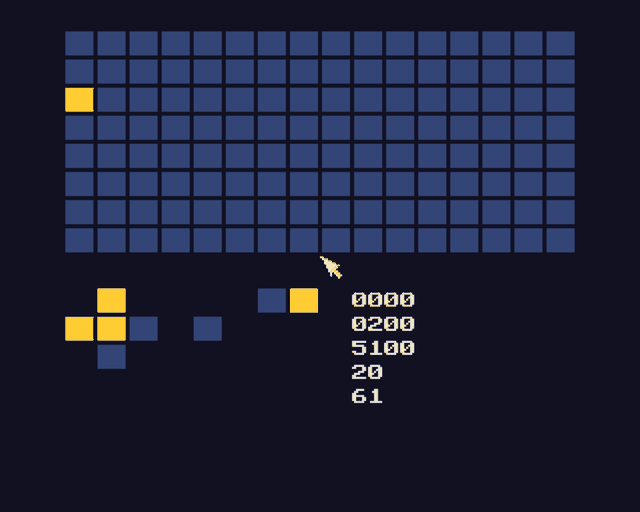

# 11. Input

Most demos need very little input: the left mouse button to leave, perhaps a key to skip to the next part. A music disk wants a menu, an intro may have a hidden part behind a key, and a game written by a demo coder needs a joystick and maybe the keyboard. All of it is easy to read straight from the hardware, with one exception: the keyboard, which has a handshake that v7 warned people kept getting wrong. This chapter goes through each of them, both ways: taking the machine, and with the system left running.

`examples/ch11_keyboard_joystick.s` shows all of them at once. A cell lights for each key held down (one cell for each of the 128 raw key codes, in code order), the joystick's directions and buttons light theirs, a sprite follows the mouse, and the registers are shown in hexadecimal. Esc or the left mouse button leaves.



The numbers, top to bottom, are `JOY0DAT` (the mouse), `JOY1DAT` (the joystick), `POTGOR` (the second buttons), the last raw key code, and the character that key types, from the keymap (only with the system running on Kickstart 2 or later; `--` otherwise).

## The two ports

Every Amiga has two nine-pin ports for a mouse or a joystick. The software numbers them **0** (the mouse's port) and **1** (the joystick's); the *Hardware Reference Manual* calls the same two ports 1 and 2. This chapter uses the software's numbers, as the register names do.

| What | Port 0 (mouse) | Port 1 (joystick) | Pressed reads as |
|---|---|---|---|
| Movement: mouse counters, or joystick switches | `JOY0DAT` (`$DFF00A`) | `JOY1DAT` (`$DFF00C`) | see below |
| Fire button (pin 6): left mouse button, joystick fire | CIA-A `PRA` (`$BFE001`) bit 6 | bit 7 | 0 |
| Pin 9: right mouse button, joystick's second button | `POTGOR` (`$DFF016`) bit 10 | bit 14 | 0 |
| Pin 5: middle mouse button | `POTGOR` bit 8 | bit 12 | 0 |

Reading any of these is harmless, with the system running or not: the system reads them too. Writing is another matter, as the section on `POTGO` shows.

## The mouse

`JOY0DAT` holds two 8-bit counters: the vertical count in the high byte and the horizontal count in the low byte. The mouse sends pulses as it moves, and the chips count them: up as it moves right or down (towards you), down as it moves left or up. They never stop at an edge: they **wrap around**, from 255 to 0 and from 0 to 255. So the counters aren't a position, and they don't start at any particular value. What they give is *movement*: read them once a frame, and subtract last frame's reading.

The *Hardware Reference Manual* suggests doing the subtraction with signed 8-bit arithmetic: the difference between two readings, as a signed byte, is the movement, as long as the mouse moved less than 128 counts between them. The manual's figures: about 200 counts per inch, so reading once a frame, the mouse would have to move at more than 38 inches a second to go wrong. (It says once each 1/60 of a second: that's NTSC. On PAL it's 1/50, which still allows 32 inches a second.)

```asm
        move.w  JOY0DAT(a5),d0
        move.w  OldMouse,d1
        move.w  d0,OldMouse
        move.b  d0,d2                   ; horizontal: the low bytes
        sub.b   d1,d2
        ext.w   d2                      ; d2.w: how far right (negative: left)
        add.w   PointerX,d2
        ...
        lsr.w   #8,d0                   ; vertical: the high bytes
        lsr.w   #8,d1
        sub.b   d1,d0
        ext.w   d0                      ; d0.w: how far down (negative: up)
```

The mistake is to subtract the two words at once (`sub.w d1,d0`) and split the answer: when the horizontal count wraps, the borrow from the low byte goes into the high byte, and the pointer jumps a line up or down every time it crosses that point. Each byte is its own counter: subtract them separately.

Remember the first reading before the first frame, as the example's `Init` does, or the first frame sees a jump from wherever the counters happened to be.

## The joystick

A digital joystick is four switches, and the chips read them through the same counters as a mouse, in `JOY1DAT` (or `JOY0DAT`, for a joystick in the mouse's port). So the directions aren't simply four bits. From the *Hardware Reference Manual*'s table:

| Direction | Bit, in `JOY1DAT` |
|---|---|
| Right | bit 1 |
| Left | bit 9 |
| Down | bit 1 XOR bit 0 |
| Up | bit 9 XOR bit 8 |

The usual way: shift a copy right by one bit and exclusive-OR it with the original. Then bit 0 is down and bit 8 is up, while right and left are read from the original.

```asm
        move.w  JOY1DAT(a5),d0
        move.w  d0,d1
        lsr.w   #1,d1
        eor.w   d0,d1                   ; now bit 8 = up, bit 0 = down
        btst    #8,d1
        sne     Up
        btst    #0,d1
        sne     Down
        btst    #9,d0
        sne     Left
        btst    #1,d0
        sne     Right
```

The mistake is testing bit 0 for down and bit 8 for up. It seems to work when you try it, pushing straight down. But push right and the joystick reads as "down", and push down and right together and down disappears.

## The fire buttons

Each port's fire button (pin 6, which is also the left mouse button) is a bit of CIA-A's port A, at `$BFE001`: bit 6 for port 0, bit 7 for port 1. The bit is 0 while the button is held.

```asm
        btst    #7,$bfe001              ; CIAB_GAMEPORT1 in the NDK
        seq     Fire                    ; 0 while pressed: so "equal" means pressed
```

Only read it. The same register's other bits do other things: bit 1 switches the audio filter (and the power light on most models), and bit 0 is the overlay that maps the ROM over chip RAM. A careless `move.b` to `$BFE001` changes them all, and `CIAADDRA` (`$BFE201`), which makes these pins outputs, is the system's.

## The second buttons, and POTGO

The right mouse button, a joystick's second button and a mouse's middle button are on pins 9 and 5, the "pot" pins, which were made for analogue paddles and joysticks. They can be read as plain buttons in `POTGOR` (bits 10, 14, 8 and 12, as in the table above), 0 while pressed, but only when the pin is set up for it. The *Hardware Reference Manual*: "The Amiga must provide a pull-up resistance on the sense pin. To do this, set the proper pin to output, and drive the line high (set both OUT... and DAT... to 1)." That's done in `POTGO` (`$DFF034`):

| `POTGO` bit | Name | What it does |
|---|---|---|
| 15, 14 | `OUTRY`, `DATRY` | port 1, pin 9: output, and its level |
| 13, 12 | `OUTRX`, `DATRX` | port 1, pin 5 |
| 11, 10 | `OUTLY`, `DATLY` | port 0, pin 9 (the right mouse button) |
| 9, 8 | `OUTLX`, `DATLX` | port 0, pin 5 (the middle button) |
| 0 | `START` | start the analogue counters (which also discharges the pins) |

The system sets up port 0's pin 9 for itself, since Intuition reads the right mouse button. So **the right mouse button can simply be read**, either way. v8 checked this on an emulated A500 with Kickstart 1.3 and 3.1: `POTGOR` bit 10 was 1 with the button up and 0 with it held, with nothing written to `POTGO`.

The joystick's second button is different. On Kickstart 1.3, `POTGOR` read `$0500` with nothing pressed: bit 14 at 0, as if the second button were held down, because nothing had set up port 1's pin 9. (Kickstart 3.1 read `$5500`.) So a program that wants the second button has to set the pin up itself, and that means writing `POTGO`. This is where it goes wrong:

- **`POTGO` can't be read back.** `POTGOR` gives the pins' levels, not what was written. Write your own value, and you can't put back what was there.
- **It's shared.** Its bits belong to different users: Intuition has the right mouse button, and a three-button mouse driver, a paddle program or `lowlevel.library` may have others. The system keeps its own copy of what each owner wrote. A program that writes `POTGO` directly changes every bit at once. It takes away the pull-up for the right mouse button (which then reads wrongly for the system as well as for you), or sets `START`, and the system's copy no longer matches the hardware.

The right way is **`potgo.resource`**, which keeps that copy: ask for the bits with `AllocPotBits`, set them with `WritePotgo`, and give them back with `FreePotBits`. It's a few register writes inside, so it's fine with the machine taken, too. From the example's `Init`:

```asm
OUTRY           equ     $8000           ; POTGO: the joystick port's pin 9 an output...
DATRY           equ     $4000           ; ...driven high (and in POTGOR, the pin's level)
_LVOAllocPotBits equ    -6
_LVOFreePotBits equ     -12
_LVOWritePotgo  equ     -18

        move.l  ExecBase.w,a6
        lea     PotgoName(pc),a1        ; "potgo.resource"
        jsr     _LVOOpenResource(a6)
        move.l  d0,PotgoBase
        beq.s   .nopotgo
        move.l  d0,a6
        move.l  #OUTRY!DATRY,d0
        jsr     _LVOAllocPotBits(a6)
        move.w  d0,PotBits              ; what we were given (0 if someone else has them)
        and.w   #DATRY,d0
        beq.s   .nopotgo
        move.l  #OUTRY!DATRY,d0         ; the bits' values...
        move.l  d0,d1                   ; ...and which bits to write
        jsr     _LVOWritePotgo(a6)
.nopotgo:
```

As the demo ends, `WritePotgo(0, OUTRY!DATRY)` puts the pin back to an input, and `FreePotBits(PotBits)` gives the bits back. With that, the example's second button read 1 (up) on Kickstart 1.3 too. The pins have large capacitors, so the manual says a change can take up to 300 microseconds to show: set them up in `Init`, and read them from the next frame.

## The keyboard

The keyboard isn't read like the others. It has a processor of its own, which scans the keys and sends a code to the Amiga each time one goes down or up. It sends them one bit at a time, to CIA-A's serial port: the keyboard's data line (KDAT) is the CIA's `SP` pin and its clock (KCLK) is the `CNT` pin. When eight bits have arrived, the CIA puts the byte in its serial data register (`SDR`, `$BFEC01`), sets bit 3 (`SP`) in its interrupt control register (`ICR`, `$BFED01`), and interrupts the processor at level 2 (`INTF_PORTS`).

### What the keyboard sends

Each code is a **raw key code**: bits 0 to 6 say which key, and bit 7 is set when the key is let go. So the A key sends `$20` going down and `$A0` coming up. The codes are *positions* on the keyboard, not letters: `$20` is the key right of Caps Lock, which is A on an English keyboard and Q on a French one. The *Hardware Reference Manual* lists them all; a few a demo might use are Space `$40`, Return `$44`, Esc `$45`, the cursor keys `$4C`-`$4F` (up, down, right, left), F1-F10 `$50`-`$59`, and the Shift, Alt, Ctrl and Amiga keys `$60`-`$67`. Codes `$68` to `$7F`, and the same with bit 7 set, aren't keys: `$78` warns of a reset (Ctrl-Amiga-Amiga) and `$F9` to `$FE` are the keyboard's own messages ("the last code was bad", "my buffer overflowed", the codes sent at power-up). Caps Lock is odd too: it sends a code only when pressed, with bit 7 saying whether its light went off.

Two things are done to each byte on the way. It's sent **rotated** (bit 6 first, bit 7 last: "6-5-4-3-2-1-0-7", so that a byte cut short reads as a key going up rather than down), and the line is **active low**, so every bit arrives **inverted**. Reading it, undo both:

```asm
        move.b  $bfec01,d0              ; CIA-A SDR: the byte as it came
        not.b   d0
        ror.b   #1,d0                   ; d0: the raw key code
```

### The handshake

After each byte, the Amiga must tell the keyboard it has the byte. It does this by pulling KDAT low for a moment, the **handshake**. Until it sees the handshake, the keyboard sends nothing more (it keeps up to 10 codes waiting). The *Hardware Reference Manual*, twice: "While some keyboards can detect a 1 microsecond handshake pulse, the pulse must be at least 85 microseconds for operation with all models of Amiga keyboards," and in its keyboard appendix, "Software MUST pulse the line low for 85 microseconds to ensure compatibility with all keyboard models."

The pulse is made by switching CIA-A's serial port to output (bit 6, `SPMODE`, of control register A, `CRA` at `$BFEE01`), which pulls KDAT low, and back to input after the 85 microseconds.

If the handshake doesn't come within 143 milliseconds, the keyboard decides it has lost touch. It clocks out 1 bits until it gets a handshake, then sends `$F9` ("the last code was bad") and the code again. So a missing handshake loses keys and repeats them, and a handshake too short for that keyboard to notice is a missing handshake.

**Time it with the hardware, never with a loop.** v7's warning, and its example: in F-15 Strike Eagle II on an Amiga 3000, "the key repeat delay is ridiculously short, you ttyyppee lliikkee tthhiiss aallll tthhee ttiimmee". A `dbf` loop that lasts 85 microseconds on a 7 MHz 68000 is over in a fraction of that on a 68030 or 68040, whose caches run it from inside the processor. v7: "I have seen too many, even commercial, programs that just ignores this and have NO delay code or just a simple dbf-loop. After about 15 keypresses your keyboard is dead and there is no code to reset it."

Two clocks run at the same speed on every Amiga:

- **The beam.** `VHPOSR`'s high byte is the line being drawn, and it changes every 64 microseconds on PAL (63.5 on NTSC), whatever the processor. Wait until it has changed three times, and at least two whole lines have passed: 127 microseconds or more. The first change may come at once, which is why it's three. This needs nothing from the system, and it's what the example does.
- **A CIA timer.** They count the 0.7 MHz E clock: 709,379 counts a second on PAL, 715,909 on NTSC, so 85 microseconds is 61 counts on either. But the system uses the CIA timers itself, so one has to be asked for through `cia.resource` (`AddICRVector`) and given back, even with the machine taken. It's more work than the beam for no gain here.

v8 couldn't show a short handshake failing: FS-UAE took the keyboard's codes even with no wait at all, on a 68040. So the 85 microseconds here rest on the *Hardware Reference Manual*, and on v7's experience with real keyboards, not on v8's tests.

### Taking the machine: a level 2 interrupt

With the machine taken, the system's keyboard handling (`keyboard.device`, behind the level 2 interrupt) isn't running, so the demo needs its own level 2 interrupt. The startup switches every interrupt off and puts its own level 3 interrupt in place. The example adds level 2 in `Init`, at the vector base the startup found (on a 68010 or later the vectors may not be at address 0; see [startup and exit](04-startup-and-exit.md)), and takes it out again in the routine it gives the startup as `ExitHook`:

```asm
        move.l  VectorBase,a0
        move.l  $68(a0),OldLevel2       ; level 2's vector: $68 from the vector base
        move.l  #Level2,$68(a0)
        move.w  #INTF_SETCLR!INTF_PORTS,INTENA(a5)
```

The CIA's own interrupt for the serial port is already switched on: `keyboard.device` switched it on when the system started. A trackmo running with no system would switch it on itself, by writing `$88` to CIA-A's `ICR` (bit 7 set means "switch these on"; bit 3 is `SP`).

The interrupt, from the example:

```asm
Level2:
        movem.l d0-d2/a0-a1,-(sp)
        move.b  CIAA+CIAICR,d0          ; which of CIA-A's events: reading clears them all
        move.b  d0,d1
        and.b   #$1f&~(1<<CIAICRB_SP),d1
        or.b    d1,MissedICR            ; the others, noted for the system (see below)
        btst    #CIAICRB_SP,d0
        beq.s   .done

        move.b  CIAA+CIASDR,d0          ; the byte, as it came
        bset    #CIACRAB_SPMODE,CIAA+CIACRA ; the handshake starts: KDAT low
        move.b  CUSTOM+VHPOSR,d2        ; the line it started on

        not.b   d0                      ; inverted and rotated: put it right
        ror.b   #1,d0
        bsr     QueueKey                ; for Frame to take

        moveq   #3-1,d1                 ; until three new lines have started:
.line:                                  ; at least 127 microseconds, on any processor
        cmp.b   CUSTOM+VHPOSR,d2
        beq.s   .line
        move.b  CUSTOM+VHPOSR,d2
        dbf     d1,.line
        bclr    #CIACRAB_SPMODE,CIAA+CIACRA ; the handshake ends

.done:
        move.w  #INTF_PORTS,CUSTOM+INTREQ ; twice, for fast processors
        move.w  #INTF_PORTS,CUSTOM+INTREQ
        movem.l (sp)+,d0-d2/a0-a1
        rte
```

Things to notice:

- **The ICR first, then INTREQ.** Reading CIA-A's `ICR` is what lets go of the CIA's interrupt line. Clear `INTREQ` before that and the request comes straight back. And acknowledge it twice, as the startup's level 3 interrupt does: on a fast processor the first write may not have reached the chips by the `RTE`.
- **The handshake starts as soon as the byte is read**, and the decoding and queueing happen while it lasts, so the wait is only for whatever's left of it.
- **Keep the interrupt short, and do the work in `Frame`.** The interrupt only puts the code in a small queue (16 bytes with two counters, one written only by the interrupt and one only by `Frame`, so neither has to stop the other). `Frame` takes the codes off, once a frame.
- **Reading the ICR clears everything in it**, not only the keyboard's event: anything else CIA-A had to report (a timer the system was using, say) is lost with it. The NDK's `cia.resource` documentation warns: "Never read the contents of the CIA interrupt control registers directly. Reading the contents of one of the CIA interrupt control registers clears the register. This can result in interrupts being missed by critical operating system code." Taking the machine, you have to read it: there's no other way to know a byte has come. So the example notes any other events it sees (`MissedICR`), and as the demo ends, gives them back to the system with `cia.resource`'s `SetICR`, which passes them on to the system's handlers:

```asm
        move.l  CiaaBase,a6             ; OpenResource("ciaa.resource"), in Init
        move.b  MissedICR,d0
        and.b   SystemICRMask,d0        ; the ones the system wants: AbleICR(0), in Init
        and.w   #$1f&~(1<<CIAICRB_SP),d0 ; not the keyboard's: that byte was ours
        beq.s   .none
        or.w    #$80,d0                 ; bit 7 set: cause them
        jsr     _LVOSetICR(a6)
.none:
```

- **Level 2 is shared** with the expansion bus: hard disk controllers and network cards use it too. With the machine taken, nothing should be busy there. But don't take the machine while the disk is still being written to, or a controller may be left waiting for an interrupt nobody answers.

### With the system running: an input handler

With the system running, `keyboard.device` does all of the above (handshake included) and passes each key to `input.device`, which sends every input event down a chain of **input handlers**, highest priority first. Intuition's is at priority 50, and the startup adds one at 100, so it sees mouse and keyboard events first. It notes the last key (`LastKey`) and the left button, and turns both kinds of event into nothing, so they don't fall through to Workbench. That's what v7 asked for: "add an input handler... at a high priority to grab all input events before workbench/cli can get to them. You can then use this for your keyboard handler too (no more $bfexxx peeking, PLEASE!!!)" (v7 pointed to ProTracker's source, by Lars Hamre, as a good example.)

`LastKey` is enough for "press space for the next part". It isn't enough for more than that, which v8 found by testing. The first version of the example read `LastKey` once a frame. When ten keys were typed quickly (each held for 0.15 seconds, so each one went down before the last came up), keys went down and their release was never seen: a key's release and the next key's press came within the same frame, and only the later survived. Nine cells stayed lit with no key held.

So the example adds its own input handler, at priority 101, ahead of the startup's, which puts every key on the same queue the level 2 interrupt uses when the machine is taken. `Frame` then works the same either way. The handler is added with the startup's own request to `input.device`, which is open already (`InputRequest`), and taken out again in `ExitHook`:

```asm
        move.l  ExecBase.w,a6
        lea     InputRequest,a1
        move.w  #IND_ADDHANDLER,IO_COMMAND(a1)
        move.l  #KeyHandler,IO_DATA(a1)
        jsr     _LVODoIO(a6)
        ...
KeyHandler:
        dc.l    0,0                     ; the node's links
        dc.b    NT_INTERRUPT,101        ; ahead of the startup's handler (100) and Intuition (50)
        dc.l    KeyHandlerName
        dc.l    0,KeyHandlerCode        ; is_Data, is_Code
```

The handler is called by `input.device`, in its own task, with `a0` pointing at a list of events, and returns the list in `d0`. It leaves the events alone: the startup's handler, next in line, swallows them.

```asm
KeyHandlerCode:
        move.l  a0,-(sp)
.event:
        cmp.b   #IECLASS_RAWKEY,ie_Class(a0)
        bne.s   .next
        btst    #IEQUALIFIERB_REPEAT-8,ie_Qualifier(a0) ; a held key repeating: not a new press
        bne.s   .next
        move.b  ie_Code+1(a0),d0
        bsr     QueueKey
.next:
        move.l  (a0),d0                 ; ie_NextEvent
        move.l  d0,a0
        bne.s   .event
        move.l  (sp)+,d0                ; the list, as it came
        rts
```

With this, the same ten-key test left nothing lit, both ways, on every Kickstart and processor tried.

### From raw keys to characters

Raw key codes are positions. For "press space", that's what you want. To let someone *type* (a name for a high-score table, a hidden word), the codes must become characters by the user's keymap, so that the key marked A gives "a" in Germany and France too. On Kickstart 2 and later, `keymap.library`'s `MapRawKey` does it (V36):

```asm
_LVOMapRawKey   equ     -42             ; keymap.library

        lea     RawKeyEvent,a0          ; an InputEvent, all zeros but these:
        move.b  #IECLASS_RAWKEY,ie_Class(a0)
        move.w  d0,ie_Code(a0)          ; the raw key code
        clr.w   ie_Qualifier(a0)        ; no Shift, no Alt: a real program passes the event's own
        lea     MapBuffer,a1            ; where the characters go
        moveq   #8,d1                   ; its size
        sub.l   a2,a2                   ; the default keymap
        move.l  KeymapBase,a6
        jsr     _LVOMapRawKey(a6)       ; d0: how many characters (0 for Shift alone, -1 if too many)
```

The example shows the first character's code: the A key gave `$61` ("a") on Kickstart 3.1. A real program would keep each event's `ie_Qualifier` in its queue too, so that Shift and Alt work. Kickstart 1.3 has no `keymap.library`; there, `console.device`'s `RawKeyConvert` does the same job. v8 hasn't tested it.

With the machine taken, there's no keymap: a table of your own from raw codes to characters, for the keys you need, is the usual answer.

### Peeking at $BFEC01

v7: "no more $bfexxx peeking, PLEASE!!!" The habit it meant looks like this:

```asm
        cmp.b   #$7f,$bfec01            ; wrong: is space ($40, rotated and inverted) the last key?
        beq     NextPart
```

With the system running, this seems to work, because `keyboard.device` is reading every byte and doing the handshake; the `SDR` just still holds the last byte. But it's the last byte the *system* received, so a key can come and go between two looks and be missed, or one press seen many times. With the machine taken it fails outright: nothing makes the handshake, so the keyboard sends one code and waits, and 143 milliseconds later starts its "lost sync" recovery. Use the input handler, or a level 2 interrupt with a handshake.

### v7's warnings, today

- **Different keyboards.** v7 noted that Cherry keyboards (on some A2000s, with small function keys) had different timings from the usual Mitsumi ones. The manual's 85 microseconds covers "all models"; a handshake of that length or more is right for every one.
- **The A1200.** v7 said hardware-hitting routines seemed unable to read more than one key at a time on the A1200's keyboard, and didn't know why. v8 couldn't check this: the emulator doesn't model the keyboard's own controller. Two things in the manual are worth knowing for any keyboard. The handshake must be at least 85 microseconds. And not every combination of keys can be read at once: the keys are wired in a grid, and since the A500 the keyboard's controller holds back a key whose combination with others could be a "ghost", until the grid clears. Only the seven qualifier keys (both Shifts, both Alts, both Amiga keys and Ctrl) are wired separately and never block or ghost. A game that needs several keys held at once should test the combinations on real keyboards, or use the qualifiers.
- **"If you can, skip having your own keyboard routines, since they mostly fail anyway"** (v7). With the system running, there's no reason for your own. Taking the machine, you need one, and the reason they "mostly failed" was the handshake. Timed by the beam, it's a few lines.

## How it was tested

`ch11_keyboard_joystick.s` was run both ways on an emulated A500 (FS-UAE) with Kickstart 1.3 and 3.1, each with a 68000, a 68020 and a 68040, twelve runs in all. FS-UAE can play its joystick from the keyboard, so the test pressed real keys into the emulator through the X server's XTEST extension. In each run:

- **Holding keys and controls:** A held, with joystick up and left, fire, and the right mouse button. All lit, with `JOY1DAT` at `$0200` (left, and up by the XOR) and `POTGOR` bit 10 clear.
- **Fast typing:** ten keys typed quickly, Q to P, so each went down before the last came up. Nothing was left lit, and the last code was `$99` (P let go).
- **After the demo:** `echo ok` typed at the CLI worked, so the keyboard was still in step with the system.

Separately:

- **The mouse:** moving it moved the pointer, both ways.
- **Esc:** it ended the demo, both ways.
- **The keymap:** `MapRawKey` gave `$61` for A and `$70` for P on Kickstart 3.1.

Not tested:

- a handshake that's too short (the emulator accepts any);
- the joystick's second button being pressed (the emulator's keyboard joystick has one button);
- the middle mouse button;
- real keyboards, the A1200's among them.

## What changed from v7

- **The handshake** is given its number (at least 85 microseconds, from the *Hardware Reference Manual*) and timed by the beam. v7 said only to use "the given time-delay", and not a loop.
- **Taking the machine**, the keyboard is read with v8's own level 2 interrupt, put in through the startup's `ExitHook`. The other CIA-A events it consumes are handed back with `cia.resource`.
- **With the system running**, v7's advice (an input handler, not `$BFExxx` peeking) stands, and v8's startup has one. A program that needs every key adds a second, as the example does.
- **The mouse, the joystick and the buttons** are new: v7 didn't cover them. So are `POTGO`'s dangers and `potgo.resource`.
