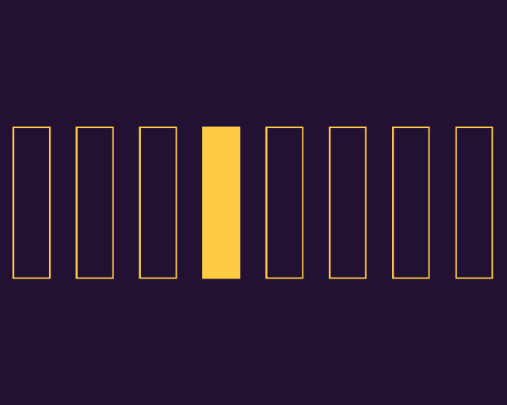

# 12. Sound and music

The Amiga's sound comes from **Paula**, the chip that also looks after the interrupts, the disk and the serial port. It has four sound channels, each reading 8-bit samples from chip RAM by DMA and turning them into sound without the processor's help. A demo sets a channel going, and from then on the processor's work is only to say when to change something: a new note, a new volume.

This chapter covers how to play a sound on Paula properly, the one timing problem that broke a generation of replayers on faster Amigas, and the replayers to use today. Everything here was checked against chapter 5 of the *Hardware Reference Manual* (HRM), its appendices on the CIAs, and the NDK 3.2. The examples were run on an emulated Amiga 500 with Kickstart 1.3 and 3.1, both ways, with a 68000, 68020 and 68040, and on an NTSC machine; and their sound was **recorded** from the emulator and checked note by note (how is in [the examples](#the-examples) below).

## Paula's four channels

Each channel has a digital-to-analogue converter of its own, fed by its own DMA. Channels **0 and 3 come out on the left**, **1 and 2 on the right**. There's no panning: a sound on channel 0 is on the left only. (The HRM's online edition says it the other way round, 0 and 3 on the right; its own note there says the printed manual has 0 and 3 on the left, "which is identical how the real hardware works". The emulated A500 agrees: channel 0 came out on the left.) Emulators often blend the two sides a little for headphones; a real Amiga doesn't.

Each channel has five registers, `$10` apart, from `$DFF0A0` for channel 0:

| Register | Offset | What it is |
|---|---|---|
| `AUDxLC` (`AUDxLCH`, `AUDxLCL`) | `$A0` | where the sample starts: a long word, an even address in chip RAM |
| `AUDxLEN` | `$A4` | its length, **in words** (two samples a word) |
| `AUDxPER` | `$A6` | its **period**: how many clock ticks each sample lasts, so how fast it plays |
| `AUDxVOL` | `$A8` | its volume, 0 to 64 |
| `AUDxDAT` | `$AA` | the next two samples, for playing without DMA (rarely used) |

`hardware.i` has them as `AUD0LC`, `AUD0LEN`, `AUD0PER`, `AUD0VOL`, `AUD0DAT`, with `AUD1LC` to `AUD3LC` and `AUD_SIZE` (`$10`) for the others.

A sample is a list of signed bytes, -128 to 127. It has to be in **chip RAM**, like anything the custom chips read: a `data_c` or `bss_c` section, or memory allocated with `MEMF_CHIP`. Each channel gets one word (two samples) from memory in every scan line, in a slot kept for it (the HRM: "Each audio channel is allocated one DMA slot per horizontal scan line"); the slots are there whether the channel plays or not, so playing sound takes no time from the processor or the blitter.

## Playing a sample

Set the four registers, then switch the channel's DMA on in `DMACON`, with `DMAEN` (the master switch) as well. From `ch12_tone.s`:

```asm
        lea     CUSTOM,a5
        move.l  #Wave,AUD0LC(a5)                ; the address: chip RAM, a word boundary
        move.w  #WAVEBYTES/2,AUD0LEN(a5)        ; the length, in words
        move.w  #VOLUME,AUD0VOL(a5)
        move.l  Periods,a0
        move.w  (a0),AUD0PER(a5)                ; the first note
        clr.w   NoteIndex
        move.w  #DMAF_SETCLR!DMAF_MASTER!DMAF_AUD0,DMACON(a5)  ; and go: the waveform repeats until it's stopped
```

The channel plays the sample, and when it gets to the end, plays it again from the start, for ever: a sample of one cycle of a waveform makes a steady tone. That's because the channel doesn't use `AUDxLC` and `AUDxLEN` directly. When it starts, it **copies** them into counters of its own (the HRM calls them back-up registers), plays from those, and copies them again each time it gets to the end. So writing `AUDxLC` and `AUDxLEN` while a channel plays changes nothing now: it's what the channel will play *next*, after the current sample ends. Trackers use exactly that for a sample with a loop: start the whole sample, then point the registers at the loop, which plays when the sample has finished and then repeats.

`AUDxPER` and `AUDxVOL` are different: they're used from the next sample on. Writing a new period while a channel plays changes the pitch at once, with no click, as the waveform carries on where it was. That's how `ch12_tone.s` changes note every second, and how a tracker does vibrato, slides and arpeggios.

**Stopping** is the channel's bit in `DMACON` with bit 15 clear, and its volume to 0:

```asm
        move.w  #DMAF_AUD0,DMACON(a5)
        move.w  #0,AUD0VOL(a5)
```

Set the volume to 0 as well: a channel left without new data holds its last sample's value on its output (the HRM says so of playing without DMA), and with the volume at 0 there's nothing left to hear, whatever comes next.



`ch12_tone.s` plays a waveform on channel 0, up and down a C major scale, a note a second, with the note playing lit on screen. Its waveform is one cycle of 32 samples: a sine with a little of its second and third harmonics, which sounds rounder than a plain sine. It starts at 0, so starting it makes no click.

### Stopping as the demo ends

Taking the machine, the startup stops all four channels as the demo ends: audio DMA off and every volume 0. With the system running it leaves sound alone, as other programs may be playing, unless the demo set `AUDIO_CHANNELS` (a mask of the channels it plays): then the startup allocates those channels from audio.device as the demo starts and silences and frees them as it ends, as the examples below do for themselves. Either way, a program that starts a sound should stop it too, in its `ExitHook` (see [startup and exit](04-startup-and-exit.md)), and there's an order to it. The vertical blank goes on running until the startup takes its interrupt away, which is *after* `ExitHook`. A player that's still running then will start the next note again. So stop the player first, then the sound:

```asm
PlayerExit:
        sf      Playing                         ; the vertical blank does nothing from now on
        move.w  #DMAF_AUDIO,DMACON(a5)
        moveq   #0,d0
        move.w  d0,AUD0VOL(a5)
        ...
```

### With the system running: ask audio.device first

With `OS_FRIENDLY` set, the system is still running, and **audio.device** owns the four channels: other programs ask it for them. A program that writes the audio registers itself must allocate its channels from audio.device first, so the system won't give them to anyone else while the demo plays. The audio.device autodoc: "If you decide to store directly to the audio hardware registers, you must either lock the channels you've allocated, or set the precedence to maximum (ADALLOC_MAXPREC) to prevent the channels from being stolen."

Opening the device with a list of the channel combinations you'd take allocates them; closing it frees them again. The allocation needs a message port, made by hand here as `CreateMsgPort` is only in Kickstart 2 and later (the startup makes its input handler's port the same way). From `ch12_tone.s` (the port's set up just before):

```asm
        lea     AudioRequest,a1
        move.b  #NT_MESSAGE,LN_TYPE(a1)
        move.b  #ADALLOC_MAXPREC,LN_PRI(a1)     ; the allocation's precedence: nothing can take it from us
        move.l  a0,MN_REPLYPORT(a1)
        move.w  #ioa_SIZEOF,MN_LENGTH(a1)
        move.l  #ChannelWanted,ioa_Data(a1)
        move.l  #1,ioa_Length(a1)               ; one combination to try
        lea     AudioName(pc),a0
        moveq   #0,d0
        moveq   #0,d1
        jsr     _LVOOpenDevice(a6)
        tst.l   d0
        bne.s   .noopen
...
ChannelWanted:  dc.b    %0001                   ; channel 0 (bits 0 to 3 are channels 0 to 3)
```

`ADALLOC_MAXPREC` is 127, and `ioa_Data`, `ioa_Length` and `ioa_SIZEOF` are offsets in the `IOAudio` structure (34, 38 and 68, from the NDK's `devices/audio.i`). If `OpenDevice` fails, another program has the channels: both examples then run without sound rather than fight over them. The channels go back with `CloseDevice` in `ExitHook`, after the sound has stopped. audio.device is in the Kickstart ROM, 1.3 included.

Taking the machine, none of this is needed: nothing else runs.

## Periods and notes

The period is how many ticks of the chips' clock each sample lasts. That clock is the **colour clock**: **3,546,895 Hz on PAL** machines and **3,579,545 Hz on NTSC** ones (the HRM's "clock constant"). So:

```
samples a second = clock / period
frequency of a note = clock / (period * samples in one cycle of the waveform)
```

For `ch12_tone.s`'s 32-sample waveform, middle C (261.6 Hz) is 3546895 / (32 × 261.6) = **424** on PAL. On NTSC it's **428**. The two clocks differ by about 1%, so a demo that wants to be in tune on both has two tables, and picks one at the start, as `ch12_tone.s` does with the startup's `PalDisplay`:

```asm
PeriodsPAL:     dc.w    424,377,336,317,283,252,224,212
PeriodsNTSC:    dc.w    428,381,339,320,285,254,226,214
```

Doubling the period plays a note an octave lower. So does doubling the length of the waveform at the same period: `ch12_tiny_player.s` plays its bass from the same period table as the lead, with a waveform of 64 samples instead of 32, and it sounds an octave below.

**ProTracker's periods.** ProTracker's period table runs from 856 (its C-1) to 113 (B-3), with C-2 at 428. Those are the NTSC values above: a sample played at C-2 plays at 3579545 / 428 = 8363 samples a second on NTSC, and 3546895 / 428 = 8287 on PAL, so on a PAL Amiga every module plays about a sixth of a semitone flat. Since most modules were written and heard on PAL Amigas, that's how they're meant to sound. Its finetune tables go a little further: the longest period, C-1 at finetune -8, is 907.

**The shortest period is 124** (the HRM; 123 on PAL). The reason is the DMA: a channel gets one word, two samples, a line. A PAL line is 227 colour clocks, so two samples a line is a period of 113.5 at the very least; the HRM leaves a margin and says 124. Below it, "the audio DMA will not have had enough time to retrieve the next data sample and the previous sample will be reused". ProTracker's top note, B-3 at 113, is under the HRM's limit, and a whisker under even 113.5. With a 32-sample waveform, 124 is about 894 Hz on PAL; for higher notes, use a waveform with fewer samples a cycle (or more than one cycle in it), not a shorter period. The longest period is 65535.

**The filter.** The Amiga has a low-pass filter on its output that the HRM says starts to cut in around 4 kHz, and later A500s, and A2000s with two-layer boards, can switch it off (the HRM): it's bit 1 of CIA-A's port A (`$BFE001`), the same bit that dims the power light. The HRM's advice for waveforms of one cycle is periods from 124 to 256 (14,000 to 28,000 samples a second), which keeps the waveform's own harmonics where the filter can do its job; that means a different waveform for each octave. If anything you use changes the filter bit (some replayers do, below), the v8 startup puts it back as the demo ends, as it was found; a demo on another startup has to do it itself.

## Volume

`AUDxVOL` is 0 (silent) to 64 (loudest): 64 is the top, not 63. It scales the sample's amplitude in a straight line, so 32 is half as loud in amplitude, 6 dB down; the HRM's table has 48 at -2.5 dB and 16 at -12 dB.

Changing the volume every frame gives a note a shape, an **envelope**: loud as it starts, falling away. `ch12_tiny_player.s` does that for each channel, keeping the volume times 256 so it can fall by fractions of a step each frame.

The HRM has three rules for clean changes from one sound to another: avoid **clicks** by making a waveform start and end at about the same value; avoid **pops** by starting a waveform at a zero crossing; and avoid **thumps** by giving waveforms the same average value, best of all 0. The tiny player's pulse wave is 96 for a quarter of its cycle and -32 for the rest, rather than ±64, so it averages 0.

## Starting a new note: the wait

Playing a new sample on a channel that's already playing (a new note in a tune) takes three steps:

1. Switch the channel's DMA off.
2. Set `AUDxLC`, `AUDxLEN` and `AUDxPER` for the new sample, and switch its DMA on again.
3. Once it's started, point `AUDxLC` and `AUDxLEN` at what follows: the sample's loop, or silence.

And there must be a **wait** after step 1, and another after step 2. They're where v7's tracker section came from, and where most replayers of the time went wrong.

### Why it has to wait

A channel only looks at its DMA bit at the end of a sample, and it may be up to two samples from that. The HRM: "If the channel is disabled for a very short time (less than two sampling periods) it may stay on and thus continue from where it left off." Switch it on again before then and, as far as the channel knows, it never stopped. It carries on through the *old* sample, and the new note's start is lost: it only gets the new sample when the old one runs out, and by then step 3 has pointed the registers at the loop. That's the classic "notes missing" fault, and it's worst for low notes, as their samples are longest: two samples at ProTracker's longest period, 907, are 1,814 colour clocks, about **eight lines**.

v8 measured it. A test program played a long sample at period 907, then stopped it, waited a number of new lines (counted with the beam, as below) and started a different sample. It tried each wait at eight different points in the old sample, on the emulated A500, and the sound was recorded to see whether the new sample was heard:

| New lines waited | 1 | 2 | 3 | 4 | 5 | 6 | 7 | 8 to 12 |
|---|---|---|---|---|---|---|---|---|
| New note heard, of 8 | 1 | 2 | 3 | 4 | 5 | 6 | 7 | 8 |

Just as the HRM says: whether a short wait works depends on where the old sample was, and from eight lines on, it always worked. (This is the emulator's model of Paula, FS-UAE's, which follows the HRM's state machine; it wasn't checked on a real A500.)

So: **after stopping a channel, wait at least two of its old samples: twice its period in colour clocks**. A line is 227 colour clocks (227.5 on NTSC). Counting new lines with the beam, the first may be nearly over as you start, so count one more than you need. `ch12_tiny_player.s` waits for 10, at least nine whole lines, 2,043 colour clocks: enough for any period up to 1,021.

### How not to wait

v7's tracker section was about this wait. It reported that ProTracker 2.3's replay routine had an equate, `DMAWait = 300`, "Set this as low as possible without losing low notes", and then never used it, waiting with a hard-coded `dbf` loop of 300 instead; v7's advice was to use the equate and raise it to 1024, or to 1800 to 2000 on a 68040.

The fault wasn't the number. A `dbf` loop's time depends on the processor: on a 68000 at 7 MHz, 300 times round takes about 3,000 cycles, about six and a half lines; a 68030 or 68040 running it from its cache is done in a fraction of a line, and an emulator with a just-in-time compiler takes no time at all. There's no right number of times round a loop. Waiting for a clock that runs at the same speed on every Amiga is the fix (see [general guidelines](03-general-guidelines.md): no delay loops).

### The right ways

- **The beam.** Count new lines with `VHPOSR`. Any processor, any speed. This is the tiny player's way:

  ```asm
  ; Waits until the beam has started d0 new lines. Any processor, any speed: the beam is the clock.
  WaitLines:
  .line:
          move.b  VHPOSR(a5),d1                   ; the line the beam is on (its low 8 bits)
  .same:
          cmp.b   VHPOSR(a5),d1
          beq.s   .same
          subq.w  #1,d0
          bne.s   .line
          rts
  ```

  It's simple, but the processor does nothing else while it waits, ten lines or so for each row of a tune with a new note in it. (v7's archive came with a replayer that did wait with the beam, for six new lines between its steps, plus the time it spent on the other channels.)

- **A CIA timer.** Start a one-shot timer, and do the next step in its interrupt. The processor's free meanwhile. A CIA tick is exactly five colour clocks (709,379 × 5 = 3,546,895 on PAL; 715,909 × 5 = 3,579,545 on NTSC). LightSpeedPlayer's CIA toolkit waits 496 ticks (2,480 colour clocks, nearly 11 lines); ptplayer waits 576 (12.7 lines; its history says it was raised from 496 to fix low notes on a few A1200s). See [interrupts](05-interrupts.md) for CIA timers both ways.

- **The copper.** If the replay runs at a known line each frame (the top of the frame, from the vertical blank), a copper `MOVE` to `DMACON` about 11 lines further down the copper list can do step 2's DMA on. The replay stops the channels, sets the new samples, and writes which channels to start into that `MOVE`'s value. LightSpeedPlayer and The Player do it this way. The `MOVE` has to be in every copper list the demo uses.

### The second wait: the channel says when it's ready

After step 2, the channel has to take the new sample's address and length into its counters before step 3 changes the registers; change them too soon and it starts from the loop, or the silence, instead. Players wait a second time for this, as long again. But the channel says when it's done it, with its **audio interrupt request**. The HRM: "Interrupts occur immediately after the audio DMA channel has read the location and length registers and stored their values in the back-up registers." The request shows in `INTREQR` (bits 7 to 10 for channels 0 to 3) whether the interrupt is enabled or not. So clear the request, start the channel, and wait for the request to come back; in v8's test it came within a line. `ch12_tiny_player.s` does all three steps for every channel starting a note at once:

```asm
StartNotes:
        move.w  d7,DMACON(a5)                   ; 1: the channels' DMA off (bit 15 clear: clear these bits)
        moveq   #DMA_WAIT_LINES,d0
        bsr     WaitLines

        ...                                     ; 2: the new samples, into AUDxLC, AUDxLEN, AUDxPER

        move.w  d7,d5                           ; their audio interrupt requests: INTF_AUD0 is bit 7
        lsl.w   #7,d5
        move.w  d5,INTREQ(a5)                   ; cleared, so a new one shows the start
        move.w  d5,INTREQ(a5)
        move.w  d7,d0
        or.w    #DMAF_SETCLR,d0
        move.w  d0,DMACON(a5)                   ; and go

        moveq   #DMA_WAIT_LINES,d2              ; 3: wait for every channel to ask
        move.b  VHPOSR(a5),d1
.ask:
        move.w  INTREQR(a5),d0
        and.w   d5,d0
        cmp.w   d5,d0
        beq.s   .asked
        cmp.b   VHPOSR(a5),d1
        beq.s   .ask
        move.b  VHPOSR(a5),d1
        subq.w  #1,d2
        bne.s   .ask
.asked:
        move.w  d5,INTREQ(a5)
        move.w  d5,INTREQ(a5)

        ...                                     ; then the drums' AUDxLC and AUDxLEN to silence
```

The wait has a limit (`DMA_WAIT_LINES`), in case the request never comes. In v8's stop-and-start test, it never came when the new note was lost: the channel hadn't restarted. Taking the machine, the startup leaves the audio interrupts disabled, so nothing else clears the requests. With the system running, the channels are the demo's (allocated, above), so audio.device has no business with them either.

The other way is to leave step 3 to the next tick: a frame later, the channel has long since started. LightSpeedPlayer does that.

### Playing a sample once

A channel never stops by itself: at the end of a sample it plays it again. To play a sample once (a drum), point the channel at a word of silence as soon as it has started, with a length of one word, and it plays the sample and then repeats nothing:

```asm
        move.l  #Silence,(a1)                   ; a1: the channel's AUDxLC
        move.w  #1,AUDLEN(a1)
...
Silence:        ds.w    1               ; a word of 0, in chip RAM
```

Trackers do the same with the first word of a sample, kept at 0 for it. ptplayer's readme asks the same of sound effects: "always make sure the first word is cleared! It is used for idling when the effect stopped. This is the same technique as used by the music samples in Amiga trackers."

## Modulation: ADKCON

A channel can **modulate** the next one instead of making a sound: its samples become the next channel's volume or period, one word each time its own period runs out. Channel 0 modulates 1, 1 modulates 2, 2 modulates 3; channel 3 has no next channel, so attaching it only silences it. `ADKCON`'s bits:

| Bit | Name | |
|---|---|---|
| 7, 6, 5, 4 | `ATPER3` to `ATPER0` (the NDK's `ADKB_USE3PN` to `ADKB_USE0P1`) | channel 3, 2, 1, 0 modulates the next one's period |
| 3, 2, 1, 0 | `ATVOL3` to `ATVOL0` (`ADKB_USE3VN` to `ADKB_USE0V1`) | channel 3, 2, 1, 0 modulates the next one's volume |

With both bits set for a channel, its words go volume, period, volume, period. For a volume word only bits 6 to 0 count; for a period, all 16. The HRM suggests it for vibrato and tremolo, done by the chips with no processor time; demos rarely use it, as it costs a channel, and a replayer can do the same a frame at a time.

`ADKCON` is a set/clear register, like `DMACON`: bit 15 set sets the bits given, clear clears them. Its other bits (8 to 14) are the **disk's** settings and the serial port's break, so never write a whole value to it: set and clear only the audio bits you mean. `ADKCONR` reads it back. Taking the machine, the startup puts `ADKCON` back as it was; with the system running, it doesn't, so clear any of these bits you set.

## The audio interrupts

Each channel has an interrupt, at level 4 (`INTENA`/`INTREQ` bits 7 to 10, `AUD0` to `AUD3`; the vector is at `VectorBase+$70`). It comes, as above, when the channel has taken `AUDxLC` and `AUDxLEN` into its counters: when a sample starts, and each time it starts again. So in the interrupt, the registers are free for what plays next, and there's the whole length of the sample now playing to set it. That's **double buffering** for sound: two buffers, one playing while the program fills the other. It's how sound is mixed in software (more than four sounds at once, or a sample stream from disk), and how the HRM joins waveforms end to end with no gap.

v8 tried this sketch, taking the machine (`Init` and `ExitHook` of a test demo): channel 0 plays two buffers of 4096 samples in turn, queued by the interrupt. The recording was continuous, the two tones alternating every 0.23 seconds, on a 68000 and a 68040:

```asm
        move.l  VectorBase,a0
        move.l  $70(a0),OldLevel4               ; level 4: the audio interrupts
        move.l  #Level4,$70(a0)
        move.l  #BufferA,AUD0LC(a5)             ; the first buffer
        move.w  #BUFBYTES/2,AUD0LEN(a5)
        move.w  #200,AUD0PER(a5)
        move.w  #48,AUD0VOL(a5)
        move.l  #BufferB,NextBuffer             ; and the one to queue when it starts
        move.w  #INTF_AUD0,INTREQ(a5)
        move.w  #INTF_SETCLR!INTF_AUD0,INTENA(a5)
        move.w  #DMAF_SETCLR!DMAF_AUD0,DMACON(a5)
        rts

; Called each time channel 0 has taken AUD0LC and AUD0LEN and started a buffer: queue the other.
Level4:
        movem.l d0/a0,-(sp)
        lea     CUSTOM,a0
        move.l  NextBuffer,d0
        move.l  d0,AUD0LC(a0)                   ; played after the one that's just started
        cmp.l   #BufferA,d0                     ; and the next time, the other one
        beq.s   .tob
        move.l  #BufferA,NextBuffer
        bra.s   .ack
.tob:
        move.l  #BufferB,NextBuffer
.ack:
        move.w  #INTF_AUD0,INTREQ(a0)
        move.w  #INTF_AUD0,INTREQ(a0)
        movem.l (sp)+,d0/a0
        rte

AudioExit:                                      ; the ExitHook
        move.w  #INTF_AUD0,INTENA(a5)
        move.w  #DMAF_AUD0,DMACON(a5)
        move.w  #INTF_AUD0,INTREQ(a5)
        move.l  VectorBase,a0
        move.l  OldLevel4,$70(a0)
        rts
```

Acknowledge twice, as every interrupt on a fast processor (see [interrupts](05-interrupts.md)). The startup gives back `INTENA` but not the level 4 vector, so `ExitHook` puts it back.

With the system running, the audio interrupts are **handlers**, not server chains: one routine each, which audio.device uses. Allocate the channel first (above), then install a handler with exec's `SetIntVector` (`INTB_AUD0` and so on), which returns the old one to put back as the demo ends. Its autodoc: the handler is called with `a1` = `IS_DATA` and `a0` = the custom chips, may change `d0`, `d1`, `a0`, `a1`, `a5` and `a6`, returns with `rts`, and has to clear its request in `INTREQ` itself. (v8 hasn't run this one.)

Without DMA, a program can write samples to `AUDxDAT` itself, two at a time, and the interrupt comes after each word instead. The HRM: "more processor-intensive and is therefore not recommended". If a new word isn't written within two samples, the output stays where it was.

## A tiny player

`ch12_tiny_player.s` plays a short tune of its own on all four channels, from the startup's `VBlank`: bass, a lead, a chord arpeggio and drums. It's a player to learn from, not a tracker replayer, but it does everything a replayer has to do:

- **A tick a frame.** Like a tracker, it counts **ticks**, 50 a second, and moves on a **row** every six (the "speed"). Each channel has its own list of notes and how many rows each lasts, and they loop.
- **Envelopes**: each tick, each channel's volume falls towards a floor, and is written to `AUDxVOL`.
- **An arpeggio**: the chord channel plays one note of its chord a tick, changing `AUDxPER` each frame with no restart: the old chip-music way to play a chord on one channel.
- **Starting notes** with the three steps and two waits above, all the channels at once.
- **Drums played once**, then silence. The drums and waveforms are worked out by the code in `Init`: a triangle falling in pitch for the kick, and noise from a shift register for the snare and hi-hat, each fading out. So the example needs no sample files, and all of it is CC0.
- **The same tempo on NTSC**: it skips every sixth frame there, so it still has 50 ticks a second.
- **Two period tables**, PAL and NTSC, so it's in tune on both.


The bars are the channels' volumes as the envelopes move them, and the steps along the bottom are the rows.

## Tempo: the vertical blank or a CIA timer

A ProTracker module plays at a **speed** (ticks a row, 6 at first) and a **tempo** in "BPM" (125 at first). The tempo sets how many ticks there are a second: BPM × 2 / 5, so **125 BPM is 50 ticks a second**, and with four rows to a beat at speed 6, that's 125 beats a minute.

There are two ways to get the ticks:

- **The vertical blank**: one tick a frame. Simple, and the replay runs at a known point in the frame. But it's 50 ticks a second only on PAL. On an NTSC Amiga, frames come 60 a second, and the music plays 20% fast. And a module's tempo commands (`Fxx` with xx of `$20` or more) can't change anything: there's one tick a frame, whatever the tempo. Players with a vertical blank mode play every module at 125 BPM.
- **A CIA timer**: a timer interrupt at the tempo's rate. The timer counts the E clock (709,379 Hz PAL, 715,909 Hz NTSC), so for a tempo of `bpm`, the timer is set to 709379 × 2.5 / `bpm` = **1773447 / bpm** on PAL, and **1789773 / bpm** on NTSC (LightSpeedPlayer's CIA toolkit uses exactly these two numbers). At 125 BPM that's 14,188 ticks, 50 interrupts a second, on both. Tempo commands work, and NTSC plays at the right speed.

Taking the machine, a CIA-B timer is yours to set; with the system running, ask `ciab.resource` for one, as [interrupts](05-interrupts.md) shows, and give it back in `ExitHook`. Level 6 is above everything else, so the music's timing doesn't waver when the disk or keyboard is busy.

A demo that draws in step with its music may still prefer the vertical blank, with the music at 125 BPM. The tiny player shows the third way, for NTSC: skip a frame in six, so there are 50 ticks a second still; the cost is a slightly uneven step on NTSC, which nobody hears.

## Replayers today

For a real tune, use a replayer: a tracker module has effects (slides, vibrato, arpeggios, retriggers, pattern breaks) that take a lot of code to get right. These three are widely used, and their terms are clear.

### LightSpeedPlayer

**LightSpeedPlayer** (LSP), by **Arnaud Carré (Leonard / Oxygene)**: <https://github.com/arnaud-carre/LSPlayer>. MIT licence.

LSP does nearly all of the work before the demo runs. Its converter, **LSPConvert**, plays a ProTracker module through (using Martin Cameron's micromod library) and writes down what each tick does to Paula: which volumes, periods and samples change. The replayer on the Amiga only reads that back and writes the registers; it has no code for effects at all. It's under 512 bytes, and its README, measured on an A500, gives 0.83 lines a tick on average and 2.27 at most. The files LSPConvert writes are a `.lsmusic` (the score, any memory) and a `.lsbank` (the samples, chip RAM).

It comes three ways:

- **Standard** (`LightSpeedPlayer.asm`): call `LSP_MusicPlayTick` once a tick, with `a6` = `$DFF0A0`. It stops the channels whose notes start, and writes which ones to start into the low byte of a copper `MOVE` to `DMACON`, about 11 lines later in your copper list. It sets the loop pointers a tick later, when the channel has long since started.
- **Insane** (`-insane`): LSPConvert writes a replayer just for that module, taking about half the time of the standard one (0.46 lines on average), but up to 30K of code.
- **Micro** (`-micro`, `LightSpeedPlayer_Micro.asm`): a replayer of 224 bytes once packed, for 4K and 40K intros; its music data is bigger but packs very well.

There's also a **CIA toolkit** (`LightSpeedPlayer_cia.asm`), the easiest to use: it plays on CIA-B's timer A at the module's tempo, and starts the channels from timer B, one-shot, 496 ticks later, so you don't need the copper `MOVE`. It takes CIA-B and the level 6 vector (it asks for the VBR, so give it `VectorBase`), and, as its own comment says, "this code doesn't restore any amiga OS stuff": use it taking the machine, and call `LSP_MusicDriver_CIA_Stop` in `ExitHook`. It also wants `d0` = 0 on PAL or 1 on NTSC, for its timer's clock; only bit 0 counts, so don't pass the startup's `PalDisplay` as it is (it's `$FF` on PAL): test it and load 0 or 1.

Two things to know: `LSP_MusicInit` switches the audio filter off (it sets bit 1 of `$BFE001`) and doesn't put it back; and `-fixed50hz` makes a module whose tempo isn't 125 play right from a 50 Hz vertical blank, without a CIA timer.

**In Limoniter**: with a ProTracker module in front, **File › Run on › Amiga crunchers and music** converts it with LSPConvert, with LSPConvert's options, writing the `.lsmusic` and `.lsbank` beside the module (and, if you ask, the insane player's source, or a WAV of how it will sound on the Amiga). Limoniter can download LSPConvert's release from GitHub when you ask. It then writes the **replay calls** as commented 68000 source, into your source at the cursor or onto the clipboard: LSP with its CIA toolkit; LSP from your own interrupt with `DMACON` set by the copper 11 lines later; the insane player; or the micro player. They `include` LSP's own files from its package rather than copying them. Limoniter also plays modules in its preview, so you can hear one before converting it.

### The Player 6.1A

**The Player 6.1A**, by **Jarno Paananen (Guru / Sahara Surfers)**, fixed in 1998 by NoName, Platon42, Tolkien and The Dark Coder, and optimised in 2010 by **Photon / Scoopex** (version 610.8): <https://aminet.net/package/mus/misc/P6108>. It's freely distributed on Aminet, with no licence beyond that, and the original's copyright notice: include it as it comes.

Its converter, **P61Con**, packs a module into its own P61 format and is an Amiga program: run it on an Amiga or in an emulator, and it saves a `P61.name` file. It also gives a **USE code** that says which effects the module uses, so the replayer can leave out the rest (and keeps it in the file's comment). The replayer, `P6108-Play.S` with its options in `P6108-StandardOptions.S`, has `P61_Init`, `P61_Music` once a tick and `P61_End`, and plays from the vertical blank or a CIA timer. Its readme, timed on a 68000: a module that took 8.7 lines a tick with version 6.106 takes 3.5 to 4.5 with its fastest options. Like LSP, it has a mode that writes the channels to start into a copper `MOVE` to `DMACON` 11 lines on, rather than using a level 6 interrupt for it.

In Limoniter, the same menu finds the P61 file P61Con saved beside the module, and writes the replay calls for it: `P61_Init`, `P61_Music` and `P61_End`, with the `use` value to fill in.

### ptplayer

**ptplayer**, by **Frank Wille**, version 6.4 (2024): <https://aminet.net/package/mus/play/ptplayer>. It's **public domain**: its readme says Frank Wille releases it "into the public domain. This applies worldwide."

It plays ProTracker modules as they are, with no converting, and was written for games: it can play **sound effects** in among the music, choosing the channel each time (one that's free, or the music can spare), with priorities, and has a master volume for the music alone. Its readme: "No busy waiting. DMA and repeat pointers are set with timer interrupts." By default it takes CIA-B's timer A for the music and timer B for the DMA waits (576 ticks for the DMA, since version 6.0), taking the machine. Its options: `VBLANK_MUSIC` to call `_mt_music` from your own vertical blank (timer B is still used for the waits, and tempo commands no longer work); `NO_TIMERS`, which leaves the waits to you ("wait at least 550 ticks, then call _mt_dmaon", and again before `_mt_setrep`); and `OSCOMPAT`, which allocates the channels from audio.device and its CIA interrupts through the system, for a demo that keeps it running.

### Which?

- **For a demo**: LightSpeedPlayer. It's the fastest by its own benchmarks, by a long way, and the easiest to get a module into with Limoniter.
- **With sound effects over the music** (a game, an intro with sounds), or a module played as it is: ptplayer.
- **The Player** is a good replayer that many demos used, and you'll meet it in older sources.

## Music you have the right to use

Most music in old demos was written for them, by the group's own musicians, and the ripped modules that are on every archive site are still theirs. Using someone's module in your demo, or the samples out of it, needs their permission, whatever the archive says. Use music you've made, music written for you, or music whose licence says you can (CC0, or a Creative Commons licence whose terms you keep, credit included). Credit the musician either way: it's what the scene has always done, and many parties' rules ask for it. v8's examples have music of their own making, so they can be CC0.

## The examples

Both run on the v8 startup, both ways (`OS_FRIENDLY` 0 and 1); with the system running, they allocate their channels from audio.device first.

- `ch12_tone.s`: a sampled waveform on one channel, a new note from a period table each second, the note on screen; PAL and NTSC periods; stopping cleanly.
- `ch12_tiny_player.s`: the tiny player: a four-channel tune of its own from the vertical blank, with envelopes, an arpeggio, one-shot drums and the DMA waits.

Each was run in FS-UAE on an Amiga 500 with Kickstart 1.3 and 3.1, both ways, with a 68000, 68020 and 68040, and on an NTSC machine, ending each time with the CLI's "back in AmigaDOS" line. The emulator's sound was recorded to a file (FS-UAE plays its sound through OpenAL Soft, which can write a WAV file instead of using a sound card), and checked by measuring the pitch of each note:

- `ch12_tone.s` played C, D, E, F, G, A, B, C and back down, a second each, within 0.2% of the notes' frequencies, PAL and NTSC; and then silence.
- `ch12_tiny_player.s`: every bass and lead note in the ten seconds it played, on every machine, was the note in its list, within 18 cents, at 0.12 seconds a row on PAL and NTSC alike. Separately (with the other channels silenced in a copy), the drums started on their rows and stopped, and 493 of 499 arpeggio ticks were notes of their bar's chord (the other six all came in the last second or so of the recording).

## What changed from v7

- v7's tracker section was one bug report: ProTracker 2.3's replay routine ignored its own `DMAWait` equate and waited with a hard-coded `dbf` loop of 300. v7's fix was to use the equate and make it bigger (1024, or 1800 to 2000 on a 68040). The problem was real, but no loop count is right: a loop's time depends on the processor. v8 waits for the beam, or a CIA timer, or lets the copper do it, and for the second wait, the channel's own interrupt request. It also measures how long the first wait has to be: two of the old note's samples, about eight lines for ProTracker's lowest notes.
- v7 said "No demo would be complete without a tracker module" and that tracker code "seems to be amongst the worst written I've seen". The replayers above are well written, and say what they need.
- v7's archive had a ProTracker replayer by others (`protracker_replay.s`). It isn't in v8; v8 points to replayers whose terms are clear.
- New: Paula's registers, playing and stopping a sample properly, allocating the channels from audio.device with the system running, periods for PAL and NTSC, the minimum period and why, volume, modulation, the audio interrupts, tempo from the vertical blank or a CIA timer, today's replayers, and using music you have the right to.
