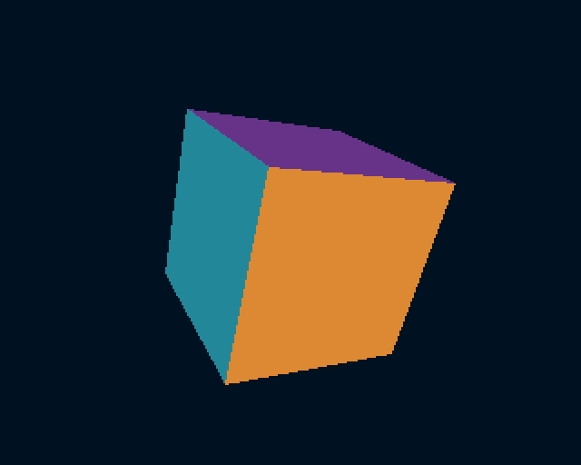
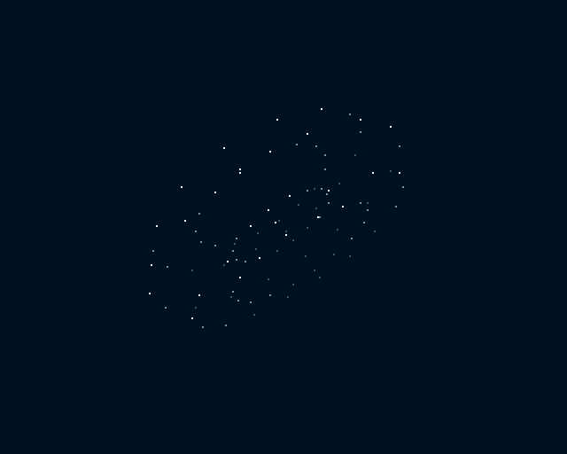
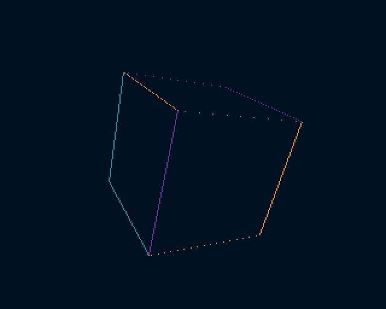
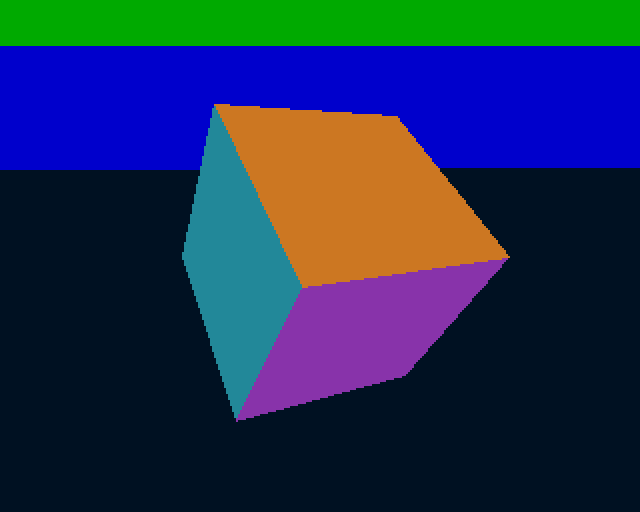

# 13. 3D vectors

"Vectors", in a demo, are objects worked out in three dimensions and drawn flat on the screen: dots, lines, filled faces, balls. This chapter goes through the maths and the drawing, from a turning cloud of dots to a solid cube, lit and in perspective, at 50 frames a second on an Amiga 500.

The maths is **Carl-Henrik Skårstedt**'s (Asterix of Movement), v7's co-editor, who wrote v7's Vectors chapter over his Easter holidays in 1993: fixed point, the sine table, the rotation matrix worked out once a frame so each point takes nine multiplies, the back-face test and the sorting. v7 also carried a shorter way into rotation matrices by **Michael Vissers**, which is kept here too. The text and code are new: every routine in this chapter is in one of the two examples, each assembled with Limoniter and run on an emulated Amiga 500 with Kickstart 1.3 and 3.1, both ways (taking the machine and keeping the system running), and with a 68020 and a 68040. The fixed-point maths was checked separately against a model in Python.

The examples:

- `ch13_dots.s`: a ring of 96 dots (a torus) turning in three dimensions. The simplest object, and the place to start.
- `ch13_cube.s`: a solid cube, three faces in view at once, each its own colour and lit by how squarely it faces you. It uses chapter 7's line and fill routines.



## The budget

Everything has to be done in a frame: that's what makes it move smoothly. On a PAL Amiga 500 the 68000 runs at 7.09 MHz, and a frame is 312 lines of 227.5 memory cycles, two processor clocks each: about **142,000 processor cycles a frame**, or **454 a line**. (NTSC: 7.16 MHz and 262 lines, about 119,000 a frame, but 60 of them a second.) The blitter works from the same clock and memory.

What the work costs, from the 68000 user's manual (Table 8-4) and the Hardware Reference Manual ("Blitter Speed"):

| Work | Cost |
|---|---|
| `MULS`, `MULU` (16 × 16 bits = 32) | 38 + 2n cycles, at most 70, plus the operand's address time |
| `DIVS` (32 ÷ 16 bits) | at most 158 cycles; `DIVU` at most 140 (the best case is less than 10% quicker) |
| `ADD.L Dn,Dn`; `SWAP` | 8 cycles; 4 |
| `ASR.L #n,Dn` | 8 + 2n cycles (n is 1 to 8) |
| blitter: clear (D only) or fill (A to D) | 4 cycles a word |
| blitter: a line | 8 cycles a pixel |

(For `MULU`, n is the number of 1 bits in the source; for `MULS`, the number of times the bits change from 0 to 1 or 1 to 0 along the source with a 0 put below it, so the worst case is $5555.)

So a point turned in 3D (9 multiplies) and put in perspective (2 more, or 2 divides) costs around a thousand cycles with everything around it: a hundred or so points a frame, if the 68000 does nothing else. Filling a 320 by 256 bitplane costs 5120 words × 4 = 20,480 cycles of blitter time, about 45 lines, before the display takes its share of memory. Those two facts shape everything below: turn few points, and fill and clear as little screen as you can.

## Fixed point

The 68000 has no floating point, and sines are fractions. The answer is **fixed point**: keep each fraction multiplied by a power of 2, so it's a whole number, and shift the result back down after multiplying.

Which power of 2? The 68000 multiplies 16 bits by 16 and gives 32. So the numbers that get multiplied should fit in 16 bits, and a sine (from −1 to 1) is best kept as **2.14**: multiplied by 16384 (2^14), with two bits for the whole part and sign and 14 for the fraction. 1.0 is 16384, which fits (1.15 would be more precise, but couldn't hold 1.0 itself). The coordinates of the object are plain whole numbers.

Multiplying a coordinate by a sine gives the answer times 16384 in 32 bits. Shifting right by 14 brings it back; but `ASR.L` can only shift by 8 at a time, and two shifts (8, then 6) take 44 cycles. Shifting the other way is quicker: two doublings move the answer's whole part up into the top word, and `SWAP` brings it down. 20 cycles. Both examples have it as a macro:

```asm
; MULF: multiplies a word by a 2.14 fixed point number (a sine, or a matrix entry) and keeps the whole part.
; MULS gives 32 bits, 14 of them fraction; two doublings and a swap leave bits 14 to 29 in the low word: the
; same as shifting right by 14 (asr.l #8 then asr.l #6, 44 cycles), in 20.
MULF    macro
        muls    \1,\2
        add.l   \2,\2
        add.l   \2,\2
        swap    \2
        endm
```

It works for negative numbers too, as long as the product fits in 30 bits, which a coordinate times a sine always does. It **truncates** (rounds towards minus infinity). v7 had a trick for rounding to the nearest instead, halving the error: after `asr.l #8`, the last bit shifted out is in the X flag, and `addx.l` of a register holding 0 adds it back on. With MULF there's no shift to leave it in X; add half (`$2000`, from a register) before the doublings for the same effect.

Why not 8.8 fixed point, sines times 256, as v7 used? It's cheaper (one `asr.l #8`), but coarse: in a Python model of the tables, a sine times 256 is up to 0.002 out, which is more than half a pixel on a point 111 pixels from the centre, before the errors of three products are added together. Objects wobble as they turn. With 2.14, the cube's corners in `ch13_cube.s` come out within about a pixel (at worst 1.01) of the exact answer at every angle tried (2000 of them), and the matrix entries within 4 of 16384.

Why not 16.16, the usual choice on later processors? Multiplying two 32-bit numbers on a 68000 takes three or four `MULU`s and some adding, as it can only multiply 16 bits by 16. On a 68020 or later, `MULS.L` does it in one, and 16.16 is the easy choice there; but every example in this guide has to run on a 68000.

## Sines and cosines

Never work out a sine while the demo runs: look it up. `ch13_cube.s` and `ch13_dots.s` have a table of 1024 words, one whole turn, as 2.14:

```python
import math
sine = [round(16384 * math.sin(2 * math.pi * i / 1024)) for i in range(1024)]
```

Limoniter's **table generator** (Tools › General › Table generator) makes the same table without leaving the editor: a sine, 1024 values, signed words, amplitude 16384, put in the source at the cursor as `dc.w` lines. It does perspective tables (scale ÷ z) too, which comes up below.

An angle is then a number from 0 to 1023, and a whole turn wraps round by itself with an `AND`. The examples keep each angle as a byte offset into the table (the angle times 2), so it's used as it is:

```asm
        move.w  (a1)+,d0                ; the angle, as a byte offset
        and.w   #$7fe,d0                ; the angle wraps round: 1024 words
        move.w  (a0,d0.w),SC_S1(a2)     ; its sine
        add.w   #512,d0                 ; a quarter turn on
        and.w   #$7fe,d0
        move.w  (a0,d0.w),SC_C1(a2)     ; is its cosine
```

The cosine is the sine a quarter of a turn on, so one table does both. (v7 gave an AmigaBASIC program to make the table, and a series to work sines out in assembler; with a modern computer beside the Amiga, neither is needed.)

## Turning a point

In two dimensions, a point (x, y) turned by an angle a about the centre goes to

    x' = x·cos a − y·sin a
    y' = x·sin a + y·cos a

In three dimensions, turning about one axis is the same, leaving that axis's coordinate alone: about the z axis, x and y change as above and z stays. To turn an object any way at all, turn it about z by one angle, then about y by a second, then about x by a third. The order matters: the same angles in another order give another answer.

That's 4 multiplies for each turn, 12 for a point. Carl-Henrik's improvement: the three turns, one after another, come to x', y' and z' each being some amount of x, plus some of y, plus some of z, and those amounts depend only on the angles. Work the nine amounts out once a frame, as a **rotation matrix**, and each point takes 9 multiplies:

    x' = xx·x + xy·y + xz·z
    y' = yx·x + yy·y + yz·z
    z' = zx·x + zy·y + zz·z

For the turns above (z by angle 1, then y by angle 2, then x by angle 3), with c1 for cos(angle 1), s2 for sin(angle 2) and so on:

| | x | y | z |
|---|---|---|---|
| **x'** | c2·c1 | −c2·s1 | −s2 |
| **y'** | s1·c3 − c1·s2·s3 | c1·c3 + s1·s2·s3 | −c2·s3 |
| **z'** | s1·s3 + c1·s2·c3 | c1·s3 − s1·s2·c3 | c2·c3 |

Working the matrix out the way Carl-Henrik did, c1·s2 and s1·s2 are each multiplied once and used twice: 14 multiplies in all, once a frame. Here's the start of `CalcMatrix`, with `MULF` doing the 2.14 multiplies:

```asm
        move.w  SC_C1(a0),d6            ; d6 = c1*s2
        MULF    SC_S2(a0),d6
        move.w  SC_S1(a0),d7            ; d7 = s1*s2
        MULF    SC_S2(a0),d7

        move.w  SC_C2(a0),d0            ; xx = c2*c1
        MULF    SC_C1(a0),d0
        move.w  d0,(a1)
        ...
        move.w  SC_S1(a0),d0            ; yx = s1*c3 - c1*s2*s3
        MULF    SC_C3(a0),d0
        move.w  d6,d1
        MULF    SC_S3(a0),d1
        sub.w   d1,d0
        move.w  d0,6(a1)
```

Michael Vissers' way to the same place, in v7, was to write each turn as a matrix and multiply the three together; the result is the table above (his has other signs, as he turned the other way). Either way, if you only turn two or three points, turning them one axis at a time is quicker than making the matrix; for a whole object, the matrix wins. And to leave an angle out, put cos = 1 and sin = 0 into the table, and it simplifies itself.

Two rules from v7 that still stand:

- **Always turn the original points**, by the whole angle so far, never last frame's turned points by a little more. Every turn loses a little to rounding, and after a few hundred frames, as Michael Vissers put it, you "lose all detail until nothing is left".
- **The matrix only turns.** Its determinant (a measure of how it changes volumes) must be 1; in the 2.14 model it is, to within 6 parts in 16384 at every angle tried.

**A mistake in v7.** v7's two-dimensional formula was x' = x·cos a + y·sin a, y' = x·sin a − y·cos a. At a = 0 that gives (x, −y): it doesn't just turn, it mirrors. Its 3D matrix, built from three of those, has a determinant of −1 (v7 suggested checking that it's 1; it isn't). Everything comes out mirrored, which a cube hides; but a mirror also reverses which way round a face's corners go, so the visible-face test below gives the opposite answer. If all your faces vanish just when they should show, look for a mirror. (There's also a slip in v7's working-out of zy; its final table is right.)

## Perspective

Things further away look smaller: a point's screen position is its x and y divided by how far away it is. With the eye `DISTANCE` from the centre of the object, and the screen 256 from the eye:

    screen x = centre x + x' × 256 / (z' + DISTANCE)
    screen y = centre y + y' × 256 / (z' + DISTANCE)

(z goes into the screen, so a positive z' is further away; y goes down the screen, as the Amiga's does.) Bigger `DISTANCE` flattens the perspective; the 256 is the zoom.

In `ch13_cube.s`, each sum of three products is the answer times 16384. Times 256 is what's wanted before dividing, so it's shifted right by 6, not 14, keeping the precision and saving a shift:

```asm
        move.w  d0,d3                   ; x
        muls    (a1),d3
        move.w  d1,d4
        muls    2(a1),d4
        add.l   d4,d3
        move.w  d2,d4
        muls    4(a1),d4
        add.l   d4,d3
        asr.l   #6,d3                   ; x * 256
        divs    d5,d3                   ; / distance
        add.w   #CENTREX,d3
```

`DIVS` only gives a 16-bit answer, and it has to fit: here, x' is at most 111 and the distance at least 209, so the answer is well inside. Make sure the distance can never reach 0 or go negative: an object that passes the eye needs **clipping** (cutting off what's behind the eye or off the screen), which neither example needs and this chapter doesn't cover. Chapter 7's line routines don't clip either: every corner has to land on the screen.

Two divides a point, at up to 158 cycles each, is fine for a cube's 8 corners. For many points, divide once per distance, not once per point: a **reciprocal table**. `ch13_dots.s` makes one as it starts, 256 × 16384 / (z + `DISTANCE`) for each z from −128 to 127; then the perspective is a `MULF` by the table entry, a multiply instead of a divide:

```asm
        add.w   d3,d3                   ; z, as a word offset
        move.w  (a2,d3.w),d5            ; d5 = 256 * 16384 / (z + DISTANCE)
        ...
        MULF    d5,d3                   ; x * 256 / (z + DISTANCE)
```

The table entries must stay under 32768 to be signed words for `MULS`; with `DISTANCE` 320 the biggest is 21845. Limoniter's table generator can make this table too (perspective, scale ÷ z).

## Dots: the first object

`ch13_dots.s` is all of the above and nothing else: 96 dots on a torus (the shape of a ring doughnut, made from the sine table as the program starts), turned, put in perspective, and plotted by the processor with `BSET`. The dots are shaded by distance: near ones in colour 3, far ones in colour 1, the rest in colour 2, which helps the eye see which way the ring is turning.



Two things in it are worth borrowing:

- A **table of line starts** (y × 40), made as the program starts, saves a multiply for every dot.
- **Rubbing out only the dots.** Clearing a whole screen for a hundred dots is a waste. Each dot's byte offset goes in a list as it's plotted, and next time that screen is drawn in, those bytes are cleared (`CLR.B`, in both bitplanes) before the new dots go in. 96 dots take far less time than the blitter would to clear the screen.

It takes about 230 lines of the 312 in a frame on the emulated A500: about 1000 cycles a dot. With 128 dots it no longer fits, and drops to 25 frames a second. That's the limit of turning every point with 9 multiplies.

## Which faces you can see

A solid object is made of flat **faces**, each a polygon (a shape with straight edges). For a cube, 8 corners make 6 faces; turn the 8 corners, not the 24 corners of 6 squares. The faces just say which corners they use.

Half the faces of a closed object face away from you, and they mustn't be drawn. Carl-Henrik's test: list every face's corners in the same order, clockwise as seen from outside the object. After turning and projecting, a face that still goes clockwise on the screen is facing you; one that goes anticlockwise faces away. The sign of the **2D cross product** of two of its edges tells which, from three of its corners (x0, y0), (x1, y1) and (x2, y2) on the screen:

    c = (x1 − x0)·(y2 − y0) − (y1 − y0)·(x2 − x0)

With y going down the screen, as on the Amiga, c is positive when the corners go clockwise: draw the face. Two multiplies a face, and it uses the projected points, so it's right with perspective too. (v7's appendix showed why: c is the z part of the cross product of the two edges, which points out of a face that goes one way round, and into it for the other.)

```asm
        movem.w (a0)+,d0-d3             ; three corners (as offsets into Projected), and the colour
        movem.w (a1,d0.w),d4-d5         ; x0, y0
        movem.w (a1,d1.w),d0-d1         ; x1, y1
        movem.w (a1,d2.w),d2/d6         ; x2, y2
        sub.w   d4,d0                   ; x1-x0
        sub.w   d5,d1                   ; y1-y0
        sub.w   d4,d2                   ; x2-x0
        sub.w   d5,d6                   ; y2-y0
        muls    d6,d0
        muls    d2,d1
        sub.l   d1,d0
        bgt.s   .visible
        moveq   #0,d3                   ; turned away: colour 0
.visible:
        move.b  d3,(a2)+
```

A tempting shortcut is to look only at which way the face's normal (the direction it faces) points after turning: towards you or away. Without perspective that's the same test. With perspective it isn't: near the edges of the view you see a face a little from the side, and a face can be visible with its normal pointing slightly away. The cross product of the projected corners is always right.

For a **convex** object (one with no dents, so no part of it can ever hide another), that's the whole of hidden surface removal: the faces that face you never overlap, so they can be drawn in any order. A cube, a pyramid, a football are convex. For the rest, see sorting, further down.

## Drawing filled faces with the blitter

The blitter fills between lines, a row at a time (see [the blitter](07-blitter.md)): draw each face's edges in a special way, then fill. Chapter 7's `DrawFillLine` draws the edges, and `FillArea` fills; `ch13_cube.s` uses both unchanged. In short, a line for filling:

- has **one dot on each row** of the screen (the SING bit), as every dot turns the fill on or off;
- is drawn with **exclusive or**, so two dots in the same place cancel;
- leaves off its **top end**, so where one edge ends and the next carries on down, there's one dot on that row, not two that cancel and let the fill run out of the shape;
- and **level lines** aren't drawn at all.

Chapter 7 leaves the top end off by pointing `BLTDPT` at a spare word: the blitter writes a line's first dot through `BLTDPT` and the rest through C's pointer, so the first dot lands out of sight. v7 (in Carl-Henrik's appendix) did it another way, which also works: just before starting the line, flip its first dot on the screen with the processor (`BCHG`), so the blitter's first dot flips it back. The first version of `ch13_cube.s` did that, and filled just as cleanly.

### More than one colour

A face of colour 3 is filled in bitplanes 0 and 1; colour 1 only in bitplane 0. Each bitplane is filled on its own, so each needs its own outline: round the faces whose colour has that bitplane's bit. Where two faces of colours 1 and 3 meet, the edge between them belongs in bitplane 1 (one side is colour 3, the other isn't), but not in bitplane 0, where both sides are filled.

The rule that does it: an edge goes in the bitplanes given by the **exclusive or of the colours of the two faces it joins**, counting a hidden face as colour 0. Edges between two hidden faces go nowhere and aren't drawn; an edge on the outline of the object goes in the bitplanes of the one face you can see; an edge between two visible faces goes where they differ. Each edge is drawn once, in only the bitplanes it's needed in. (v7 noted that drawing every visible face's edges draws the shared ones twice, and that "with some struggle you can also find ways to omit some lines": this is that.)

So `ch13_cube.s` keeps a list of the 12 edges, each with its two corners and the two faces it joins:

```asm
        movem.w (a2)+,d0-d3             ; its two corners (offsets into Projected), and its two faces
        lea     FaceColour,a1
        move.b  (a1,d2.w),d5
        move.b  (a1,d3.w),d2
        eor.b   d2,d5                   ; the bitplanes it goes in
        beq.s   .next
```

Here are the edges of one frame before filling: orange in bitplane 0 only, teal in bitplane 1 only, purple in both. (The shallow edges are dotted: one dot a row.)



and the same frame filled, which is the picture at the top of the chapter. Opposite faces share a colour, as they're never both in view; so 2 bitplanes give the three colours a cube needs, and every face you see is always a different colour from its neighbours.

**The fill** covers only the box round the cube: its 8 projected corners' smallest and largest x and y, widened to whole words. The same box, remembered for each screen, is all that needs clearing next time that screen is drawn in. A 320 by 256 screen of two bitplanes would be 10,240 words to fill and 10,240 to clear, every frame; the box is usually under half of that.

### Light

v7 described **light sourcing**: a face is brighter the more squarely it faces the light. The brightness is the cosine of the angle between the face's normal N and the direction of the light L, which is

    (N · L) / (|N| |L|) = (n1·l1 + n2·l2 + n3·l3) / (|N| |L|)

N comes from the cross product of two of the face's edges; the lengths never change as the object turns, so they can be worked out once. For a cube there's a shortcut: the faces' normals are the x, y and z axes, so after turning they're simply the **columns of the matrix**. With the light coming from the viewer, the brightness of the x faces is how much their normal points along z: the matrix's zx. `ch13_cube.s` turns zx, zy and zz into one of 16 steps of each face colour, and changes the palette, not the picture.

## Two screens

While the blitter fills and clears one screen, it mustn't be on show, or you'd see the cube half drawn and flickering. So there are two, and they swap: one on show while the other is drawn (**double buffering**).

The swap is a change to the bitplane pointers in the copper list, and when it happens matters. The copper reads its list from the top at the start of every frame, so a change made while it's reading the pointers would be seen half done: the high word of one screen's address with the low word of the other. In `ch13_cube.s`, `Frame` finishes the picture and leaves its address for the vertical blank:

```asm
        move.l  SCR_PLANES(a4),PendingScreen
        st      SwapPending
```

and `VBlank`, which runs at the start of every frame from the interrupt, writes it into the copper list if one is waiting. The copper list sets the bitplane pointers only after a wait for line $28, long after the interrupt has run and still before the display starts at line $2c, so it can never see half a change:

```asm
        dc.w    $2801,$fffe             ; wait for line $28
CopperPlanes:
        dc.w    BPL1PTH,0,BPL1PTL,0
        dc.w    BPL2PTH,0,BPL2PTL,0
```

The face colours go into the copper list the same way, so the picture and its colours change together.

**The mistake to avoid**: starting the next picture in the screen that's still on show. With the machine taken over, the startup's `WaitFrame` waits for the next frame to begin, by which time `VBlank` has made the swap. With the system running (`OS_FRIENDLY`), it waits for a signal, and a signal that came while `Frame` was still busy is still there: if one frame took too long, `Frame` is called again at once, before the swap, and would draw into the screen being shown. So `Frame` checks first:

```asm
.waitswap:
        tst.b   SwapPending
        beq.s   .swapped
        jsr     WaitFrame
        bra.s   .waitswap
.swapped:
```

## Where the time goes

`ch13_cube.s` and `ch13_dots.s` have a setting, `SHOW_TIME`: set it to 1, and the cube changes the background colour as it works: red while the processor works out the picture (with the blitter clearing meanwhile), green while the edges are drawn, blue while the fill finishes. Each colour shows how many lines of the screen went by while that part took place.



The red isn't there: it's all over before the display starts. The frame begins at the vertical blank, 44 lines before the first line shown, and the turning, projecting and culling fit in those lines. Started later (a test build waited for line $40 first, so all of it showed), the cube on the emulated A500 took:

| Part | Lines |
|---|---|
| matrix, 8 corners, faces, box (the blitter clearing the first bitplane meanwhile) | about 32 |
| edges (after the second bitplane's clear) | 30 to 42 |
| fill, both bitplanes | 43 to 70 |
| **in all** | **115 to 143 of 312** |

Under half the frame, with the system running too: the cube runs at the full 50 frames a second on a 68000. A test build that turned the background green if a frame was ever missed ran with it unchanged on Kickstart 1.3 and 3.1, both ways. Notice that the processor's maths is the smallest part: on a 68000, filled vectors are limited by the blitter, and the size of what it fills. Big objects cost more than complicated ones.

Those are emulated figures. FS-UAE's Amiga 500 is cycle-exact, but they haven't been checked on a real A500; and its 68020 and 68040 aren't cycle-exact, so no timings are given for them (both examples run correctly there).

## Objects that aren't convex: sorting

A torus, a letter, a spaceship: parts of them hide other parts, and back-face culling isn't enough. The classic answer is the **painter's algorithm**: draw the parts furthest away first, and let the nearer ones paint over them. For that, they have to be **sorted** by distance.

With filled faces on the blitter, the faces can't simply be drawn into the same bitplanes one after another, as their edges would interfere in the fill. v7's advice: split the object into convex parts, draw each into a spare area on its own (edges, fill), and then copy it onto the screen as a cookie-cut bob (chapter 7), furthest first. Each part's distance is the average z of its corners, which v7 suggested taking from points inside the part rather than one corner, so two parts that share a corner don't sort the wrong way. That costs a lot more blitter time than a convex object, which is why so many demos stick to convex ones.

v7 described three ways to sort:

- **Bubble sort**: compare neighbours, swap, repeat. v7: "Just make sure you don't use BUBBLE SORTING!!!!" It's far too slow for more than a handful.
- What v7 called **insert sort** is really a **counting sort**: count how many entries have each z (after scaling z down to a small range), add the counts up so each z knows where its entries start, then put each entry in its place. Two passes over the entries and one over the range of z, and no comparisons at all. It's the quickest for many entries over a small range of z: vector balls, say. (v7's code needed a 68020 for one scaled index; on a 68000, double the index with an `ADD` instead.)
- **Quicksort**: take the first entry, split the rest into those nearer and those further, and sort each of the two the same way. Quick for long lists, but it calls itself, and needs stack for it.

One more, not in v7: an object turns only a little each frame, so last frame's order is almost right. **Insertion sort** (take each entry in turn and move it back past the ones it should be behind) is very quick on a list that's nearly in order, and very short to write. For a few dozen faces or balls, keeping last frame's order and insertion-sorting it is hard to beat.

## Vector balls

Vector balls are an object made of balls (or any picture) instead of faces: turn the balls' centres as points, sort them by z, and blit a ball at each one, furthest first, so the near ones cover the far ones. The balls are cookie-cut bobs, as in chapter 7; a few sizes of ball, chosen by z, make them shrink into the distance. v7's order for a frame still makes sense: start the blitter clearing the screen not on show, turn and sort while it does, then wait for it and blit the balls.

## The examples

Both run on the v8 startup, both ways (`OS_FRIENDLY` 0 and 1), and were run on Kickstart 1.3 and 3.1 with a 68000, 68020 and 68040; each gave the machine back to the CLI afterwards.

- `ch13_dots.s`: 96 dots in a torus, turned with a matrix, a reciprocal table for perspective, shaded by distance, rubbed out from a list, two screens. About three quarters of a frame on a 68000.
- `ch13_cube.s`: a cube with filled faces, back-face culled, lit, two screens, with chapter 7's `DrawFillLine` and `FillArea`. Under half a frame on a 68000. `SHOW_TIME` shows where the time goes.

## What changed from v7

- The maths is Carl-Henrik's: fixed point, sine tables, the rotation matrix worked out once a frame (with his reuse of c1·s2 and s1·s2), the projection, the back-face test and its proof, light sourcing, and the sorting methods. Michael Vissers' matrix approach and his warning about turning turned points are kept.
- v7's 2D rotation formula mirrors as well as turns, and its 3D matrix has a determinant of −1, not 1. The formulas here are corrected, and checked.
- Fixed point is 2.14 instead of v7's 8.8, as 8.8 is visibly imprecise for objects over 100 pixels across.
- v7's "insert sort" is a counting sort, and is described as one. Insertion sort on last frame's order is added.
- The line drawer is chapter 7's, not v7's K-Seka routine; v7's way of dropping a fill line's top end (flipping the first dot with the processor) is described, and was tested.
- New: the cost of each step on a 68000, measured; drawing several colours with one edge list (the exclusive or of the faces' colours); double buffering with the swap at the vertical blank, and the system-running trap; clearing and filling only the box the object is in; rubbing out dots from a list.
- Left out: the AmigaBASIC program and the MacLaurin series for making sine tables (a script or the table generator does it now), the introduction to vectors (any linear algebra book has it), and glenz vectors, which v7 also left out ("they are amazingly depressive").
