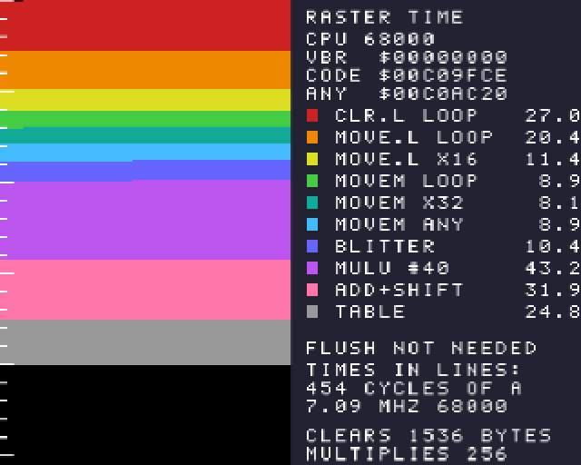
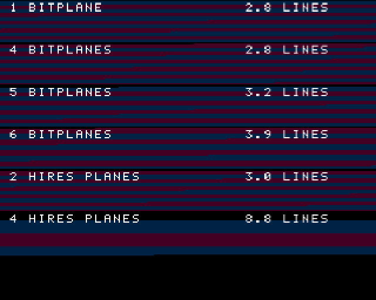
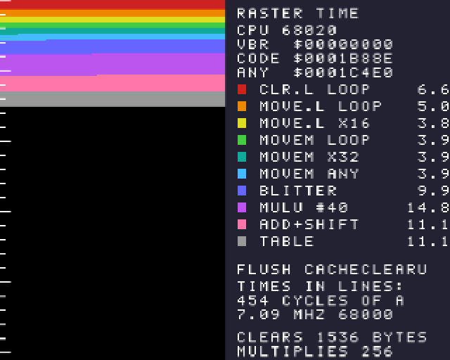
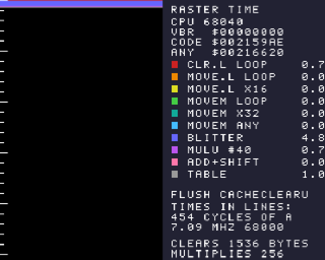

# 14. The 68000 and later processors

Every Amiga has a processor from Motorola's 68000 family, but not the same one. The Amiga 500 has a 68000 at 7 MHz; the A1200 a 68020 at 14 MHz; accelerator boards bring 68030s, 68040s and 68060s, and today FPGA processors that are faster still. A demo is usually written for the first and has to survive the rest.

This chapter is about both halves of that. First, how fast things really are on the A500's 68000: what each instruction costs, why the same code runs at different speeds in different memory, and which of v7's optimisation tips still hold. Then what changes on each later processor, and what breaks. Throughout, it measures rather than guesses, with the oldest tool there is: the raster bar.



## Which processor is this?

Exec knows, and keeps it in `AttnFlags`, a word in ExecBase. Each bit says a processor (or a maths coprocessor) is there. From the NDK 3.2's `exec/execbase.i`:

| Bit | Name | Set for |
|---|---|---|
| 0 | `AFB_68010` | a 68010, and every later processor |
| 1 | `AFB_68020` | a 68020 and later |
| 2 | `AFB_68030` | a 68030 and later (Kickstart 2 on) |
| 3 | `AFB_68040` | a 68040 and later (Kickstart 2 on) |
| 4 | `AFB_68881` | a 68881 or 68882 maths coprocessor |
| 5 | `AFB_68882` | a 68882 (Kickstart 2 on) |
| 6 | `AFB_FPU40` | the 68040's own FPU |
| 7 | `AFB_68060` | a 68060 |
| 10 | `AFB_FPGA` | an FPGA processor (named in the NDK 3.2) |

The processor bits add up: a 68030 sets bits 0, 1 and 2. So test the highest first. This is `WhichProcessor` from `ch14_rastertime.s`:

```asm
WhichProcessor:
        move.l  ExecBase.w,a6
        move.w  AttnFlags(a6),d0
        lea     Name68060,a0
        btst    #AFB_68060,d0
        bne.s   .known
        lea     Name68040,a0
        btst    #AFB_68040,d0
        bne.s   .known
        lea     Name68030,a0
        btst    #AFB_68030,d0
        bne.s   .known
        lea     Name68020,a0
        btst    #AFB_68020,d0
        bne.s   .known
        lea     Name68010,a0
        btst    #AFB_68010,d0
        bne.s   .known
        lea     Name68000,a0
.known:
        rts
```

Some things to know about it:

- **Kickstart 1.3 knows only bits 0, 1 and 4.** v7 marked the others "V37+". On 1.3 a 68030 shows as a 68020, and a 68040 or 68060 isn't known at all (1.3 was never made for them, though FS-UAE will boot it on an emulated 68040).
- **Bit 7 isn't set by Kickstart 3.1.** Its exec doesn't know the 68060: it's the board's `68060.library` that sets the bit, when it's loaded. Without it, a 68060 shows as a 68040. FS-UAE's 68060, run on Kickstart 3.1 with no 68060.library, did exactly that: `ch14_rastertime.s` said "CPU 68040". Not every 68060.library sets it, either: Thomas Richter's notes to his MMULib, in the NDK 3.2, say the one for the Apollo LC75 board didn't. So read "68040" as "68040 or later".
- **A non-zero `AttnFlags` doesn't mean a faster processor.** v7's warning still holds: a 68881 maths chip can sit beside a plain 68000.
- **It doesn't tell you the speed.** A 68000 can be at 7 MHz or 14 MHz, and a 68030 anything from 16 to 50 MHz. Never use the processor type to time anything: use the beam, the CIA timers or the frame ([general guidelines](03-general-guidelines.md) says more).

## The 68000 in the Amiga 500

### Clocks, memory cycles and raster lines

A PAL Amiga 500's 68000 runs at 7.09 MHz (an NTSC one at 7.16). Each time it reads or writes memory takes 4 of its clock cycles at least. The custom chips count in **colour clocks**, half the processor's speed: one colour clock is one memory slot, about 280 nanoseconds, and a PAL line is 227 of them. (The HRM's figure is 227.5, which is NTSC's average: its lines alternate between 227 and 228.)

So a PAL line lasts 454 of the 68000's clocks, about 64 microseconds, and a frame of 312 lines about 141,600. That's the budget. A routine that takes 20 lines takes a fifteenth of the frame.

Motorola's manual gives every instruction's time in clocks, written like **12(1/2)**: 12 clocks in all, of which 1 is a read and 2 are writes (each read or write takes 4 clocks; the rest is the processor working inside). The figures below are from the *M68000 8-/16-/32-Bit Microprocessors User's Manual* (Motorola, 1993, on bitsavers.org), checked against a second copy of the tables (the NVG Amiga archive's "MC68000 Instructions timing").

### Sharing chip RAM: the processor's turns

The chips and the processor share chip RAM, and take turns at it, one slot each colour clock. The *Hardware Reference Manual* (HRM) explains the order: disk, audio, sprites and the display have first claim on the slots they're given; then the copper; then the blitter; and last the processor. And: "The 68000 uses only the even-numbered memory access cycles." The display's slots are the odd ones, as long as there are no more than four low-resolution bitplanes; so with up to four, a 68000 hardly notices the display.

More bitplanes than that, and the display starts taking even slots too. `ch14_contention.s` shows it. The copper divides the screen into six zones, each with a different display, and all the way down the processor does the same small job again and again: write 256 bytes to chip RAM. Each time, it changes the background colour, so each stripe is one go, and each zone's label gives the average time of a go there.



| Display in the zone | A500, 68000 | A500, program in fast RAM | A1200, 68020 |
|---|---|---|---|
| 1 bitplane | 2.8 lines | 2.7 | 0.8 |
| 4 bitplanes | 2.8 | 2.7 | 0.9 |
| 5 bitplanes | 3.2 | 3.1 | 0.9 |
| 6 bitplanes | 3.9 | 3.1 | 1.1 |
| 2 high resolution bitplanes | 3.0 | 3.0 | 0.9 |
| 4 high resolution bitplanes | 8.8 | 8.0 | 2.7 |

Up to four low-resolution bitplanes cost nothing. Six take 40% longer: the HRM says six bitplanes take half the processor's slots ("bitplane DMA steals 50 percent of the open slots"), but only while the display is being fetched, about 70% of each line. Four high-resolution bitplanes take every slot while the line is shown (the HRM: it "effectively locks out the 68000 ... from any memory access during the display"), and the job runs only in the borders, three times slower.

That's the display. The blitter, while it's running, takes the even slots too: see [the blitter nasty](07-blitter.md#the-blitter-nasty).

Three things follow:

- **The processor's own instructions are memory reads too.** On an A500 the program is in chip RAM, or in the slow RAM of a trapdoor expansion, so even code that touches no data waits for its turns. With the program in fast RAM (the second column), only the job's writes wait, and six bitplanes cost 15% instead of 40%.
- **Slow RAM is no faster than chip RAM.** The A500's trapdoor RAM at `$C00000` is on the same bus as chip RAM, and waits for the same slots; only the chips can't reach it. ([General guidelines](03-general-guidelines.md) has more on slow RAM.)
- **Fast RAM doesn't wait at all.** Real fast RAM (an A590's, or any Zorro board's) is on the processor's own side, and the chips never use it.

### Not quite the manual's figures, in chip and slow RAM

There's a subtler cost. The processor's turns come every 4 clocks, and its memory accesses take 4 clocks; but many instructions spend 2 clocks working inside, between their accesses (`DBF` takes 10, a `MULU #40` 46). After those, the next access has to wait for the next slot. The HRM: "Some 68000 instructions do not match perfectly with the allocation of even cycles and cause cycles to be missed."

The raster time example shows how much. Here are its ten routines on the emulated A500, with the time Motorola's figures give (plus about half a line for the timing code around each), the time with the program in slow RAM, and with it in fast RAM:

| Routine | By the book | Slow RAM | Fast RAM |
|---|---|---|---|
| Clear 1536 bytes, `CLR.L (A0)+` loop | 25.9 lines | 27.0 | 27.0 |
| ... `MOVE.L D1,(A0)+` loop | 19.2 | 20.4 | 20.4 |
| ... the same, 16 to a loop | 11.2 | 11.4 | 11.4 |
| ... `MOVEM.L` of 12 registers, in a loop | 8.8 | 8.9 | 8.9 |
| ... 32 `MOVEM.L`s, no loop | 8.1 | 8.1 | 8.1 |
| ... `MOVEM.L` loop, into "any" memory | 8.8 | 8.9 | 8.8 |
| ... the blitter, the processor waiting | | 10.4 | 10.3 |
| 256 numbers times 40 with `MULU #40` | 41.2 | 43.2 | 41.2 |
| ... with `ADD`s and a shift | 31.0 | 31.9 | 31.0 |
| ... from a table | 23.2 | 24.8 | 23.2 |

In fast RAM, the multiplications take exactly the book's time, to a tenth of a line: their code and data are all in fast RAM, and nothing waits. In slow RAM they take up to 7% longer. The clears write to chip RAM wherever the code is, so they wait either way; the 32 `MOVEM`s, each 104 clocks (a multiple of 4), wait least of all. On a real A500 with only chip and slow RAM, plan for the middle column.

(These are FS-UAE's figures. Its 68000 is cycle-exact, and where nothing waits it matches Motorola's figures to the tenth of a line, but it is still an emulator.)

### What instructions cost

The 68000 figures for the instructions demos use most. An instruction that reads or writes memory also pays for its **addressing mode**, the second table; where a time has a "+", add that.

| Instruction | Clocks |
|---|---|
| `MOVEQ #n,Dn` | 4 |
| `MOVE.W`/`MOVE.L Dn,Dn` | 4 |
| `MOVE.L Dn,(An)+` | 12 |
| `MOVE.L (An)+,(An)+` | 20 |
| `ADD.W Dn,Dn` / `ADD.L Dn,Dn` | 4 / 8 |
| `ADDQ.W #n,Dn` / `ADDQ.L #n,Dn` | 4 / 8 |
| `ADDQ #n,An` (word or long) | 8 |
| `ADDI.W #n,Dn` / `ADDI.L #n,Dn` | 8 / 16 |
| `LEA d16(An),An` | 8 |
| `ADDA.W #n,An` / `ADDA.L #n,An` | 12 / 16 |
| `CLR.L Dn` | 6 |
| `CLR.L (An)+` | 20 (it reads, then writes) |
| `LSL`, `LSR`, `ASL`, `ASR`, `ROL`... `.W` by n | 6 + 2n |
| ... `.L` by n | 8 + 2n |
| `SWAP`, `EXT` | 4 |
| `MULU`, `MULS` | 38 + 2n (at most 70) + |
| `DIVU` | at most 140 + |
| `DIVS` | at most 158 + |
| `DBF` (looping / falling through) | 10 / 14 |
| `Bcc.S`, `Bcc.W` taken | 10 |
| `Bcc.S` / `Bcc.W` not taken | 8 / 12 |
| `BRA` | 10 |
| `BSR` / `JSR` (absolute long) | 18 / 20 |
| `RTS` | 16 |
| `MOVEM.L` registers to `-(An)` or `(An)` | 8 + 8 per register |
| `MOVEM.L` `(An)+` to registers | 12 + 8 per register |
| `BTST #n,Dn` | 10 |

| Addressing mode | Byte or word | Long |
|---|---|---|
| `Dn`, `An` | 0 | 0 |
| `(An)`, `(An)+` | 4 | 8 |
| `-(An)` | 6 | 10 |
| `d16(An)`, `d16(PC)`, `$nnnn.W` | 8 | 12 |
| `d8(An,Xn)`, `d8(PC,Xn)` | 10 | 14 |
| `$nnnnnnnn` (absolute long) | 12 | 16 |
| `#n` | 4 | 8 |

**Multiplying** takes 38 clocks plus 2 for each 1 bit in the *source* (`MULU`; for `MULS`, each change from 0 to 1 or 1 to 0 in it). So the source decides the cost: `MULU #40,D0` is 38 + 2×2 + 4 (for the `#40`) = 46 clocks, while `MULU #$FFFF,D0` would be 70 + 4. Put the number with fewer 1s as the source when you can.

**Dividing** is the slowest thing the 68000 does: Motorola gives at most 140 clocks for `DIVU` and 158 for `DIVS`, and says the best case is less than 10% faster. Avoid it in anything done often: multiply by a reciprocal, shift, or look it up.

### Loops, unrolling and MOVEM

The clears in the table show the usual steps, from 27 lines down to 8:

- **`CLR` is slow in memory**, because on a 68000 it reads before it writes: `CLR.L (A0)+` is 20 clocks against 12 for `MOVE.L D1,(A0)+` with D1 zero. (Never `CLR` a chip register either: see [general guidelines](03-general-guidelines.md#the-processor-isnt-fixed-either).)
- **A loop costs its `DBF` each time round**: 10 clocks, against 12 for each `MOVE.L` in it. **Unrolling**, 16 `MOVE.L`s to each `DBF`, pays for it once in 64 bytes, and nearly halves the time.
- **`MOVEM` writes many registers in one instruction**, 8 clocks a long and 8 for the instruction: 48 bytes in 104 clocks with 12 registers, against 144 for 12 `MOVE.L`s.
- **No loop at all** (32 `MOVEM`s one after another) saves a little more. The example doesn't keep 32 copies in its source: it writes them as it starts, from one `MOVEM` it copies, and then clears the processor's caches before running them. [General guidelines](03-general-guidelines.md#code-written-at-run-time-done-properly) explains why that last step matters.

The blitter, on the A500, takes 10.4 lines for the same clear, while the processor waits for it. That's slower than the best processor loop, but the blitter leaves every other slot free, so the processor can work alongside it; [the blitter chapter](07-blitter.md#clearing) measures both together.

### Multiplying faster

256 numbers times 40 took 43.2 lines with `MULU`, 31.9 with `ADD`s and a shift (n×4+n, then ×8), and 24.8 from a table made once at the start. On a 68000, a table usually wins, if there's the memory for it.

On the A1200 the order changes: 14.8, 11.1 and 11.1 lines. The table is no better than the arithmetic there, because the A1200's chip RAM is slow for its processor, and reading the table is a trip to it. v7's notes from Chris Green of Commodore said this in 1993: "it may be better to use calculations for some things that you might have used tables for on the A500."

## v7's 68000 tips, checked

v7's "68000 Optimisation", by Irmen de Jong with notes by Comrade J, listed tricks that every coder then knew. Each is checked here against Motorola's figures. Most are right. Some save bytes but not time, two can give wrong answers, and one points at the wrong register.

| v7's tip | Checked |
|---|---|
| `BRA`/`BSR` to `BRA.S`/`BSR.S` | Shorter, not faster: a taken branch is 10 clocks (`BSR` 18) either way. Only a `Bcc` that *isn't* taken is quicker short: 8 against 12. |
| `MOVE.L #0,Dn` to `MOVEQ #0,Dn`; `CLR.L Dn` to `MOVEQ` | Right: 4 clocks, against 12 and 6. |
| `MOVE.L #0,An` to `SUB.L An,An` | Right: 8 against 12. |
| `MOVE.x #0,mem` to `CLR.x mem` | Shorter, but `CLR` reads the memory first, and it's no faster than storing a register that holds 0. |
| `CMP #0` to `TST` | Right: `TST.W Dn` 4, `CMPI.W #0,Dn` 8. |
| `MOVE.L #n,Dn` to `MOVEQ` | Right, for -128 to 127: 4 against 12. |
| `ADD`/`SUB #n` to `ADDQ`/`SUBQ` | Right, for 1 to 8: `ADDQ.W #n,Dn` 4 against `ADDI.W` 8. On an address register `ADDQ` is 8, word or long. |
| `JMP`/`JSR` to `BRA`/`BSR` | Right (2 clocks), but only within a section: sections can be loaded anywhere. |
| `JSR x` then `RTS` to `JMP x` | Right. |
| `LSL #1` or `#2` to one or two `ADD Dn,Dn` | Right for words: 4 against 8, 8 against 10. **Wrong for two on a longword**: two `ADD.L`s take 16, `LSL.L #2` only 12. One `ADD.L` (8) still beats `LSL.L #1` (10). |
| `MULU #2^n` to a shift | Much faster, but not the same: `MULU` uses only the bottom word of the register, a shift all of it. Clear the top word first, unless you know it's clear. |
| `DIVU #2^n` to a shift | As v7 says, there's no remainder in the top word. And: **`ASR` isn't `DIVS`** for negative numbers. `DIVS` rounds towards 0 (-7/2 is -3), `ASR` down (-7 shifted right once is -4). |
| `MOVEA.L #n,An` to `MOVEA.W #n,An` | Right: 8 against 12, for -32768 to 32767 (it's sign-extended). |
| `ADDA #n,An` to `LEA n(An),An` | Right: 8, against 12 (`ADDA.W`) or 16 (`ADDA.L`). |
| `LEA n(An),An` to `ADDQ.W #n,An` | Shorter, not faster: both 8. |
| `$0000nnnn` to `$nnnn.W` | Right: 4 clocks and a word, for `$0000` to `$7FFF` (and `$FFFF8000` up). `move.l 4.w,a6` is the famous one. |
| `MOVE.L #x,An` to `LEA x,An` | No faster: both 12. `LEA x(PC),An` is 8. |
| `MOVE.L Ax,Ay` and `ADD #n,Ay` to `LEA n(Ax),Ay` | Right. |
| `x` to `x(PC)` | Right for reading (4 clocks less than absolute long). The 68000 can't write to a PC-relative address. |
| `(Ax,Dx.L)` to `(Ax,Dx.W)` | **No faster.** Motorola: "The size of the index register (Xn) does not affect execution time." |
| `BSET`/`BCLR`/`BCHG #n` to `ORI`/`ANDI`/`EORI.W` | On a data register, right: 8 against 12 to 14 (and the flags differ). **On memory, no faster** (`BSET #n,(An)` and `ORI.B #x,(An)` are both 16), and a bit operation on memory is on a byte, so its bit numbers aren't `ORI.W`'s. |
| `BTST #n,Dn` to `ANDI.W` | 8 against 10, but `ANDI` changes the register. Only if you're finished with it. |
| `MOVEM` of one register to `MOVE.L` | Right: 12 against 16. (`MOVE` sets the flags; `MOVEM` doesn't.) |
| `MOVE x,-(SP)` to `PEA x` | For a constant that fits in a word, right: `PEA $1234.W` is 16, `MOVE.L #$1234,-(SP)` 20. `PEA (Ax)` pushes Ax (as `MOVE.L Ax,-(SP)` does, in the same time), *not* what Ax points at. |
| `0(Ax)` to `(Ax)` | Right (4 clocks); assemblers do it for you. |
| `MULU #0` to `MOVEQ #0`; `MULU #1` to `SWAP`, `CLR.W`, `SWAP` | Right. For `MULS #1`, `EXT.L` alone does it. |
| Unroll loops | Right: see the clears above. |
| Clear with `MOVEM` from all 15 registers, with the stack pointer as the pointer | Fast, but don't use SP. With the system running, a task switch saves the task's registers on its stack, which is now your buffer, and as SP reaches the start of the buffer they land in memory below it. In supervisor mode an interrupt does the same. Use another address register: 14 registers of zero, or 13 and a loop counter, are almost as fast. |
| "If it's chip memory, use the blitter" | On an A500, the blitter alone was slower than a `MOVEM` loop here; working together they're fastest ([the blitter](07-blitter.md#clearing)). On faster processors the processor wins outright (below). |
| Always wait for the blitter after clearing with both | Right, and more than v7 knew: see [the race](07-blitter.md#the-race-wait-before-the-processor-touches-the-blitters-work). |
| "Don't set BLTPRI (#10 in $dff09a)" | The advice and the bit are right, but **the register is `DMACON`, `$DFF096`**. `$DFF09A` is `INTENA`. |
| Use registers, not memory; pass parameters in registers; replace `MULU`/`DIVU` with tables | Right on a 68000. Tables are no help on an A1200 (above). |
| Find the 10% of the code that takes 90% of the time | Right, and raster bars are how you find it (below). |

## The 68010

The 68010 fits the 68000's socket, and some A500 and A2000 owners fitted one. Three differences matter to a demo:

- **The vector base register.** The exception vectors, the interrupts' among them, are at the VBR, not at address 0. The system may move them. The startup reads the VBR with `Supervisor()` and `MOVEC VBR,D0` (a 68010 instruction, written as words so a 68000 assembler takes it) when `AttnFlags` says there's a 68010 or later. [Interrupts](05-interrupts.md#vectors-and-the-vbr) explains it.
- **`MOVE SR,<ea>` is privileged.** Run in user mode, it's a privilege violation: a crash. Exec's `GetCC()` gives the flags on any processor.
- **Exception stack frames have an extra word**, so a handler that looks into the frame (rather than just ending with `RTE`) must know which processor it's on.

The 68010 also has **loop mode**: a one-word instruction followed by a `DBcc` that branches back to it runs without fetching either instruction again. Motorola's manual lists which instructions can loop (moves, adds, compares and others, on `(An)`, `(An)+` and `-(An)`). `MOVE.B (A0)+,(A1)+` and `DBF` take 14 clocks a byte in loop mode, against 22 on a 68000. v8 hasn't measured it.

## The 68020 and 68030

The **68020** is a 32-bit processor (the A1200's 68EC020 has a 24-bit address bus; see [general guidelines](03-general-guidelines.md#addresses-are-32-bits)). The **68030** is much the same to a demo, with an MMU and a data cache added.

### The caches

The 68020 has a 256-byte **instruction cache**: 64 longwords of the instructions it has run, kept on the chip. A loop that fits runs without reading its instructions from memory at all. One that doesn't fit, doesn't: each address has one place in the cache, shared with the addresses 256, 512... bytes away, so a loop over 256 bytes pushes part of itself out every time round. v7's advice from Chris Green: "A straight line loop 258 bytes long will execute slower than a 254 byte one." So on a 68020, unrolling stops paying when the loop outgrows the cache.

The 68030 has a 256-byte instruction cache and a 256-byte **data cache**. The system sets chip RAM so the data cache never holds it ("For all current Amiga models, Chip memory is set with Instruction caching enabled, data caching disabled": the `CacheClearE` Autodoc), so data the chips write is always what the processor reads. Instructions in chip RAM are cached.

Code that writes code has to clear the caches before running it: [general guidelines](03-general-guidelines.md#no-self-modifying-code) explains, and has a routine that does it on every Kickstart. `ch14_rastertime.s` does it too, and says which way it cleared them: "FLUSH CACHECLEARU" (Kickstart 2.04 or later), "FLUSH MOVEC CACR" (Kickstart 1.3 with a 68020) or "FLUSH NOT NEEDED" (Kickstart 1.3 on a 68000).

### The A1200



On an A1200 with no fast RAM, the routines take between a quarter and a half of their A500 time, with one exception: the blitter, which is the same chip at the same speed, took 9.9 lines. Every processor clear beat it, the best by two and a half times. v7 said "almost three times" for its A1200. With the blitter that slow by comparison, give the processor something else to do while it runs, or have the processor do the work.

### New instructions, and what they cost you

The 68020 added instructions and addressing modes. v7 listed the useful ones:

```asm
        move.w  (a1,d0.w*2),d1          ; scaled index: d0*2, d0*4 or d0*8, at no extra cost
        muls.l  d2,d1                   ; 32 x 32 bits
        divs.l  d2,d1                   ; 32 / 32 bits
        extb.l  d0                      ; byte to longword in one
        bfextu  (a0){d1:5},d2           ; a bit field: 5 bits from bit d1 on
        tst.w   table(pc,d0.w)          ; TST and CMPI may read relative to the PC
```

Also the 64-bit forms of `MULU.L`/`MULS.L`/`DIVU.L`/`DIVS.L`, the rest of the bit field instructions (`BFINS`, `BFFFO`, `BFSET`, `BFCLR`...), 16- and 32-bit displacements in indexed modes, and memory-indirect addressing. Shifts take the same time whatever the count.

**Use any of them and the program needs a 68020.** On a 68000 each is an illegal instruction, and a crash. If that's what you want (most AGA demos assume a 68020), check as the program starts, and say so if it isn't there:

```asm
        move.l  ExecBase.w,a6
        btst    #AFB_68020,AttnFlags+1(a6)
        beq     NeedA68020              ; tell the user, and leave
```

Or keep two versions of the routine that matters, and choose one at the start.

It's easier to use them by accident than you'd think. `ch14_contention.s`, as first written for v8, had `tst.b ZoneHires(pc,d4.w)`, which looked like ordinary 68000 code. It ran on the emulated A1200 and crashed the A500: on a 68000, `TST` can't read relative to the PC. (Limoniter's assembler took it without a word; tell your assembler which processor you mean, if it can be told, and test on a 68000.) The same goes for the other way round: the 68020 reads a word or a longword from an odd address (slowly), but the 68000 takes an **address error**, and the program stops. A demo tested only on an A1200 can fail on an A500 for both reasons.

## The 68040 and 68060

These are many times faster than the chips they drive, and that's where their problems come from.

**Bigger caches, written back later.** The 68040 has 4K instruction and 4K data caches, the 68060 8K each. Both can run the data cache in **copyback** mode: a write to fast RAM can stay in the cache for a while before it reaches memory. Code that writes code must clear the caches (again, [general guidelines](03-general-guidelines.md#code-written-at-run-time-done-properly)); a trackloader that loads code must too. Chip RAM isn't data-cached, so the chips see what the processor writes there.

**The processor outruns the chips.** A 68040 can do far more between two chip RAM slots than a 68000 can. Code that only worked because the processor was slow breaks:

- **The blitter.** v8 found this in its own startup demo: the processor drew on the screen while the blitter was still clearing it. On a 68000 the blitter always finished first; on a 68040 it didn't. Always wait for the blitter before touching what it's working on ([the blitter](07-blitter.md#the-race-wait-before-the-processor-touches-the-blitters-work)).
- **Interrupts.** A write to `INTREQ` can still be on its way when the `RTE` runs, so acknowledge twice ([interrupts](05-interrupts.md#acknowledging-twice)).
- **Timing by instruction counts.** None of it holds.



On FS-UAE's emulated 68040 every processor routine took a line or two at most (it varies from run to run), and the blitter about 4.5. Don't trust any of those figures: FS-UAE runs its 68030, 68040 and 68060 as fast as the computer running it can, not at any real processor's speed, and doesn't make them wait for chip RAM as a real one would (in `ch14_contention.s` every zone took "0.0 lines"); and with them its blitter isn't cycle-exact either (it took 10.4 lines on the A500). What they do show is true of a real one: the processor is so much faster than the blitter that it spends its time waiting for it.

**MOVE16.** The 68040 and 68060 have `MOVE16`, which copies 16 bytes at a time, from and to addresses on a 16-byte boundary, in a single burst. It's for copying in fast RAM. It isn't on the 68030 or anything earlier.

**Instructions that aren't there.** The 68040's FPU lacks some of the 68881's instructions (`FSIN`, `FCOS` and the rest), which `68040.library` emulates. The 68060 also lacks some **integer** instructions, which its Motorola manual lists:

- `MOVEP`
- `CHK2` and `CMP2`
- `CAS2`, and `CAS` on a misaligned address
- the 64-bit `MULU.L`, `MULS.L`, `DIVU.L` and `DIVS.L` (32 × 32 to 64 bits, and 64 / 32)

Each traps to `68060.library`, which does it in software: correct, but far slower than an instruction. The 32-bit forms of `MULx.L` and `DIVx.L` are there. `MOVEP`, made for 8-bit peripheral chips (it reads or writes every other byte), has been used in graphics routines for that odd ability; on a 68060, avoid it in anything that runs often.

## The 68080

The Apollo 68080, in Vampire accelerators and the Apollo team's stand-alone machines, is a processor built in an FPGA: faster than a 68060 by its makers' figures, running 68000-family code, with instructions of its own as well. The NDK 3.2 names `AttnFlags` bit 10, `AFB_FPGA`, for an FPGA processor, and `ch14_rastertime.s` adds "FPGA" after the processor's name when it's set.

v8 hasn't run its examples on one, and FS-UAE doesn't emulate it, so this chapter says no more than that. Everything above about fast processors applies. If you use its own instructions, the demo is for Vampires only: say so.

## Measuring: raster time

The quickest way to see how long something takes is to change the background colour when it starts. The beam draws the border in `COLOR00`, so each routine paints a band down the screen as it runs, as tall as the time it takes: one line is 64 microseconds. Every demo coder has done it, and it needs no tools at all.

`ch14_rastertime.s` does it with ten routines, one after another, from the first line of the display:

```asm
Frame:
        move.w  #FIRSTLINE,d0
        bsr     WaitLine                ; start at the same line every frame
        lea     Tests,a6
.test:
        move.l  TEST_CODE(a6),d0
        beq.s   .tested
        move.w  TEST_COLOUR(a6),COLOR00(a5)     ; this routine's band starts here
        bsr     BeamPosition
        move.l  d0,TEST_TIME(a6)
        move.l  TEST_CODE(a6),a0
        jsr     (a0)
        lea     CUSTOM,a5
        bsr     BeamPosition
        sub.l   TEST_TIME(a6),d0        ; how long, in colour clocks
        move.l  d0,TEST_TIME(a6)
        lea     TEST_SIZE(a6),a6
        bra.s   .test
.tested:
        move.w  #$000,COLOR00(a5)
```

The bands are enough to compare routines by eye. For a figure, it also reads where the beam is before and after: `VPOSR`, read as a longword, has the line in bits 16 to 8 and the position across it (in colour clocks) in bits 7 to 0.

```asm
BeamPosition:
        move.l  VPOSR(a5),d0
        moveq   #0,d1
        move.b  d0,d1                   ; the position on the line
        lsr.l   #8,d0
        and.w   #$1ff,d0                ; the line
        mulu    #LINECLOCKS,d0          ; 227 colour clocks a line, on PAL
        add.l   d1,d0
        rts
```

Some things to keep in mind:

- **Start at the same line each frame**, or the bands jump about.
- **The measuring costs something too**: about half a line here, for each routine.
- **Interrupts land in the middle.** With the machine taken, only your own do; with the system running, its interrupts add a little, at random.
- **Measure on the machine you're writing for**, with its memory. The tables above show a routine's time changing with the memory its code is in.
- **A frame overrun shows as flicker**: if the work takes longer than a frame, the bands are drawn every other frame. The first version of the example did exactly that, on the A500.

Use it to find where the time goes before you optimise anything: the band that's tallest is the one to work on.

## The examples

- **`ch14_rastertime.s`**: ten routines each frame, each a band of colour; the panel names them, gives each time in lines, and shows the processor, the VBR, where the program was loaded, and how the caches were cleared after writing code.
- **`ch14_contention.s`**: the same job done again and again under six different displays, showing what bitplanes cost the processor.

Both were run both ways (taking the machine, and with the system running), on an emulated A500 with Kickstart 1.3 and 3.1; on Kickstart 3.1 with a 68020, 68030, 68040 and 68060, each with 8 MB of fast RAM; on Kickstart 1.3 with a 68020; on an A500 with a 68000 and fast RAM; and on an A1200. Each showed its effect, then the CLI with "back in AmigaDOS, return code OK".

How far to trust the figures: FS-UAE's 68000 and 68020 are cycle-exact (its log says so), and so is its blitter on those machines. Its 68020 on an A500 runs at about the A500's own 7 MHz, by our measurements (a loop of `DBF`s, and the `MULU`s, both fit that), and has the 8 MB of fast RAM; its A1200 runs at 14 MHz, with no fast RAM. On Kickstart 1.3, AmigaDOS loaded the programs into slow RAM even with fast RAM fitted. The 68030, 68040 and 68060 run as fast as the host allows, so their timings mean nothing.

## What changed from v7

- **Processor detection** has bit 7 (the 68060, set by `68060.library`) and bit 10 (FPGA processors), and the warning that Kickstart 3.1 alone calls a 68060 a 68040.
- **Instruction timings** are given, from Motorola's manual, and measured on an emulated A500, in chip, slow and fast RAM. v7 had none.
- **v7's 68000 tips are checked**: some save bytes but no time (`BRA.S`, `ADDQ` for `LEA`, `LEA` for `MOVE.L #`, `.W` for `.L` index registers); `LSL.L #2` beats two `ADD.L`s; `ASR` isn't `DIVS`; `PEA (Ax)` isn't pushing what Ax points at; `ORI.W` isn't `BSET` on memory; BLTPRI is in `DMACON`, not at `$DFF09A`; and the `MOVEM` clear through SP is dangerous.
- **Chip-bus contention** is explained and measured: the display's slots, slow RAM's waits, and instructions that miss their slot.
- **The 68010** section has the VBR, `MOVE SR` and the exception frames, not only loop mode.
- **The 68040 and 68060**: copyback caches, the processor outrunning the chips, `MOVE16`, and the instructions the 68060 doesn't have. **The 68080** gets a mention.
- **v7's 68020 notes from Chris Green are kept**, and the A1200's blitter-against-processor figure checked again: two and a half times, against v7's "almost three".
- **Measuring with raster bars** is shown, as a whole example.
