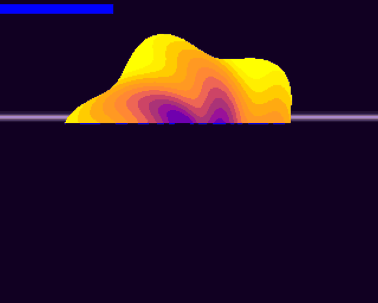

# 15. Loading and memory

A demo that fits in one file and runs from start to end with the machine taken needs to know little about memory, beyond putting the chips' data in chip RAM. Bigger productions need more: memory found at run time, files loaded while something is on the screen, parts loaded one after another, sometimes a disk with no file system at all. This chapter covers memory first (the kinds there are, how to ask for them, and why you never assume an address), then loading: with the system running, between parts, and with a trackloader.

[General guidelines](03-general-guidelines.md) already covers the basics, and this chapter doesn't repeat them: sections, chip RAM for the chips, v7's mistake about slow RAM, memory on a boundary, and 32-bit addresses.

## The kinds of memory

| Kind | Who can use it | Where | Use it for |
|---|---|---|---|
| **Chip RAM** | the processor and the custom chips | from address 0: 512K, 1 MB or 2 MB, depending on the machine | everything the chips read or write: bitplanes, copper lists, sprites, samples, the blitter's data |
| **Slow RAM** | the processor only | `$C00000` (an A500's or A2000's trapdoor or internal expansion) | as fast RAM, but no faster than chip RAM |
| **Fast RAM** | the processor only | an expansion's address: `$200000` up for 24-bit (Zorro II) memory, above `$1000000` for 32-bit | code, tables, buffers: anything only the processor touches |

**Chip RAM** is shared. The custom chips read it by DMA (bitplanes, the copper, sprites, audio, the disk, the blitter), and when they need the bus, the processor waits. A demo with six bitplanes on screen and the blitter running leaves the processor very little time in chip RAM; see [the 68000 and later processors](14-processors.md).

**Fast RAM** isn't on that bus, so the processor never waits for the chips there. On a 68000 the gain is modest. On a 68020 or later it's large: a 32-bit processor at 14, 25 or 50 MHz running from chip RAM is held to the chips' pace. Code and the processor's own data belong in fast RAM when there is some, which is what a plain `code` or `data` section gives you.

**Slow RAM** is the odd one, and v7 got it wrong (see [general guidelines](03-general-guidelines.md#slow-ram-v7-was-wrong)). It's on the chip bus, so the processor waits for the chips there, but the chips can't read it. Exec calls it fast RAM. v8's memory map example shows exec's own view of it:

| Kickstart | Slow RAM's attributes | Chip RAM's attributes |
|---|---|---|
| 1.3 | `$0005`: `MEMF_PUBLIC`, `MEMF_FAST` | `$0003`: `MEMF_PUBLIC`, `MEMF_CHIP` |
| 3.1 | `$0705`: as 1.3, plus `MEMF_LOCAL`, `MEMF_24BITDMA`, `MEMF_KICK` | `$0703` |

(The three extra bits came with V36 and V39. `MEMF_LOCAL` means the memory survives a reset, and `MEMF_24BITDMA` that a Zorro II card can reach it.)

## Asking for memory: AllocMem and FreeMem

Memory a program needs beyond its sections comes from exec:

```asm
        move.l  ExecBase.w,a6
        move.l  #SCREENSIZE,d0          ; how many bytes
        move.l  #MEMF_CHIP!MEMF_CLEAR,d1 ; what kind, and cleared to zero
        jsr     _LVOAllocMem(a6)
        move.l  d0,Screen
        beq     NoMemory                ; 0: there wasn't any. Always check.
        ...
        move.l  Screen,a1               ; as the demo ends: the address...
        move.l  #SCREENSIZE,d0          ; ...and the same size
        jsr     _LVOFreeMem(a6)
```

The rules, from the `AllocMem` Autodoc:

- **`MEMF_CHIP`** for anything the chips use. "If the requested memory will be used by the Amiga custom chips, this flag *must* be set."
- **Nothing (`MEMF_ANY`, 0)** for everything else: "If no flags are set, the system will return the best available memory block. For expanded systems, the fast memory pool is searched first."
- **Never `MEMF_FAST` alone**: "DO NOT SPECIFY MEMF_FAST unless you know exactly what you are doing! If MEMF_FAST is set, AllocMem() will fail on machines that only have chip memory!" If you'd *like* fast RAM for a table but can manage without, ask for `MEMF_FAST`, and if that fails, ask again with `MEMF_ANY`.
- **`MEMF_CLEAR`** clears the block to zero. Without it, the block holds whatever was there before.
- **`MEMF_PUBLIC`** for memory used by interrupts or other tasks. On today's AmigaOS all memory is public in practice, but the Autodoc asks for it, and it costs nothing.
- **Check for 0**, every time. A 512K Amiga runs out quickly.
- **`FreeMem` with the same size.** Exec doesn't remember it for you. (`AllocVec` and `FreeVec` do, from V36; they don't exist on Kickstart 1.3.)
- **Blocks start on a multiple of 8 bytes** (`MEM_BLOCKSIZE`). For anything coarser, see [memory on a boundary](03-general-guidelines.md#memory-on-a-boundary).

To find out how much there is, `AvailMem` (exec, `-216`) takes the kind in `d1` and returns the bytes free. Add `MEMF_LARGEST` to get the biggest single block, which is what decides whether one big allocation can succeed.

**When to allocate.** With v8's startup, in `Init`. Taking the machine, the startup has called `Forbid` by then. `AllocMem` works under `Forbid` (it needs neither interrupts nor another task), but never call it from an interrupt. Free everything in the routine you give the startup as `ExitHook`, as `ch15_load_picture.s` does.

**Sections or `AllocMem`?** A `bss_c` section is allocated by AmigaDOS's loader as the program loads, and freed when it ends: no code, no failure to handle (if there isn't room, the program doesn't start). Use sections for what the demo always needs. Use `AllocMem` for memory that depends on the machine (fast RAM if there is some), for memory that's only needed for a while, and when you want to fail with a message rather than not start.

## AllocAbs, and why it's rarely right

`AllocAbs(size, address)` (exec, `-204`) allocates memory at an address you choose, if it's free. v7 used it to look for a block on a 64K boundary, trying each boundary in turn. It's the right tool for very little, and the Autodoc says what it's for: "Often this is used by boot-surviving entities such as recoverable ram-disks."

Why not to use it in a demo:

- **The address you want is usually taken.** The system's own structures, the program's own sections and other programs live at addresses that differ from machine to machine and boot to boot. "It's free on my A500" is the assumption v7 spent pages arguing against.
- **It doesn't check what kind of memory is there.** An address that's chip RAM on one Amiga is slow RAM, or nothing, on another.
- **The block's edges aren't yours.** The Autodoc: "The 8 bytes past the end of an AllocAbs will be changed by Exec relinking the next block of memory. Generally you can't trust the first 8 bytes of anything you AllocAbs."
- **There's always a better way.** For a boundary, allocate a little more and round up, as [general guidelines](03-general-guidelines.md#memory-on-a-boundary) shows. For an old demo assembled with `ORG` at a fixed address, make it relocatable: assemble it as an ordinary program.

The one place it fits is a trackmo's boot code, with the system barely started, loading parts to fixed addresses (see [trackloaders](#trackloaders) below). There, `AllocAbs` on each address before loading is a cheap check that the memory exists and nothing is using it.

## Never assume an address

The rule from [general guidelines](03-general-guidelines.md#allocate-everything-never-use-a-fixed-address) is worth seeing in numbers. `examples/ch15_memory_map.s` shows each region of memory exec knows about (its attributes, first address, the address after its end, and bytes free) and what `AvailMem` says is free. It works either way. These are its readings on emulated Amigas (FS-UAE):

| Machine | Regions, as exec lists them |
|---|---|
| A500, 512K chip only, Kickstart 1.3 | chip `$0008E8`-`$07E800` |
| A500, 512K chip only, Kickstart 3.1 | chip `$000420`-`$080000` |
| A500 with the trapdoor's 512K, Kickstart 1.3 | slow `$C004E8`-`$C7E800`; chip `$000420`-`$080000` |
| A500 with the trapdoor's 512K, Kickstart 3.1 | slow `$C00020`-`$C80000`; chip `$000420`-`$080000` |
| A500, 1 MB chip, Kickstart 1.3 | chip `$0008E8`-`$0FE800` |
| A500, 1 MB chip and the trapdoor's 512K, Kickstart 3.1 | slow `$C00020`-`$C80000`; chip `$000420`-`$100000` |
| 2 MB chip and the trapdoor's 512K, Kickstart 3.1 | slow `$C00020`-`$C80000`; chip `$000420`-`$200000` |
| A500 with a 68020 and 8 MB fast, Kickstart 1.3 | slow `$C004E8`-`$C7E800`; fast `$200020`-`$A00000`; chip `$000420`-`$080000` |
| A500 with a 68040 and 8 MB fast, Kickstart 3.1 | fast `$200020`-`$A00000`; slow `$C00020`-`$C80000`; chip `$001020`-`$080000` |
| CD32 (AGA, 2 MB chip), Kickstart 3.1 | chip `$000420`-`$200000` |

What it shows:

- **Even chip RAM doesn't start or end at the same place.** With nothing but chip RAM, Kickstart 1.3 keeps some of it for itself, outside the list: up to `$0008E8` at the bottom (exec's base), and the top 6K (the system stack), so the region runs from `$0008E8` to `$07E800`. Give it slow RAM and both move there: chip RAM's region then runs from `$000420` to the full `$080000`, and the slow region shrinks instead. On the 68040, chip RAM's first free address moved up from `$420` to `$1020`.
- **The order differs too.** Exec lists the regions by priority, and allocates from the first that fits. With Kickstart 1.3 and the trapdoor's 512K, slow RAM came before the real fast RAM: an allocation of "any memory" got slow RAM first.
- So any address you picked because it was free on your Amiga is somebody else's on another. Allocate.

(FS-UAE's A500 comes with the trapdoor's 512K unless told otherwise, as the A500s most people had did; the 512K-only rows were run with `slow_memory = 0`.)

Reading exec's list of regions (`MemList` in ExecBase) is reading a private structure, so the example only reads it, with multitasking off (`Forbid`), and treats it as information for a person, not something to act on. For a program, `AvailMem` and `TypeOfMem` (exec, `-534`: what kind of memory an address is in) are the documented ways to ask.

### The Amigas' memory

| Machine | Chip RAM | Usual expansion |
|---|---|---|
| A500 | 512K; 1 MB with the later Agnus (8372A), set by a jumper on later boards | trapdoor: 512K of slow RAM at `$C00000`; fast RAM from the side expansion port |
| A500+, A600 | 1 MB (ECS) | A600: a trapdoor card giving 2 MB of chip RAM; PCMCIA memory as fast RAM |
| A1200 | 2 MB (AGA) | trapdoor accelerators with fast RAM; PCMCIA memory |
| A3000, A4000 | 1 or 2 MB; 2 MB | 32-bit fast RAM on the motherboard |

The *Hardware Reference Manual* gives the ECS Agnus 1 MB of chip RAM (on the A2000 "with proper jumpering of the motherboard"), and says the A3000 can have 2 MB. The rest of this table comes from the machines' own documentation, not the HRM, and v8 hasn't checked it on real machines. The emulated machines above had 512K, 1 MB and 2 MB of chip RAM, and the memory map example reads whatever yours has.

### 24 and 32 bits

A 68000 has 24 address lines: 16 MB of addresses, `$000000` to `$FFFFFF`, which is the map in the *Hardware Reference Manual* (chip RAM at the bottom, Zorro II expansion from `$200000` to `$9FFFFF`, slow RAM from `$C00000`, the chips' registers at `$DFF000`, the ROM at the top). The A1200's 68EC020 is the same. A 68020, 68030, 68040 or 68060 with all 32 lines (the A3000, the A4000, nearly every accelerator) has 4 GB of addresses, and its fast RAM is usually above `$1000000`, out of a 68000's reach. Two consequences, besides the top-byte rule in [general guidelines](03-general-guidelines.md#addresses-are-32-bits):

- **Keep whole 32-bit addresses.** A word or a 24-bit value isn't enough to hold the address of something in fast RAM.
- **The chips only reach chip RAM.** Copying a picture from fast RAM to the screen is the processor's job, not the blitter's.

## Loading with the system running

This is the way to load during a demo: on a hard drive, a CD or a floppy alike, with every file system and device, and with the effect still running. With v8's startup it's `OS_FRIENDLY 1`, and loading is ordinary `dos.library`: `Open`, `Read`, `Close`.

`examples/ch15_load_picture.s` loads a 16-colour picture (`ch15_picture.raw`, 38432 bytes: 16 colours, then 240 lines of four interleaved bitplanes) a band at a time, while a copper bar bounces over it and the blitter draws a progress bar.



### Open, Read, Close

```asm
MODE_OLDFILE    equ     1005            ; dos/dos.i: a file that's there already

        move.l  DosBase,a6              ; OpenLibrary("dos.library", 33), in Init
        move.l  #PictureName,d1         ; the name...
        move.l  #MODE_OLDFILE,d2        ; ...and how to open it: in d1 and d2, not a0
        jsr     _LVOOpen(a6)
        move.l  d0,File
        beq     Failed                  ; 0: no such file (or no disk, or...)

        move.l  File,d1                 ; the file
        move.l  Screen,d2               ; where to put what's read: any memory, chip RAM too
        move.l  #CHUNKLINES*LINEBYTES,d3 ; how many bytes
        jsr     _LVORead(a6)
        tst.l   d0                      ; how many it read: -1 is an error, 0 the end of the file
        ble     Failed
        ...
        move.l  File,d1
        jsr     _LVOClose(a6)
```

`dos.library` takes its arguments in data registers, `d1` first. The name is relative to the program's current directory, which is the CLI's when started from the CLI, and the program's own drawer when started from an icon, so a demo's files can sit beside it. `Read` can read straight into chip RAM: the file system takes care of how the data gets there.

Close every file you open, including when the demo is left halfway through loading. The example's `ExitHook` routine does that, and frees the screen's memory.

### Only a process can load, and it waits

`dos.library` must be called from a **process**: a task that AmigaDOS knows about, as a program started from the CLI or Workbench is. Never call it from an interrupt (the startup's `VBlank`, an input handler). And a `Read` doesn't return until the data has arrived: from a floppy that can be a second or more. Meanwhile the main loop is stopped, `Frame` isn't called, and nothing it does moves.

So whatever must keep moving during loading is done in **`VBlank`**, which the system calls at the start of every frame whatever the main task is doing: the music, and in the example, the copper bar. `Frame` does the loading, a band at a time, so the picture appears as it comes and the left mouse button is noticed between bands. (A demo that can't put its effect in the interrupt can load from a second process of its own instead, with `CreateProc` or `CreateNewProc`. That's more work, and v8 has no example of it yet.)

### Share the blitter

With the system running, the blitter belongs to whoever owns it, and the system uses it too. `trackdisk.device`, which reads and writes floppy disks, does its MFM encoding and decoding with the blitter. That's always so on Kickstart 1.x, and even AmigaOS 3.2's `trackdisk.device` still does on a 68000: its release notes, in the NDK, record the change to "a new MFM-Encoder using the CPU... used if there is a 68020 or better" and "TDMfmDecode will use always the CPU if 68020+ is present". So a demo that blits without asking can wreck a floppy read in progress, or have its own blit wrecked.

v8's startup has two macros for this: `BLIT_BEGIN` (`OwnBlitter`, then wait until the blitter is idle) and `BLIT_END` (wait for the blit, then `DisownBlitter`). Put every blit, or run of blits, between them:

```asm
        BLIT_BEGIN                      ; waits, if the system's using it
        move.l  d1,BLTDPTH(a5)
        move.w  d1,BLTDMOD(a5)
        move.l  #$01ff0000,BLTCON0(a5)  ; D only, minterm $ff: all 1s
        move.w  d0,BLTSIZE(a5)
        BLIT_END
```

v8 tried to make it go wrong, to show what happens, and couldn't: blits without `OwnBlitter`, from `Frame` and from the vertical blank interrupt, while Kickstart 1.3 loaded the picture from an emulated floppy, left the picture whole. The emulator may not reproduce the clash, or the timing may never have met. The documentation is clear, and the macros cost almost nothing.

### How it was tested

`ch15_load_picture.s` loaded its picture:

- **From DH0** (the emulator's hard drive): on an A500 with Kickstart 1.3 and 3.1, each with a 68000, a 68020 and a 68040.
- **From a floppy:** an OFS disk in DF0, made for the test, with Kickstart 1.3 and 3.1 on a 68000 and a 68040. From the floppy it took about three seconds at the emulator's normal floppy speed, with the picture arriving 16 lines at a time.

Every run showed the whole picture, and was back at the CLI after. Built with `OS_FRIENDLY 0` it ends at once, as its first comment says, cleanly on both Kickstarts. v8's test copies the program and `ch15_picture.raw` into the emulated Amiga's DH0 (or onto the floppy), and starts the program with that as its current directory. `ch15_make_picture.py` beside it makes the picture again.

## Taking the machine, giving it back to load

Taking the machine gives a demo everything, except loading. The multi-part demos of the 1990s, run from the CLI or a hard drive, loaded their parts with the system in between:

1. Part one takes the machine, runs, and gives everything back, exactly as v8's startup does at the end.
2. With the system running again (perhaps showing a still picture, or a simple effect from `VBlank` as in the example above), the next part is loaded.
3. The next part takes the machine again.

With v8's startup, the simplest way to do this is to make each part a program of its own, built on the startup, and run them one after another. That can be from a script, or from a small main program that loads each part with `dos.library`'s `LoadSeg` (it loads a program and fixes up its addresses, like the CLI does), calls it, and frees it with `UnLoadSeg`. The main program can be `OS_FRIENDLY 1` itself, keeping a picture or an effect on screen while each `LoadSeg` waits for the disk, as `ch15_load_picture.s` does with its `Read`s. v8 has no example of this yet.

Giving the machine back "briefly", in the middle of one part, is the same thing in smaller pieces: everything the startup does at the end (interrupts and DMA back as they were, the system's vectors and copper list, `Permit`, `DisownBlitter`), then the loading, then everything it does at the start. Done properly, it costs a visible pause, which is why trackmos exist.

## Trackloaders

A **trackloader** reads the floppy disk directly, track by track, with no file system: the demo's parts are put at known places on the disk (and loaded to known places in memory). The disk needn't be an AmigaDOS disk at all. Kickstart reads its **boot block** (the first two sectors, 1024 bytes) and runs the code in it, and that code loads the rest. A demo on such a disk is a **trackmo**.

Why demos used them, and still do: loading is faster and needs no memory for a file system, the disk can be packed full, and the whole machine can belong to the demo from the moment the boot block runs. The costs: the demo only runs from a floppy (not a hard drive, not a CD, unless someone patches it, which is what WHDLoad is for), and a hardware trackloader is real driver code, with real timing.

v7 had two pieces of advice, both still sound. "Use CIA timers! DON'T use processor timing. If you use processor timing you will MESS UP the diskdrives in accelerated Amigas." (The drive's head needs milliseconds to step and settle; a delay loop that's long enough on a 68000 is far too short on a 68030.) And "Use AddICRVector to allocate your timers, don't hit $bfxxxx addresses!!!", which holds while the system is running. Then: "On second thoughts. DON'T use trackloaders! Use Dos..." For a demo that should run from a hard drive, that's still the answer.

There's a middle way that keeps most of a trackmo's advantages: the boot block, and later parts, load with **`trackdisk.device`**, the system's own floppy driver, rather than with the hardware. That needs no file system on the disk, and nothing of your own to go wrong with drive timing on fast machines.

### Trackmos with Limoniter

Limoniter makes such disks itself: **Tools › Amiga › Boot disk with no file system (trackmo)**.

- **Pieces.** Each piece is an assembler source (assembled by Limoniter's 68000 assembler at its `ORG`, or at the address given) or any other file (graphics, music, packed data). Each is put at a **first sector** of your choosing and loaded to an **address**. One piece is marked to **start**. A piece can be left unloaded, for a program that loads it itself later.
- **The boot block.** Limoniter's example reads each piece from its sectors **with `trackdisk.device`**, turns the drive's motor off, and jumps to the start, with `a6` still ExecBase. **Change it** saves the example's source beside the plan and opens it, to make it your own (a fade, a loader that unpacks). However it's written, Limoniter assembles it, checks it fits in 1024 bytes, gives it "DOS", and works out its checksum as Kickstart checks it.
- **Checks before writing.** The disk's map shows every sector, and points out pieces on the boot block, past the disk's end, over each other, or with no start or two.
- **Writing and running.** It writes the disk as an `.adf` (880K or 1760K), and **Run it** boots it in the emulator. The plan is kept in a `.bootdisk` file, to build again after any change.

[Working with Limoniter](02-working-with-limoniter.md) and [releasing](17-releasing.md) say more.

Pieces load to fixed addresses: this is the one place in a demo where that's normal, because when the boot block runs there's no program loader to place things for you. Choose the addresses with the same care as everything else in this chapter:

- **Only chip RAM is certain**, and only 512K of it. Everything above `$80000` may not exist.
- **Chip RAM is the system's while it runs.** The vectors, exec's base, the boot block's own buffers, and (on Kickstart 1.3 with nothing but chip RAM, as the table above shows) the system stack at the top of chip RAM are all in use.
- **Before loading, the boot code can ask exec** with `AllocAbs` whether each region is free, and refuse to start rather than overwrite something.

### Clear the caches after loading code

Code that arrives other than through `LoadSeg` (loaded with `Read`, by a trackloader or `trackdisk.device`, or unpacked by a decruncher) may not be what the processor runs: a 68020 or 68030's instruction cache can hold what was at those addresses before, and a 68040 or 68060's copyback data cache may not have written all of it to memory yet. After loading or unpacking code, and before jumping to it, call exec's `CacheClearU` (V37 and later). `LoadSeg` does this itself. [General guidelines](03-general-guidelines.md#code-written-at-run-time-done-properly) has the code, including what to do on Kickstart 1.3, where there's no such call.

v7 quoted the Imploder's author on why this became urgent with the 68040: its copyback cache meant that "if you stuff some code into memory and try to execute it, chances are some of it will still be in the data cache. The code cache won't know about this..." That's as true of a trackloader as of a cruncher.

## Which Kickstart

v7 had a chapter on Kickstart versions. The rule it gave stands: find out which version you're on from exec's version number, and compare with "higher or same", never "equal".

```asm
        move.l  ExecBase.w,a6
        cmp.w   #37,LIB_VERSION(a6)     ; a word: LIB_VERSION is a UWORD
        bhs.s   .kick2                  ; 37 or later: Kickstart 2.04 or later
```

(v7's own example had `move.l LIB_VERSION(a6),d0`, which reads the version *and* the revision after it as one long: compare that with 39 and every Kickstart is "newer". Read a word.)

| Version | Kickstart |
|---|---|
| 33 | 1.2 |
| 34 | 1.3 |
| 36 | 2.0 (early: the first A3000s) |
| 37 | 2.04, and the A600's 2.05 |
| 39 | 3.0 |
| 40 | 3.1 |
| 45, 46 | 3.1.4 (2018) |
| 47 | 3.2 |

(v7's list also had 35, an early 1.4 beta, and 38, Workbench 2.1, which was disk-based libraries only: exec never reports it. The 3.1.4 and 3.2 numbers are from the release notes in the NDK 3.2.)

v7's other warnings are worth keeping too. Everything in the ROM moves between versions: never use an address in it, a routine you found there, or the data of the ROM's topaz font. And new versions bring new functions, which won't be there on older ones (see [opening libraries properly](03-general-guidelines.md#open-libraries-properly)).

## Resetting the machine

A trackmo, with nothing to go back to, often ends by resetting the Amiga. On Kickstart 2 and later (V36), there's a call: exec's `ColdReboot` (`-726`), which "never returns". On Kickstart 1.3 there isn't, and v7 gave the routine Commodore supported for it, which v8 tested:

```asm
_LVOColdReboot  equ     -726

Reset:
        move.l  ExecBase.w,a6
        cmp.w   #36,LIB_VERSION(a6)
        blo.s   .old
        jmp     _LVOColdReboot(a6)      ; Kickstart 2 and later: the system's own way
.old:
        lea     .reset(pc),a5
        jsr     _LVOSupervisor(a6)      ; RESET needs supervisor mode
        cnop    0,4                     ; RESET and JMP must be in one longword: see below
.reset:
        lea     $01000000,a0            ; the end of the ROM
        sub.l   -$14(a0),a0             ; less the ROM's size, kept $14 before its end: its start
        move.l  4(a0),a0                ; the ROM's starting address, from its second longword
        subq.l  #2,a0                   ; back two bytes, to the RESET instruction before it
        reset                           ; resets the chips and expansions: the ROM appears at 0
        jmp     (a0)                    ; already fetched, so it runs even though memory moved
```

The `RESET` instruction resets everything outside the processor, and on the Amiga that brings the ROM's "overlay" back: the ROM appears at address 0, over chip RAM, so the next instruction can no longer be fetched from where it was. That's why the `cnop 0,4` matters. With `RESET` and `JMP` in the same longword, the `JMP` was fetched along with the `RESET` and still runs.

v8 ran this in FS-UAE: `ColdReboot` on Kickstart 3.1, and the routine for 1.3 on both 1.3 and 3.1. All three reset the machine and booted again. On Kickstart 2 and later, use `ColdReboot`: it knows about accelerators and memory that the old routine doesn't.

## What changed from v7

- **Slow RAM** at `$C00000` is real and common, and exec calls it fast RAM. v7 said it didn't exist ([general guidelines](03-general-guidelines.md) has the details). This chapter adds what exec reports on a range of machines, measured.
- **`AllocMem` and `FreeMem`** are explained, with the Autodoc's rules. **`AllocAbs`** is shown for what it is: a tool for boot-surviving code and trackmo boot blocks, not for finding memory.
- **Loading with the system running** is shown in a tested example. It explains why the effect goes in the interrupt, and that the blitter must be shared because `trackdisk.device` uses it, on Kickstart 1.x and on a 68000 even with AmigaOS 3.2.
- **Trackloaders**: v7's advice (CIA timers, not loops; better, use DOS) stands, with `trackdisk.device` as the middle way, and Limoniter's trackmo disks.
- **Kickstart versions** brought up to 3.2, and v7's `move.l LIB_VERSION` corrected to a word.
- **The reset routine** is v7's (Commodore's), tested, with `ColdReboot` first where it exists.
