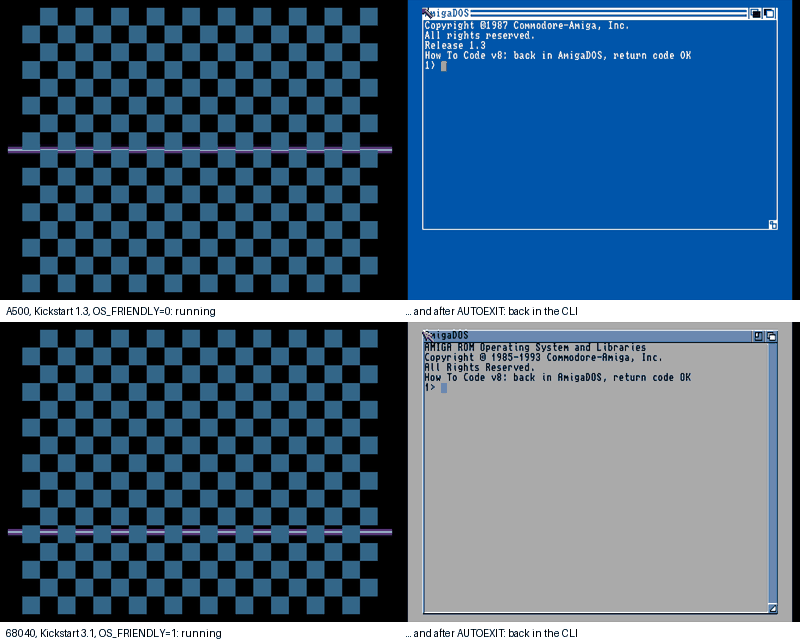

# 16. Debugging and testing

v7 said a decent debugger was essential, and recommended MonAm (which came with Devpac) or ASM-One's built-in one. For the bugs a debugger can't see, it recommended Commodore's Enforcer, which needed a processor with an MMU, and a serial terminal (another Amiga, in Comrade J's case) to read what your code printed with `dprintf()` while it owned the display.

That's all still the right idea, but the tools have moved. The emulator is now your debugger, your serial terminal and a room full of different Amigas. This chapter covers debugging at source level from Limoniter, the emulator's own debugger, the machines to test on, and how v8 tested its own examples.

## Debugging in Limoniter

Limoniter debugs Amiga programs at source level through the emulator's **GDB server**: a part of the emulator that lets a debugger outside it stop the emulated processor, read and change its registers and memory, and set breakpoints. You set breakpoints beside your source's lines, press F9, and step through your demo line by line while it runs on the emulated Amiga.

### What you need

An emulator with a GDB server. Two have one:

- **The FS-UAE that comes with uae-dap.** uae-dap, by Graham Bates (<https://github.com/grahambates/uae-dap>, GPL-3.0), is a debug adapter taken out of the vscode-amiga-assembly extension. It ships FS-UAE (based on the 4.x development builds), patched with a GDB server, for Windows, macOS and Debian Linux x64. Install it with `npm i -g uae-dap`; the programs are in its `bin/fs-uae` folder (`fs-uae-linux_x64`, `fs-uae-darwin_x64`, `fs-uae-win32_x64.exe`).
- **WinUAE with Bartman's GDB server**, as shipped by Bartman/Abyss's vscode-amiga-debug extension for Visual Studio Code (<https://github.com/BartmanAbyss/vscode-amiga-debug>), and by uae-dap in its `bin/winuae` folder.

In **File › Run on › Devices and emulators…**, point the emulator's program at one of these. Limoniter looks inside the emulator's program to see whether it has a GDB server. If it hasn't, and your source has breakpoints, F9 says so and runs the program anyway, without stopping.

The program has to be assembled by **Limoniter's own assembler**, as an AmigaDOS program: Limoniter knows which line made which bytes in which section because it assembled them. A program built by vasm, or a boot disk, runs but can't be stepped through in the source (use the emulator's debugger, below).

### How it works

Click beside a line's number for a **breakpoint**, and press **F9**. The Amiga boots. As AmigaDOS loads your program, the emulator notes where each hunk went (that can be anywhere in memory, and different every time) and stops as the program starts. Limoniter asks it where the hunks are, works out where each of your lines ended up, and sets the breakpoints there. Then the program runs until it reaches one.

While it's stopped, the panel beside the source has:

- **Step** (to the next line, into the program's own subroutines; a call into the ROM or a library is run whole), **Step over**, **Run to cursor**, **Carry on**, and **Pause** while it runs.
- **D0–D7, A0–A7, PC and SR**, with SR's flags spelled out. Click one to change it.
- **The call stack**, as far as the JSRs and BSRs can be seen.
- **Watches**: expressions worked out at every stop, such as `D0.w`, `long[ptr]` or `COLOR00`.
- **Conditions on breakpoints**: a breakpoint with a condition, such as `word[BarLine]>200`, only stops when it's true.
- **Stop when written to**: addresses, labels or ranges (`buffer..buffer+31`) whose writing stops the program after the instruction that wrote, saying what was written where. This finds the bug where something scribbles on your copper list.
- **A memory window**, to read and write the Amiga's memory.
- **The custom chips' registers**, named and explained as in the register guide ([chapter 2](02-working-with-limoniter.md)), with colours shown as colours.
- **Output**: anything the program printed with `kprintf`, which these emulators pass on.

When the emulator stops, the whole emulated Amiga stops with it: the processor, the copper, the blitter and the beam. So you can stop in the middle of a frame and look at the copper list and the chips exactly as they are. Bear in mind that the frame you stopped in will be late when it carries on.

One thing to watch: Bartman's WinUAE always listens on port 2345, so only one can be debugged at a time. Limoniter tells you if something else is using that port.

## The emulator's own debugger

Both emulators have a debugger of their own, inherited from UAE. It knows nothing of your source, but it sees everything in the machine, and it works on anything: a crunched program, a boot disk, someone else's demo.

In **WinUAE**, press **Shift+F12** (or End+F12) to stop the Amiga and open the debugger. In **FS-UAE**, set `console_debugger = 1` in its configuration, run it from a terminal, and press **F12+D**; the debugger is in the terminal.

Type `h` or `?` for its full list of commands. The ones worth knowing for demos, from WinUAE's own help:

| Command | What it does |
|---|---|
| `g` | carry on (`g <address>`: carry on from there) |
| `t` | step one instruction (`t 10`: ten) |
| `z` | step over a JSR, a DBRA loop and the like |
| `fi` | run until the next RTS, RTD or RTE |
| `f <address>` | set a breakpoint there, or clear it; `fl` lists them, `fd` removes them all |
| `r` | the processor's registers; `r d0 1234` changes one |
| `m <address>` | memory, in hex |
| `d <address>` | disassemble |
| `c` | the CIAs, the disk drives and the custom registers |
| `e` | every custom register (`ea` for AGA's colours) |
| `o 1` | the copper list COP1LC points at, as copper instructions (`o 0`: where the copper is now) |
| `ob <address>` | stop when the copper reaches an address; `ot` steps the copper one instruction |
| `w 1 <address> <length> W` | a watchpoint: stop when the memory is written (`R` for read); `w 1` again clears it |
| `fs <lines>` | run on so many scanlines |
| `v -2` | the visual DMA debugger: who used each memory cycle, drawn over the screen (accurate only in cycle-exact mode) |
| `H <count>` | the last instructions run, before the stop |
| `T` | exec's tasks, and their PCs |
| `wd 1` | log accesses to memory that isn't there, and stop on one |
| `smc 1` | detect self-modifying code, and stop on it |
| `S <file> <address> <length>` | save memory to a file (a screen, a table, a decrunched program) |
| `x` | close the debugger |

`wd` is an Enforcer of sorts, with no MMU needed. `smc` finds code that writes code, which works on a 68000 and then fails on a 68040 ([chapter 3](03-general-guidelines.md) explains why). And `v -2` shows at a glance whether the blitter, the bitplanes or the processor is hogging the bus.

## MuForce and MuGuardianAngel: Enforcer today

Enforcer used the MMU of a 68030 or 68040 to catch a program reading or writing memory it had no business touching: address 0 and the rest of the first page, or memory that isn't there. MungWall caught a program writing past the ends of the memory it had allocated, or freeing what it hadn't. Both still matter for anything that runs with the system: your startup, your loader, a demo with `OS_FRIENDLY=1`.

Their modern successors, by Thomas Richter, are in the NDK 3.2's `MuTools` folder:

- **MuForce**, "an Enforcer type debugging tool" (it's based on Michael Sinz's Enforcer): it reports accesses to the zero page or to memory that doesn't exist.
- **MuGuardianAngel**, which also catches accesses to memory that exists but isn't allocated, and does everything MungWall did. It needs MuForce running.

They need the **mmu.library**, which isn't in the NDK: it's in Thomas Richter's MMULib on Aminet (<https://aminet.net/package/util/libs/MMULib>), which also has the latest MuTools. MMULib needs Kickstart 2.04 or later and a processor with a working MMU: a 68030, 68040 or 68060 (not their EC versions), or a 68020 with a 68851. And they must be started after SetPatch: start MuForce without it, and an alert says so: "The mmu.library and the MuTools \*MUST\* be run \*AFTER\* SetPatch. No exceptions, no excuses, no discussion. It won't work this way." So they need a Workbench 2.04 or later installed on the emulated hard drive.

In FS-UAE, `cpu = 68030` or `cpu = 68040` gives a processor with an MMU (FS-UAE's `68040-NOMMU`, `68EC030` and the like don't have one). Then, from the Shell:

```
Run >NIL: MuForce FILE=CON:0/0/640/100/HIT/AUTO/WAIT
```

`FILE` sends the reports to a window that opens when there's something to say; without it, they go out of the serial port, as Enforcer's did. Give MuForce a few seconds to set up (its guide says so), then run your program. A report looks like this (from MuForce's guide):

```
WORD WRITE to  00000000        data=0000       PC: 01044774
...
01044770 :  31c0 0000                  move.w d0,$0.w
01044774 : *4eae ff7c                  jsr -$84(a6)
Name: "Initial CLI"  CLI: "lawbreaker"  Hunk 0000 Offset 00000074
```

The hunk and offset say where in your program it happened; Limoniter's disassembler, or your assembler's listing, takes you from there to the line.

*v8 checked that MuForce refuses to start without SetPatch in an emulated 68040; it didn't have a Workbench installation to run it further.*

## The machines to test on

An Amiga demo that works on your machine has been tested on one Amiga. These are the ones that find the bugs, and how to get each in Limoniter. The model is chosen under the emulator in **Devices and emulators**; anything more is given to FS-UAE in the emulator's **Extra options**, which go on its command line and win over the configuration Limoniter makes (FS-UAE's log says so: "amiga_model = A500 (ignored)").

| Machine | What it finds | In Limoniter, with FS-UAE |
|---|---|---|
| **A500**: 68000, OCS, 512K chip RAM and 512K slow RAM, Kickstart 1.3 | the baseline: everything must work here. Assuming any memory beyond chip RAM; Kickstart 2 functions called on 1.3 | the A500 model |
| **A500 with Kickstart 3.1** | what changed in the system: v8 found Kickstart 3's `LoadView(0)` switching bitplane DMA off, which 1.3 doesn't | the A500 model, with a 3.1 ROM chosen for it |
| **A500 with 512K and nothing else** | a demo that needs the slow RAM it didn't ask for | Extra options `--slow_memory=0` |
| **A1200**: 68020, AGA, 2 MB chip RAM, no fast RAM | AGA's registers left as the system had them; a 68020's instruction cache; the VBR | the A1200 model |
| **An accelerated Amiga**: 68030, 68040 or 68060 with fast RAM | code that only works because the 68000 is slow: the blitter not waited for, self-modifying code, timing loops, interrupts acknowledged once; data and code in fast RAM where the chips can't see them | Extra options `--cpu=68040 --fast_memory=8192` (or `68030`, `68060`) |
| **NTSC** | 60 frames a second instead of 50, and 200 lines instead of 256 | Extra options `--ntsc_mode=1` |

Each option is in FS-UAE's documentation (<https://fs-uae.net/docs/options/cpu/> and the pages beside it). You can make a device for each machine, all pointing at the same FS-UAE with different extra options, and F9 asks which one.

An emulated 68040 found the first bug in v8's own startup: its demo cleared its screen with the blitter and drew on it with the processor without waiting in between. On a 68000 the blitter was always first; on a 68040, the processor won and its picture was wiped ([chapter 4](04-startup-and-exit.md) has the story).

## How v8 tests its examples

Every example in v8 is tested the same way, and you can do the same with your own demo.

**1. Build it every way, ending by itself.** The startup's `AUTOEXIT` setting ends the demo after so many frames, as if the mouse button had been pressed. So a test needs no one to press it:

```
limoniter --assemble mydemo.s test/dh0/demo OS_FRIENDLY=0 AUTOEXIT=500
```

500 frames is ten seconds on PAL. With `OS_FRIENDLY=1`, build it again and test that too.

**2. Boot an Amiga straight into it, and see that it comes back.** The test drive is a folder made the Amiga's hard drive, with the demo in it and this `S/Startup-Sequence`:

```
demo
back
```

`back` is a tiny program that prints a line in the CLI:

```asm
; back - prints one line, to show the Amiga is back in AmigaDOS after the demo before it.

_LVOOpenLibrary equ     -552
_LVOCloseLibrary equ    -414
_LVOOutput      equ     -60
_LVOWrite       equ     -48

        section code,code
        move.l  4.w,a6
        lea     DosName(pc),a1
        moveq   #33,d0
        jsr     _LVOOpenLibrary(a6)
        tst.l   d0
        beq.s   .nodos
        move.l  d0,a6
        jsr     _LVOOutput(a6)          ; the CLI's window
        move.l  d0,d1
        lea     Line(pc),a0
        move.l  a0,d2
        moveq   #LineEnd-Line,d3
        jsr     _LVOWrite(a6)
        move.l  a6,a1
        move.l  4.w,a6
        jsr     _LVOCloseLibrary(a6)
.nodos:
        moveq   #0,d0
        rts

DosName:        dc.b    "dos.library",0
Line:           dc.b    "Back in AmigaDOS",10
LineEnd:
        even
```

The line proves three things. The demo ended. It gave the machine back working well enough to run another program and draw text in a window. And it returned a good return code: a command in a script that fails with a return code of 10 or more stops the script, so `back` never runs.

FS-UAE is started with a configuration like this one (the paths are your own):

```
[fs-uae]
amiga_model = A500
kickstart_file = /path/to/kick13.rom
hard_drive_0 = /path/to/test/dh0
hard_drive_0_label = DH0
```

with `cpu = 68040` and `fast_memory = 8192` added for the accelerated run, and so on. F9 does all this for you (without `back`); a script is for running every example on every machine without watching.

**3. Look at the pictures.** v8's script runs the emulator under a virtual display and takes the screen at set times: one while the effect runs, one after it has ended. Each must be right: the effect while it runs, and the CLI, with the line, after it.



**4. Keep it building.** Limoniter's own test suite assembles every v8 example both ways, so an example that stops assembling is caught at once.

## Emulators and real Amigas

FS-UAE's `accuracy` setting is at its most accurate unless you change it. For the A500, Limoniter's WinUAE configuration turns WinUAE's **cycle-exact** emulation on for the processor and the blitter: every memory cycle is shared between the processor and the chips as on a real A500. That's what makes an emulator good enough to time an effect by, and to find a blitter that isn't waited for.

But an emulator is a model of the machine, and the real ones differ, from each other as well as from the model. Things an emulator won't tell you:

- **How it looks on a real display.** A 1084 monitor, a TV, and today's flat screens and scan converters all show the edges of the picture differently. Keep anything important away from the edges of a PAL screen. v7 warned that AGA's other screen modes need a monitor that can show them; a demo that sticks to PAL (or NTSC) lores and hires, as almost all do, runs on everything.
- **Real floppy drives.** Loading speed, drives that are slower or fussier than the emulated one, and disks that have been copied a few times.
- **Accelerator cards.** Each has its own memory, speed and caches. An emulated 68040 is a good test of your code, but it isn't a particular card.

*Which of these v8 has checked on real hardware: none. v8's examples are tested in FS-UAE.*

If you have a real Amiga, use it before you release. **File › Send to device** sends a file in one step to a card or a USB stick (a Gotek's, say, for an `.adf`), to a shared folder, or to an FTP server, such as one running on an Amiga with a network card. Set the device up once in **Manage devices**; **Ctrl+Alt+S** sends again.

## Breaking out of a never-ending loop

v7 had a tip from Boerge: start the demo from inside `Supervisor()`, keep the stack pointer, and let the keyboard interrupt put the stack back and return with an RTE, so a demo stuck in a loop could still be left by a key, and its exit code run. On a real Amiga in 1993 that mattered: the alternative was a reset, and the reset took the unsaved source in your editor with it.

Today the source is on another computer, and the emulator restarts in seconds, so v8 leaves the trick out. Instead, find out where it's stuck: **Pause** in Limoniter's debugger shows the line, and Shift+F12 in WinUAE shows the instruction, with `H` for the ones before it. An endless loop usually turns out to be waiting for something that will never happen: a frame counter that isn't counted because the interrupt is off, or the blitter that was never started.

## What changed from v7

- **MonAm and ASM-One's debugger** are replaced by source-level debugging through the emulator, and the emulator's own debugger.
- **Enforcer and MungWall** are replaced by MuForce and MuGuardianAngel, in the NDK 3.2, with MMULib's mmu.library. An emulated 68030 or 68040 has the MMU they need; nobody has to buy an A2620 any more, as v7 suggested.
- **The serial terminal** is replaced by the debugger's output window, and by the emulator, which lets you stop and look at everything.
- **Testing** is a matrix of machines run in an emulator, every build, rather than on whichever Amigas your friends had.
- **The never-ending-loop trick** is left out: stop the emulator and look, instead.
