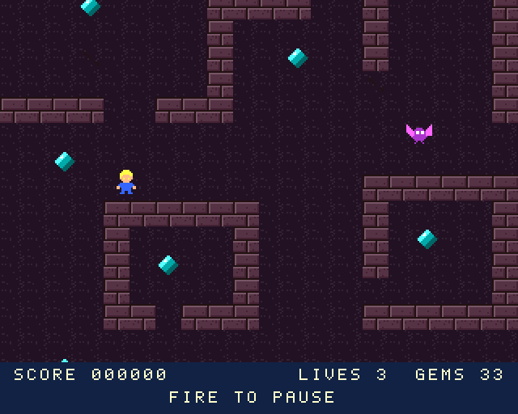
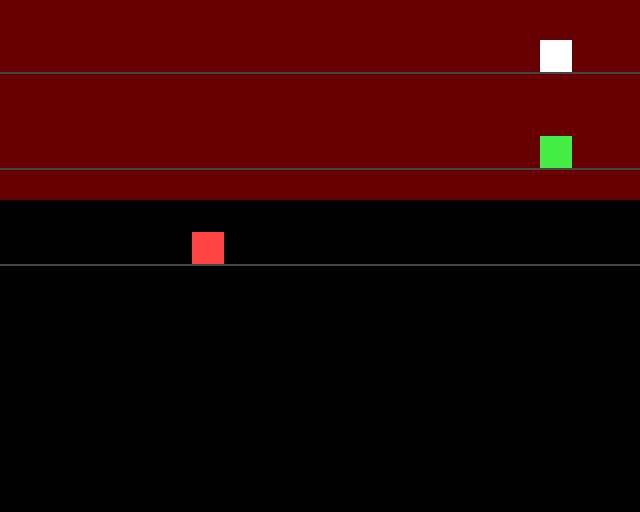
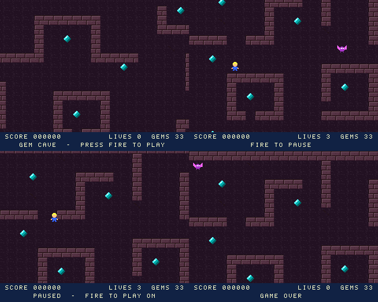
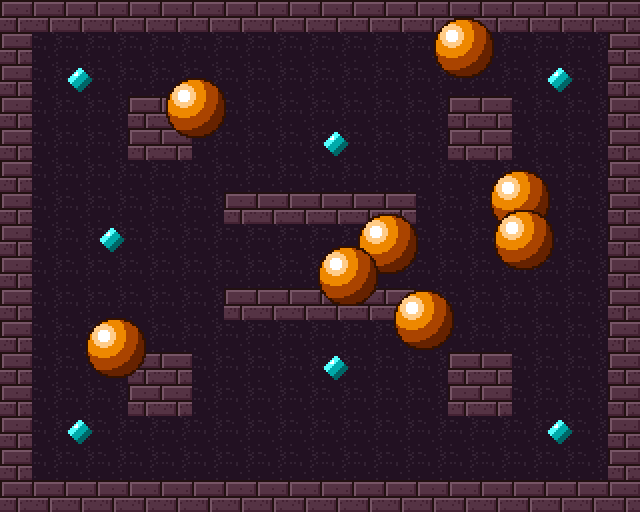
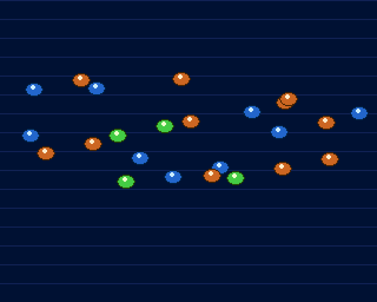
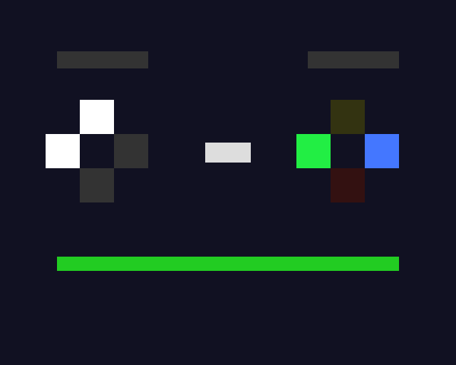
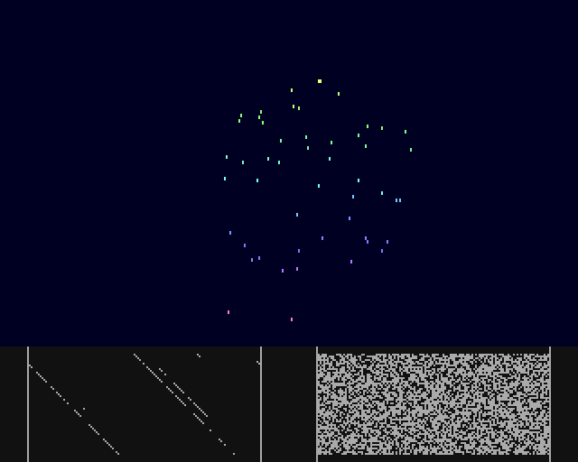

# 17. Writing games

[‹ Debugging and testing](16-debugging-and-testing.md) · [Contents](README.md) · [Releasing ›](18-releasing.md)

Most people writing for the Amiga today write games, not demos, and a game needs things a demo never does. A demo plays the same way every time; a game has to answer the player, every frame, however busy the screen gets. Its world is bigger than the screen. Things in it bump into each other. It has a title screen, a pause and a game over, and has to go from one to the next cleanly. It plays sound effects over its music, loads its levels and saves its high scores. And people will play it on every Amiga there is, and from a hard drive through WHDLoad, for hours at a time.

v7 had no chapter on any of this. Everything in it builds on the chapters before: the startup ([chapter 4](04-startup-and-exit.md)), the copper and blitter ([6](06-copper.md) and [7](07-blitter.md)), scrolling and sprites ([8](08-display.md)), the joystick ([11](11-input.md)), sound ([12](12-sound-and-music.md)) and loading ([15](15-loading-and-memory.md)). This chapter is about putting them together, and about the techniques that only games need.

The examples, all on v8's startup and all working both ways (`OS_FRIENDLY` 0 and 1):

- `ch17_game.s`: **Gem Cave**, a small but whole game. A cave of 48 by 40 tiles scrolls in eight directions, three bats fly about, and the player collects the gems. Title screen, pause and game over, a score and lives, sound effects.
- `ch17_game_loop.s`: a fixed-step game loop, with frames that run late, beside the mistake it fixes.
- `ch17_bobs.s`: bobs that save what they cover and put it back, double-buffered.
- `ch17_multiplex.s`: 24 balls on the eight sprite channels, each channel reused down the screen.
- `ch17_cd32_pad.s`: the CD32's pad, all seven buttons.
- `ch17_random.s`: random numbers, done well and badly, and fixed-point maths.

The tiles, sprites, font and sound effects are drawn by a Python script, `ch17_make_graphics.py`, into `ch17_graphics.raw`, so they're CC0 like everything else here: no one else's graphics or music.



## Gem Cave: how a game is put together

Gem Cave is the startup's four routines like any demo, with a game inside `Frame`:

| Routine | What it does |
|---|---|
| `Init` | PAL or NTSC, the panel cleared, the cave made from its map, the first copper list |
| `Frame` | works out how many steps the game is due, runs them, then makes the screen match: new tiles, the copper list, the sprites, the panel |
| `VBlank` | the sound effects (three short steps, below) |
| `ExitHook` | stops the sound effects before the startup stops the sound |

The game's own work happens in `Tick`, one step of the game: read the joystick, then do whatever the current state does. Everything that moves, moves in `Tick`; everything that draws, draws in `Render`, once a frame. Keeping the two apart is the most useful habit in this chapter. The rest of it follows from there.

Play it with the joystick in the second port (FS-UAE's keyboard joystick: the cursor keys and right Ctrl for fire). Fire starts the game and pauses it; the left mouse button leaves, as in every v8 example.

## The game loop

### The mistake: moving once a frame

The obvious way to move something is to add its speed to its position every frame. That's how demos do it, and it's fine for a demo, which can be made to fit in a frame. A game can't always fit. The screen fills up, ten bobs become twenty, and one frame in a few takes longer than a fiftieth of a second. Then the next `Frame` comes a frame late, and everything that moves "once a frame" has lost a step. The game slows down exactly when it's most exciting. Worse, on an NTSC Amiga there are 60 frames a second, not 50, so everything runs 20% faster, and the game is harder.

The other old mistake is to run the whole game in the vertical blank interrupt. It's never late, until the game takes longer than a frame. Then the next vertical blank can't interrupt it (the processor holds off interrupts of the same level until it returns), so a frame is lost all the same, and everything else in that interrupt (the music, say) is late with it, while the main program gets no time at all. Keep the interrupt short ([chapter 5](05-interrupts.md)), and the game in the main loop.

### Fixed steps

The fix: decide that the game moves in **steps** of a fixed length of time (Gem Cave's is 1/50 of a second), and each frame, run as many steps as the time since the last frame asks for. Usually that's one. After a late frame it's two. The drawing happens once, after the steps, however many there were. The game's speed then depends only on the clock, never on how long the drawing took.

The clock is the startup's `Frames`, counted by the vertical blank interrupt. From `ch17_game.s`:

```asm
Frame:
        move.l  Frames,d0
        move.l  d0,d1
        sub.l   LastFrames,d0           ; frames since the last time
        move.l  d1,LastFrames
        cmp.l   #MAXTICKS,d0
        bls.s   .few
        moveq   #MAXTICKS,d0
.few:
        mulu    #TICKRATE,d0
        add.w   TickClock,d0            ; 50 for each frame...
        moveq   #0,d7
.count:
        cmp.w   FrameRate,d0            ; ...and a step for each 50 or 60 of them
        blo.s   .counted
        sub.w   FrameRate,d0
        addq.w  #1,d7
        bra.s   .count
```

Each frame that has passed puts 50 into `TickClock`, and each 50 (PAL) or 60 (NTSC) taken out of it is a step. On PAL that's exactly a step a frame. On NTSC it's five steps in every six frames, so the game moves at the same speed on both, and what's left over waits in `TickClock` for the next frame. `FrameRate` comes from the startup's `PalDisplay`, which asks graphics.library on Kickstart 2 and later ([chapter 8](08-display.md)).

### When a frame runs late

There's a limit, `MAXTICKS` (4 in Gem Cave). Without one, a game that takes too long to draw falls into a trap: the late frame means more steps next time, which take longer, which makes the next frame later still. Capped, the game slows down rather than stopping, and catches up when the screen calms down.

`ch17_game_loop.s` shows the difference. Three blocks run along three rails at 100 pixels a second. The top one (white) is put where it should be from the time alone. The middle one (green) moves in fixed steps. The bottom one (red) moves once for each frame drawn. Every fourth frame the program keeps the processor busy for a frame and a half, with the background red while it does. The green block stays with the white one. The red one falls further behind with every late frame.



### PAL and NTSC

Five steps in six frames has a cost: on NTSC, one frame in six shows nothing moving, which a sharp eye sees as a slight judder in smooth scrolling. The alternative is to step once a frame on both, and scale every speed by 50/60 on NTSC. That's smoother, but every speed, timer and animation in the game then has two values, and the two versions of the game drift apart: a jump is a pixel shorter on one than the other. For most games, fixed steps are worth the judder. Whichever you choose, choose it at the start: changing later means retuning everything.

Fixed steps have one more advantage: the game does the same thing from the same input, whatever the machine. That makes a bug that happened once happen again, and a recording of the player's moves, played back with the same random seed, gives exactly the same game.

## States: title, game, pause, game over

A game is in one of a few **states**, and each reads the controls and moves things in its own way. Gem Cave has four, and `Tick` jumps to the current one's routine through a table:

```asm
Tick:
        addq.w  #1,TickCount
        bsr     ReadJoystick
        move.w  State,d0                ; 0, 4, 8 or 12
        jmp     .states(pc,d0.w)
.states:
        bra.w   TitleTick
        bra.w   PlayTick
        bra.w   PauseTick
        bra.w   OverTick
```

Changing state is a write to `State` and nothing else, and every state knows exactly what it does. The alternative, flags tested all over the game (`tst.b Paused` in every routine that moves something), is how a pause comes to stop the player but not the bats.



### Pressed, not held

The classic mistake with states: fire starts the game from the title screen, and in the game fire pauses it. The player presses fire once. The title screen sees it and starts the game; the next step, the game sees fire (still held: a press lasts several steps) and pauses. The game seems not to start at all.

What a state wants to know is that fire **went down**, not that it **is down**. Keep last step's reading and compare:

```asm
        move.b  Fire,d1                 ; held last step
        btst    #CIAB_GAMEPORT1,CIAA+CIAPRA
        seq     d0                      ; held now (the bit is 0 while it's pressed)
        move.b  d0,Fire
        not.b   d1
        and.b   d1,d0                   ; held now and not before
        move.b  d0,FirePressed
```

Movement wants the opposite: the player walks for as long as the stick is held, so `JoyX` and `JoyY` are read as they are. The joystick's directions are decoded as in [chapter 11](11-input.md).

## Scrolling in eight directions

Gem Cave's cave is 768 by 640 pixels. As a bitmap in 4 bitplanes, it would take 240K of chip RAM, nearly half of an A500's, and a game with bigger levels couldn't do it at all. The way games do it is to keep the level as a **tile map** (here 48 by 40 bytes, one for each 16 by 16 tile) and a screen buffer only a little bigger than the screen, and to draw each row or column of tiles into the buffer just before it comes into view. Gem Cave's buffer is 51K.

Two things make that work: the bitplane pointers can start anywhere in memory, and the copper can change them part of the way down the screen.

### Down and up: the buffer wraps round

The buffer holds 17 rows of tiles (272 lines). The screen shows 14 or 15 of them, depending on how the scroll falls; the other two are the rows just above and below, drawn ready before they come into view. Row `r` of the cave always goes in the buffer's slot `r mod 17`.

So as the screen scrolls down, the buffer's line at the top of the screen goes down too, and when it gets near the end of the buffer, the screen has to carry on from the buffer's first line. That's the copper's job. At the top of the frame it points the bitplanes at the buffer's line for the top of the screen, and on the screen's line that shows the end of the buffer, it points them back at the buffer's start:

```asm
        ; The bitplanes at the top of the screen.
        move.w  BufferTop,d0
        mulu    #LINEBYTES,d0
        add.l   #Buffer,d0
        ...
        bsr     CopperPlanes

        ; Where the buffer runs out, back to its first line, if that's on the screen.
        move.w  #BUFLINES,d0
        sub.w   BufferTop,d0            ; the screen's line that shows the buffer's line 0
        cmp.w   PlayLines,d0
        bhs.s   .nowrap
        bsr     CopperWait
        move.l  #Buffer,d0
        ...
        bsr     CopperPlanes
```

That copper wait moves every frame, and can be anywhere on the screen, including past line 255. A copper `WAIT` compares only the low 8 bits of the line (the HRM: "The line number will never be greater than $FF"), so a line past 255 needs a wait for the end of line 255 first, `$FFDF`, and then a wait for the line less 256 ([chapter 6](06-copper.md)). There must be only one `$FFDF` in a list: a second one, once the beam is past line 255, waits for a line that won't come until the next frame. Gem Cave's `CopperWait` notes whether it has written one:

```asm
CopperWait:
        add.w   #$2c,d0                 ; the screen's line, as the beam counts
        cmp.w   #$100,d0
        blo.s   .low
        tst.w   d6                      ; past 255 already?
        bne.s   .low
        move.l  #$ffdffffe,(a0)+
        moveq   #1,d6
.low:
        lsl.w   #8,d0
        or.w    #$07,d0                 ; at the left edge, before the line's fetch starts
        move.w  d0,(a0)+
        move.w  #$fffe,(a0)+
        rts
```

It waits for the start of the line, and the four bitplanes' pointers (eight copper moves) follow straight after, so they're set before the line's fetch begins at `DDFSTRT`.

### Left and right: a ribbon

Sideways, there's a neater trick. The screen fetches 21 words a line (20 shown and one for the fine scroll, [chapter 8](08-display.md)), and after each line the modulo takes it to the start of the next. Make each line of the buffer 24 words wide, and scroll right by adding 2 to the bitplane pointers for each 16 pixels. The screen then reads further and further into each line: past its end, into the start of the next line. Nothing is wrapped and nothing is copied. The buffer is a long **ribbon**, each line following on from the one before, and the screen slides along it.

The words that come into view on the right of a line are simply the next words of the ribbon, which until then held the left-hand column of the line below, now out of view; the new tile is drawn over them. Gem Cave keeps it simple: tile column `c` of the cave is always at byte `2 × (c + 1)` of a line, row slot `s` at line `16 × s`, so a tile's place in the buffer is always

```
Buffer + (row mod 17) × 16 × LINEBYTES + 2 × (column + 1)
```

and the display, the tiles and the blitter all agree on it. The cost is memory at the end of the buffer: the screen slides 2 bytes along for each 16 pixels it scrolls right, so the buffer needs `2 × MAPW` bytes more than its lines (96 bytes, for a cave 48 tiles wide). A cave a thousand tiles wide would need 2,000 bytes more: nothing.

Why 24 words, not 22? The screen shows parts of 21 columns. Scrolling right, the column after them (number 22) must be drawn before it shows; scrolling left, the column before them. With lines 22 words long, the column one past the right of a line is the same words as the column one before the left of the next line, and the two can't both be ready. With 24, they're different words, so the buffer always holds both, and the scroll can change direction at any moment. (24 words is also a multiple of 64 pixels, which the AGA chips' fastest fetch mode needs; see [chapter 9](09-aga.md).)

The fine scroll, 0 to 15 pixels, is `BPLCON1`'s delay, worked out as in [chapter 8](08-display.md); the game keeps the screen at least 16 pixels in from the cave's left edge, so the column being drawn on the left is never seen.

### Drawing the tiles in

Each frame, `Scroll` works out which tile column and row are at the top left of the screen, and compares them with the ones the buffer was drawn for:

- a column further right: draw the column past the right edge (17 tiles, one for each slot);
- a column further left: the one past the left edge;
- then a row further down: the row below the bottom one (23 tiles: the 21 columns and one each side); further up, the row above the top.

The column is drawn first, for the rows as they were; the row after, as wide as the new columns. That way the corner tile is right when the screen moves diagonally. The camera moves less than a tile a frame (up to 8 pixels, after four late steps), so there's never more than one of each. Anything more (a new game, a new cave) draws all 17 rows.

Each tile is one blit: the tiles in `ch17_graphics.raw` are interleaved like the buffer, so a tile is 64 rows of one word, A to D, with D's modulo the rest of the buffer's line. 40 tiles (a column and a row together, the worst case) are 2,560 words copied, A to D: at 4 ticks a word ([chapter 7](07-blitter.md#how-fast)), about 1.4 milliseconds, a fourteenth of a frame.

A gem that's taken changes the cave: the map's byte becomes floor, and if the buffer holds that tile, it's drawn again (`RedrawTile`). The map is the truth; the buffer is only ever a picture of it.

Georg Steger's **ScrollingTricks** (<https://aminet.net/package/dev/src/ScrollingTrick>, 1999) explains these and other ways of scrolling a tile map, for each direction and for all eight, with pictures of what happens in the buffer, and demo programs in C. His *XLimited* and *XYLimited* ways are the ribbon and the wrap-round used here, though his are tighter: 22 words a line, not 24, and the new column drawn a tile at a time as the screen scrolls the 16 pixels that bring it in, rather than all at once. Gem Cave draws its 17 or 23 tiles in one go for clarity. Note his archive's own terms: he asks to be told about (or sent) a game made with his documentation or code.

### A copper list made each frame

Gem Cave doesn't patch its copper list: it makes a new one every frame (`MakeCopper`), because the wrap-round wait moves and sometimes isn't needed at all. It makes it in a second list that isn't being shown, then writes that list's address to `COP1LC` at the end of `Frame`. The copper reloads `COP1LC` at the start of every frame, so the new list is used from the next frame, and never half-written. The sprites the list points at are double-buffered in the same way, so the processor never changes a sprite's control words while they're being read (the HRM warns that a sprite moved "at the same time that the system is using that data" can show a glitch).

There's no need to time the write: if `Frame` runs late and writes `COP1LC` in the middle of a frame, the list is simply used from the frame after, and until then the old one, whole and unchanged, carries on.

### A panel

Under the playfield is a panel for the score, lives and messages. It's a copper split: on the panel's first line, the copper points bitplane 1 at the panel's own bitmap, sets one bitplane, no scroll, a modulo of 0 and the panel's colours. The panel is 32 lines on PAL and NTSC alike; the playfield is 224 lines on PAL and 168 on NTSC, and the copper's waits, the camera and the sprites' clipping all use `PlayLines`, set in `Init`.

The panel's colour 0 is also the border's: outside the display window, the screen shows colour 0 of whatever line it's on. That's why Gem Cave's playfield colour 0 is the same deep blue as the panel's. The playfield's tiles never use it, so the whole screen has one border.

## Bobs that put back what they cover

A scrolling game can't keep a clean copy of its background to put back behind its bobs, as `ch07_bobs.s` does: the background is the scroll buffer, and it changes. So each bob first **saves** the rectangle it's about to cover, and is taken off again by putting that back. [Chapter 7](07-blitter.md#putting-the-background-back) gave the rule; `ch17_bobs.s` shows it. Eight balls bounce over a wall of tiles, in four bitplanes, with no spare copy of the screen: that alone saves 40K of chip RAM.



Each frame, in the screen that isn't shown:

1. **Off**, in reverse order: each bob's saved rectangle back where it came from, the last bob drawn first.
2. **Move** them.
3. For each bob in order: **save** the rectangle it will cover (A to D, from the screen to its own save area), then **draw** it (the cookie-cut, D = AB + aC).

The mistake is in step 1. Taking the bobs off in the order they were drawn works perfectly until two of them overlap. Then the second bob's save holds part of the first bob (it was drawn there first). Put the first one's save back, then the second's, and that piece of the first bob comes back with it, and stays on the screen as a smear that grows. Reverse order undoes the drawing exactly: the second bob's save goes back first, then the first's, which was taken from the clean background.

```asm
.restore:
        move.l  -(a2),d0                ; where it was: the list, read backwards
        add.l   DrawScreen,d0
        sub.w   #SAVEBYTES,a3           ; its save, also backwards
        jsr     WaitBlitter
        move.l  a3,BLTAPTH(a5)
        move.l  d0,BLTDPTH(a5)
        move.w  #BOBSIZE,BLTSIZE(a5)
        dbf     d7,.restore
```

The save area is three words by 128 rows for each bob (a 32-pixel bob shifted across three words, in four bitplanes): 768 bytes, so eight bobs in two screens take 12K, against 40K for a third screen.

### Double and triple buffering

Each screen has its own list of where its bobs were, because the screen being drawn was last drawn two frames ago ([chapter 7](07-blitter.md#double-buffering)). In a scrolling game, each buffer also has its own copy of the scroll: the new tiles have to be drawn into both, a frame apart.

With two screens, the program can't start drawing the next frame until the one it just finished is on show: the other screen is still being shown until the next vertical blank. When drawing takes nearly a frame, that wait costs a whole frame every time it misses. A **third** screen lets drawing start at once, in the screen that's neither on show nor waiting to be shown, which makes the frame rate steadier when drawing takes close to a frame. It costs a third screen of chip RAM, and the steps above need a third list of bobs. Most A500 games double-buffer, and keep their drawing comfortably inside a frame.

How many bobs fit? [Chapter 7](07-blitter.md#cookie-cut-bobs) worked out about 5 lines of a PAL frame for a 32 by 32 bob in three bitplanes; in four, with its save and its restore, it's about 14 lines. Sprites cost nothing at all.

## Sprites in a game

Gem Cave's player and bats are hardware sprites, not bobs: they're drawn by the display, over the playfield, with nothing to save or restore, and they don't scroll with it. The player is sprite 0; the bats are sprites 2, 4 and 6, each with its own colour registers (sprites share colours in pairs). Sprite 7 isn't there to use: the HRM says of starting the fetch at `$30` for scrolling, "Incidentally, this will disable sprite 7."

Each frame, `MakeSprite` writes a sprite's control words and copies its 16 lines in, **clipped** to the playfield. The HRM: sprites "will be partially or totally clipped if they pass across or beyond the boundaries of the display window". But the panel is inside the display window, so a bat going off the bottom of the playfield would be drawn over the panel. So the lines that would be below the playfield aren't copied in, and the sprite's stop line is moved up to match; the same at the top.

### More objects than sprites: a multiplexer

Eight sprites aren't many, but each can be used again further down the screen ([chapter 8](08-display.md#reusing-sprites-down-the-screen)). A game with many small objects can show far more than eight, as long as no more than eight are on any one line. Sorting that out every frame is a **multiplexer**. `ch17_multiplex.s` shows 24 balls on the eight channels:

1. Sort the objects by height, top first.
2. For each, in that order, find a channel that's free by its top line: one whose last object ended at least a line above. The HRM: "at least one video line must separate the bottom of one usage of a sprite from the starting point of the next usage". The channel needs that line to fetch the next control words.
3. Add the object to that channel's list; the channel is free again a line after the object's last line.
4. End each list with two words of 0.



The sort is an insertion sort, which looks slow (it compares each object with those before it) but isn't here: objects move a few lines a frame, so last frame's order is almost right, and on a list that's almost in order insertion sort does almost nothing. Keep the order from frame to frame, rather than sorting from scratch.

When a ninth object shares a line with eight others, it gets no channel. The example just doesn't show it that frame. A game usually prefers **flicker**: give the objects that missed out priority next frame, so each is shown every other frame rather than one vanishing. Most players will take flicker over an invisible enemy. And keep the number of objects that can be level with each other low in the first place: that's a game design question as much as a coding one.

With no bitplanes switched on at all (`BPLCON0` = `$0200`), FS-UAE showed no sprites; with one bitplane, they appeared. The example has one bitplane, of faint lines. (Not checked on a real Amiga.)

## Collisions

### With the map

Walls are in the tile map, so whether something can move somewhere is a question for the map, not the screen. A box no bigger than a tile can only touch the tiles under its four corners:

```asm
; The tile at the cave's pixel (d2, d3): a0 points at it in MapTiles.
TileAt:
        move.w  d3,d4
        asr.w   #4,d4                   ; the row...
        mulu    #MAPW,d4
        move.w  d2,d5
        asr.w   #4,d5                   ; ...and the column
        add.w   d5,d4
        lea     MapTiles,a0
        add.w   d4,a0
        rts
```

Each object has a **box** smaller than its picture (the player's is 8 pixels wide inside its 16), so it can squeeze through a one-tile gap without being lined up to the pixel.

The mistake is moving both ways at once, testing, and undoing both if there's a wall. Then the player pushing up and right along a wall stops dead, because the move "up" hits the wall, and "right" is undone with it. Move across first, test, undo only that; then down, test, undo only that. The player slides along walls, as players expect:

```asm
MovePlayer:
        move.w  JoyX,d0
        muls    #SPEED,d0
        add.w   PlayerX,d0              ; across...
        move.w  PlayerY,d1
        lea     PlayerBox(pc),a1
        bsr     HitsWall
        bne.s   .noacross
        move.w  d0,PlayerX
.noacross:
        move.w  JoyY,d1
        muls    #SPEED,d1
        add.w   PlayerY,d1              ; ...then down, from where across left it
        move.w  PlayerX,d0
        lea     PlayerBox(pc),a1
        bsr     HitsWall
        bne.s   .nodown
        move.w  d1,PlayerY
.nodown:
```

The bats use the same test, turning back when they meet a wall. Gems are the tile under the middle of the player.

### Between objects: boxes

Two objects touch when their boxes overlap: each one's left edge is left of the other's right edge, and the same for top and bottom. Four comparisons, no multiplication:

```asm
; Do box A (d0-d3: left, top, right, bottom) and box B (d4-d7) overlap? Z clear (bne) if so.
Overlap:
        cmp.w   d6,d0                   ; A's left past B's right?
        bgt.s   .no
        cmp.w   d4,d2                   ; A's right before B's left?
        blt.s   .no
        cmp.w   d7,d1                   ; and the same down
        bgt.s   .no
        cmp.w   d5,d3
        blt.s   .no
        moveq   #1,d0                   ; Z clear
        rts
.no:
        moveq   #0,d0                   ; Z set
        rts
```

Boxes are rough: two round things touch at their corners before they really do. Make the boxes smaller than the pictures, and players will feel the game is fair. (This routine isn't in an example; Gem Cave uses the hardware instead.)

### CLXDAT: the hardware's collisions

The Amiga can tell you which sprites touched which, to the pixel, for nothing. As the display draws each pixel, it notes when two objects' non-transparent pixels are in the same place, in `CLXDAT` (`$DFF00E`). From the HRM's table, the bits for sprites:

| Bit | Collision |
|---|---|
| 9 | sprite 0 (or 1) with sprite 2 (or 3) |
| 10 | sprite 0 (or 1) with sprite 4 (or 5) |
| 11 | sprite 0 (or 1) with sprite 6 (or 7) |
| 12 to 14 | 2 with 4, 2 with 6, 4 with 6 (each with its pair) |
| 1 to 8 | the odd or even bitplanes with each sprite pair |

It's read-only and "automatically cleared to 0 after it is read", so it holds every collision since the last read. Gem Cave reads it once a frame, in `Frame`:

```asm
        move.w  CLXDAT(a5),d0           ; reading it clears it
        cmp.w   #PLAY_STATE,State
        bne.s   .nobite
        and.w   #$0e00,d0               ; bits 9 to 11: sprite 0 met sprite 2, 4 or 6
        beq.s   .nobite
        tst.w   Safe                    ; just bitten: two seconds' grace
        bne.s   .nobite
        bsr     Bitten
```

The odd sprites only count if `CLXCON` (`$DFF098`) says so: "The even-numbered sprites always are included". Gem Cave puts its bats on even sprites only, and leaves the odd ones empty, so it needn't touch `CLXCON` at all. That matters because `CLXCON` is write-only: there's no reading what the system had in it, to put it back.

What `CLXDAT` can't do: it only sees what was shown. An object off the screen, or not shown this frame (a multiplexed sprite that lost its channel, a flashing player), never collides. It tells you which pair of sprites met, not which of many bobs in a bitplane. And it's about the frame just shown, so it's a frame behind the game. For the player against enemies, that's ideal: pixel-perfect and free. For bullets against twenty enemies, it's boxes in software.

### Pixel masks in software

Between boxes and `CLXDAT` there's the exact test in software: two objects collide if their masks (the same masks the blitter's cookie-cut uses) have a set bit in common, once they're lined up. For each line the two share, shift one mask's line by the difference in their x positions and AND it with the other's; any bit left set is a collision. Test the boxes first, and only do this for the few that overlap: it's a loop over every shared line. (Not in an example.)

## The controls

The joystick and its fire button are [chapter 11](11-input.md)'s, with the rule above: a state wants presses, movement wants what's held. The joystick's **second button** is pin 9, read in `POTGOR`, and it needs the pin set up first; chapter 11 does it through potgo.resource, the only safe way.

### The CD32 pad

The CD32's pad has seven buttons: red, blue, green and yellow, two on its shoulders, and play. It plugs into the same ports, and to a program that knows nothing of it, it's a two-button joystick: red is fire, blue is the second button. The other five are read through a **shift register** in the pad. From AROS's `lowlevel.library` (<https://github.com/aros-development-team/AROS/blob/master/arch/m68k-amiga/lowlevel/readjoyport.c>), and the pad's circuit as documented on Gerd Kautzmann's page (preserved at <https://www.mrdictionary.net/PSCD32/diary/sites/CD32Gamepad_gerdkautzmann_de.html>):

- **Pin 5** (`POTGO`'s `OUTRX`/`DATRX` for port 1) driven **low** puts the pad in shift mode, with the first button on pin 9. Driven high, the pad loads its buttons and acts as a joystick.
- **Pin 6** (the fire pin) is the clock. The Amiga drives it, as an output of CIA-A, and each rising edge moves the next button onto pin 9.
- **Pin 9** is read in `POTGOR` (bit 14 for port 1). 0 is a button held, as for every Amiga button.

The buttons come out in the order blue, red, yellow, green, forward (the right shoulder), reverse (the left one), play, and then two more bits that read 1 and then 0. Those two are how to tell a pad from a joystick: a two-button joystick, with nothing driving pin 9, reads the same every time. `ch17_cd32_pad.s`:

```asm
        ; The fire pin an output, low; then pin 5 low, for shift mode, with pin 9 an input.
        bclr    #CIAB_FIRE1,CIAA+CIAPRA
        bset    #CIAB_FIRE1,CIAA+CIADDRA
        move.l  PotgoBase,a6
        move.l  #OUTRX,d0               ; pin 5: an output, low; pin 9: an input
        move.l  #PORT1BITS,d1
        jsr     _LVOWritePotgo(a6)

        moveq   #0,d2
        moveq   #9-1,d3
.bit:
        tst.b   CIAA+CIAPRA             ; (six of these: a little time for the pad)
        ...
        add.w   d2,d2
        move.w  POTGOR(a5),d0
        btst    #14,d0                  ; pin 9
        bne.s   .up
        addq.w  #1,d2                   ; low: held
.up:
        bset    #CIAB_FIRE1,CIAA+CIAPRA ; the clock up, and down: the next bit onto pin 9
        bclr    #CIAB_FIRE1,CIAA+CIAPRA
        dbf     d3,.bit

        ; The fire pin an input again, and the pad back in its ordinary mode.
        bclr    #CIAB_FIRE1,CIAA+CIADDRA
        bsr     Idle                    ; pins 5 and 9 outputs, high
```

The `tst.b` reads of the CIA are a delay that doesn't depend on the processor: an access to a CIA waits for the CIAs' own slow clock (it counts at a tenth of the 68000's 7 MHz, the HRM says of their timers), so they take the same time on a 68060 as on a 68000. A plain loop would be over in no time on a fast processor, before the pad's output had settled. The reader in the WHDLoad developer package (`Src/sources/whdload/jotd/ReadJoypad.s`, "original code by asman with timing fix by wepl", with JOTD's detection of pad or joystick) waits the same way.



Two warnings. The first is from that source's comments: a plain two-button joystick held down on its second button pulls pin 9 low throughout, so a reader that doesn't check the two last bits sees every button held at once, and a game that quits on the shoulder buttons quits. Check them. The second: the pins are shared. Pins 5 and 9 are `POTGO`'s, so the example asks potgo.resource for them and writes them with `WritePotgo`, as chapter 11 explains; and the fire pin's direction is the system's (`CIAADDRA`), so it's made an output only for the read, and an input straight after.

With the system running on Kickstart 3.1 (V40) or later, `lowlevel.library`'s `ReadJoyPort()` reads the pad for you, and tells a pad from a joystick and a mouse. It's on the CD32 in ROM, and on other Amigas in `LIBS:`.

## Sound effects

### On a channel of their own

Gem Cave plays its two sound effects on channel 3, and nothing else uses it. Starting a sample on a channel that's playing needs a wait after switching its DMA off, and another after switching it on ([chapter 12](12-sound-and-music.md#starting-a-new-note-the-wait)). A game can't spend ten lines waiting each time a gem is taken, and doesn't need to: it does the three steps a frame apart, in the vertical blank, and the waits pass by themselves:

1. switch the channel off (it may still be playing the last effect);
2. a frame later: the new sample's address, length, period and volume, and the channel on;
3. a frame later: the address and length pointed at a word of silence, so the sample plays once.

```asm
PlaySound:
        move.w  d0,SoundLength
        move.l  a0,SoundNext            ; last: a long is written in one go, so the interrupt sees both or neither
        rts
```

The sound starts 20 to 40 milliseconds after it's asked for, which no one can hear. With the system running, the startup allocates channel 3 from audio.device (`AUDIO_CHANNELS equ %1000`), so no other program cuts in. And `ExitHook` stops the interrupt's steps before the startup silences the channels, so the last effect can't be started again after the sound has been stopped (chapter 12 explains why the order matters).

### Over music

Most games play music too, and four channels have to be shared. The usual ways:

- **Give the effects a channel of their own**, and write the music for three. Simple, and the music never loses a note, but it's only three channels of music.
- **Take a channel from the music for each effect**, and give it back when the effect has finished. The music loses that channel's notes for a moment, which, if the player chooses well, no one notices.

**ptplayer**, Frank Wille's ProTracker player (<https://aminet.net/package/mus/play/ptplayer>, public domain), was written for exactly this, for his games Sqrxz and Solid Gold. In its readme's words, `_mt_playfx` plays an effect "either on a fixed channel or on the most unused one", with a priority: "When multiple samples are assigned to the same channel the lower priority sample will be replaced." While an effect plays, "The chosen channel is blocked for music until the effect has completely been replayed", and then the music has it back. `_mt_musicmask` reserves channels for music only, `_mt_loopfx` and `_mt_stopfx` play and stop an effect that repeats (an engine), and the master volume changes the music without touching the effects. Its one rule: "always make sure the first two bytes of your sound effect sample are zero!", which is why `ch17_make_graphics.py` starts each effect with a word of 0.

**LightSpeedPlayer** (Arnaud Carré's, [chapter 12](12-sound-and-music.md)) is a music player only: its readme (v1.33) mentions no sound effects, and it writes all four channels and `DMACON` itself. With LSP, write the music for three channels and play the effects on the fourth yourself, as Gem Cave does.

## Numbers

### Fixed point

Games need fractions: a speed of 1.5 pixels a frame, gravity of 0.04 pixels a frame every frame, a bat that drifts slowly. The 68000 has no floating point, and division is slow (a `DIVU` takes up to 140 cycles). The answer is **fixed point**: keep the number multiplied by a power of two, so the fraction is whole numbers in the low bits.

**16.16** suits the 68000 well: a long, with the whole pixels in the top word and the fraction in the bottom word. Adding and subtracting are ordinary `ADD.L` and `SUB.L`. The pixel is the top word, and `SWAP` gets it in one instruction. From `ch17_random.s`'s fireworks:

```asm
        movem.l (a0),d0-d3              ; x, y, x speed, y speed: all 16.16
        add.l   #GRAVITY,d3             ; 2600: 0.04 of a pixel, as 2600/65536
        move.l  d2,d4
        asr.l   #6,d4
        sub.l   d4,d2                   ; the air: 1/64 of the speed lost each frame
        ...
        add.l   d2,d0
        add.l   d3,d1
        movem.l d0-d3,(a0)
        swap    d0                      ; the pixel
        swap    d1                      ; the line
```

Multiplying two 16.16 numbers needs a 64-bit result, which the 68000 doesn't have (the 68020's `MULS.L` does). Usually one of the two is small: drop it to 8.8 (shift it down 8) and multiply by a word, or keep speeds in 8.8 from the start. Choose the split for the job: 8.8 in a word is enough for a speed; 16.16 for a position on a map bigger than 256 pixels.



### Random numbers

A game needs random numbers: where a bat turns, which way a firework bursts. The usual mistake on the Amiga is to read the beam's position, `VHPOSR`, and call it random. Read once, at a moment the player chose, it is. Read again and again in a loop, it isn't: each read is a fixed time after the last, so the numbers step along together. `ch17_random.s` places dots with `VHPOSR` on the left (x from one read, y from the next), and they fall into diagonal lines. Taken from a proper generator, on the right, they fill the box evenly.

The generator is **xorshift**, from George Marsaglia's paper *Xorshift RNGs* (Journal of Statistical Software, 2003: <https://www.jstatsoft.org/article/view/v008i14>). Three shifts and three exclusive-ORs, with the shifts 13, 17 and 5 that the paper calls "one of my favorite choices", go through every 32-bit number except 0 before repeating:

```asm
Random:
        move.l  Seed,d0
        move.l  d0,d1
        moveq   #13,d2
        lsl.l   d2,d1
        eor.l   d1,d0                   ; x ^= x << 13
        move.l  d0,d1
        moveq   #17,d2
        lsr.l   d2,d1
        eor.l   d1,d0                   ; x ^= x >> 17
        move.l  d0,d1
        lsl.l   #5,d1
        eor.l   d1,d0                   ; x ^= x << 5
        move.l  d0,Seed
        rts
```

Three things to get right:

- **The seed must never be 0**, or it stays 0 for ever.
- **Seed it from the player.** The same seed gives the same game every time, which is what you want while testing, and not afterwards. Gem Cave mixes in the beam's position and its step count at the moment fire starts the game: no one presses fire at the same moment twice. (That one read of `VHPOSR` is fine: it's random because a person chose when.)
- **Ranges.** For a number from 0 to 55, the mistake is `AND #63` and then wrapping anything over 55 back round: 0 to 7 then come up twice as often as the rest. Instead, `AND #63` and try again if it's over 55 (exactly even, and `ch17_random.s`'s way); or `MULU` a random word by 56 and keep the top word of the result (even to within a part in a thousand, and no loop). `DIVU` by 56 for the remainder is as even, and much slower.

### The score in BCD

A score is shown in decimal, and turning a binary number into decimal digits takes a division for each digit. Games often keep the score in **BCD** instead (binary-coded decimal, two digits to a byte), which the 68000 adds with `ABCD`, a byte at a time, carrying in the X flag. Printing it then needs no division at all: each 4 bits is a digit.

```asm
AddScore:
        lea     Score+3,a1              ; from the end: the lowest digits first
        addq.l  #3,a0                   ; a0: the points, in BCD too
        sub.b   d0,d0                   ; X clear (SUB sets X as it sets C: no borrow)
        abcd    -(a0),-(a1)
        abcd    -(a0),-(a1)
        abcd    -(a0),-(a1)
```

`ABCD` adds X as well, so X must be clear before the first. `MOVEQ` and `CLR` don't touch X; `SUB` does.

## Loading levels and saving high scores

### Loading while the game runs

A game bigger than memory loads its levels as it goes. [Chapter 15](15-loading-and-memory.md) covers loading with the system running (`OS_FRIENDLY` 1: `Open`, `Read`, `Close` from the program's own process, with the blitter shared), and by taking the machine and giving it back to load. For a game, the simplest is to load between levels, behind a "get ready" screen: the player expects a pause there. Loading while the game plays is possible with the system running, as the system's tasks run whenever the game waits for the next frame; but the floppy is slow (a 100K level takes several seconds), so start early.

A trackloader, reading the disk with the hardware (chapter 15), loads faster and needs no system, but the game then only runs from its floppy. Whichever you choose, put every load through **one routine** of your own. Then changing how the game loads (from a trackloader to files, for a hard drive version) is one change, and anyone making a WHDLoad install of it (below) has one place to patch.

### Saving high scores safely

A high score table saved to disk is the one time a game writes, and writing is where things go wrong: the disk is write-protected, or full, or the machine is switched off halfway through. A game that writes straight over its high score file loses the whole table if it's interrupted. So:

1. **Write a new file** alongside the old one (`hiscores.new`), and check every `Write`: a short write means a full disk.
2. **Then swap them**: `DeleteFile` the old file, and `Rename` the new one to its name. (`Rename` won't replace a file: its Autodoc says "If the file or directory 'newName' exists, Rename() fails and returns an error.")
3. **When loading**, if the table is missing or the wrong length, look for `hiscores.new` before giving up, and start with a default table if there's neither.

A disk that's write-protected makes `Open` fail, with `IoErr()` returning 214 (`ERROR_DISK_WRITE_PROTECTED` in `dos/dos.i`). Many people play from write-protected disks on purpose, to keep them safe. So if saving fails, say so in a word on the screen and carry on: never stop the game, and never ask the player to remove the write protection from an original.

Don't write high scores to a disk with a trackloader. A write that goes wrong on a disk with no file system can destroy the game itself. If a trackloaded game must save, ask for a separate disk, and check it's the right one before writing.

## Friendly to every Amiga

### PAL and NTSC

A game is played in both, so test it in both ([chapter 8](08-display.md#pal-and-ntsc)). The screen is shorter on NTSC: Gem Cave's playfield is 168 lines there, not 224, and its panel moves up with it. The timing is the game loop's job, above. And a game that switches an NTSC Amiga to PAL with `BEAMCON0` to get the taller screen has to work on the monitors people really have: chapter 8 says when that's safe.

### OCS to AGA

A game for an A500 should also work on an A1200 and a CD32: AGA runs OCS programs, as long as they leave AGA's own registers as the system expects. v8's copper lists write `FMODE` as 0 and `BPLCON3` as `$0C00` in every frame ([chapter 9](09-aga.md)): a game started from an AGA Workbench may otherwise find the sprites at a different width or resolution, or the bitplanes fetched in a different mode. The startup puts `BPLCON4` back as it ends.

### WHDLoad

**WHDLoad**, by Bert Jahn (<https://www.whdload.de/>), runs games that take the machine from a hard drive, by patching each one: for each game, someone writes a small **slave** that loads the game and "patches the main executable (so that the program will load his data via the Slave, to fix compatibility problems, to enable an exit from the program)", in the words of its programming documentation (<https://www.whdload.de/docs/en/howto.html>). Many people will only ever play your game that way. A few things make it much easier to install:

- **Load through one routine** (above). The slave's author has to find the game's loader and replace it; their documentation describes searching the game's code for it.
- **Load files, not tracks**, if you can: a game that loads files through the system (`OS_FRIENDLY` 1) can simply be copied to a hard drive, and may need no slave at all.
- **Leave the processor's control registers alone.** WHDLoad's guidelines for slave writers say not to touch the `VBR` or the `CACR` directly, and to change the caches only through WHDLoad, because it manages both for the game. A game that only *reads* the `VBR` (as v8's startup does, through `Supervisor()`) and changes the caches only through the system is easy to install; one that writes them has to be patched.
- **Don't count on what's in memory.** No fixed addresses, no reading the system's private structures, nothing assumed about where the game was loaded or what's around it ([chapter 3](03-general-guidelines.md)).
- **Give a way out.** WHDLoad quits with a key of its own, but a game that already ends cleanly (as every v8 example does, with everything given back) is one less thing to patch.

None of this costs the game anything, and it's the same list that makes a game work on every Amiga in the first place.

## The examples

| Example | What it shows |
|---|---|
| `ch17_game.s` | Gem Cave: every section of this chapter in one small game |
| `ch17_game_loop.s` | fixed steps against moving once a frame, with late frames, on PAL and NTSC |
| `ch17_bobs.s` | bobs that save and put back what they cover, in reverse order, double-buffered |
| `ch17_multiplex.s` | 24 objects on eight sprite channels: sorted, and given channels a line apart |
| `ch17_cd32_pad.s` | the CD32 pad's seven buttons, through its shift register, and telling a pad from a joystick |
| `ch17_random.s` | xorshift against the beam's position, and fireworks in 16.16 fixed point |
| `ch17_make_graphics.py` | makes `ch17_graphics.raw`: the tiles, sprites, bob, font and sound effects |

## How it was tested

Every example was built with `limoniter --assemble`, both ways, ending by itself (`AUTOEXIT`), and run in FS-UAE as [chapter 16](16-debugging-and-testing.md) describes: booted into the example, then `back`, with the screen taken while the example ran and after it ended. Every run showed the example working, and then the CLI with `back`'s line. Each of the six examples ran both ways on each of these:

| Machine | Kickstart |
|---|---|
| A500: 68000, OCS, 512K of chip RAM and 512K of slow RAM | 1.3 and 3.1 |
| A500 with no slow RAM: a plain 512K machine | 1.3 and 3.1 |
| A500 with a 68020 and 8 MB of fast RAM | 3.1 |
| A500 with a 68040 and 8 MB of fast RAM | 1.3 and 3.1 |
| A1200: AGA, 68020 | 3.1 |
| CD32, with its own Kickstart and extended ROM, the examples on a hard drive | 3.1 (40.60) |
| A3000: 68030, and with a 68040; ECS, fast RAM | 2.04 |
| A500 (with and without slow RAM, and NTSC), A500 with a 68020, A1200 | AROS (FS-UAE's built-in replacement) |

The controls were pressed in the emulator, through the X server's XTEST extension, as in chapter 11:

- **Gem Cave**: on every machine, fire started the game and the joystick walked the player. On the A3000, a gem was taken (score 10, 32 left), fire paused and played on, and a bat's bite took a life; the game went back to the title after game over and after the cave was cleared, each checked with a test build (one that starts with one life and a bat beside the player, and one with a single gem). On the CD32 it was played with the pad: red is fire.
- **The CD32 pad**: FS-UAE's CD32 pad, its buttons on keys, on every machine above. The buttons held lit their boxes and nothing else; on the A3000 each of the seven buttons and four directions was tried, and with an ordinary joystick in the port, the bar said there was no pad.
- **The game loop**: on PAL and on NTSC, the green block kept with the white one and the red one fell behind.

Not tested: real Amigas and a real CD32 pad; and the sound effects as sound (the test machine has no sound device: the samples were checked as data).

## What changed from v7

v7 had no chapter on games: everything here is new. Its parts that games rest on (the copper, the blitter, sprites, input, the tracker) are covered in the chapters before, corrected where v7 was wrong.

[‹ Debugging and testing](16-debugging-and-testing.md) · [Contents](README.md) · [Releasing ›](18-releasing.md)
